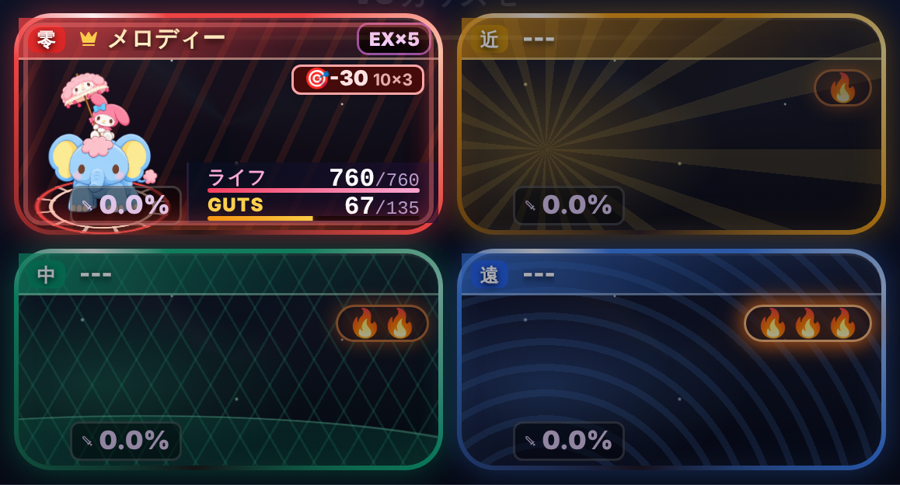

# タクティクス: ヘイトの基準表と試算(数字で見る)

2026-10-17 バトル部:ブレイブくん。**ゲーム本体には入れていない**(試算だけ)。
- 1回目の依頼: 社長「まず案をまとめて数値化してみせて」→ 末尾の「参考: 1回目の試算」
- 2回目の依頼: 社長「基準の数値がほしい」「ユグとかタンク系、補助系もヘイト上がりやすい仕組みはほしいけど、出来るだけ意図的に調整できるようにしたい」→ この資料の本文

案の本文: [tactics-hate-plan.md](tactics-hate-plan.md)。見せ方は社長の決定どおり「炎のアイコン1〜3段」、WAVE が変わったら0。
作り直す: `node tools/playbot/sim/hate-table.js --runs 200 --md <file>`(数字は道具の先頭の `TACTICS_HATE` の1か所だけ)。

## まとめ(先に結論)

1. **基準の表は下の A〜D の1枚にまとめた。** 数字の置き場は1か所で、3段に分けてある。
   - 行動ごとの基準値
   - 役割ごとの既定値(盾×1.3・回復×1.2・補助×1.1・攻撃×1.0・ひそむ×0.8)
   - 子ごとの上書き(倍率・行動ごとの上乗せ・行動のたびの上乗せ)
2. **ヘイトは全員にたまる。** 与ダメージのぶんがあるので、どの子も平均で 26〜69 になる。
   - そのため、盾の印(倍率・かばう)を強めても、盾が狙われる割合は数点しか動かない。
     - モノリス: 今 31% → 基準 33% → 強く(×2・+6)36%
   - 盾を目立たせたいなら、**与ダメージのぶんを小さく**するのが一番効く(×30→×15 で +1.8点。調整の手引き G)。
3. **勇者の扱い: 「勇者の下地20」をおすすめする。** 勇者のヘイトが20より下がらない形。
   - 今はライフの多い勇者が自然と受け役になっている。ヘイトを入れると攻撃が打たれ弱い子へ散り、1位の組のクリア率が 38%→32% に下がった。
   - 下地20を入れると 38% に戻った。
   - 炎の表示は、下地を引いた値で出す(勇者だけ、いつも🔥が付くのを避ける)。
4. **★おすすめの組み合わせ**: 基準の表 + 勇者の下地20 + 与ダメージ×15 + ガード+25 + モノリス(×1.5・行動のたび+3)
   - Expert のクリア率(今の式→おすすめ): 1位の組 38→34%、盾役入り 21→24%、盾2 24→20%、盾+回復 1→1%
   - 200回のぶれは約±3点なので、**クリア率はほぼ今のまま**で、盾(モノリス)が狙われる割合だけが少し上がる(31→35%)。
5. **注意**: シミュレーターのボットは、ヘイトを考えて動かない。
   - あつの挑発を盾に持たせる、回復をだれに使わせる、といった工夫はしていない。
   - 人が遊ぶときは選べるので、盾の効き目はこの表より大きく出るはず。
   - また、回復のカードはボットが助手を選ぶときにあまり取らないので、試算の中では少なめ。

## モノリス: 「かばう」と「特性の常時の上乗せ」の比べ(Expert・盾役入り・200回)

| 形 | かばう1回 | ふだんの行動1回(例: 通常攻撃 +2) | モノリスが狙われた割合 | クリア率 |
| --- | --- | --- | --- | --- |
| 今の式(ヘイトなし) | — | — | 31% | 21% |
| かばうだけ(基準の表: 盾×1.3・かばう+60) | +78 | +2.6 | 33% | 24% |
| 特性だけ(×1.5・行動のたび+3・かばう0) | +4.5 | +7.5 | 33% | 20% |
| 両方(×1.5・行動のたび+3・かばう+60) | +95(上限100) | +7.5 | 34% | 20% |
| 両方を強く(×2・行動のたび+6・かばう+60) | +100(上限) | +16 | 36% | 20% |

- **「かばう」はそのターンの攻撃をもともと全部引き受ける**ので、ヘイトが効くのは次のターンから。3割ずつ減るので、効くのは2〜3ターン。
- **特性の常時の上乗せ**は、毎ターン少しずつ積もる。盾の印として安定するのはこちら。
- どちらもクリア率の差はぶれの範囲。社長が「モノリスはいつも🔥が付いている」見た目を望むなら特性、「かばった後だけ燃える」なら、かばう。
- おすすめは**両方(×1.5・+3)**。

## ほかに、ヘイトを上げる側・下げる側として自然な子(候補。決めるのは社長)

| 側 | 子 | 理由 | 今の表の役割 |
| --- | --- | --- | --- |
| 上げる | モノリス | かばう・丈夫さ250 | 盾 |
| 上げる | ユグドラシル | 世界樹の守り・ライフ800・丈夫さ180 | 盾 |
| 上げる | メルホイップ | ライフ780・丈夫さ150 | 盾 |
| 上げる | オボロゲソウ・プラント | ライフ900台。受けた傷をライフに変える(吸収)ので、狙われるほど得 | 盾 |
| 上げる | メロディー・ウンディーネ | 回復の EX(メロディボックス・生命の泉) | 回復 |
| 上げる(勇者のとき) | モッチー・ミタラシ | もち肌(被ダメ−20%)。今の受け役 | 攻撃(勇者の下地20で補う) |
| 下げる | ゴースト | オフリィアボイド(よける EX) | ひそむ |
| 下げる | ライガー・ザン | 俊足・血踊(よける) | ひそむ |
| 下げる | ピクシー・ミーア・エイキ | ライフ250〜400・丈夫さが低い | 補助/攻撃(ひそむにしてもよい) |

## 数字を1か所の表(定数)にまとめる設計の案(ゲームに入れるとき)

- 置き場所: `src/parts/32-tactics-units.jsx` の、狙いの重み(`tacticsTargetWeights`)の隣に、定数 `TACTICS_HATE` を1つだけ置く。
  - 形は、試算の道具の先頭にある `TACTICS_HATE` そのまま。
  - 中身: `k`・`decay`・`cap`・`flames`・`hero.floor`・`action`・`exByEffect`・`roles`・`monsters`
- 関数は3つだけにする。
  - `tacticsHateProfile(id)`: 役割の既定値に、子の上書きを重ねる
  - `tacticsHateGain(kind, id, amount)`: 行動1回で増えるヘイト
  - `tacticsHateStep(hate, gains, units)`: 毎ターンの減りと上限、倒れたら0
  - 狙いの重みは、`tacticsTargetWeights` に「×(1 + ヘイト ÷ k)」を掛けるだけ。
  - 数字はこの定数以外に書かない。
- ヘイトはバトル中だけの値。**保存しない(新しい保存キーは要らない)。**
- 新しいモンスターは、表に無ければ「攻撃」の既定値になる。
  - `monster-add` スキルに「`TACTICS_HATE.monsters` へ1行足す」を加える。
  - 全モンスターが表にあるかを見る検査を1本足す。
- 社長が直すのは `roles`(役割ごとの倍率)と `monsters`(だれがどの役割か、個別の上書き)の2か所。行動の基準値は `action`。

---

# 基準の表と、回した結果(道具の出力)

## A. 行動ごとの基準値(全員に共通)

| 行動 | ヘイト | メモ |
| --- | --- | --- |
| 通常攻撃(通常技・距離の技)1枚 | +2 | 当てたダメージのぶんは下の「与ダメージ」で別に足す |
| 固有技 1枚 | +4 | 同上 |
| 与ダメージ | そのターンの味方の与ダメージのうちの割合 × 30 | 1人で全部与えたら +30、4人で等分なら +7.5 |
| 回復 | 回復の量 × 30 | 量 = ライフの回復率 + ガッツの回復率 × 0.5(全員に50%なら +15) |
| 強化のカード | +5 | ニコラオ・ドラ・かどみうむ・みゃる・きき・ポルツ |
| 弱体のカード | +8 | |
| ガードのカード 1枚 | +6 | 盾の役割は +6 を上乗せ |
| 挑発(あつの挑発) | +40 | 攻撃のダメージぶんも足される |
| かばう(モノリスの EX) | +60 | |
| 味方を守る・癒やす EX | +20(世界樹の守り・生命の泉)/ +15(メロディボックス・緑のめぐみ)/ +10(プレゼント) | |
| そのほかの EX | +10 | |
| 毎ターン | ×0.7(3割へる) | 何もしなければ 3ターンで約3分の1 |
| 上限・戻るとき | 100。倒れたら0、WAVE が変わったら0 | |
| 炎の段 | 🔥 20以上・🔥🔥 50以上・🔥🔥🔥 80以上 | |

増え方: ヘイト = 前のヘイト × 0.7 + 役割の倍率 ×(そのターンに増えたぶん)。狙いの重み = 今の重み ×(1 + ヘイト ÷ 25)

## B. 役割ごとの既定値

| 役割 | 増え方の倍率 | 行動ごとの上乗せ | 入っている子 |
| --- | --- | --- | --- |
| 盾 | ×1.3 | ガード +6 | モノリス・ユグドラシル・メルホイップ・オボロゲソウ・プラント |
| 回復 | ×1.2 | — | メロディー・ウンディーネ |
| 補助 | ×1.1 | — | ピクシー・ミーア・アーク・イブリース・スネグーラチカ・ヤオビクニ |
| 攻撃 | ×1 | — | モッチー・ミタラシ・ゴーレム・スエゾー・ハム・パンドラ・剣士モッチー・エイキ・クロミー・スプーキー |
| ひそむ | ×0.8 | — | ライガー・ザン・ゴースト |

## C. 狙われる確率の目安(4人・ほかの3人はライフ満タンでヘイト0)

| その子のヘイト | 炎 | 満タンの子 | 半分の子 | 4分の1の子 |
| --- | --- | --- | --- | --- |
| 0 | — | 25% | 40% | 45% |
| 20 | 🔥 | 38% | 55% | 60% |
| 50 | 🔥🔥 | 50% | 67% | 71% |
| 80 | 🔥🔥🔥 | 58% | 74% | 78% |
| 100 | 🔥🔥🔥 | 63% | 77% | 81% |

ヘイト0のときが今の式と同じ(満タン25%・半分40%・4分の1 45%)。

## D. 名前の出た子の具体値(1回あたり。役割の倍率を掛けたあと)

| 行動 | 使う子 | 基準 | 倍率 | 1回で増えるヘイト | 炎 |
| --- | --- | --- | --- | --- | --- |
| あつの挑発(攻撃ぶんは別) | モッチー(攻撃) | 40 | ×1 | 40 | 🔥 |
| あつの挑発(攻撃ぶんは別) | モノリス(盾) | 40 | ×1.3 | 52 | 🔥🔥 |
| みゅあの愛(一段目) | モッチー(攻撃) | 15 | ×1 | 15 | — |
| みゅあの愛(二段目) | モッチー(攻撃) | 31.5 | ×1 | 31 | 🔥 |
| みゅあの愛(三段目) | モッチー(攻撃) | 40.5 | ×1 | 41 | 🔥 |
| ももすけのおねだり(一段目) | モッチー(攻撃) | 7.5 | ×1 | 8 | — |
| ももすけのおねだり(二段目) | モッチー(攻撃) | 31.5 | ×1 | 31 | 🔥 |
| ももすけのおねだり(三段目) | モッチー(攻撃) | 40.5 | ×1 | 41 | 🔥 |
| みゅあの愛(三段目) | ウンディーネ(回復) | 40.5 | ×1.2 | 49 | 🔥 |
| モノリスのかばう | モノリス(盾) | 60 | ×1.3 | 78 | 🔥🔥 |
| ガード1枚 | モノリス(盾) | 12 | ×1.3 | 16 | — |
| ガード1枚 | モッチー(攻撃) | 6 | ×1 | 6 | — |
| 世界樹の守り | ユグドラシル(盾) | 20 | ×1.3 | 26 | 🔥 |

みゅあ・ももすけ・あつは助手のカードなので、ヘイトは**そのカードを使った子**に付く(だれに使わせるかで受け役を作れる)。

## E. 代表のパーティを回した表(Expert・同じ種で 200 回)

狙われた割合 = 敵が1人を選んで撃った攻撃のうち、その子に来た割合。倒れた回数は1回あたり。

### 1位(モッチー + ゴースト・スプーキー・ハム)

| 形 | クリア率 | 平均 WAVE | 狙われた割合 | 倒れた回数 |
| --- | --- | --- | --- | --- |
| 今の式(ヘイトなし) | 38% | 10.32 | モッチー 45%・ゴースト 28%・スプーキー 17%・ハム 10% | モッチー 0.05・ゴースト 0.81・スプーキー 1.11・ハム 1.30 |
| 基準の表(モノリス = 盾の既定・かばう+60) | 32% | 10.19 | モッチー 42%・ゴースト 26%・スプーキー 20%・ハム 12% | モッチー 0.07・ゴースト 0.85・スプーキー 1.33・ハム 1.44 |
| 基準の表 + 勇者の下地20 | 38% | 10.29 | モッチー 45%・ゴースト 24%・スプーキー 20%・ハム 12% | モッチー 0.05・ゴースト 0.74・スプーキー 1.27・ハム 1.40 |
| 基準の表 + ガード+25(前回の調整案) | 38% | 10.30 | モッチー 43%・ゴースト 26%・スプーキー 20%・ハム 12% | モッチー 0.05・ゴースト 0.81・スプーキー 1.21・ハム 1.38 |
| 基準の表 + 勇者の下地20 + ガード+25 | 37% | 10.29 | モッチー 46%・ゴースト 23%・スプーキー 19%・ハム 12% | モッチー 0.07・ゴースト 0.63・スプーキー 1.18・ハム 1.32 |
| ★おすすめ(勇者の下地20・与ダメージ×15・ガード+25・モノリス×1.5と+3) | 34% | 10.27 | モッチー 47%・ゴースト 23%・スプーキー 19%・ハム 11% | モッチー 0.07・ゴースト 0.69・スプーキー 1.27・ハム 1.32 |

### 盾役入り(モッチー + モノリス・ゴースト・ハム)

| 形 | クリア率 | 平均 WAVE | 狙われた割合 | 倒れた回数 |
| --- | --- | --- | --- | --- |
| 今の式(ヘイトなし) | 21% | 7.16 | モッチー 50%・モノリス 31%・ゴースト 12%・ハム 7% | モッチー 0.01・モノリス 0.30・ゴースト 0.18・ハム 0.34 |
| 基準の表(モノリス = 盾の既定・かばう+60) | 24% | 7.31 | モッチー 46%・モノリス 33%・ゴースト 15%・ハム 7% | モッチー 0.01・モノリス 0.41・ゴースト 0.20・ハム 0.47 |
| 基準の表 + 勇者の下地20 | 21% | 7.20 | モッチー 49%・モノリス 31%・ゴースト 14%・ハム 7% | モッチー 0.01・モノリス 0.30・ゴースト 0.18・ハム 0.36 |
| 基準の表 + ガード+25(前回の調整案) | 23% | 7.35 | モッチー 47%・モノリス 33%・ゴースト 14%・ハム 7% | モッチー 0.01・モノリス 0.40・ゴースト 0.20・ハム 0.40 |
| 基準の表 + 勇者の下地20 + ガード+25 | 23% | 7.28 | モッチー 49%・モノリス 31%・ゴースト 13%・ハム 6% | モッチー 0.01・モノリス 0.33・ゴースト 0.17・ハム 0.36 |
| モノリスの特性だけ(×1.5・行動のたび+3・かばうは+0) | 20% | 7.34 | モッチー 45%・モノリス 33%・ゴースト 15%・ハム 7% | モッチー 0.01・モノリス 0.32・ゴースト 0.23・ハム 0.42 |
| かばう+特性の両方(×1.5・行動のたび+3・かばう+60) | 20% | 7.38 | モッチー 44%・モノリス 34%・ゴースト 15%・ハム 7% | モッチー 0.01・モノリス 0.34・ゴースト 0.23・ハム 0.46 |
| 両方を強く(×2・行動のたび+6・かばう+60) | 20% | 7.58 | モッチー 42%・モノリス 36%・ゴースト 15%・ハム 7% | モッチー 0.01・モノリス 0.38・ゴースト 0.29・ハム 0.46 |
| ★おすすめ(勇者の下地20・与ダメージ×15・ガード+25・モノリス×1.5と+3) | 24% | 7.30 | モッチー 48%・モノリス 35%・ゴースト 11%・ハム 6% | モッチー 0.01・モノリス 0.32・ゴースト 0.16・ハム 0.31 |

### 盾2(モッチー + ユグドラシル・ゴースト・ハム)

| 形 | クリア率 | 平均 WAVE | 狙われた割合 | 倒れた回数 |
| --- | --- | --- | --- | --- |
| 今の式(ヘイトなし) | 24% | 8.25 | モッチー 46%・ユグドラシル 33%・ゴースト 14%・ハム 7% | モッチー 0.06・ユグドラシル 0.08・ゴースト 0.47・ハム 1.05 |
| 基準の表(モノリス = 盾の既定・かばう+60) | 21% | 8.28 | モッチー 42%・ユグドラシル 33%・ゴースト 17%・ハム 8% | モッチー 0.02・ユグドラシル 0.11・ゴースト 0.79・ハム 1.26 |
| 基準の表 + 勇者の下地20 | 22% | 8.30 | モッチー 46%・ユグドラシル 31%・ゴースト 16%・ハム 8% | モッチー 0.04・ユグドラシル 0.10・ゴースト 0.65・ハム 1.25 |
| 基準の表 + ガード+25(前回の調整案) | 20% | 8.24 | モッチー 43%・ユグドラシル 33%・ゴースト 16%・ハム 8% | モッチー 0.04・ユグドラシル 0.07・ゴースト 0.72・ハム 1.09 |
| 基準の表 + 勇者の下地20 + ガード+25 | 20% | 8.31 | モッチー 47%・ユグドラシル 30%・ゴースト 15%・ハム 8% | モッチー 0.05・ユグドラシル 0.13・ゴースト 0.65・ハム 1.20 |
| ★おすすめ(勇者の下地20・与ダメージ×15・ガード+25・モノリス×1.5と+3) | 20% | 8.36 | モッチー 48%・ユグドラシル 30%・ゴースト 15%・ハム 7% | モッチー 0.06・ユグドラシル 0.12・ゴースト 0.57・ハム 1.09 |

### 盾+回復(モッチー + モノリス・ユグドラシル・ウンディーネ)

| 形 | クリア率 | 平均 WAVE | 狙われた割合 | 倒れた回数 |
| --- | --- | --- | --- | --- |
| 今の式(ヘイトなし) | 1% | 5.39 | モッチー 52%・モノリス 33%・ユグドラシル 13%・ウンディーネ 2% | モッチー 0.00・モノリス 0.10・ユグドラシル 0.01・ウンディーネ 0.12 |
| 基準の表(モノリス = 盾の既定・かばう+60) | 1% | 5.39 | モッチー 50%・モノリス 33%・ユグドラシル 14%・ウンディーネ 3% | モッチー 0.00・モノリス 0.10・ユグドラシル 0.01・ウンディーネ 0.12 |
| 基準の表 + 勇者の下地20 | 0% | 5.44 | モッチー 51%・モノリス 32%・ユグドラシル 14%・ウンディーネ 3% | モッチー 0.00・モノリス 0.09・ユグドラシル 0.01・ウンディーネ 0.11 |
| 基準の表 + ガード+25(前回の調整案) | 1% | 5.50 | モッチー 49%・モノリス 33%・ユグドラシル 14%・ウンディーネ 3% | モッチー 0.01・モノリス 0.10・ユグドラシル 0.02・ウンディーネ 0.17 |
| 基準の表 + 勇者の下地20 + ガード+25 | 2% | 5.59 | モッチー 51%・モノリス 32%・ユグドラシル 14%・ウンディーネ 3% | モッチー 0.01・モノリス 0.12・ユグドラシル 0.03・ウンディーネ 0.17 |
| モノリスの特性だけ(×1.5・行動のたび+3・かばうは+0) | 0% | 5.39 | モッチー 49%・モノリス 34%・ユグドラシル 14%・ウンディーネ 3% | モッチー 0.00・モノリス 0.12・ユグドラシル 0.01・ウンディーネ 0.13 |
| かばう+特性の両方(×1.5・行動のたび+3・かばう+60) | 1% | 5.41 | モッチー 48%・モノリス 35%・ユグドラシル 14%・ウンディーネ 3% | モッチー 0.00・モノリス 0.12・ユグドラシル 0.01・ウンディーネ 0.10 |
| 両方を強く(×2・行動のたび+6・かばう+60) | 1% | 5.42 | モッチー 46%・モノリス 37%・ユグドラシル 14%・ウンディーネ 3% | モッチー 0.00・モノリス 0.12・ユグドラシル 0.01・ウンディーネ 0.13 |
| ★おすすめ(勇者の下地20・与ダメージ×15・ガード+25・モノリス×1.5と+3) | 1% | 5.40 | モッチー 49%・モノリス 35%・ユグドラシル 13%・ウンディーネ 3% | モッチー 0.00・モノリス 0.12・ユグドラシル 0.01・ウンディーネ 0.12 |

## E. 代表のパーティを回した表(Master・同じ種で 200 回)

狙われた割合 = 敵が1人を選んで撃った攻撃のうち、その子に来た割合。倒れた回数は1回あたり。

### 1位(モッチー + ゴースト・スプーキー・ハム)

| 形 | クリア率 | 平均 WAVE | 狙われた割合 | 倒れた回数 |
| --- | --- | --- | --- | --- |
| 今の式(ヘイトなし) | 4% | 7.64 | モッチー 55%・ゴースト 28%・スプーキー 11%・ハム 6% | モッチー 0.43・ゴースト 1.74・スプーキー 2.25・ハム 1.25 |
| 基準の表(モノリス = 盾の既定・かばう+60) | 3% | 7.34 | モッチー 54%・ゴースト 28%・スプーキー 13%・ハム 5% | モッチー 0.38・ゴースト 1.54・スプーキー 2.20・ハム 1.23 |
| 基準の表 + 勇者の下地20 | 5% | 7.79 | モッチー 54%・ゴースト 27%・スプーキー 13%・ハム 6% | モッチー 0.45・ゴースト 1.49・スプーキー 2.38・ハム 1.38 |
| 基準の表 + ガード+25(前回の調整案) | 1% | 7.35 | モッチー 54%・ゴースト 28%・スプーキー 12%・ハム 6% | モッチー 0.45・ゴースト 1.63・スプーキー 2.37・ハム 1.24 |
| 基準の表 + 勇者の下地20 + ガード+25 | 4% | 7.70 | モッチー 55%・ゴースト 27%・スプーキー 12%・ハム 6% | モッチー 0.45・ゴースト 1.52・スプーキー 2.35・ハム 1.26 |
| ★おすすめ(勇者の下地20・与ダメージ×15・ガード+25・モノリス×1.5と+3) | 4% | 7.78 | モッチー 56%・ゴースト 27%・スプーキー 12%・ハム 5% | モッチー 0.48・ゴースト 1.63・スプーキー 2.33・ハム 1.25 |

### 盾役入り(モッチー + モノリス・ゴースト・ハム)

| 形 | クリア率 | 平均 WAVE | 狙われた割合 | 倒れた回数 |
| --- | --- | --- | --- | --- |
| 今の式(ヘイトなし) | 0% | 4.11 | モッチー 66%・モノリス 31%・ゴースト 3%・ハム 0% | モッチー 0.04・モノリス 0.49・ゴースト 0.04・ハム 0.09 |
| 基準の表(モノリス = 盾の既定・かばう+60) | 1% | 4.09 | モッチー 64%・モノリス 32%・ゴースト 3%・ハム 1% | モッチー 0.04・モノリス 0.47・ゴースト 0.04・ハム 0.09 |
| 基準の表 + 勇者の下地20 | 1% | 4.01 | モッチー 66%・モノリス 32%・ゴースト 2%・ハム 0% | モッチー 0.04・モノリス 0.43・ゴースト 0.04・ハム 0.05 |
| 基準の表 + ガード+25(前回の調整案) | 1% | 4.12 | モッチー 63%・モノリス 33%・ゴースト 3%・ハム 1% | モッチー 0.04・モノリス 0.45・ゴースト 0.05・ハム 0.09 |
| 基準の表 + 勇者の下地20 + ガード+25 | 1% | 4.08 | モッチー 65%・モノリス 32%・ゴースト 3%・ハム 1% | モッチー 0.06・モノリス 0.46・ゴースト 0.04・ハム 0.07 |
| モノリスの特性だけ(×1.5・行動のたび+3・かばうは+0) | 1% | 4.05 | モッチー 65%・モノリス 32%・ゴースト 2%・ハム 0% | モッチー 0.04・モノリス 0.44・ゴースト 0.04・ハム 0.07 |
| かばう+特性の両方(×1.5・行動のたび+3・かばう+60) | 0% | 4.07 | モッチー 63%・モノリス 34%・ゴースト 2%・ハム 1% | モッチー 0.03・モノリス 0.45・ゴースト 0.04・ハム 0.09 |
| 両方を強く(×2・行動のたび+6・かばう+60) | 0% | 4.11 | モッチー 62%・モノリス 35%・ゴースト 3%・ハム 1% | モッチー 0.04・モノリス 0.42・ゴースト 0.04・ハム 0.09 |
| ★おすすめ(勇者の下地20・与ダメージ×15・ガード+25・モノリス×1.5と+3) | 1% | 4.07 | モッチー 62%・モノリス 35%・ゴースト 2%・ハム 1% | モッチー 0.04・モノリス 0.42・ゴースト 0.03・ハム 0.06 |

### 盾+回復(モッチー + モノリス・ユグドラシル・ウンディーネ)

| 形 | クリア率 | 平均 WAVE | 狙われた割合 | 倒れた回数 |
| --- | --- | --- | --- | --- |
| 今の式(ヘイトなし) | 0% | 3.89 | モッチー 68%・モノリス 31%・ユグドラシル 1%・ウンディーネ 0% | モッチー 0.03・モノリス 0.35・ユグドラシル 0.01・ウンディーネ 0.00 |
| 基準の表(モノリス = 盾の既定・かばう+60) | 0% | 3.86 | モッチー 68%・モノリス 31%・ユグドラシル 1%・ウンディーネ 0% | モッチー 0.03・モノリス 0.36・ユグドラシル 0.01・ウンディーネ 0.00 |
| 基準の表 + 勇者の下地20 | 0% | 3.87 | モッチー 69%・モノリス 30%・ユグドラシル 1%・ウンディーネ 0% | モッチー 0.02・モノリス 0.38・ユグドラシル 0.01・ウンディーネ 0.00 |
| 基準の表 + ガード+25(前回の調整案) | 0% | 3.88 | モッチー 67%・モノリス 32%・ユグドラシル 1%・ウンディーネ 0% | モッチー 0.03・モノリス 0.37・ユグドラシル 0.01・ウンディーネ 0.00 |
| 基準の表 + 勇者の下地20 + ガード+25 | 0% | 3.88 | モッチー 68%・モノリス 31%・ユグドラシル 1%・ウンディーネ 0% | モッチー 0.03・モノリス 0.38・ユグドラシル 0.01・ウンディーネ 0.00 |
| モノリスの特性だけ(×1.5・行動のたび+3・かばうは+0) | 0% | 3.88 | モッチー 67%・モノリス 31%・ユグドラシル 1%・ウンディーネ 0% | モッチー 0.03・モノリス 0.38・ユグドラシル 0.02・ウンディーネ 0.00 |
| かばう+特性の両方(×1.5・行動のたび+3・かばう+60) | 0% | 3.88 | モッチー 66%・モノリス 33%・ユグドラシル 1%・ウンディーネ 0% | モッチー 0.03・モノリス 0.37・ユグドラシル 0.01・ウンディーネ 0.00 |
| 両方を強く(×2・行動のたび+6・かばう+60) | 0% | 3.88 | モッチー 65%・モノリス 34%・ユグドラシル 1%・ウンディーネ 0% | モッチー 0.03・モノリス 0.37・ユグドラシル 0.01・ウンディーネ 0.00 |
| ★おすすめ(勇者の下地20・与ダメージ×15・ガード+25・モノリス×1.5と+3) | 0% | 3.88 | モッチー 65%・モノリス 34%・ユグドラシル 1%・ウンディーネ 0% | モッチー 0.03・モノリス 0.36・ユグドラシル 0.00・ウンディーネ 0.00 |

## F. 基準の表で、だれがどれくらい燃えるか(Expert・各ターンの終わり)

### 1位(モッチー + ゴースト・スプーキー・ハム)

| 子 | 平均ヘイト | 炎の段の割合(— / 🔥 / 🔥🔥 / 🔥🔥🔥) | 1回あたりの行動(多い順) |
| --- | --- | --- | --- |
| モッチー | 26 | 52% / 33% / 11% / 4% | 通常攻撃 17.9・固有技 17.0・ガード 14.8・EX 2.9 |
| ゴースト | 26 | 45% / 44% / 9% / 2% | 通常攻撃 22.7・固有技 12.7・ガード 10.0・EX 4.5 |
| スプーキー | 44 | 20% / 44% / 25% / 12% | 通常攻撃 20.8・固有技 9.5・強化 9.4・ガード 6.2 |
| ハム | 41 | 24% / 42% / 24% / 10% | 通常攻撃 19.5・ガード 6.8・固有技 6.7・挑発 2.4 |

### 盾役入り(モッチー + モノリス・ゴースト・ハム)

| 子 | 平均ヘイト | 炎の段の割合(— / 🔥 / 🔥🔥 / 🔥🔥🔥) | 1回あたりの行動(多い順) |
| --- | --- | --- | --- |
| モッチー | 38 | 33% / 36% / 22% / 10% | 通常攻撃 20.5・固有技 13.6・ガード 11.5・挑発 3.7 |
| モノリス | 51 | 23% / 28% / 24% / 25% | ガード 14.9・通常攻撃 13.3・固有技 10.7・かばう 5.0 |
| ゴースト | 50 | 11% / 37% / 40% / 11% | 通常攻撃 18.4・固有技 6.6・強化 5.7・挑発 4.1 |
| ハム | 34 | 26% / 56% / 16% / 3% | 通常攻撃 11.7・固有技 4.2・ガード 2.5・強化 2.2 |

### 盾2(モッチー + ユグドラシル・ゴースト・ハム)

| 子 | 平均ヘイト | 炎の段の割合(— / 🔥 / 🔥🔥 / 🔥🔥🔥) | 1回あたりの行動(多い順) |
| --- | --- | --- | --- |
| モッチー | 35 | 36% / 38% / 18% / 7% | 通常攻撃 23.8・固有技 16.4・ガード 15.3・挑発 3.8 |
| ユグドラシル | 44 | 26% / 34% / 24% / 16% | 通常攻撃 21.6・固有技 15.3・ガード 9.5・EX 4.2 |
| ゴースト | 46 | 16% / 41% / 35% / 9% | 通常攻撃 21.9・固有技 8.5・強化 7.1・ガード 6.8 |
| ハム | 39 | 25% / 45% / 21% / 10% | 通常攻撃 15.0・ガード 5.3・固有技 4.8・強化 1.9 |

### 盾+回復(モッチー + モノリス・ユグドラシル・ウンディーネ)

| 子 | 平均ヘイト | 炎の段の割合(— / 🔥 / 🔥🔥 / 🔥🔥🔥) | 1回あたりの行動(多い順) |
| --- | --- | --- | --- |
| モッチー | 47 | 17% / 39% / 30% / 14% | 通常攻撃 21.9・固有技 11.0・ガード 8.1・挑発 4.7 |
| モノリス | 55 | 14% / 31% / 31% / 24% | 通常攻撃 14.9・ガード 12.1・固有技 8.9・かばう 3.6 |
| ユグドラシル | 65 | 7% / 25% / 34% / 35% | 通常攻撃 10.2・固有技 4.7・強化 3.5・EX 2.5 |
| ウンディーネ | 69 | 7% / 16% / 34% / 42% | 通常攻撃 3.6・強化 1.2・固有技 1.0・挑発 0.7 |

## G. 調整の手引き

### 式だけで決まるもの(満タンの子・ほかの3人はヘイト0・k=25)

| ヘイト | 狙われる確率 | ヘイトを+10すると |
| --- | --- | --- |
| 0 | 25.0% | 31.8%(+6.8点) |
| 20 | 37.5% | 42.3%(+4.8点) |
| 50 | 50.0% | 53.1%(+3.1点) |
| 80 | 58.3% | 60.5%(+2.2点) |

### 1つずつ動かしたとき(Expert・盾役入り。モノリスの狙われた割合とクリア率)

| 動かしたもの | モノリスが狙われた割合 | モッチー | クリア率 |
| --- | --- | --- | --- |
| 基準の表のまま | 32.6% | 46.0% | 24% |
| k 25 → 20(ヘイトが効きやすい) | 32.5%(-0.1点) | 45.4% | 20% |
| k 25 → 30(ヘイトが効きにくい) | 32.5%(-0.1点) | 46.3% | 23% |
| かばう 60 → 80 | 32.7%(0.1点) | 45.9% | 24% |
| 盾の倍率 1.3 → 1.5 | 33.6%(0.9点) | 45.2% | 25% |
| 与ダメージの割合 30 → 40 | 31.8%(-0.9点) | 46.2% | 21% |
| 与ダメージの割合 30 → 15 | 34.5%(1.8点) | 45.4% | 17% |
| ガード 6 → 25 | 32.6%(-0.1点) | 46.5% | 23% |
| 回復 30 → 40 | 32.6%(-0.1点) | 46.0% | 23% |

---

# 参考: 1回目の試算(K=50・敵の最大ライフ比の式)

## (1回目) まとめ(先に結論)

1. **案の式(敵の最大ライフの1%で+1・K=50)は効きが弱い。** 狙われる回数の割合は数%しか動かず、クリア率の差(±2〜8点)は 200 回のぶれ(約±3点)と同じくらい。
   とくにボス戦は敵のライフが大きく、ヘイトがほとんど育たない(0〜13)
2. **効きを強めると(K=20・割合×60)、狙いが勇者(モッチー)から仲間へ約1割移る。** そのぶん打たれ弱いアタッカー(ハム・ゴースト・スプーキー)が倒れる回数が増え、クリア率は下がる
   (Expert: 1位の組 38%→33〜34%、盾役入り 21%→12%(割合の式)、回復役入り 24%→16%)
3. 理由: 今は**ライフの多い勇者が自然に一番狙われる受け役**になっている。ヘイトを強くすると、その役が崩れて攻撃が散る
4. **調整案(1つ)**: ヘイトは入れるなら「受け役が引き受ける手段」と組にする
   - 与ダメージのヘイトは「そのターンに味方が与えたダメージのうち、その子の割合 × 40」(敵のライフに左右されない。ボス戦でも同じように育つ)
   - 効き K = 25(案の50より強く、20より穏やか)
   - **ガードのカードを使った子 +25、モノリスのかばう +60**(盾役がヘイトを集めて、アタッカーを守れる)
   - 支援(強化・回復)は +5 のまま
   - これでも難しくなりすぎるなら、ヘイトの分だけ敵の攻撃を少し弱める(例: 狙った子のヘイトが50以上のとき被ダメ −10%)ではなく、まずは **受け役のヘイトだけを強くする** 方から試す
   - 注: シミュレーターはガードのカードを子ごとに数えていないので、この調整案の「ガード+25」は今回の数字に入っていない。入れるなら、まずシミュレーターに数える口を足して回し直す
5. 社長に試してほしい所(作るなら): 盾役(モノリス)を入れてガードで引きつけ、アタッカーの炎の段が下がるか

## (1回目) 炎のアイコンの見本

味方の枠の右上に、段(なし・🔥・🔥🔥・🔥🔥🔥)を並べた見本(ゲームの盤面に見本として書き足して撮ったもの。ゲーム本体は変えていない)。
数字は出さず、20・50・80 で段が上がる。

## (1回目) 効きを強めた場合(Expert・200回・K=20・割合×60)

| パーティ | 式 | クリア率 | 平均 WAVE | 狙われた回数(多い順) | 倒れた回数 |
| --- | --- | --- | --- | --- | --- |
| 1位(モッチー + ゴースト・スプーキー・ハム) | 今の式 | 38% | 10.32 | モッチー 3378・ゴースト 2087・スプーキー 1300・ハム 780 | ハム 260・スプーキー 223・ゴースト 163・モッチー 10 |
| 1位(モッチー + ゴースト・スプーキー・ハム) | 案の式 | 33% | 10.24 | モッチー 3114・ゴースト 2217・スプーキー 1394・ハム 855 | ハム 276・スプーキー 251・ゴースト 187・モッチー 8 |
| 1位(モッチー + ゴースト・スプーキー・ハム) | 調整案 | 34% | 10.25 | モッチー 2897・ゴースト 2109・スプーキー 1464・ハム 921 | ハム 308・スプーキー 236・ゴースト 168・モッチー 9 |
| 盾役入り(モッチー + モノリス・ゴースト・ハム) | 今の式 | 21% | 7.16 | モッチー 3278・モノリス 2015・ゴースト 792・ハム 446 | ハム 68・モノリス 60・ゴースト 36・モッチー 2 |
| 盾役入り(モッチー + モノリス・ゴースト・ハム) | 案の式 | 21% | 7.05 | モッチー 3042・モノリス 2160・ゴースト 843・ハム 378 | モノリス 72・ハム 62・ゴースト 37・モッチー 1 |
| 盾役入り(モッチー + モノリス・ゴースト・ハム) | 調整案 | 12% | 7.21 | モッチー 3216・モノリス 1891・ゴースト 1097・ハム 523 | ハム 113・モノリス 70・ゴースト 58・モッチー 3 |
| 回復役入り(モッチー + ユグドラシル・ゴースト・ハム) | 今の式 | 24% | 8.25 | モッチー 3541・ユグドラシル 2494・ゴースト 1037・ハム 556 | ハム 211・ゴースト 93・ユグドラシル 16・モッチー 12 |
| 回復役入り(モッチー + ユグドラシル・ゴースト・ハム) | 案の式 | 16% | 8.22 | モッチー 3362・ユグドラシル 2349・ゴースト 1330・ハム 576 | ハム 215・ゴースト 145・ユグドラシル 15・モッチー 6 |
| 回復役入り(モッチー + ユグドラシル・ゴースト・ハム) | 調整案 | 16% | 8.20 | モッチー 3251・ユグドラシル 2298・ゴースト 1541・ハム 640 | ハム 264・ゴースト 172・ユグドラシル 19・モッチー 5 |

## (1回目) 試算の前提(各 200 回・K=50・毎ターン ×0.7)

作り直す: `node tools/playbot/sim/hate-trial.js --runs 200 --md <file>`(シミュレーター battle.js の狙いの口に式を差し込む。ゲーム本体は変えていない)

- 今の式: 重み = 1 + 2 ×(1 − 残りライフの割合)
- 案の式: 今の重み ×(1 + ヘイト ÷ 50)。ヘイトは与ダメージが敵の最大ライフの1%で+1(1ターン最大+30)・モノリスのかばう+60・ユグドラシルの回復+10・毎ターン ×0.7・倒れたら0・WAVE ごとに0・上限100
- 調整案: 案の式の「与ダメージ」を「そのターンに味方が与えたダメージのうち、その子の割合 × 40」に替えたもの(敵のライフの大きさに左右されない)
- 近似: 回復カード・強化カード・ガードによるヘイトはシミュレーターが子ごとに数えていないので入れていない

## (1回目) 1. 比べ(Expert・同じ種で 200 回)

| パーティ | 式 | クリア率 | 平均 WAVE | 狙われた回数(多い順) | 倒れた回数 |
| --- | --- | --- | --- | --- | --- |
| 1位(モッチー + ゴースト・スプーキー・ハム) | 今の式 | 38% | 10.32 | モッチー 3378・ゴースト 2087・スプーキー 1300・ハム 780 | ハム 260・スプーキー 223・ゴースト 163・モッチー 10 |
| 1位(モッチー + ゴースト・スプーキー・ハム) | 案の式 | 36% | 10.30 | モッチー 3245・ゴースト 2144・スプーキー 1352・ハム 805 | ハム 265・スプーキー 242・ゴースト 189・モッチー 10 |
| 1位(モッチー + ゴースト・スプーキー・ハム) | 調整案 | 28% | 10.16 | モッチー 3202・ゴースト 2125・スプーキー 1398・ハム 843 | ハム 284・スプーキー 254・ゴースト 183・モッチー 9 |
| 盾役入り(モッチー + モノリス・ゴースト・ハム) | 今の式 | 21% | 7.16 | モッチー 3278・モノリス 2015・ゴースト 792・ハム 446 | ハム 68・モノリス 60・ゴースト 36・モッチー 2 |
| 盾役入り(モッチー + モノリス・ゴースト・ハム) | 案の式 | 22% | 7.05 | モッチー 3093・モノリス 2109・ゴースト 794・ハム 418 | モノリス 66・ハム 64・ゴースト 33・モッチー 2 |
| 盾役入り(モッチー + モノリス・ゴースト・ハム) | 調整案 | 14% | 7.09 | モッチー 3134・モノリス 1988・ゴースト 938・ハム 462 | ハム 81・モノリス 61・ゴースト 53 |
| 回復役入り(モッチー + ユグドラシル・ゴースト・ハム) | 今の式 | 24% | 8.25 | モッチー 3541・ユグドラシル 2494・ゴースト 1037・ハム 556 | ハム 211・ゴースト 93・ユグドラシル 16・モッチー 12 |
| 回復役入り(モッチー + ユグドラシル・ゴースト・ハム) | 案の式 | 20% | 8.23 | モッチー 3495・ユグドラシル 2426・ゴースト 1182・ハム 570 | ハム 224・ゴースト 111・ユグドラシル 13・モッチー 10 |
| 回復役入り(モッチー + ユグドラシル・ゴースト・ハム) | 調整案 | 20% | 8.29 | モッチー 3395・ユグドラシル 2356・ゴースト 1322・ハム 618 | ハム 246・ゴースト 149・ユグドラシル 24・モッチー 5 |

## (1回目) 1. 比べ(Master・同じ種で 200 回)

| パーティ | 式 | クリア率 | 平均 WAVE | 狙われた回数(多い順) | 倒れた回数 |
| --- | --- | --- | --- | --- | --- |
| 1位(モッチー + ゴースト・スプーキー・ハム) | 今の式 | 4% | 7.64 | モッチー 4398・ゴースト 2210・スプーキー 903・ハム 477 | スプーキー 450・ゴースト 347・ハム 251・モッチー 87 |
| 1位(モッチー + ゴースト・スプーキー・ハム) | 案の式 | 5% | 7.39 | モッチー 4151・ゴースト 2268・スプーキー 910・ハム 434 | スプーキー 430・ゴースト 353・ハム 243・モッチー 84 |
| 1位(モッチー + ゴースト・スプーキー・ハム) | 調整案 | 5% | 7.48 | モッチー 4155・ゴースト 2291・スプーキー 972・ハム 445 | スプーキー 435・ゴースト 354・ハム 262・モッチー 82 |
| 盾役入り(モッチー + モノリス・ゴースト・ハム) | 今の式 | 0% | 4.11 | モッチー 3117・モノリス 1482・ゴースト 131・ハム 22 | モノリス 98・ハム 17・モッチー 8・ゴースト 7 |
| 盾役入り(モッチー + モノリス・ゴースト・ハム) | 案の式 | 1% | 4.11 | モッチー 3018・モノリス 1527・ゴースト 129・ハム 29 | モノリス 101・ハム 15・ゴースト 8・モッチー 6 |
| 盾役入り(モッチー + モノリス・ゴースト・ハム) | 調整案 | 1% | 4.13 | モッチー 3107・モノリス 1423・ゴースト 153・ハム 41 | モノリス 96・ハム 21・ゴースト 13・モッチー 9 |
| 回復役入り(モッチー + ユグドラシル・ゴースト・ハム) | 今の式 | 0% | 3.91 | モッチー 3088・ユグドラシル 1577・ゴースト 57・ハム 5 | ユグドラシル 46・モッチー 28・ゴースト 6・ハム 4 |
| 回復役入り(モッチー + ユグドラシル・ゴースト・ハム) | 案の式 | 0% | 3.92 | モッチー 3061・ユグドラシル 1636・ゴースト 81・ハム 12 | ユグドラシル 51・モッチー 25・ハム 10・ゴースト 10 |
| 回復役入り(モッチー + ユグドラシル・ゴースト・ハム) | 調整案 | 0% | 3.95 | モッチー 3078・ユグドラシル 1620・ゴースト 86・ハム 21 | ユグドラシル 40・モッチー 26・ゴースト 20・ハム 14 |

## (1回目) 2. 代表の場面(案の式・Expert で1回。予告のたびに1行)

### 1位(モッチー + ゴースト・スプーキー・ハム)・WAVE 5(ふつうの WAVE)・デルピエロ(種 1)

各マス: ヘイト / 炎の段 / 狙われる確率(今の式 → ヘイトあり)

| 予告 | モッチー | ゴースト | スプーキー |
| --- | --- | --- | --- |
| 1 | 0 / — / 36%→36% | 0 / — / 36%→36% | 0 / — / 27%→27% |
| 5 | 7 / — / 33%→32% | 5 / — / 33%→31% | 18 / — / 33%→38% |
| 7 | 10 / — / 33%→32% | 2 / — / 33%→28% | 26 / 🔥 / 33%→40% |

### 1位(モッチー + ゴースト・スプーキー・ハム)・WAVE 10(ボス戦)・覚醒ムー(種 1)

各マス: ヘイト / 炎の段 / 狙われる確率(今の式 → ヘイトあり)

| 予告 | モッチー | ハム | ゴースト | スプーキー |
| --- | --- | --- | --- | --- |
| 2 | 1 / — / 33%→33% | 1 / — / 33%→33% | 倒れている | 2 / — / 33%→34% |
| 3 | 1 / — / 33%→33% | 2 / — / 33%→34% | 倒れている | 1 / — / 33%→33% |
| 5 | 0 / — / 33%→33% | 4 / — / 33%→35% | 倒れている | 1 / — / 33%→33% |
| 7 | 0 / — / 33%→30% | 2 / — / 33%→31% | 倒れている | 12 / — / 35%→40% |
| 9 | 0 / — / 33%→32% | 3 / — / 33%→33% | 倒れている | 6 / — / 33%→35% |
| 10 | 1 / — / 25%→24% | 3 / — / 25%→25% | 0 / — / 25%→24% | 4 / — / 25%→26% |
| 11 | 1 / — / 24%→22% | 2 / — / 29%→29% | 0 / — / 24%→22% | 12 / — / 24%→27% |
| 12 | 0 / — / 26%→25% | 2 / — / 25%→24% | 0 / — / 25%→23% | 11 / — / 25%→28% |

### 盾役入り(モッチー + モノリス・ゴースト・ハム)・WAVE 5(ふつうの WAVE)・デルピエロ(種 2)

各マス: ヘイト / 炎の段 / 狙われる確率(今の式 → ヘイトあり)

| 予告 | モッチー | モノリス | ゴースト |
| --- | --- | --- | --- |
| 1 | 0 / — / 40%→40% | 0 / — / 30%→30% | 0 / — / 30%→30% |
| 2 | 0 / — / 33%→33% | 0 / — / 33%→33% | 2 / — / 33%→34% |
| 5 | 8 / — / 33%→31% | 3 / — / 33%→28% | 26 / 🔥 / 33%→41% |
| 6 | 7 / — / 33%→32% | 2 / — / 33%→29% | 21 / 🔥 / 33%→39% |
| 10 | 5 / — / 33%→32% | 3 / — / 33%→30% | 17 / — / 33%→38% |
| 11 | 4 / — / 33%→23% | 62 / 🔥🔥 / 33%→48% | 16 / — / 33%→29% |

### 盾役入り(モッチー + モノリス・ゴースト・ハム)・WAVE 10(ボス戦)・覚醒ムー(種 2)

各マス: ヘイト / 炎の段 / 狙われる確率(今の式 → ヘイトあり)

| 予告 | モッチー | モノリス | ゴースト | ハム |
| --- | --- | --- | --- | --- |
| 2 | 0 / — / 25%→24% | 0 / — / 25%→25% | 4 / — / 25%→26% | 0 / — / 25%→25% |
| 3 | 0 / — / 18%→18% | 0 / — / 45%→45% | 4 / — / 18%→19% | 0 / — / 18%→18% |
| 4 | 0 / — / 20%→19% | 0 / — / 41%→41% | 3 / — / 20%→21% | 0 / — / 20%→20% |
| 5 | 0 / — / 21%→20% | 0 / — / 36%→35% | 10 / — / 21%→24% | 0 / — / 21%→20% |
| 9 | 1 / — / 25%→21% | 29 / 🔥 / 25%→32% | 12 / — / 25%→25% | 2 / — / 25%→21% |
| 10 | 3 / — / 25%→23% | 21 / 🔥 / 25%→30% | 8 / — / 25%→25% | 1 / — / 25%→22% |
| 11 | 2 / — / 22%→20% | 15 / — / 22%→25% | 6 / — / 34%→34% | 2 / — / 22%→20% |
| 12 | 1 / — / 25%→24% | 10 / — / 25%→28% | 4 / — / 25%→25% | 2 / — / 25%→24% |

### 回復役入り(モッチー + ユグドラシル・ゴースト・ハム)・WAVE 5(ふつうの WAVE)・デルピエロ(種 1)

各マス: ヘイト / 炎の段 / 狙われる確率(今の式 → ヘイトあり)

| 予告 | モッチー | ゴースト | ユグドラシル |
| --- | --- | --- | --- |
| 1 | 0 / — / 34%→34% | 0 / — / 29%→29% | 0 / — / 37%→37% |
| 2 | 0 / — / 32%→31% | 3 / — / 32%→33% | 1 / — / 36%→35% |
| 3 | 0 / — / 33%→31% | 5 / — / 33%→35% | 5 / — / 33%→34% |
| 4 | 3 / — / 33%→33% | 6 / — / 33%→34% | 3 / — / 33%→33% |
| 5 | 2 / — / 28%→26% | 12 / — / 28%→31% | 5 / — / 44%→43% |
| 6 | 8 / — / 33%→32% | 8 / — / 33%→32% | 15 / — / 33%→36% |
| 7 | 7 / — / 33%→33% | 6 / — / 33%→32% | 10 / — / 33%→35% |
| 8 | 5 / — / 33%→27% | 34 / 🔥 / 33%→42% | 12 / — / 33%→31% |

### 回復役入り(モッチー + ユグドラシル・ゴースト・ハム)・WAVE 10(ボス戦)・覚醒ムー(種 1)

各マス: ヘイト / 炎の段 / 狙われる確率(今の式 → ヘイトあり)

| 予告 | モッチー | ハム | ゴースト | ユグドラシル |
| --- | --- | --- | --- | --- |
| 4 | 0 / — / 25%→24% | 1 / — / 25%→25% | 3 / — / 25%→26% | 1 / — / 25%→25% |
| 6 | 0 / — / 25%→24% | 1 / — / 25%→25% | 5 / — / 25%→27% | 0 / — / 25%→24% |
| 8 | 0 / — / 25%→24% | 1 / — / 25%→24% | 10 / — / 25%→28% | 0 / — / 25%→24% |
| 9 | 0 / — / 21%→20% | 1 / — / 21%→20% | 8 / — / 21%→23% | 0 / — / 38%→37% |
| 10 | 1 / — / 32%→32% | 1 / — / 19%→19% | 6 / — / 19%→20% | 0 / — / 30%→29% |
| 11 | 0 / — / 23%→23% | 0 / — / 23%→23% | 4 / — / 23%→24% | 1 / — / 31%→30% |
| 15 | 0 / — / 25%→25% | 0 / — / 25%→25% | 4 / — / 25%→26% | 0 / — / 25%→25% |
| 18 | 0 / — / 25%→24% | 2 / — / 25%→24% | 9 / — / 25%→28% | 1 / — / 25%→24% |

## (1回目) 2. 代表の場面(調整案・Expert で1回。予告のたびに1行)

### 1位(モッチー + ゴースト・スプーキー・ハム)・WAVE 5(ふつうの WAVE)・デルピエロ(種 1)

各マス: ヘイト / 炎の段 / 狙われる確率(今の式 → ヘイトあり)

| 予告 | モッチー | ゴースト | スプーキー |
| --- | --- | --- | --- |
| 1 | 0 / — / 36%→36% | 0 / — / 36%→36% | 0 / — / 27%→27% |
| 5 | 26 / 🔥 / 33%→30% | 18 / — / 33%→27% | 58 / 🔥🔥 / 33%→43% |
| 7 | 54 / 🔥🔥 / 33%→39% | 9 / — / 33%→22% | 55 / 🔥🔥 / 33%→39% |

### 1位(モッチー + ゴースト・スプーキー・ハム)・WAVE 10(ボス戦)・覚醒ムー(種 1)

各マス: ヘイト / 炎の段 / 狙われる確率(今の式 → ヘイトあり)

| 予告 | モッチー | ハム | ゴースト | スプーキー |
| --- | --- | --- | --- | --- |
| 2 | 17 / — / 25%→28% | 23 / 🔥 / 25%→30% | 0 / — / 25%→21% | 0 / — / 25%→21% |
| 3 | 12 / — / 25%→23% | 24 / 🔥 / 25%→28% | 27 / 🔥 / 25%→29% | 5 / — / 25%→20% |
| 10 | 24 / 🔥 / 33%→27% | 倒れている | 33 / 🔥 / 33%→30% | 67 / 🔥🔥 / 33%→43% |
| 11 | 17 / — / 30%→21% | 倒れている | 23 / 🔥 / 30%→23% | 87 / 🔥🔥🔥 / 40%→57% |
| 12 | 12 / — / 33%→22% | 倒れている | 16 / — / 33%→24% | 100 / 🔥🔥🔥 / 33%→54% |
| 15 | 4 / — / 33%→19% | 倒れている | 54 / 🔥🔥 / 33%→37% | 74 / 🔥🔥 / 33%→44% |
| 18 | 21 / 🔥 / 25%→21% | 15 / — / 25%→20% | 22 / 🔥 / 25%→22% | 75 / 🔥🔥 / 25%→38% |

### 盾役入り(モッチー + モノリス・ゴースト・ハム)・WAVE 5(ふつうの WAVE)・デルピエロ(種 2)

各マス: ヘイト / 炎の段 / 狙われる確率(今の式 → ヘイトあり)

| 予告 | モッチー | モノリス | ゴースト |
| --- | --- | --- | --- |
| 1 | 0 / — / 40%→40% | 0 / — / 30%→30% | 0 / — / 30%→30% |
| 2 | 0 / — / 33%→26% | 0 / — / 33%→26% | 40 / 🔥 / 33%→47% |
| 5 | 11 / — / 33%→24% | 8 / — / 33%→23% | 82 / 🔥🔥🔥 / 33%→53% |
| 6 | 23 / 🔥 / 33%→28% | 6 / — / 33%→21% | 82 / 🔥🔥🔥 / 33%→51% |
| 10 | 23 / 🔥 / 33%→26% | 14 / — / 33%→23% | 90 / 🔥🔥🔥 / 33%→51% |
| 11 | 16 / — / 33%→20% | 70 / 🔥🔥 / 33%→36% | 100 / 🔥🔥🔥 / 33%→45% |

### 盾役入り(モッチー + モノリス・ゴースト・ハム)・WAVE 10(ボス戦)・覚醒ムー(種 2)

各マス: ヘイト / 炎の段 / 狙われる確率(今の式 → ヘイトあり)

| 予告 | モッチー | モノリス | ゴースト | ハム |
| --- | --- | --- | --- | --- |
| 6 | 34 / 🔥 / 50%→44% | 55 / 🔥🔥 / 50%→56% | 倒れている | 倒れている |
| 13 | 22 / 🔥 / 25%→24% | 14 / — / 25%→21% | 23 / 🔥 / 25%→24% | 45 / 🔥 / 25%→31% |
| 14 | 15 / — / 21%→18% | 9 / — / 21%→16% | 56 / 🔥🔥 / 21%→29% | 31 / 🔥 / 36%→38% |
| 16 | 14 / — / 33%→25% | 7 / — / 33%→22% | 84 / 🔥🔥🔥 / 33%→53% | 倒れている |
| 17 | 21 / 🔥 / 33%→27% | 5 / — / 33%→21% | 88 / 🔥🔥🔥 / 33%→52% | 倒れている |

### 回復役入り(モッチー + ユグドラシル・ゴースト・ハム)・WAVE 5(ふつうの WAVE)・デルピエロ(種 1)

各マス: ヘイト / 炎の段 / 狙われる確率(今の式 → ヘイトあり)

| 予告 | モッチー | ゴースト | ユグドラシル |
| --- | --- | --- | --- |
| 1 | 0 / — / 34%→34% | 0 / — / 29%→29% | 0 / — / 37%→37% |
| 2 | 0 / — / 32%→25% | 34 / 🔥 / 32%→43% | 6 / — / 36%→32% |
| 3 | 0 / — / 33%→23% | 42 / 🔥 / 33%→42% | 26 / 🔥 / 33%→35% |
| 4 | 26 / 🔥 / 33%→32% | 43 / 🔥 / 33%→39% | 19 / — / 33%→29% |
| 5 | 18 / — / 28%→23% | 60 / 🔥🔥 / 28%→38% | 23 / 🔥 / 44%→39% |
| 6 | 46 / 🔥 / 33%→35% | 42 / 🔥 / 33%→34% | 33 / 🔥 / 33%→31% |
| 7 | 72 / 🔥🔥 / 33%→44% | 29 / 🔥 / 33%→29% | 23 / 🔥 / 33%→27% |
| 8 | 50 / 🔥🔥 / 33%→36% | 57 / 🔥🔥 / 33%→39% | 20 / 🔥 / 33%→25% |

### 回復役入り(モッチー + ユグドラシル・ゴースト・ハム)・WAVE 10(ボス戦)・覚醒ムー(種 1)

各マス: ヘイト / 炎の段 / 狙われる確率(今の式 → ヘイトあり)

| 予告 | モッチー | ハム | ゴースト | ユグドラシル |
| --- | --- | --- | --- | --- |
| 4 | 3 / — / 25%→18% | 47 / 🔥 / 25%→34% | 30 / 🔥 / 25%→28% | 7 / — / 25%→20% |
| 6 | 1 / — / 25%→16% | 23 / 🔥 / 25%→24% | 83 / 🔥🔥🔥 / 25%→43% | 4 / — / 25%→17% |
| 8 | 1 / — / 25%→16% | 19 / — / 25%→22% | 100 / 🔥🔥🔥 / 25%→47% | 2 / — / 25%→16% |
| 9 | 0 / — / 33%→25% | 13 / — / 33%→31% | 倒れている | 41 / 🔥 / 33%→44% |
| 11 | 28 / 🔥 / 42%→41% | 32 / 🔥 / 29%→29% | 倒れている | 35 / 🔥 / 29%→30% |
| 15 | 7 / — / 19%→15% | 21 / 🔥 / 42%→40% | 60 / 🔥🔥 / 19%→29% | 8 / — / 19%→15% |
| 17 | 20 / 🔥 / 19%→18% | 0 / — / 19%→13% | 78 / 🔥🔥 / 19%→34% | 7 / — / 43%→34% |
| 19 | 10 / — / 21%→16% | 17 / — / 21%→18% | 82 / 🔥🔥🔥 / 21%→36% | 11 / — / 37%→29% |
