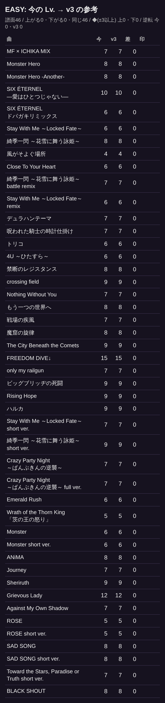
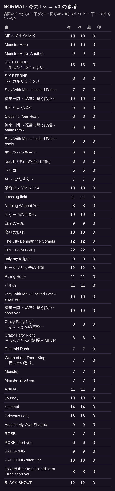
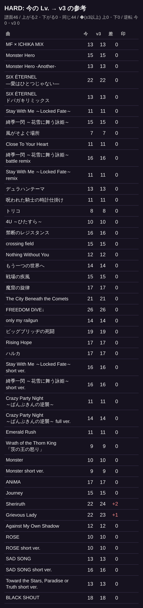
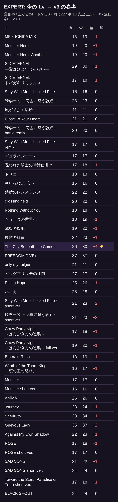
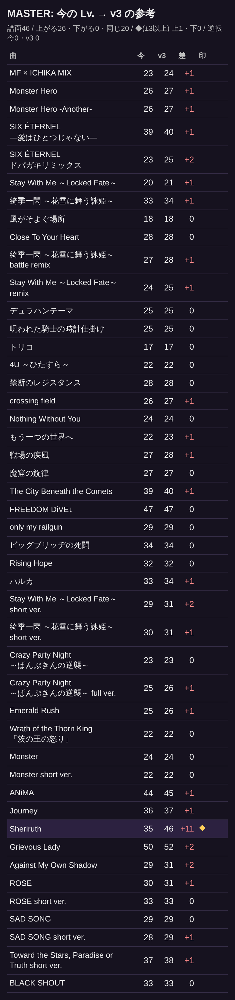

# 地上の5難易度の Lv.: 今の表示と新しい測り方(v3)の参考値(2026-10-22)

社長の決定「地上の5難易度(EASY〜MASTER)の Lv. を、新しい測り方で付け直す件 → 一覧を作り直して見る」。**譜面も表示も変えていない(参考だけ)。**

- 今 … 曲えらびに出ている Lv.(譜面の level)
- v3 … `rhythm-chart-level.js` の新しい測り方(地上と空中の入り乱れ・押さえている手の側・見分けにくさを重く)で測った参考値
- 印: ◆ = 差が ±3 以上 / 今⇅ = 今の表示で同じ曲の難易度の順が逆転 / v3⇅ = v3 で逆転
- 作り直し: `node tools/mode/rhythm-level-v3-report.js --out docs/playbot/reports/2026-10-22/level-v3`

## まとめ

| 難易度 | 譜面 | 上がる | 下がる | 同じ | ◆上がる | ◆下がる | 今⇅ | v3⇅ |
| --- | --- | --- | --- | --- | --- | --- | --- | --- |
| EASY | 46 | 0 | 0 | 46 | 0 | 0 | 0 | 0 |
| NORMAL | 46 | 0 | 0 | 46 | 0 | 0 | 0 | 0 |
| HARD | 46 | 2 | 0 | 44 | 0 | 0 | 0 | 0 |
| EXPERT | 46 | 24 | 0 | 22 | 1 | 0 | 0 | 0 |
| MASTER | 46 | 26 | 0 | 20 | 1 | 0 | 0 | 0 |

上がる幅が大きい: Sheriruth MASTER 35→46 / The City Beneath the Comets EXPERT 26→30 / SIX ÉTERNEL ドパガキリミックス MASTER 23→25 / Stay With Me ～Locked Fate～ short ver. EXPERT 21→23 / Stay With Me ～Locked Fate～ short ver. MASTER 29→31

下がる幅が大きい: なし

## 一覧(公開中の曲・曲えらびの並び)

| 曲 | EASY | NORMAL | HARD | EXPERT | MASTER |
| --- | --- | --- | --- | --- | --- |
| MF × ICHIKA MIX | 7→7 (0) | 10→10 (0) | 13→13 (0) | 18→19 (+1) | 23→24 (+1) |
| Monster Hero | 8→8 (0) | 10→10 (0) | 15→15 (0) | 19→20 (+1) | 26→27 (+1) |
| Monster Hero -Another- | 8→8 (0) | 9→9 (0) | 13→13 (0) | 19→20 (+1) | 26→27 (+1) |
| SIX ÉTERNEL ―愛はひとつじゃない― | 10→10 (0) | 13→13 (0) | 22→22 (0) | 29→30 (+1) | 39→40 (+1) |
| SIX ÉTERNEL ドパガキリミックス | 6→6 (0) | 8→8 (0) | 13→13 (0) | 17→18 (+1) | 23→25 (+2) |
| Stay With Me ～Locked Fate～ | 6→6 (0) | 7→7 (0) | 11→11 (0) | 16→16 (0) | 20→21 (+1) |
| 綺季一閃 ～花雪に舞う詠姫～ | 8→8 (0) | 10→10 (0) | 15→15 (0) | 23→23 (0) | 33→34 (+1) |
| 風がそよぐ場所 | 4→4 (0) | 5→5 (0) | 7→7 (0) | 11→11 (0) | 18→18 (0) |
| Close To Your Heart | 6→6 (0) | 8→8 (0) | 11→11 (0) | 21→21 (0) | 28→28 (0) |
| 綺季一閃 ～花雪に舞う詠姫～ battle remix | 7→7 (0) | 9→9 (0) | 16→16 (0) | 20→20 (0) | 27→28 (+1) |
| Stay With Me ～Locked Fate～ remix | 6→6 (0) | 8→8 (0) | 11→11 (0) | 17→17 (0) | 24→25 (+1) |
| デュラハンテーマ | 7→7 (0) | 9→9 (0) | 13→13 (0) | 17→17 (0) | 25→25 (0) |
| 呪われた騎士の時計仕掛け | 7→7 (0) | 8→8 (0) | 11→11 (0) | 17→18 (+1) | 25→25 (0) |
| トリコ | 6→6 (0) | 6→6 (0) | 8→8 (0) | 13→13 (0) | 17→17 (0) |
| 4U ～ひたすら～ | 6→6 (0) | 7→7 (0) | 10→10 (0) | 16→16 (0) | 22→22 (0) |
| 禁断のレジスタンス | 8→8 (0) | 10→10 (0) | 16→16 (0) | 22→22 (0) | 28→28 (0) |
| crossing field | 9→9 (0) | 11→11 (0) | 15→15 (0) | 20→20 (0) | 26→27 (+1) |
| Nothing Without You | 7→7 (0) | 8→8 (0) | 12→12 (0) | 18→18 (0) | 24→24 (0) |
| もう一つの世界へ | 8→8 (0) | 10→10 (0) | 14→14 (0) | 18→19 (+1) | 22→23 (+1) |
| 戦場の疾風 | 7→7 (0) | 9→9 (0) | 15→15 (0) | 19→20 (+1) | 27→28 (+1) |
| 魔窟の旋律 | 8→8 (0) | 10→10 (0) | 17→17 (0) | 22→23 (+1) | 27→27 (0) |
| The City Beneath the Comets | 9→9 (0) | 12→12 (0) | 21→21 (0) | 26→30 (+4) ◆ | 39→40 (+1) |
| FREEDOM DiVE↓ | 15→15 (0) | 22→22 (0) | 26→26 (0) | 37→37 (0) | 47→47 (0) |
| only my railgun | 7→7 (0) | 9→9 (0) | 14→14 (0) | 21→21 (0) | 29→29 (0) |
| ビッグブリッヂの死闘 | 9→9 (0) | 12→12 (0) | 19→19 (0) | 27→27 (0) | 34→34 (0) |
| Rising Hope | 9→9 (0) | 11→11 (0) | 17→17 (0) | 25→26 (+1) | 32→32 (0) |
| ハルカ | 9→9 (0) | 11→11 (0) | 17→17 (0) | 28→28 (0) | 33→34 (+1) |
| Stay With Me ～Locked Fate～ short ver. | 7→7 (0) | 10→10 (0) | 16→16 (0) | 21→23 (+2) | 29→31 (+2) |
| 綺季一閃 ～花雪に舞う詠姫～ short ver. | 9→9 (0) | 10→10 (0) | 16→16 (0) | 21→23 (+2) | 30→31 (+1) |
| Crazy Party Night ～ぱんぷきんの逆襲～ | 7→7 (0) | 8→8 (0) | 11→11 (0) | 17→18 (+1) | 23→23 (0) |
| Crazy Party Night ～ぱんぷきんの逆襲～ full ver. | 7→7 (0) | 8→8 (0) | 14→14 (0) | 19→20 (+1) | 25→26 (+1) |
| Emerald Rush | 6→6 (0) | 7→7 (0) | 11→11 (0) | 18→19 (+1) | 25→26 (+1) |
| Wrath of the Thorn King 「茨の王の怒り」 | 5→5 (0) | 7→7 (0) | 9→9 (0) | 16→17 (+1) | 22→22 (0) |
| Monster | 6→6 (0) | 7→7 (0) | 10→10 (0) | 17→17 (0) | 24→24 (0) |
| Monster short ver. | 6→6 (0) | 7→7 (0) | 9→9 (0) | 16→16 (0) | 22→22 (0) |
| ANiMA | 8→8 (0) | 11→11 (0) | 17→17 (0) | 26→26 (0) | 44→45 (+1) |
| Journey | 7→7 (0) | 10→10 (0) | 15→15 (0) | 23→24 (+1) | 36→37 (+1) |
| Sheriruth | 9→9 (0) | 14→14 (0) | 22→24 (+2) | 33→34 (+1) | 35→46 (+11) ◆ |
| Grievous Lady | 12→12 (0) | 16→16 (0) | 22→23 (+1) | 35→37 (+2) | 50→52 (+2) |
| Against My Own Shadow | 7→7 (0) | 9→9 (0) | 12→12 (0) | 22→23 (+1) | 29→31 (+2) |
| ROSE | 5→5 (0) | 7→7 (0) | 10→10 (0) | 17→18 (+1) | 30→31 (+1) |
| ROSE short ver. | 5→5 (0) | 6→6 (0) | 10→10 (0) | 17→17 (0) | 33→33 (0) |
| SAD SONG | 8→8 (0) | 9→9 (0) | 13→13 (0) | 21→22 (+1) | 29→29 (0) |
| SAD SONG short ver. | 8→8 (0) | 10→10 (0) | 16→16 (0) | 24→24 (0) | 28→29 (+1) |
| Toward the Stars, Paradise or Truth short ver. | 7→7 (0) | 8→8 (0) | 13→13 (0) | 17→18 (+1) | 37→38 (+1) |
| BLACK SHOUT | 8→8 (0) | 12→12 (0) | 18→18 (0) | 24→24 (0) | 33→33 (0) |

