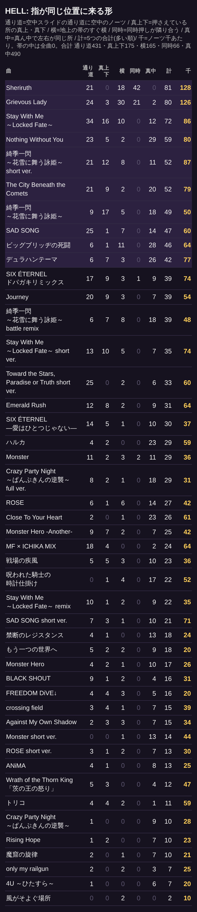
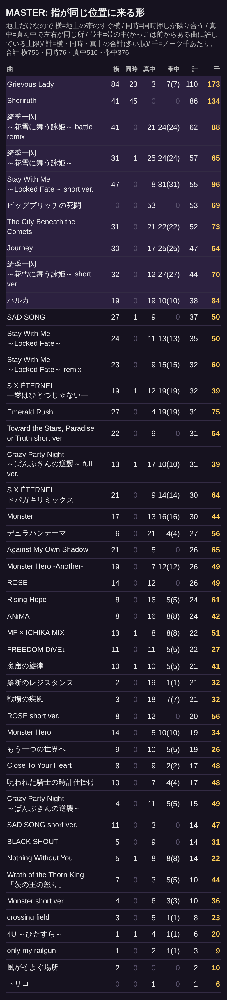
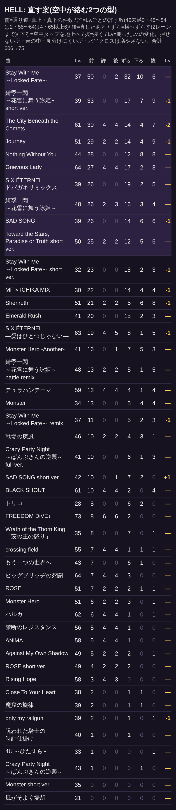

# 指が同じ位置に来る形: 公開中の HELL・MASTER の件数(2026-10-22)

社長「指が同じ位置くるやつが多い。いまやったのだとききいっせんの原曲とか」「空中スライドにほぼ同じ位置に空中タップとか」。**譜面は変えていない(数えただけ)。**

## 型(`rhythm-chart-hand-rules.js` の `samePlace`)

- **通り道** … 空中スライドの通り道に空中のノーツ: 空中のノーツの前後250msに、空中にいるスライドがすき間0.5レーン未満を通る。社長の例(ききいっせん 93.09秒: 空中スライドが右から左へ払う通り道に空中タップ)
- **真上・真下** … 押さえている所の真上・真下: 長押しの最中に、高さの違うノーツが帯と横に重なる(ききいっせん 89.80秒: 空中から地上へ下りたスライドの真上に空中タップ)
- **すぐ横** … 地上の帯のすぐ横: 地上の長押しの最中に、地上のノーツがすき間0.5レーン未満(半レーンの重なりを許した形も含む)
- **同時隣** … 同時押しが隣り合う: 同じ高さの同時押しが、すき間0.5レーン未満
- **真ん中** … 真ん中で左右が同じ所: 続く2つの押し始め(250ms以内・同じ高さ)が1レーン以上重なり、真ん中(レーン3)の左右に分かれる。左の親指が叩いた所を、すぐに右の親指が叩く(半レーンだけの重なりは流れの階段なので数えない)
- **帯の中** … 押さえている帯の中(置かない形)。前からある曲の EXPERT・MASTER は `rhythm-held-band-existing.json` の件数まで許している(上限)
- 千あたり … 5つの型の合計を、ノーツ1000個あたりにした数(曲の長さをそろえて比べる)。作り直し: `node tools/mode/rhythm-same-place-report.js --out <フォルダ>`

## HELL(46曲)

合計: 通り道 431 / 真上・真下 175 / すぐ横 165 / 同時隣 66 / 真ん中 490 / 帯の中 0

| 曲 | ノーツ | 通り道 | 真上・真下 | すぐ横 | 同時隣 | 真ん中 | 帯の中 | 計 | 千あたり |
| --- | --- | --- | --- | --- | --- | --- | --- | --- | --- |
| Sheriruth | 632 | 21 | 0 | 18 | 42 | 0 | 0 | 81 | 128 |
| Grievous Lady | 637 | 24 | 3 | 30 | 21 | 2 | 0 | 80 | 126 |
| Stay With Me ～Locked Fate～ | 835 | 34 | 16 | 10 | 0 | 12 | 0 | 72 | 86 |
| Nothing Without You | 737 | 23 | 5 | 2 | 0 | 29 | 0 | 59 | 80 |
| 綺季一閃 ～花雪に舞う詠姫～ short ver. | 598 | 21 | 12 | 8 | 0 | 11 | 0 | 52 | 87 |
| The City Beneath the Comets | 662 | 21 | 9 | 2 | 0 | 20 | 0 | 52 | 79 |
| 綺季一閃 ～花雪に舞う詠姫～ | 983 | 9 | 17 | 5 | 0 | 18 | 0 | 49 | 50 |
| SAD SONG | 780 | 25 | 1 | 7 | 0 | 14 | 0 | 47 | 60 |
| ビッグブリッヂの死闘 | 714 | 6 | 1 | 11 | 0 | 28 | 0 | 46 | 64 |
| デュラハンテーマ | 547 | 6 | 7 | 3 | 0 | 26 | 0 | 42 | 77 |
| SIX ÉTERNEL ドパガキリミックス | 529 | 17 | 9 | 3 | 1 | 9 | 0 | 39 | 74 |
| Journey | 716 | 20 | 9 | 3 | 0 | 7 | 0 | 39 | 54 |
| 綺季一閃 ～花雪に舞う詠姫～ battle remix | 817 | 6 | 7 | 8 | 0 | 18 | 0 | 39 | 48 |
| Stay With Me ～Locked Fate～ short ver. | 473 | 13 | 10 | 5 | 0 | 7 | 0 | 35 | 74 |
| Toward the Stars, Paradise or Truth short ver. | 554 | 25 | 0 | 2 | 0 | 6 | 0 | 33 | 60 |
| Emerald Rush | 485 | 12 | 8 | 2 | 0 | 9 | 0 | 31 | 64 |
| SIX ÉTERNEL ―愛はひとつじゃない― | 809 | 14 | 5 | 1 | 0 | 10 | 0 | 30 | 37 |
| ハルカ | 493 | 4 | 2 | 0 | 0 | 23 | 0 | 29 | 59 |
| Monster | 810 | 11 | 2 | 3 | 2 | 11 | 0 | 29 | 36 |
| Crazy Party Night ～ぱんぷきんの逆襲～ full ver. | 939 | 8 | 2 | 1 | 0 | 18 | 0 | 29 | 31 |
| ROSE | 639 | 6 | 1 | 6 | 0 | 14 | 0 | 27 | 42 |
| Close To Your Heart | 425 | 2 | 0 | 1 | 0 | 23 | 0 | 26 | 61 |
| Monster Hero -Another- | 589 | 9 | 7 | 2 | 0 | 7 | 0 | 25 | 42 |
| MF × ICHIKA MIX | 377 | 18 | 4 | 0 | 0 | 2 | 0 | 24 | 64 |
| 戦場の疾風 | 645 | 5 | 5 | 3 | 0 | 10 | 0 | 23 | 36 |
| 呪われた騎士の時計仕掛け | 421 | 0 | 1 | 4 | 0 | 17 | 0 | 22 | 52 |
| Stay With Me ～Locked Fate～ remix | 636 | 10 | 1 | 2 | 0 | 9 | 0 | 22 | 35 |
| SAD SONG short ver. | 296 | 7 | 3 | 1 | 0 | 10 | 0 | 21 | 71 |
| 禁断のレジスタンス | 762 | 4 | 1 | 0 | 0 | 13 | 0 | 18 | 24 |
| もう一つの世界へ | 887 | 5 | 2 | 2 | 0 | 9 | 0 | 18 | 20 |
| Monster Hero | 653 | 4 | 2 | 1 | 0 | 10 | 0 | 17 | 26 |
| BLACK SHOUT | 512 | 9 | 1 | 2 | 0 | 4 | 0 | 16 | 31 |
| FREEDOM DiVE↓ | 782 | 4 | 4 | 3 | 0 | 5 | 0 | 16 | 20 |
| crossing field | 386 | 3 | 4 | 1 | 0 | 7 | 0 | 15 | 39 |
| Against My Own Shadow | 438 | 2 | 3 | 3 | 0 | 7 | 0 | 15 | 34 |
| Monster short ver. | 317 | 0 | 0 | 1 | 0 | 13 | 0 | 14 | 44 |
| ROSE short ver. | 434 | 3 | 1 | 2 | 0 | 7 | 0 | 13 | 30 |
| ANiMA | 522 | 4 | 1 | 0 | 0 | 8 | 0 | 13 | 25 |
| Wrath of the Thorn King 「茨の王の怒り」 | 254 | 5 | 3 | 0 | 0 | 4 | 0 | 12 | 47 |
| トリコ | 187 | 4 | 4 | 2 | 0 | 1 | 0 | 11 | 59 |
| Crazy Party Night ～ぱんぷきんの逆襲～ | 363 | 1 | 0 | 0 | 0 | 9 | 0 | 10 | 28 |
| Rising Hope | 439 | 1 | 2 | 0 | 0 | 7 | 0 | 10 | 23 |
| 魔窟の旋律 | 477 | 2 | 0 | 1 | 0 | 7 | 0 | 10 | 21 |
| only my railgun | 283 | 2 | 0 | 2 | 0 | 3 | 0 | 7 | 25 |
| 4U ～ひたすら～ | 357 | 1 | 0 | 0 | 0 | 6 | 0 | 7 | 20 |
| 風がそよぐ場所 | 193 | 0 | 0 | 2 | 0 | 0 | 0 | 2 | 10 |

## MASTER(46曲・地上だけなので「すぐ横」「同時隣」「真ん中」と帯の中)

合計: すぐ横 756 / 同時隣 76 / 真ん中 510 / 帯の中 376

| 曲 | ノーツ | すぐ横 | 同時隣 | 真ん中 | 帯の中(上限) | 計 | 千あたり |
| --- | --- | --- | --- | --- | --- | --- | --- |
| Grievous Lady | 636 | 84 | 23 | 3 | 7(7) | 110 | 173 |
| Sheriruth | 642 | 41 | 45 | 0 | 0 | 86 | 134 |
| 綺季一閃 ～花雪に舞う詠姫～ battle remix | 704 | 41 | 0 | 21 | 24(24) | 62 | 88 |
| 綺季一閃 ～花雪に舞う詠姫～ | 882 | 31 | 1 | 25 | 24(24) | 57 | 65 |
| Stay With Me ～Locked Fate～ short ver. | 571 | 47 | 0 | 8 | 31(31) | 55 | 96 |
| ビッグブリッヂの死闘 | 768 | 0 | 0 | 53 | 0 | 53 | 69 |
| The City Beneath the Comets | 716 | 31 | 0 | 21 | 22(22) | 52 | 73 |
| Journey | 731 | 30 | 0 | 17 | 25(25) | 47 | 64 |
| 綺季一閃 ～花雪に舞う詠姫～ short ver. | 631 | 32 | 0 | 12 | 27(27) | 44 | 70 |
| ハルカ | 451 | 19 | 0 | 19 | 10(10) | 38 | 84 |
| SAD SONG | 742 | 27 | 1 | 9 | 0 | 37 | 50 |
| Stay With Me ～Locked Fate～ | 704 | 24 | 0 | 11 | 13(13) | 35 | 50 |
| Stay With Me ～Locked Fate～ remix | 533 | 23 | 0 | 9 | 15(15) | 32 | 60 |
| SIX ÉTERNEL ―愛はひとつじゃない― | 816 | 19 | 1 | 12 | 19(19) | 32 | 39 |
| Emerald Rush | 415 | 27 | 0 | 4 | 19(19) | 31 | 75 |
| Toward the Stars, Paradise or Truth short ver. | 481 | 22 | 0 | 9 | 0 | 31 | 64 |
| Crazy Party Night ～ぱんぷきんの逆襲～ full ver. | 792 | 13 | 1 | 17 | 10(10) | 31 | 39 |
| SIX ÉTERNEL ドパガキリミックス | 470 | 21 | 0 | 9 | 14(14) | 30 | 64 |
| Monster | 675 | 17 | 0 | 13 | 16(16) | 30 | 44 |
| デュラハンテーマ | 480 | 6 | 0 | 21 | 4(4) | 27 | 56 |
| Against My Own Shadow | 397 | 21 | 0 | 5 | 0 | 26 | 65 |
| Monster Hero -Another- | 531 | 19 | 0 | 7 | 12(12) | 26 | 49 |
| ROSE | 533 | 14 | 0 | 12 | 0 | 26 | 49 |
| Rising Hope | 393 | 8 | 0 | 16 | 5(5) | 24 | 61 |
| ANiMA | 567 | 8 | 0 | 16 | 8(8) | 24 | 42 |
| MF × ICHIKA MIX | 434 | 13 | 1 | 8 | 8(8) | 22 | 51 |
| FREEDOM DiVE↓ | 814 | 11 | 0 | 11 | 5(5) | 22 | 27 |
| 魔窟の旋律 | 518 | 10 | 1 | 10 | 5(5) | 21 | 41 |
| 禁断のレジスタンス | 650 | 2 | 0 | 19 | 1(1) | 21 | 32 |
| 戦場の疾風 | 661 | 3 | 0 | 18 | 7(7) | 21 | 32 |
| ROSE short ver. | 356 | 8 | 0 | 12 | 0 | 20 | 56 |
| Monster Hero | 553 | 14 | 0 | 5 | 10(10) | 19 | 34 |
| もう一つの世界へ | 744 | 9 | 0 | 10 | 5(5) | 19 | 26 |
| Close To Your Heart | 356 | 8 | 0 | 9 | 2(2) | 17 | 48 |
| 呪われた騎士の時計仕掛け | 352 | 10 | 0 | 7 | 4(4) | 17 | 48 |
| Crazy Party Night ～ぱんぷきんの逆襲～ | 307 | 4 | 0 | 11 | 5(5) | 15 | 49 |
| SAD SONG short ver. | 300 | 11 | 0 | 3 | 0 | 14 | 47 |
| BLACK SHOUT | 445 | 5 | 0 | 9 | 0 | 14 | 31 |
| Nothing Without You | 641 | 5 | 1 | 8 | 8(8) | 14 | 22 |
| Wrath of the Thorn King 「茨の王の怒り」 | 229 | 7 | 0 | 3 | 5(5) | 10 | 44 |
| Monster short ver. | 276 | 4 | 0 | 6 | 3(3) | 10 | 36 |
| crossing field | 354 | 3 | 0 | 5 | 1(1) | 8 | 23 |
| 4U ～ひたすら～ | 296 | 1 | 1 | 4 | 1(1) | 6 | 20 |
| only my railgun | 325 | 1 | 0 | 2 | 1(1) | 3 | 9 |
| 風がそよぐ場所 | 193 | 2 | 0 | 0 | 0 | 2 | 10 |
| トリコ | 159 | 0 | 0 | 1 | 0 | 1 | 6 |

## 直す案(HELL・空中が絡む2つの型だけ・書き込みなしで試した結果)

社長「空中がないやつはそういうシビア差の譜面で良いけど空中入り交じるとまじで厳しいからなんでもかんでもそういうのいれないで。高難易度ならまだしも」。
- 対象は空中の混ざる HELL の「通り道」「真上・真下」だけ。空中の無い譜面・地上どうしの型(すぐ横・同時隣・真ん中)は今のまま
- 許す数(HELL の Lv.): 45未満 0 / 45〜54 2 / 55〜64 4 / 65以上 6。残すのは曲の盛り上がる区間(`RHYTHM_SONG_CLIMAX`)の中から
- 直し方(1か所ずつ): ① 時刻と幅はそのまま、2レーンまで横へずらす ② 空中のタップは同じ位置のまま地上へ下ろす ③ どちらもできなければ抜く。モンスターのノーツは動かさない
- どの手も、押せない所(横持ちの物差し)・帯の中・見分けにくい所・水平クロスが1つでも増えるなら使わない。`node tools/mode/rhythm-hell-sameplace-fix.js --all`

合計: 606 → 75 / ずらす 313 ・ 下ろす 93 ・ 抜く 121 / 測った Lv. が変わる曲 11(綺季一閃 ～花雪に舞う詠姫～ short ver. 39→38・The City Beneath the Comets 61→59・Journey 51→50・SAD SONG 39→38・Stay With Me ～Locked Fate～ short ver. 32→31・MF × ICHIKA MIX 30→29・Sheriruth 51→50・SIX ÉTERNEL ―愛はひとつじゃない― 63→62・Stay With Me ～Locked Fate～ remix 37→36・SAD SONG short ver. 42→43・only my railgun 39→38)

| 曲 | Lv. | 許す | 前 | 後 | ずらす | 下ろす | 抜く | ノーツ | 測った Lv. |
| --- | --- | --- | --- | --- | --- | --- | --- | --- | --- |
| Stay With Me ～Locked Fate～ | 37 | 0 | 50 | 2 | 32 | 10 | 6 | 835→829 | 37→37 |
| 綺季一閃 ～花雪に舞う詠姫～ short ver. | 39 | 0 | 33 | 0 | 17 | 7 | 9 | 598→589 | 39→38 |
| The City Beneath the Comets | 61 | 4 | 30 | 4 | 14 | 4 | 7 | 662→655 | 61→59 |
| Journey | 51 | 2 | 29 | 2 | 14 | 4 | 9 | 716→707 | 51→50 |
| Nothing Without You | 44 | 0 | 28 | 0 | 12 | 8 | 8 | 737→729 | 44→44 |
| Grievous Lady | 64 | 4 | 27 | 4 | 17 | 2 | 3 | 637→634 | 64→64 |
| SIX ÉTERNEL ドパガキリミックス | 39 | 0 | 26 | 0 | 19 | 2 | 5 | 529→524 | 39→39 |
| 綺季一閃 ～花雪に舞う詠姫～ | 48 | 2 | 26 | 3 | 16 | 3 | 4 | 983→979 | 48→48 |
| SAD SONG | 39 | 0 | 26 | 0 | 14 | 6 | 6 | 780→774 | 39→38 |
| Toward the Stars, Paradise or Truth short ver. | 50 | 2 | 25 | 2 | 12 | 5 | 6 | 554→548 | 50→50 |
| Stay With Me ～Locked Fate～ short ver. | 32 | 0 | 23 | 0 | 18 | 2 | 3 | 473→470 | 32→31 |
| MF × ICHIKA MIX | 30 | 0 | 22 | 0 | 14 | 4 | 4 | 377→373 | 30→29 |
| Sheriruth | 51 | 2 | 21 | 2 | 5 | 6 | 8 | 632→624 | 51→50 |
| Emerald Rush | 41 | 0 | 20 | 0 | 15 | 2 | 3 | 485→482 | 41→41 |
| SIX ÉTERNEL ―愛はひとつじゃない― | 63 | 4 | 19 | 5 | 8 | 1 | 5 | 809→804 | 63→62 |
| Monster Hero -Another- | 41 | 0 | 16 | 1 | 7 | 5 | 3 | 589→586 | 41→41 |
| 綺季一閃 ～花雪に舞う詠姫～ battle remix | 48 | 2 | 13 | 2 | 5 | 1 | 5 | 817→812 | 48→48 |
| デュラハンテーマ | 59 | 4 | 13 | 4 | 4 | 1 | 4 | 547→543 | 59→59 |
| Monster | 34 | 0 | 13 | 0 | 5 | 4 | 4 | 810→806 | 34→34 |
| Stay With Me ～Locked Fate～ remix | 37 | 0 | 11 | 0 | 5 | 2 | 3 | 636→633 | 37→36 |
| 戦場の疾風 | 46 | 2 | 10 | 2 | 4 | 3 | 1 | 645→644 | 46→46 |
| Crazy Party Night ～ぱんぷきんの逆襲～ full ver. | 41 | 0 | 10 | 0 | 6 | 1 | 3 | 939→936 | 41→41 |
| SAD SONG short ver. | 42 | 0 | 10 | 1 | 7 | 2 | 0 | 296→296 | 42→43 |
| BLACK SHOUT | 61 | 4 | 10 | 4 | 2 | 0 | 4 | 512→508 | 61→61 |
| トリコ | 28 | 0 | 8 | 0 | 6 | 2 | 0 | 187→187 | 28→28 |
| FREEDOM DiVE↓ | 73 | 6 | 8 | 6 | 2 | 0 | 0 | 782→782 | 73→73 |
| Wrath of the Thorn King 「茨の王の怒り」 | 35 | 0 | 8 | 0 | 7 | 0 | 1 | 254→253 | 35→35 |
| crossing field | 55 | 4 | 7 | 4 | 1 | 1 | 1 | 386→385 | 55→55 |
| もう一つの世界へ | 43 | 0 | 7 | 0 | 6 | 1 | 0 | 887→887 | 43→43 |
| ビッグブリッヂの死闘 | 64 | 4 | 7 | 4 | 3 | 0 | 0 | 714→714 | 64→64 |
| ROSE | 51 | 2 | 7 | 2 | 2 | 1 | 1 | 639→638 | 51→51 |
| Monster Hero | 51 | 2 | 6 | 2 | 3 | 0 | 1 | 653→652 | 51→51 |
| ハルカ | 62 | 4 | 6 | 4 | 1 | 0 | 1 | 493→492 | 62→62 |
| 禁断のレジスタンス | 56 | 4 | 5 | 4 | 1 | 0 | 0 | 762→762 | 56→56 |
| ANiMA | 58 | 4 | 5 | 4 | 1 | 0 | 0 | 522→522 | 58→58 |
| Against My Own Shadow | 49 | 2 | 5 | 2 | 2 | 0 | 1 | 438→437 | 49→49 |
| ROSE short ver. | 49 | 2 | 4 | 2 | 2 | 0 | 0 | 434→434 | 49→49 |
| Rising Hope | 58 | 4 | 3 | 3 | 0 | 0 | 0 | 439→439 | 58→58 |
| Close To Your Heart | 38 | 0 | 2 | 0 | 1 | 1 | 0 | 425→425 | 38→38 |
| 魔窟の旋律 | 39 | 0 | 2 | 0 | 1 | 1 | 0 | 477→477 | 39→39 |
| only my railgun | 39 | 0 | 2 | 0 | 1 | 0 | 1 | 283→282 | 39→38 |
| 呪われた騎士の時計仕掛け | 40 | 0 | 1 | 0 | 1 | 0 | 0 | 421→421 | 40→40 |
| 4U ～ひたすら～ | 33 | 0 | 1 | 0 | 0 | 0 | 1 | 357→356 | 33→33 |
| Crazy Party Night ～ぱんぷきんの逆襲～ | 43 | 0 | 1 | 0 | 0 | 1 | 0 | 363→363 | 43→43 |
| Monster short ver. | 35 | 0 | 0 | 0 | 0 | 0 | 0 | 317→317 | 35→35 |
| 風がそよぐ場所 | 21 | 0 | 0 | 0 | 0 | 0 | 0 | 193→193 | 21→21 |

