# MFバトルカード 見た目の点検(改善部ダメダシくん・2026-10-24)

依頼: 窓口(社長「バトル時やクイック等の表示等その他もろもろ見た目関係もしっかり確認してよくして」)。
**点検だけ。直すのは窓口の返事のあと**(カード部・バトル部と分け方を決めてから)。

- 見た画面: トップ・対戦の選び方・相手えらび・対戦(自分の番・守りの番・狙う相手・長押し・捨て札・運ぶ・技の動き・KO・吹き出し)・結果・練習試合・デッキ編成・カード図鑑・ルール・マーケットのカードポイント・パックを開ける・ランキング・記録・オプション・マルチ対戦
- 大きさ: iPhone 13(390×844)・iPhone SE(375×667)・320×568。写真は `tools/card/card-battle-browser-check.js`(`CARD_SHOT_DIR`・`CARD_VIEWPORT`)と `tools/card/card-pvp-browser-check.js`(`SHOT_DIR`)で撮った
- くらべた所: モンヒロビート(モードえらび)・モンヒロバトル(バトルの選び方)のトップ
- 320×568 では、検査 ⑨ が「始まり: ボタンが画面の外 / 守りの番: ボタンが画面の外」で落ちる(390・375 は通る)

## 直す必要の大きい順

| # | どこ | 何が起きているか | 大きさ |
| --- | --- | --- | --- |
| V1 | 対戦(320幅) | 下のボタン(攻撃おわり・守らない)が画面の外に出て押せない。手札の下の字(ガッツ・ダメージ)も切れる。相手の名前「もも/すけ」、札「山札/45」「捨て/札0」「ガッツ/0」が2行に折れる | 320 |
| V2 | 対戦・練習試合・相手えらび(SE) | まんなかの技のカードと記録が、上下のモンスターの枠に重なる(守りの番)。練習試合の守りでは「守らない」が下で切れる。相手えらびでは、使うデッキの欄が「対戦する」の帯の下に隠れる | SE |
| V3 | 対戦の手札(全部の大きさ) | 選んだ手札が上に持ち上がると、その上の案内の帯(「狙う相手をタップ」「後攻: 始める前に…」)に重なって、帯の字が隠れる | 全部 |
| V4 | 言葉の途中の折れ | カード名「ぐるぐるアタッ/ク」(デッキ編成・手札・相手えらびの下)、図鑑「ストライクリパ/ー」「ワカクサケンザ/イ」、カードポイントの売り場の吹き出し「カード/ポイント」(SE) | 全部 |
| V5 | デッキを組む | SE・320 では、カードの一覧が1行ちょっとしか見えない(上の枠とタブが場所を取る)。カードの右上の「入3/持3」の札が、カードの名前の上に重なる。「デッキの中」を選んでいるのに、その札が暗い色で、選ばれていないように見える | 全部 |
| V6 | 結果の画面 | 勝ち・負けが左上の小さな見出しだけで、下が大きく空く(モンヒロビートの結果より地味)。練習試合のクリアは文字だけ(助手も絵も無い)。マルチの結果は、相手がブリーダーなのにみゅあの絵が出る・「負け」が2回出る・「おたがいの山札を見せ合って、正しく終わったことを確かめました」は仕組みの説明で、遊ぶ人には分かりにくい。周回の欄の「(Normal)」が、ほかの「NORMAL」と書き方が違う | 全部 |
| V7 | パックを開ける | 裏のカードが無地の色と小さな🃏だけで、パックの派手さ(台帳「派手に」)と合わない。1枚めくった画面ではカードが小さく、下が大きく空く | 全部 |
| V8 | 対戦の選び方・マルチの部屋 | 札2つ(部屋は合言葉の札1つ)だけで、画面の下半分が空く。ほかのトップは助手の立ち絵と吹き出しがあるが、ここは見出しだけ | 全部 |
| V9 | 手札の下の字 | 名前・ガッツ・ダメージの字が小さく、SE では読みにくい | SE・320 |

### 見たが、いまのままでよいもの

- トップ: モンヒロビート・モンヒロバトルと同じ作り(立ち絵・吹き出し・色の大きい札・下の小さいボタン)にそろっている(`v0-top-compare.jpg`)
- 長押しの詳しい画面・捨て札の一覧・記録・ランキング・オプション・ルール・円盤石の売り場: 字の切れ・重なりは見つからなかった
- 技の動き・KO の倒れ方: 写真で見るかぎり、相手まで届いて重ならない(動きのもたつきは、動画まで撮っていないので言えない)

### まだ見られないもの

- 裏のクイック周回の表示(周回の数・周回中に入ったときの見え方)は、つなぎがまだ作られていない(進捗メモ ③「まだ」)ので見られなかった。結果の画面の「クイック周回 ◯周ぶん」の欄だけ見た(V6)

## 写真

| | |
| --- | --- |
| V1(320×568。右は 390 でくらべる) | 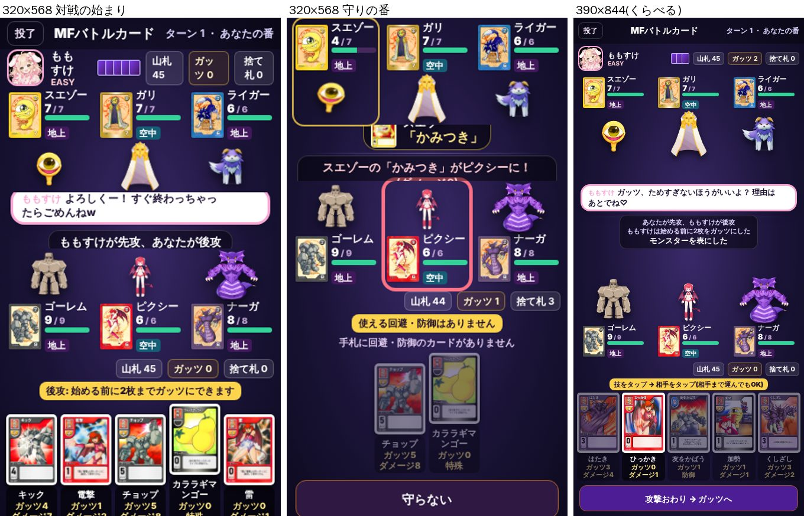 |
| V2(375×667) | 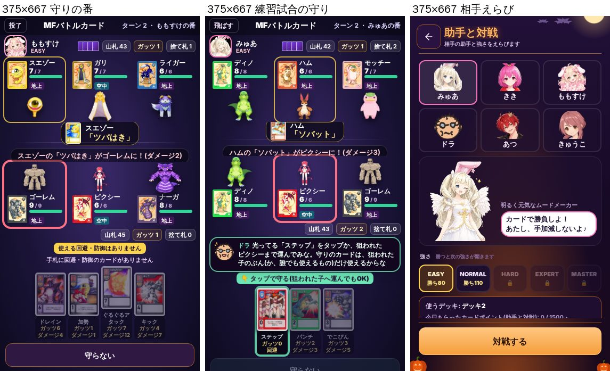 |
| V3(手札が持ち上がると帯に重なる) | 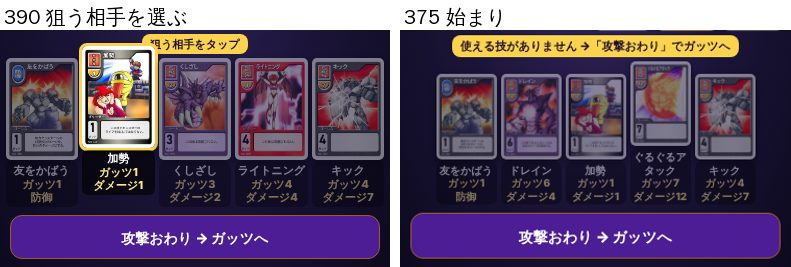 |
| V4(言葉の途中の折れ) | 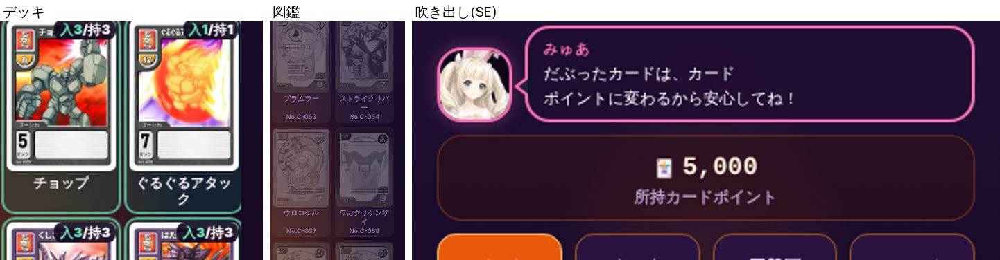 |
| V5(デッキを組む) | 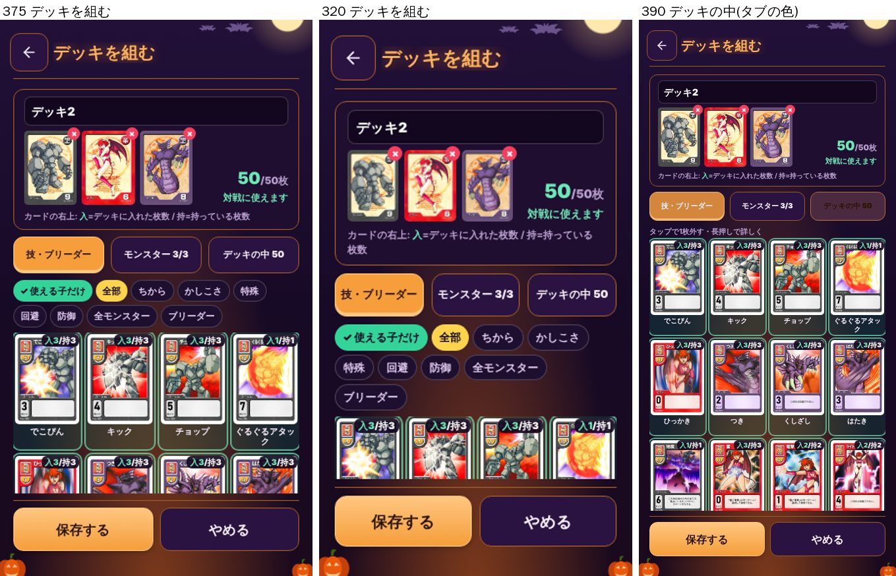 |
| V6(結果の画面) | 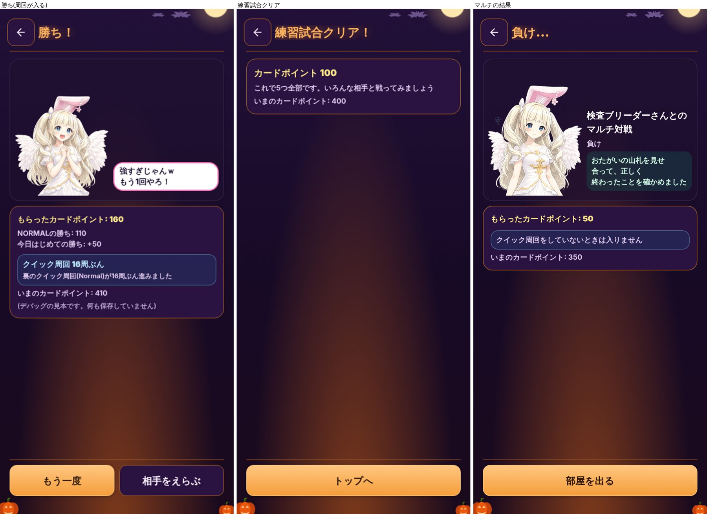 |
| V7(パック) | 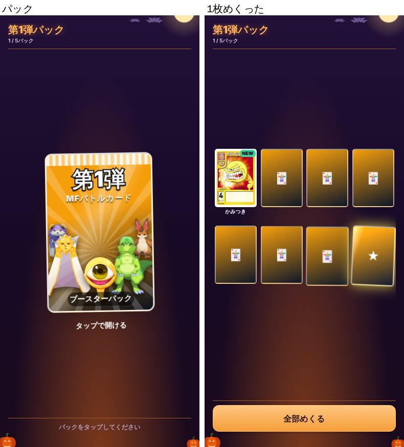 |
| V8(空きが大きい画面) | 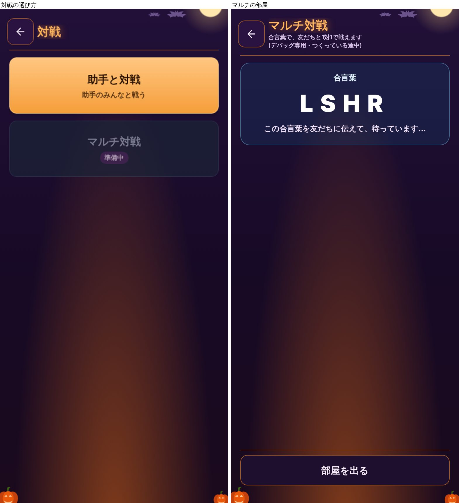 |
| トップのくらべ(よい) | 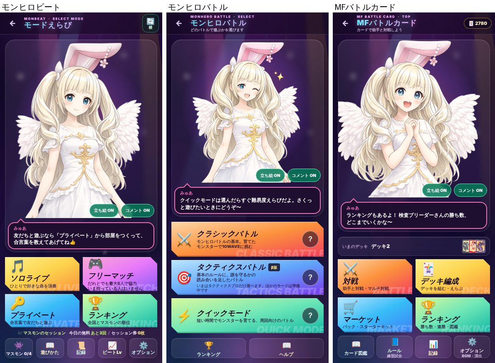 |

## 直すときの案(窓口の返事のあと)

- V1・V2: 背の低い画面の段(高さ 760 未満)に、320幅の段を足す(名前・札を1行に縮める・手札の下の字を2行に・まんなかの高さを縮める)。検査 ⑨ を 320×568 でも通す
- V3: 持ち上げるぶんだけ帯を上へ逃がすか、持ち上げを帯の高さまでにする
- V4: カード名・モンスター名を、言葉の区切りで折る(`jaWrap` か「」の言葉をまとめる仕組み)。名前だけ字を小さくして1行に収めるのも手
- V5: SE 以下は上の枠を小さく(絵3枚を横1列の小さい形に)・「入/持」の札を角の小さい丸に・選んでいるタブの色をほかのタブと同じ「選ばれた色」に
- V6: 勝ち負けを大きく出す(モンヒロビートの結果の見出しに合わせる)・練習試合のクリアにドラとみゅあの絵・マルチは相手のブリーダーの顔と名前・仕組みの説明の文を消す・「NORMAL」にそろえる
- V7: カードの裏に MFバトルカードの柄を付ける・めくった画面のカードを大きく
- V8: 対戦の選び方にも助手の立ち絵と吹き出しを置く(トップと同じ作り)

## 直したもの(窓口の分け方 2026-10-24: V1〜V5・V7〜V9・V6 の助手戦と練習試合は改善部、V6 のマルチはバトル部)

### その1(#3539)・その2: V1〜V4

- V4: 名前を1行に収める部品 `CardNameFit`(手札・デッキ・図鑑・パック)。「カードポイント」などを折らない(`jaWrap`)
- V3: 手札の箱に持ち上げの分の高さを取り、選んだ手札が帯に重ならない
- V1: 盤に「小さい段」(幅360未満・高さ620未満・SEの練習試合)。帯の札を1行・地上の札をライフの行へ・絵と手札の字を小さく・守れない理由を1行・相手の名前を1行。320×568 で検査 ⑨ が通る
- V2: SE ではまんなかの技のカードの絵を省く・相手えらびの絵を低くして「使うデッキ」まで1画面に

| | |
| --- | --- |
| V1 320幅(前/後) | 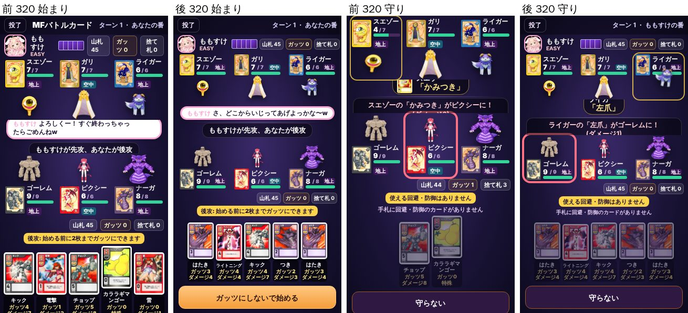 |
| V2 SE(前/後) | 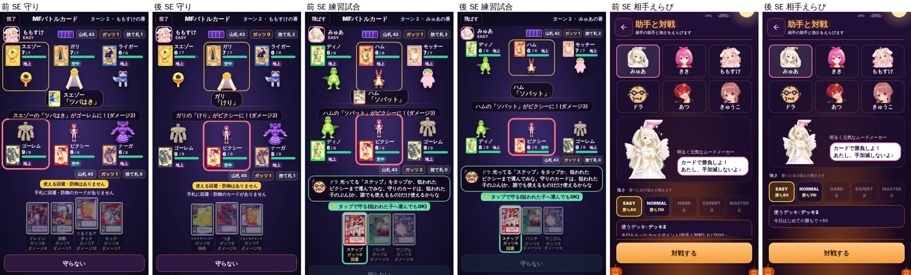 |
| V3 手札(前/後) | 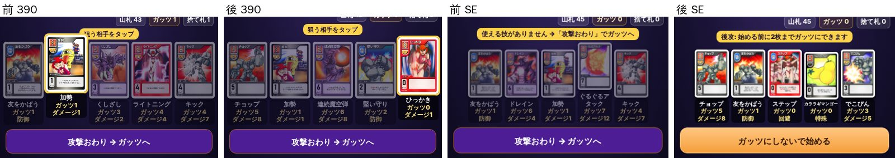 |
| V4 名前(前/後) | 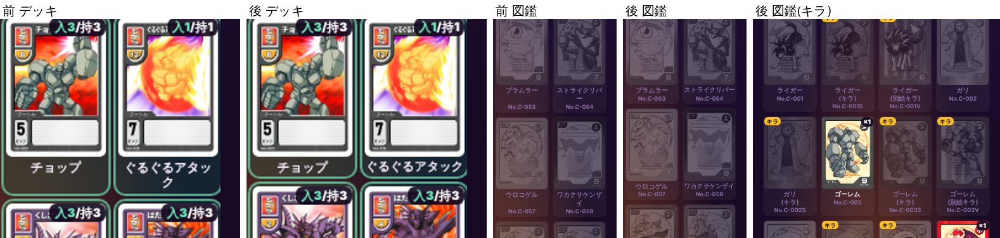 |

### その3: V5〜V8(助手戦・練習試合の結果まで)

- V5 デッキを組む: 背の低い画面は上の枠を小さく・説明の1行を省いて一覧を広く。「入/持」の札をカードの絵の右下へ(名前が隠れない)。※「デッキの中」のタブが暗く見えたのは、押した直後の色の切り替わりを写したもので、直すものではなかった
- V6 結果: 大きい見出し(勝ち！/負け…/投了・練習試合は「クリア！」)。練習試合の結果にドラの絵とひとこと(**台詞2つは新しく書いたので、カゲあつくんの確認がいる**: 「よくやったな。これで決まりはひととおりだ。あとは対戦で慣れていこう」「またいつでも練習しような。トップの「練習試合」からできるぞ」)。※周回の欄の「(Normal)」はモンヒロバトルの難易度の正式な書き方なので、そのまま
- V7 パック: カードの裏に柄(内側の枠・斜めの模様・まんなかの「MF BATTLE CARD」の紋。モンスターの枠は★)。背の高い画面は3列でカードを大きく
- V8 対戦の選び方: トップと同じ舞台の背景と色つきの大きい札。札の中に戦える助手の顔
- V9 手札の字: 320幅などの小さい段では「ガッツ」「ダメージ」を幅に合わせて縮めた(その2)。SE は 10px のまま
- V6 のマルチの結果・マルチの部屋はバトル部(ブレイブくん)

| | |
| --- | --- |
| V8 対戦の選び方(前/後) | 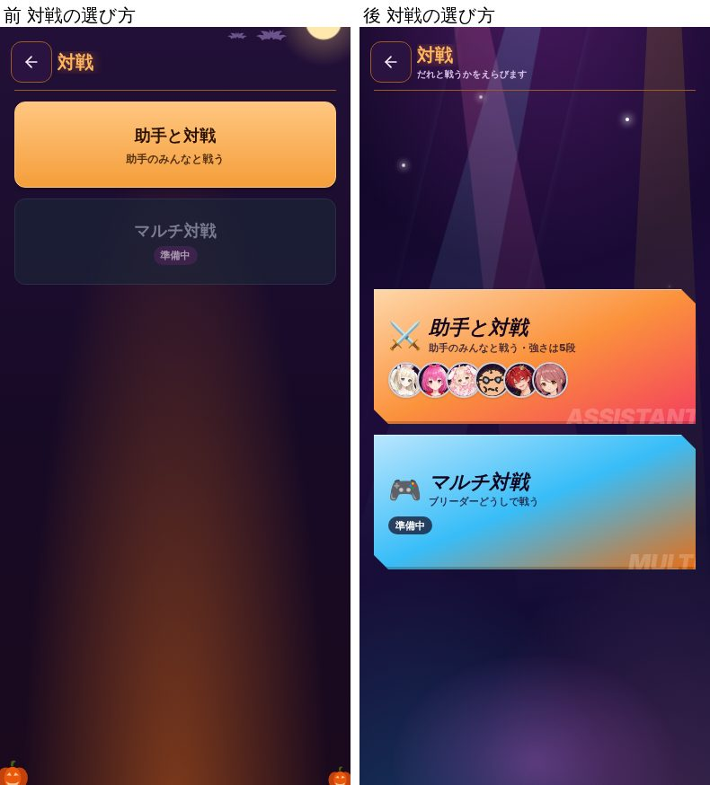 |
| V6 結果(前/後) | 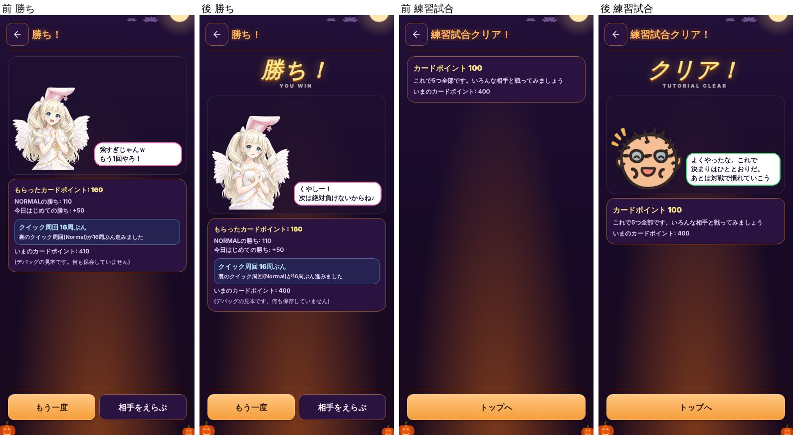 |
| V7 パック(前/後) | 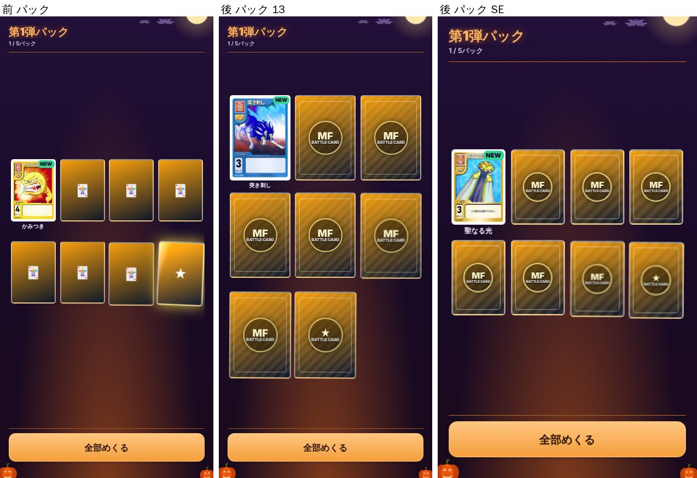 |
| V5 デッキ(前/後) | 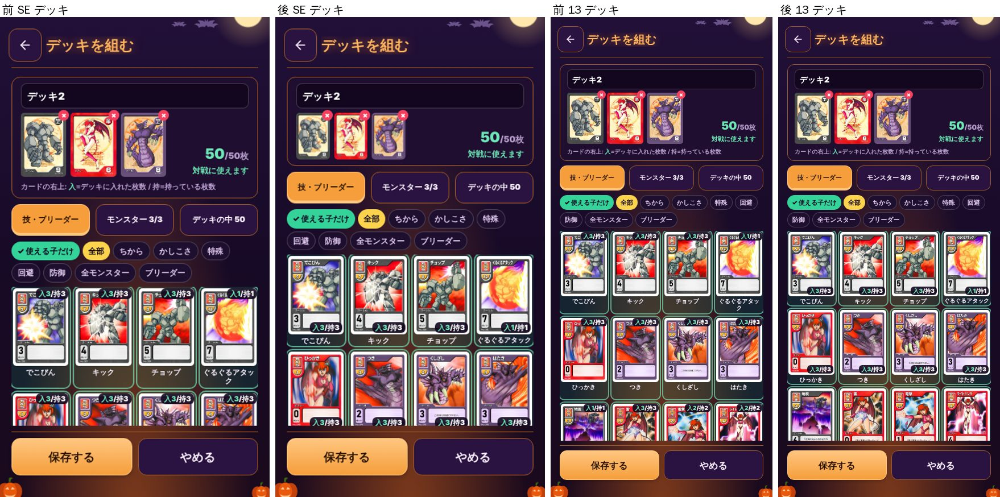 |
