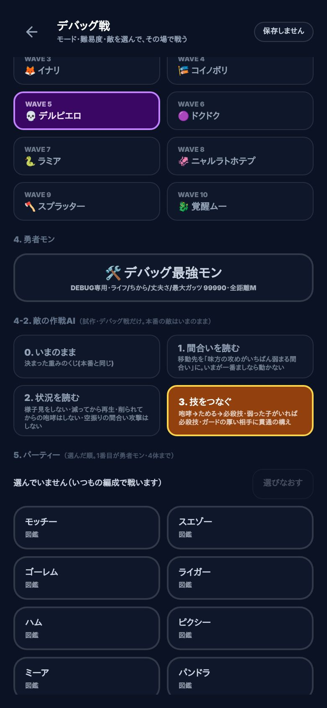
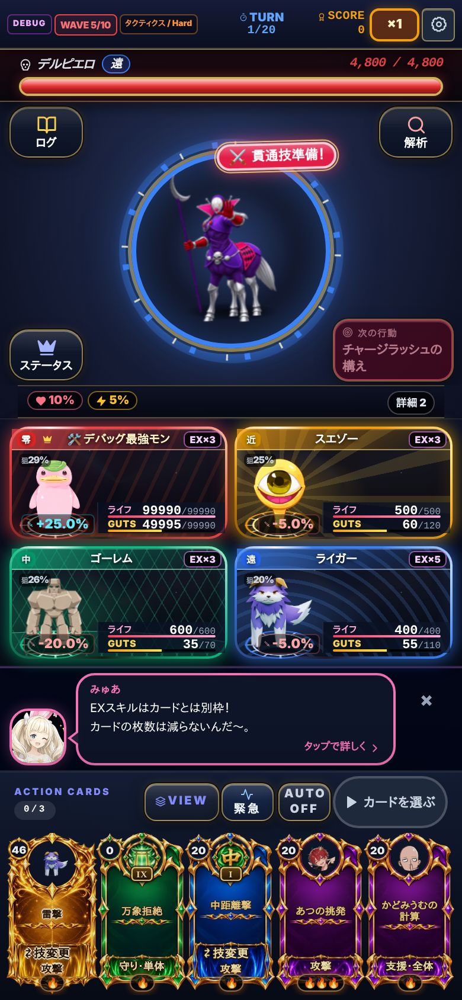

# タクティクス 敵の作戦AI 強化の案と試算(2026-11-11 サクセン)

社長の材料(11/11):「タクティクス・NPCの戦術AI強化: 行動選択、距離、スキルの組み合わせ、難易度ごとの戦術を改善」。
**社長が決めるまで本番の強さ・ランキング対象のモードは変えていない。** 試作はデバッグ戦の中だけで動く。

## 1. いまの敵AIの手の選び方

- `chooseEnemyAction`(22-enemy-and-bond-entries.jsx)は**決まった重みのくじ**。盤面(味方のライフ・並び・自分のライフ)を一切見ない
  - 重み: 通常攻撃30・ためる12・様子見10・移動10・間合い攻撃14・連撃14・貫通の構え12・咆哮10・再生10・全体攻撃10(持っている技だけ)
- 移動先は「いま以外の3つの間合いから、くじ」
- 難易度で変わるのは**数字(ライフ・攻撃)と技の本数だけ**(`TACTICS_DIFFICULTY_ACTION_DELTA`)。考え方は Beginner も GOD も同じ
- 狙い(だれを殴るか)はヘイト+ライフの少なさ(`withTacticsTarget`)。ここは社長の決めた「狙われる確率◯%」と同じ計算なので、**今回の案では変えない**

## 2. 弱い所(数字で)

シミュレーター(tools/playbot/sim/battle.js・味方は実戦ボットと同じ動き)で、勇者モン30体 × 各60回 = 1難易度1,800ラン。
表は [trial-Hard.md](trial-Hard.md) ほか。数字は予告した手の割合。

| 弱い所 | Easy | Normal | Hard | Expert |
| --- | --- | --- | --- | --- |
| 棒立ち(様子見)の割合 | 9.9% | 8.9% | 9.2% | 9.1% |
| 移動のうち、味方の主力に近づく**損な移動** | 39.8% | 38.7% | 37.0% | 26.6% |
| 敵の立ち位置の損(4つの間合いで一番ましな所より、味方の攻めが何%強い所に立っているか) | +14% | +14% | +15% | +25% |
| ライフが35%を切ってからの咆哮(もう間に合わない強化)・1,800ランの回数 | 426 | 829 | 876 | 345 |
| 予告の間合いにだれもいない間合い攻撃(弱い当たりになる)・回数 | 1,079 | 1,620 | 2,141 | 2,945 |

- 技の組み合わせ: 咆哮のあとに「ためる→必殺技」へつなぐ、などの流れは**偶然しか起きない**(くじが毎ターン独立)
- 難易度ごとの戦術: **無い**(上の表のとおり、どの難易度でも同じ割合で棒立ち・損な移動をする)

## 3. 案(段)

どの段も守ること: ①予告してから動く(移動先も予告に出した値だけ)②狙い(ヘイト)は変えない ③技の倍率・本数は変えない(重みだけ動かす)。
上の段は下の段を全部含む。

| 段 | 名前 | 中身 |
| --- | --- | --- |
| 0 | いまのまま | 本番と同じくじ |
| 1 | 間合いを読む | 移動先を「味方の攻めがいちばん弱まる間合い」に。いまが一番ましなら動かない。主力の真正面にいるときほど動きやすい |
| 2 | 状況を読む | 様子見をしない・ライフが半分を切ったら再生を選びやすく・削られてから(35%未満)の咆哮はしない・立っている子が多いほど全体攻撃・予告の間合いにだれもいない間合い攻撃はしない |
| 3 | 技をつなぐ | 咆哮のあとは「ためる→必殺技」・弱った子(ライフ40%未満)がいれば必殺技を狙う・ガードの厚い相手(丈夫さ300以上)には貫通の構え |

## 4. 勝率の試算(段ごと)

素のモンスター(育成なし)でのクリア率と平均の突破WAVE。1,800ランずつ。クリア率のぶれは ±1ポイントほど。

| 難易度 | 段0 いまのまま | 段1 間合い | 段2 状況 | 段3 技をつなぐ |
| --- | --- | --- | --- | --- |
| Easy | 85.8%(9.86) | 84.7%(9.85) | 88.9%(9.89) | 88.7%(9.89) |
| Normal | 34.6%(9.28) | 35.6%(9.27) | 29.1%(9.15) | 31.2%(9.21) |
| Hard | 17.1%(8.68) | 17.2%(8.72) | 13.2%(8.47) | 14.1%(8.52) |
| Expert | 1.1%(3.73) | 1.1%(3.84) | 0.6%(3.22) | 0.6%(3.27) |

読み取れること:

- **段1(間合い)は強さがほぼ変わらない**(どの難易度も ±1ポイント)。損な移動が 0% になるので「賢く見える」だけ。味方が距離撃で敵を動かし直すので、勝ち負けには響きにくい
- **段2(状況)が効く**。Normal −5.5ポイント・Hard −3.9ポイント(17.1%→13.2%、相対で約2割減)・Expert は平均の突破WAVEが 3.73→3.22(約1.4割減)
- **段3は段2より少しだけ易しい**。つなぐ技(ためる→必殺技)は1ターン前に予告されるので、読めばガードで受けられる。「強くする」より「読み合いを増やす」段
- Easy は段2・3でかえって勝ちやすい(+3ポイント)。様子見が減ったぶん「ためる」が増え、予告の読める大技が増えるため。易しい難易度で入れる理由はない
- Master 以上は、素のモンスターだとWAVE1〜2で倒れるので試算にならない。Expert と同じく平均の突破WAVEが1〜1.5割ほど下がる見込み

## 5. 難易度ごとの入れ方の案

| 案 | Beginner・Easy | Normal・Hard | Expert・Master | Grand Master 以上・極限 | 強さの変化(試算) |
| --- | --- | --- | --- | --- | --- |
| **ア(推奨)** 上の難易度ほど賢く | 段0 | 段1 | 段3 | 段3 | Normal・Hard はほぼ据え置き。Expert 以上は1〜1.5割きびしく |
| イ 見た目の賢さだけ | 段0 | 段1 | 段1 | 段1 | どの難易度もほぼ据え置き(損な移動だけ無くなる) |
| ウ しっかり強く | 段0 | 段2 | 段2 | 段3 | Normal −5.5・Hard −3.9ポイント。Expert 以上も1〜1.5割きびしく |

ランキングへの影響: 敵の考え方が変わると、入れた日の前後で同じ難易度の記録が比べにくくなる(とくに案ア・ウの Expert 以上)。
入れるなら、区切りの日を決めてお知らせしてから(⑦: 既存のランキングの記録は消さない・書き換えない)。

## 6. 試作の触り方(デバッグ戦だけ)

デバッグ設定 → デバッグ戦 → モード「タクティクス」→「4-2. 敵の作戦AI」で段を選んで開始。ふだんの遊び・ランキング対象のモードは段0(いまのまま)で固定。

## 7. 道具

- 試算: `node tools/playbot/sim/enemy-ai-trial.js --diff Hard --runs 60 --ai now,W,L1,L2,L3`(W は「様子見だけ消す」比べ用)
- 見張り: `node tools/battle/tactics-enemy-ai-debug-check.js [--shots <フォルダ>]`(段0が本番と1手ずつ同じ・試作がデバッグ戦の外へ出ない・実ブラウザで開ける)
- 本体: `chooseTacticsEnemyActionAi`・`tacticsEnemyAiDefinitions`(22-enemy-and-bond-entries.jsx)・`tacticsEnemyPressure`(32-tactics-units.jsx)・`tacticsEnemyAiState`(60-app.jsx)
