# MFバトルカード 進捗メモ(カード部 デッキくん)

社長のOK(台帳 #3420)で実装を始めた。作る順は「コンピューター戦とスターター → デッキ編成とパック・マーケット → 公開 → 対人戦」。
設計の正本は [`docs/spec/CARD_BATTLE.md`](../spec/CARD_BATTLE.md)、元のルールは [`docs/spec/card-battle/RULES_SOURCE.md`](../spec/card-battle/RULES_SOURCE.md)。

## 区切り1: コンピューター戦とスターター(2026-10-24 11:39 時点)

**入口はデバッグ設定の「⚔️ バトル」の中の「🃏 MFバトルカード」だけ**(HOME の入口は公開の区切りまで出さない)。
デバッグ専用のあいだは更新履歴・ヘルプに載せない(CLAUDE.md ⑤)。

### できたもの

| もの | 置き場所 | 中身 |
| --- | --- | --- |
| カードの表 | `monster-hero/data/card-battle-cards.js`(67KB・起動時に読む) | `tools/card/card-data-build.js` が `tools/art-sources/card-battle/*/cards.json` から作る。技 322 枚(使える 238)・モンスター 69 枚・スターター 3 つ。文を効果の部品にできなかったカードは「準備中」(`--list-missing` で一覧) |
| カードの絵 | `monster-hero/images/card-battle/{s,l}/`(392 枚 × 2・約 28MB) | `tools/card/card-image-build.js --build`(© を消して縮める)。起動時にも事前ダウンロード(`asset-manifest.json`)にも入れない |
| ルールの本体 | `src/parts/82-card-battle-core.jsx`(pure) | 始める・できる操作・操作を進める・守り・勝ち負け・コンピューターの考え方(くせ×難易度)・助手のデッキ・保存の正規化・カードポイントの計算 |
| 助手のひとこと | `src/parts/83-card-battle-lines.jsx`(pure) | 6人 × 14場面(挑戦の一言を足して 42 通り/人)。場面の選び方 `cardLineSceneOf` |
| 画面 | `src/parts/84-screen-card-battle.jsx` | `CARD_TOP`(スターター選び・トップ・相手えらび・結果)/ `CARD_BATTLE`(対戦) |
| 本体のつなぎ | `60-app.jsx` | デバッグ設定の1行・表示の1行・BGM(`cardBgm`。対戦は相手の助手の曲、それ以外は HOME の曲) |
| 保存 | 新しいキー7つ(`SAVE_DATA.md` に追記) | `mh_card_collection_v1` / `decks_v1` / `point_v1` / `starter_v1` / `daily_v1` / `record_v1` / `cpu_unlocked_v1` |
| 検査 | `tools/card/card-rules-check.js` | 決まりごとの場面・保存の正規化・助手のデッキ・カードの表と絵・CPU どうし 300 戦 |
| 検査 | `tools/card/card-battle-browser-check.js` | 入口 → スターター → 相手えらび → 対戦 → 長押し・捨て札 → 投了 → 結果。既存のキーを書き換えていないか。`CARD_SHOT_DIR=` で写真 |

### コンピューターの強さ(CPU どうしの試算。`card-rules-check.js` と同じ式)

- 難易度の段: 隣の難易度に 6〜7 割で勝ち越し、MASTER は EASY に 96%。
- 助手どうし(相手はスターター・同じ難易度の考え方): NORMAL・HARD は 44〜53% にそろった(`CARD_AI_TUNE`)。
  EXPERT・MASTER は、みゅあ・ももすけが 30〜35% と弱め(組み直したデッキの差)。**次の区切りで詰める。**

### 公開の条件(カゲあつくんの確認・2026-10-24)

- ~~**EXPERT・MASTER で、どの助手もほかの助手と同じくらいの強さにする。**~~ → 直した(2026-10-24。下の「助手の強さをそろえた」)。
- ~~トップの「つぎの区切りで作ります」は、公開のときに「準備中」にする~~ → 区切り2で4つの入口(デッキ編成・マーケットへ・カード図鑑・ルール)を全部作ったので、残っていない。

### まだのもの(区切り1の残り・次の区切り)

- 対戦の演出: ダメージの数字・光る・KO の暗転だけ。技ごとの動き(5-4)・倒れる動きは、まだ。
- モンヒロにいない種族の絵(ディノ・ガリ・ナーガ・ドラゴン・ヘンガー)は、カードの絵で代えている。`monster-add` の手順で配信用にしてから差し替える。
- ~~英語版の 37 枚(全モンスター・ブリーダー)の絵の文字の日本語化(2-5)~~ → 混血15枚と合わせて52枚を入れた(#3511)。
- 裏でクイック∞周回とのつなぎ(5-3)・横画面(`landscape-screens-check.js`)・BGM の設定画面(`mh_card_bgm_v1`)・演出の設定(`mh_card_settings_v1`)は公開の区切りで入れる(いまはデバッグからしか入れず、周回中に入る道がない)。
- 守れるカードが無いときの自動パス(`mh_card_settings_v1`)。
- 区切り2: デッキ編成・パック・マーケットの「カードポイント」欄・図鑑・ルール。

### 区切り1の画面の写真(390×844・`card-battle-browser-check.js` で撮った)

自分はパワフルチーム、相手はももすけ(ミラクルチーム)。**ナーガ・ガリはまだカードの絵で代えている(立ち絵は次の区切りで入る)。**

| | |
| --- | --- |
| スターター選び 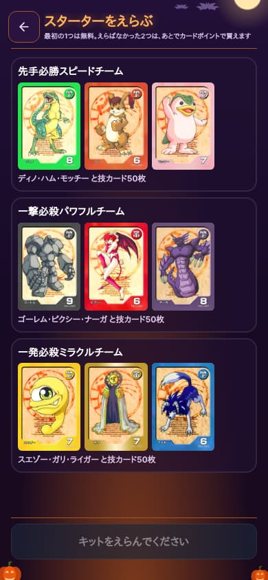 | トップ 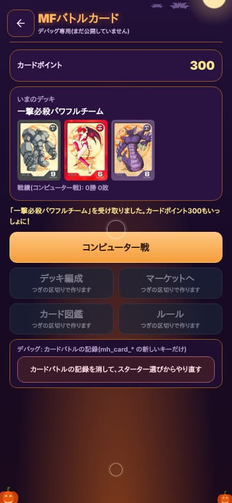 |
| 相手えらび 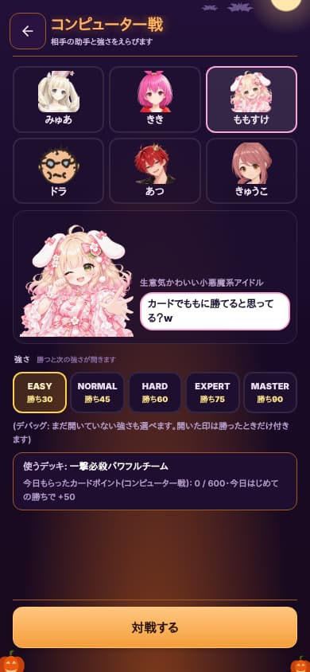 | 対戦の始まり 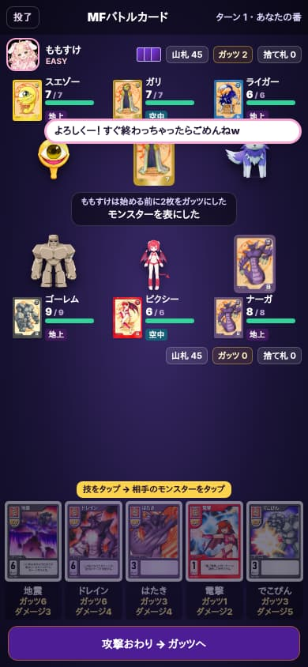 |
| 長押しの詳しい画面 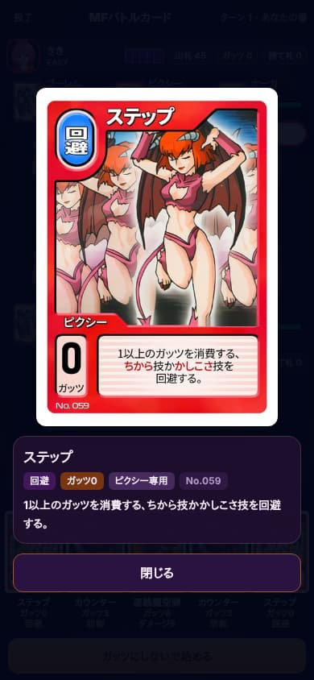 | 狙う相手を選ぶ 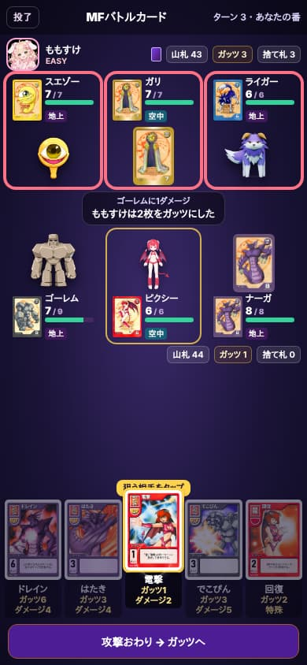 |
| 守りの番 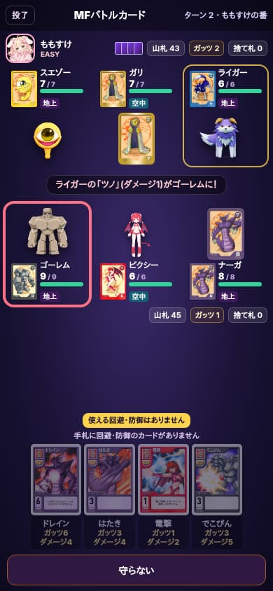 | 捨て札の一覧 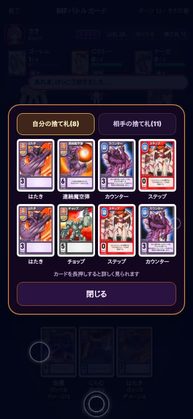 |
| 結果(投了) 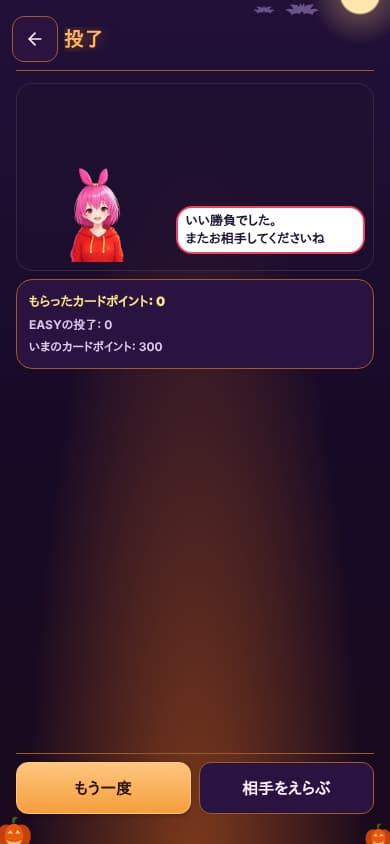 | |

### 対戦の画面の配置を直した(社長 2026-10-24「上によりすぎ。上下をもっと分けて、真ん中をアクションやログに」)

- 相手の場を上、自分の場を手札のすぐ上に置き、そのあいだを **まんなかの場所(`data-card-stage`)** にした。使った技のカードと名前(アクション)と、起きたことの新しい3行(ログ)をここに出す。**次の区切りの技ごとの動きも、この場所で見せる。**
- 背の低い画面(高さ 760 未満。iPhone SE)では、モンスターの絵・手札・帯を少し小さくし、ログは新しい1〜2行にする。
- `card-battle-browser-check.js` の ⑨ で、相手の場・まんなか・自分の場・手札・ボタンが上から順に並んで重ならないかを測る(`CARD_VIEWPORT=375x667` で SE)。

カゲあつくんの小さい直し4つ(手札の名前を2行で全部・守りの番の記録の重複を消す・吹き出しをまんなかの上へ・使える技が無いときの案内)と、立ち絵(#3437)を入れたあとの写真。

| | iPhone 13(390×844) | iPhone SE(375×667) |
| --- | --- | --- |
| 対戦の始まり | 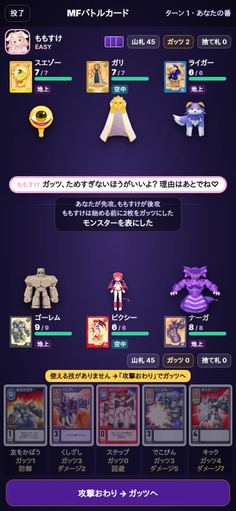 | 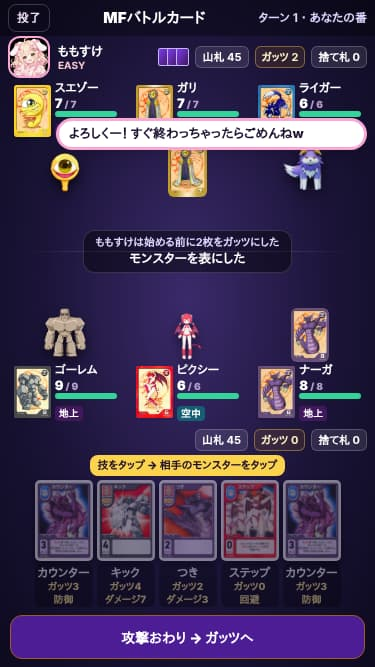 |
| 攻撃の途中(狙う相手を選ぶ) | 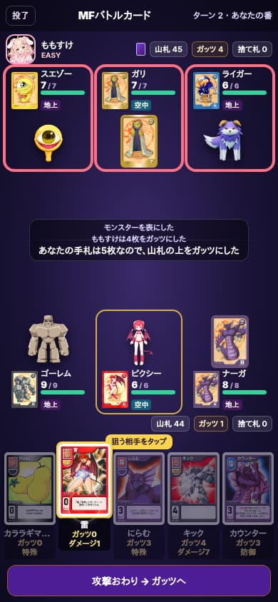 | 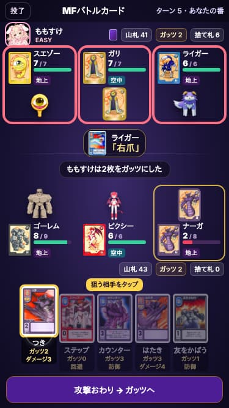 |
| 守りの番 | 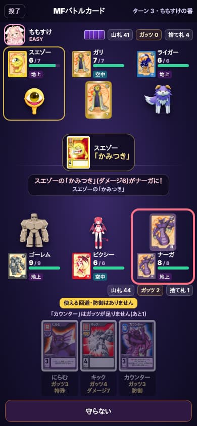 | 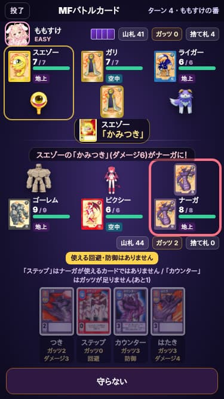 |

### 技の動き(社長「カードアクションは攻撃ならモンスターが動いてとかにならないの？」・2026-10-24)

- 攻撃した子の立ち絵が、モンヒロのバトルと同じ技の動き(`SkillFxMotion`・`SKILL_MOTION_SETS`)で、狙った子へ向かって動く。位置は画面で測る(上下に並んでいてもそのまま当たる)。
- 当て方は `85-card-battle-motion.jsx`: モンヒロに同じ名前の技があればその動き、ほかは名前と種類から(なぐる・ける・爪・剣・投げる・回る・雷・炎・氷・水・キッス・歌・光・魔法の玉・毒・葉・岩、全ての相手は上から降らせる)。1枚ずつ上書きできる(`CARD_MOTION_BY_NO`)。
- 受けた子は揺れて光る・よけた子は横へすっと避ける・防いだ子は身構えて光の盾・KO の子は横に倒れて暗くなる(CSS `mh-card-*`。味方モンスターでもそのまま使える)。
- 特殊技・ブリーダーのカードは、体は動かさず、まんなかの技のカードと記録だけ(いままでどおり)。
- `card-battle-browser-check.js` の ⑩ で、攻撃すると動きの部品が出るかを見る。

| 攻撃の途中(ナーガの「くしざし」がスエゾーへ。左から順に約0.1秒ずつ) |
| --- |
| 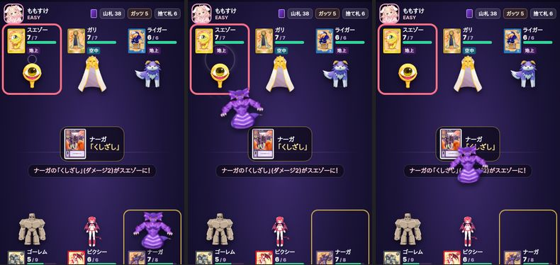 |

**動きの動画**(`docs/progress/card-battle/motion-demo.mp4`・iPhone 13 の大きさ・約19秒)。デバッグ設定 → MFバトルカード → 「技の動きの見本を流す」で、同じ場面を決まった順に流せる(保存はしない)。撮り直しは `node tools/card/card-motion-video.js docs/progress/card-battle/motion-demo.mp4`。
1. スエゾーの「かみつき」(モンヒロに同じ名前の技がある)→ ナーガが受ける
2. ガリの「雷」(名前から決めた動き)→ モッチーが受ける
3. ゴーレムの「竜巻アタック」(全ての相手に)→ ピクシーは「ステップ」でよける・モッチーは「まるまる」で防ぐ・ナーガは倒れる

### チュートリアル(練習試合。社長がOK・台詞は #3464 の版)

- スターターを選んだら、そのまま練習試合。ドラが説明(まんなかの説明の窓)、みゅあが相手。①引く(自動)→②ガッツ→③守る(ピクシーの「ステップ」)→④技(ディノの「パンチ」)→⑤山札切れ。
- 1つの段のあいだは教えている操作だけ。ちがう所を押すと、ドラが「まずは光ってる所だよ」。上の「飛ばす」で飛ばせる(飛ばしても印は付く)。
- トップの「練習試合」からもう一度できる(ルールの画面ができるまでの置き場所)。はじめて最後までやったときだけカードポイント 100(`mh_card_tutorial_v1`)。
- 台本と段は `86-card-tutorial.jsx`(pure)。`card-battle-browser-check.js` の ⑪ で、最後まで操作で通せるか・100 が1回だけかを見る。

| 練習試合(左から: はじめ・ちがう所を押したとき・守りの番・クリア) |
| --- |
| 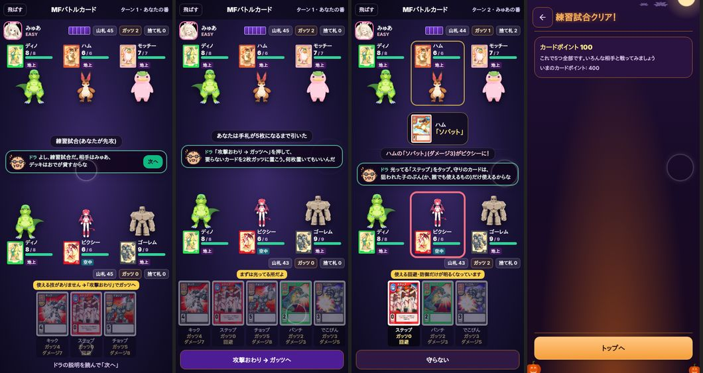 |

### 手札を指で運ぶ(社長「カードはモンバトみたいに長押しでもってくみたいなのはないの？」・台帳 #3473)

- 指が 10px 動いたら運ぶ(モンヒロバトルの `DRAG_THRESHOLD` と同じ)。動かさずに長押ししたときだけ詳しい画面。動かさずに離したらタップ(いままでどおり)。
- 技 … 狙う相手のモンスターへ / ガッツにする(始める前のガッツも)… 自分の「ガッツ」の札へ / 守り … 狙われた自分のモンスターへ。置ける所の上だけ緑に光る。
- 運んでいるカードは body 直下の箱に1枚だけ出し、位置は直接動かす(モンヒロバトルの iPhone の注意と同じ)。手札の絵はブラウザの画像ドラッグで持っていかれないようにした。
- チュートリアルの D10・D13 を「タップでも運んでもよい」言い方にした。案内の帯も「(運んでもOK)」に。
- 動画: `docs/progress/card-battle/drag-demo.mp4`(約15秒)。撮り直しは `node tools/card/card-drag-video.js <出力.mp4>`。
- `card-battle-browser-check.js` の ⑫ で、技を運んで使える・置けない所で光らない・ガッツへ運べる、を見る。

### 練習試合の直し(社長の iPhone での確認・#3475〜#3478)

- ドラの説明の窓を、まんなかの場所から **手札のすぐ上** へ移した(中身の高さぶん場所を取る・いちばん手前)。背の低い iPhone で自分の場の下に隠れ、「次へ」が押せなかったため。
- 教えている所を光らせる: 手札は緑の枠が点滅、ほかの手札は暗く。手札の上に「👇 タップでガッツに(ガッツへ運んでもOK)」などの帯。押すボタン(「ターン終了」「これで守る」など)も点滅し、教えていないボタン(「ガッツにしないでターン終了」など)は押せない。
- みゅあの攻撃で吹き出しが先に消え、次の台詞まで約2秒、光る所も吹き出しも無い時間があった → 練習試合では攻撃で吹き出しを消さない。
- 貸すデッキの同じ名前は3枚まで(かみつきが4枚あった)。`card-rules-check.js` で練習試合を最後まで回し、両方のデッキの枚数と、ほんとうのデッキ(スターター・助手のデッキ全難易度)の「同じ名前3枚まで」を見る。デッキ編成はまだ無い(作るときに `cardDeckProblems` を通す)。
- `card-battle-browser-check.js` の ⑪ で、どの台詞でもドラの窓が画面に全部入り、ほかの物の下にならず「次へ」が押せること・操作の段で光る所があることを、390×844 と 375×667(`CARD_VIEWPORT=375x667`)の両方で見る。光った瞬間ごとの写真は `f-*`。

| 光った瞬間(左から: ②ガッツの前・②ガッツ・③守る・③「これで守る」・④技・⑤攻撃おわり・⑤ターン終了) |
| --- |
| iPhone 13(390×844) 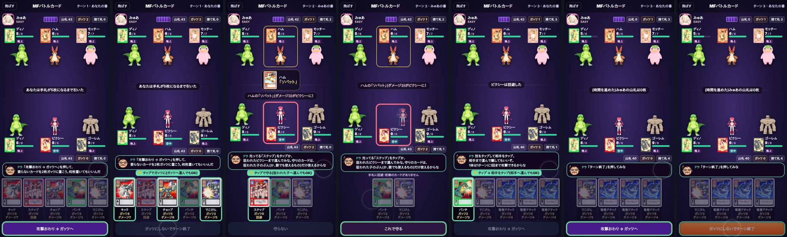 |
| iPhone SE(375×667) 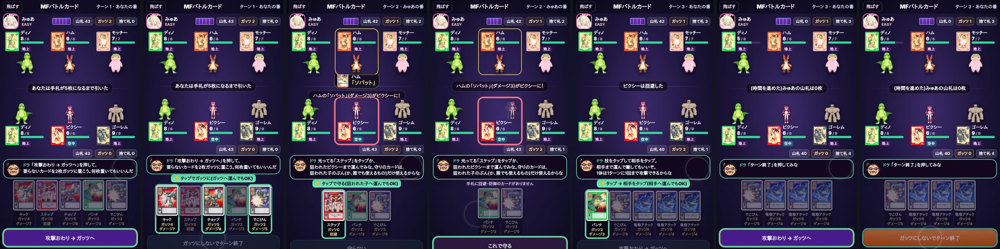 |

### 練習試合の2回目の直し(カゲあつくんの確認)

- 貸すデッキは、違う名前を1枚ずつ順に入れて1周、それを3周する組み方にした(3枚続けて入れていたので、引くたびに同じカードが並んだ)。`card-rules-check.js` は、練習の全部の段で、手札・山札・捨て札・ガッツを合わせて同じ名前が4枚以上にならないかを見る。
- ⑤を2つの段に分けた(`deckEnd` → `deckTurn`)。D17「まずは光ってる「攻撃おわり → ガッツへ」を押してみな」→ D17b「次は「ガッツにしないでターン終了」だ。みゅあの番になるぞ」。言うボタンと光るボタンが同じになる。
- 記録の「(時間を進めた)」を消した。

| ④技・⑤攻撃おわり・⑤ターン終了の手札とボタン(390×844) |
| --- |
| 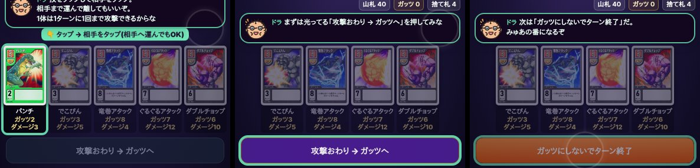 |

### 周回ぶんとカードポイントの案(#3479・社長に見せる用)

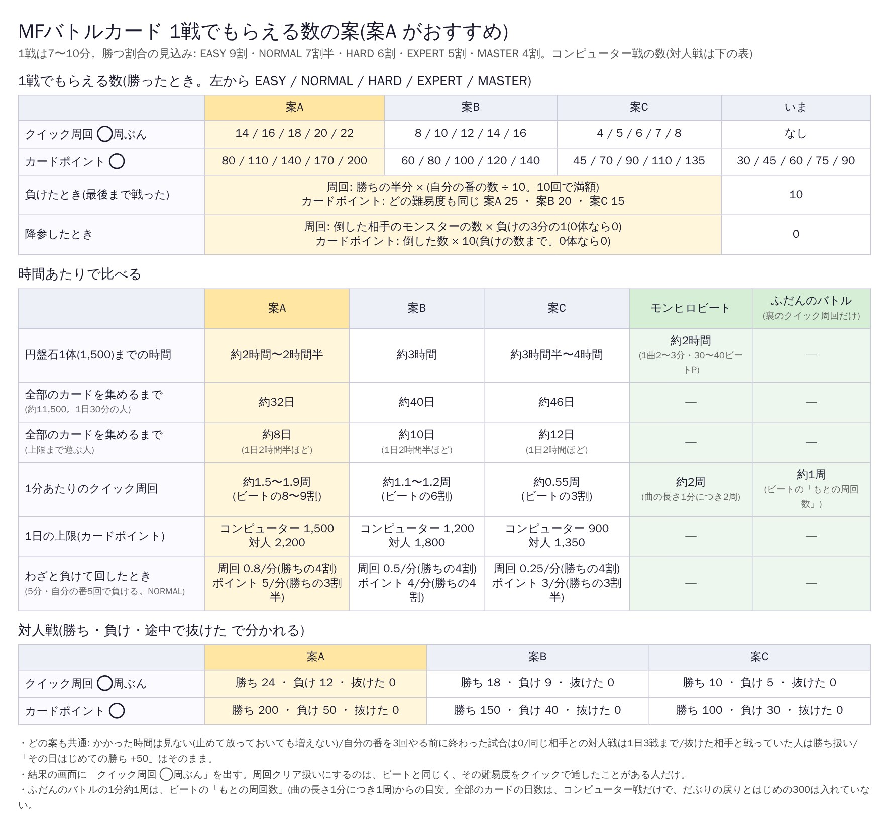

### 1戦でもらえる数を案Aに(社長・台帳 #3484)

- 勝ち: クイック周回 14/16/18/20/22周ぶん・カードポイント 80/110/140/170/200(EASY〜MASTER)。負け 25・降参は倒した数×10。周回は負け=勝ちの半分×(自分の番÷10)、降参=倒した数×負けの3分の1。自分の番を3回やる前に終わった試合は0。1日の上限 CPU 1,500。対人戦の数は `CARD_PVP_REWARD` に置いた(区切り4で使う)。
- 周回ぶんは 60-app の `awardBackQuickLoops`(プロモード・ジャック戦と同じ入口)で配る。AUTO設定のクイックがそろっていて、その難易度をクイックで通したことがある人だけ。
- 結果の画面に「クイック周回 ◯周ぶん」「裏のクイック周回(難易度)が◯周ぶん進みました」。入らないときは数字を出さず「クイック周回をしていないときは入りません」(カゲあつくんの確認)。デバッグ設定の MFバトルカードに「結果の見本」(保存しない)を置いた。`card-rules-check.js` で数、`card-battle-browser-check.js` の ⑦⑬ で画面を見る。
- 裏でクイックを回したままカードバトルに入る道は、まだ無い(公開の区切りで入れる・5-3)。いまは周回を回しながらデバッグから入ったときだけ入る。

| 結果の画面(左から: 周回が入るとき〔見本〕・入らないとき〔見本〕・投了〔本物〕) |
| --- |
| 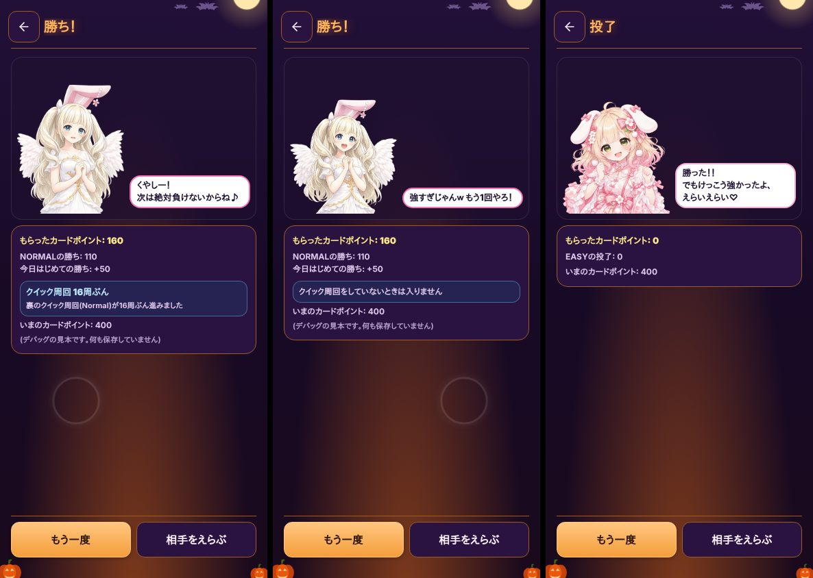 |

- 助手の絵(結果の画面・相手えらび)は `CardAssistantArt` で、描かれている所の範囲を測って枠に合わせ、足元を枠の下・まんなかにそろえる(着替えの絵などで周りの透明な余白がちがい、小さく左下に出る子がいた)。`card-battle-browser-check.js` の ⑬ で6人とも測る。

| 結果の画面の助手6人(見本) |
| --- |
| 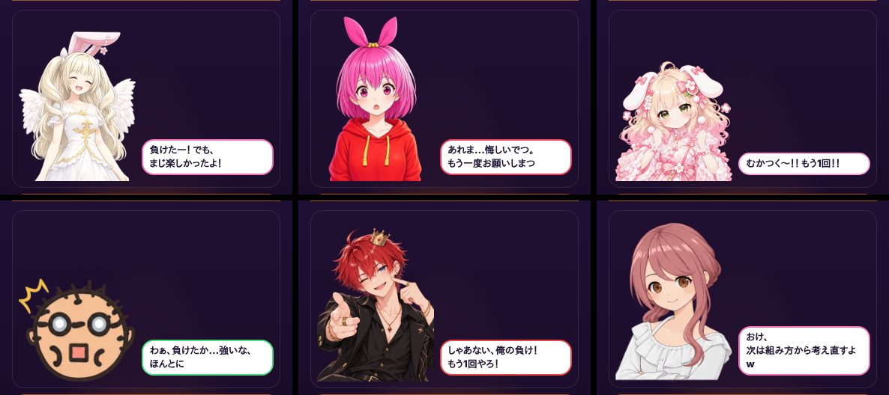 |

## 区切り2: デッキ編成・パック・マーケット・図鑑・ルール(2026-10-24 から)

窓口の頼み(社長の決め): パックは種族ごとの4弾を最初から全部・ヒノトリは第2弾・混血パック・C-060C は入れない/同じ名前は3枚まで/カードポイントの交換はマーケット(円盤石・アシストカード 1,500)/デッキ編成はトップ/ルールの正本は RULES_SOURCE.md。保存は新しい `mh_card_*` だけ・デバッグからだけ・更新履歴とヘルプは書かない。

### 2-1 デッキ編成

- トップの「デッキ編成」→ デッキの一覧(5つまで。使う・組む・写す・消す・新しく作る)→ 組む画面。部品は `87-card-deck-edit.jsx`、決まりは 82 の `cardDeckAddReason`(足せない理由を出す)・`cardDeckOwnProblems`(持っている枚数・準備中)・`cardDeckReady`。
- 組む画面: 上にモンスター3体の枠と枚数(◯/50)・「対戦に使えます/まだ使えません」。タブは「技・ブリーダー」「モンスター」「デッキの中」。「使える子だけ」と種類で絞る。タップで足す/外す、長押しで詳しい画面。各カードの右上は「入◯/持◯」(入=デッキに入れた枚数・持=持っている枚数。組む画面の上にも説明を出す。カゲあつくんの確認)。一覧のボタンは「使う・組む・コピー・消す」(ゲームの「編成をコピー」にそろえた)。
- 50枚そろっていなくても保存できる。対戦に使えるのは、決まりどおりで持っている枚数の中のデッキだけ(トップの「コンピューター戦」もそれで止める)。
- 検査: `card-rules-check.js`(足せない理由・持っていない・準備中・キラも同じモンスター)、`card-battle-browser-check.js` の ⑭(新しいデッキを50枚で保存・同じ名前の4枚目が止まる・使うデッキを変える)。

| デッキ編成(390×844。左から: 一覧・47枚で足りないとき・50枚そろったとき・デッキの中・使うデッキを変えたあと) |
| --- |
| 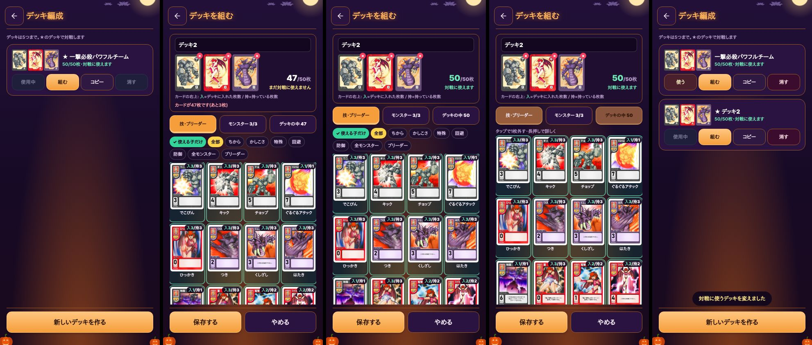 |

### 2-2 カード図鑑・ルールの画面

- トップの「カード図鑑」: 弾ごとのタブ(第1〜4弾・混血)。いちばん上に「集めた種類 ◯ / 405」と、その弾の数。「全部/持っている/まだ」で絞る。持っていないカードは暗い絵、持っているカードに「×枚数」、準備中・キラ・別絵の印。タップ・長押しで詳しい画面。C-060C はカードの表に無いので出ない。
- トップの「ルール」: 9つの節(デッキ・始め方・ターンの流れ・攻撃・守り・ガッツ・空中/地上/水中・勝ち負け・カードの文がいちばん)。文は新しい部品 `88-card-rules.jsx`(pure。正本は RULES_SOURCE.md)。下に「練習試合をもう一度」(トップにあった入口をここへ移した。ドラの D20 に合わせて)。
- 写真には押した跡の白い丸(TapRippleLayer)を写さない(`card-battle-browser-check.js` の写真だけ。ゲームの中は今までどおり出る)。
- 検査: `card-battle-browser-check.js` の ⑮(ルールの節と練習試合の入口・図鑑の数と絞り込み)。⑫ の運ぶ検査は、相手の上で光るのを見てから離す形にした(狙えない札で試す回数を使い切らないように)。

| 左から: ルール・カード図鑑(第1弾)・カード図鑑(混血)(390×844) |
| --- |
| 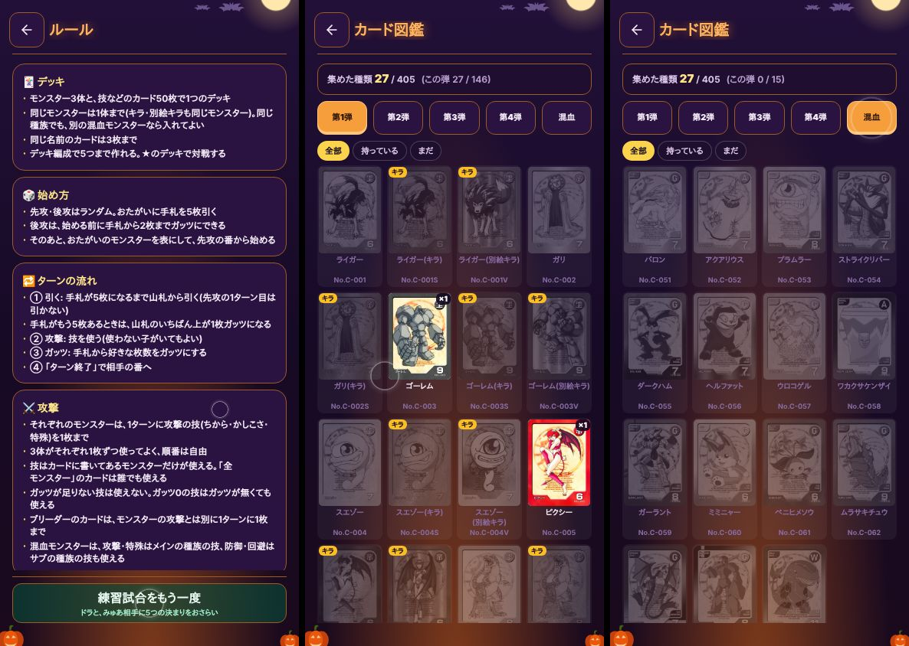 |

### 2-3・2-4 パック・パックを開ける画面・マーケットの「カードポイント」の売り場

- パックの決まりは新しい部品 `89-card-pack.jsx`(pure。乱数は外から渡す): 第1〜4弾(8枚・100/5つで450。技などの枠7・モンスターの枠1)・混血パック(3枚・150)。技などはその弾の準備中でないカードから同じ確率、モンスターはレア度(第1弾 85/12/3%・第2〜4弾 85/15%)→ まだ持っていない種族は2倍。天井はキラなし7パックで次はキラ以上(`mh_card_pack_pity_v1`)。だぶりは技4枚目から5・モンスター2枚目から50(キラ100・別絵キラ200)・混血20 をカードポイントへ。
- トップの「マーケットへ」→ マーケットの「カードポイント」の売り場(MFバトルカードから入ったときだけ出る。戻るとトップへ)。タブは パック(出る確率を見る・1つ/5つ)・スターター(選ばなかった2つ・500・1回だけ・デッキも1つ増える。印は `mh_card_shop_v1`)・円盤石・アシスト(ビートP交換所と同じ一覧・1,500。`rhythmEventPointExchangePreview` をそのまま使い、引くのはカードポイント)。
- 買ったら CARD_PACK_OPEN: パックをタップで開ける → 裏のカードをタップでめくる(モンスターの枠は最後・キラは光る)・「全部めくる」・NEW と だぶりの「+◯」・5つならつぎのパックへ。
- 保存は 60-app の `buyCardPacks`・`buyCardStarter`・`exchangeCardPoints`(保存の値を読み直して、まとめて1つの取引で入れる)。保存キーは新しく2つ(`SAVE_DATA.md` に追記)。
- 検査: `card-rules-check.js` で 3,000パックずつ開けて、枚数・別の弾や準備中が出ない・C-060C が出ない・天井・キラの割合・全部のカードが出る・持てる枚数・だぶりのポイント・まとめ買い・スターター1回だけ。`card-battle-browser-check.js` の ⑯ で、5パック買って開ける・スターターを買う・円盤石を交換・戻るとトップ。

| 上の段: パックの売り場(出る確率)・パックを開ける前・1枚めくった / 下の段: 全部めくった・スターターキットを買った・円盤石(390×844) |
| --- |
| 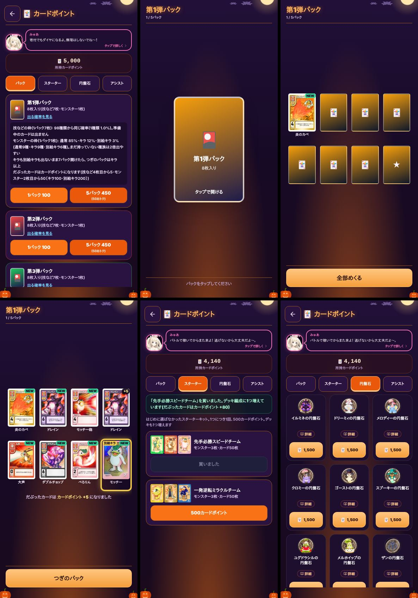 |

- ルールの直し(カゲあつくんの確認): 「」で囲んだ言葉は途中で折らない(「全/モンスター」と折れていた)。山札切れは「引くときに山札が無かったら、そのプレイヤーの負け」に。写真 `card-battle/rules-13.jpg`(上・まんなか・下)。

### 社長の2つの指示(台帳 #3495)

- 「コンピューター戦」の表示をやめた(社長「コンピューター戦って表示がやだ」): トップのボタンは「対戦」1つ → 「助手と対戦」「マルチ対戦(準備中・押せない)」を選ぶ。相手えらびの見出し・戦績・今日もらったカードポイントも「助手と対戦」に言い換えた(コードのコメントはそのまま)。
- デバッグを本実装と同じ画面で(社長「デバッグを本実装と同じ画面で作って」): デバッグの人の HOME に、公開したときと同じ入口(案A・左の列のいちばん下)を出す。見分け方は、デバッグ設定の合言葉が合った印 `mh_debug_unlocked_v1` を**読むだけ**(新しい保存は無し)。ふつうのプレイヤーは印を持たないので出ない(公開の印 `EVENT_REPLAY_RELEASE_FLAGS.cardBattle` が立つまで)。HOME から入ったときは、ふつうのプレイヤーと同じ画面(デバッグの見本ボタンや、まだ開いていない強さは出ない)。デバッグ設定の入口も残した。
- 検査: `card-battle-browser-check.js` の ⑰(ふつうのプレイヤーの HOME に入口が出ない・印がある端末には出て入れる・対戦の選び方・「コンピューター戦」が画面に出ない)。

| 左から: HOME(デバッグの人)・トップ・対戦の選び方・助手と対戦(390×844) |
| --- |
| 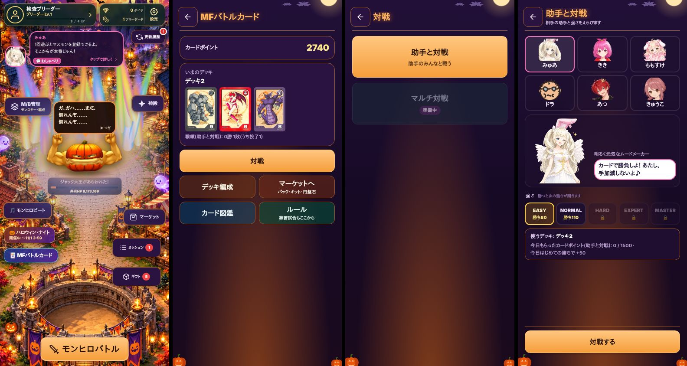 |

- 売り場の直し(カゲあつくんの確認): 出る確率の説明で「準備/中」「2倍出やす/い」と折れていた → 《》で囲んだ言葉はひとかたまりで出す(`cardRuleLine`。jaWrap が「準備中」「出やすい」を2つに分けるため)。売り場のみゅあの吹き出しはカードの話の5本(`data/assistants.js` の `MUA_CARD_SHOP_LINES`。場面にはしない＝話すのはみゅあだけ)から1本。写真 `card-battle/shop-13.jpg`。

## カードの絵の日本語化(設計書 2-5・窓口の頼み 2026-10-24)

- 英語版の絵(全モンスター19枚・ブリーダー18枚・混血15枚)の英語の文字を消して、日本語版と同じ見た目の日本語を書く道具 `tools/card/card-image-ja.js` を作った。絵(イラスト)には手を加えない。
  - 消し方: 字の点とそのまわり2〜3点を印にして、その行(または列)の「字でない所」の色の真ん中の色で埋める。文の箱のしま模様・種類の札の色・横へ色の変わる地がそのまま続く。
  - 書き方: 日本語版の技カードに合わせる。題字・札は白い字＋太い黒のふち＋右下の薄い影、種類の札は縦書き(回避・防御・特殊・ちから)、文は黒い字で「ちから」「かしこさ」は赤、「、」「。」と助詞のあとで折って行の長さをそろえる。名前と文は cards.json の日本語(社長が決めた名前。混血は台帳 #3418)。
  - 配置は3つ(全モンスター・ブリーダー・混血)。座標は英語版の絵を測って決めた。
  - 字体は Noto Sans JP(SIL Open Font License)。リポジトリには入れず、使うときに `npm pack @fontsource/noto-sans-jp@5.0.19` で取ってくる(道具の頭に手順)。
- まず3枚の見本(全モンスター「緊急回避」・ブリーダー「加勢」・混血「バロン」)。`card-battle/ja-art-sample.jpg`(左から: 英語版・日本語にした・日本語版の同じ種類のカード)。カゲあつくん → 社長に見てもらってから、残りを作る。
- 配信の絵にするときは、日本語にした絵を `card-image-build.js` に通す(© の帯を消して縮める)。見本の写真も、3列ともこの消し方を通した絵で並べた(カゲあつくんの確認)。ブリーダーの左下の札は、地がほとんど黒で黒いふちと見分けられないので、すぐ下の2行の色を列ごとに写して消す。
- ★見本を作っていて、`card-image-build.js` が混血の絵(`C051.jpg` のように「-」が無い名前)を技カードとして扱っていたのに気づいた。ゲームの混血15枚は「© TECMO」が残り、右下の「No. C-051」がにじんで消えかけていた → モンスターカードとして扱うように直して、15枚を作り直した。

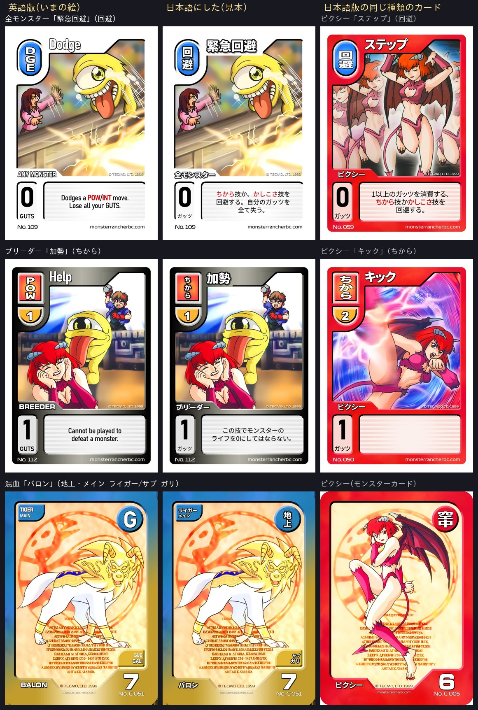

- **52枚全部をゲームに入れた**(社長 台帳 #3511「このやり方で全部作る」)。日本語にした絵は `tools/art-sources/card-battle-ja/`(英語版は残す)。
  `card-image-build.js --build` は、ここに同じ名前の絵があればそちらを使う(©・URL を消して縮める)。差し替わったのは 52枚×2つの大きさだけ。
  - 全部作っていて直したこと: ①全モンスターの題字の右と下は絵のふちの黒い線で、その先は絵。消す所を線より上の白い所だけにした(底力・根性・光の盾で絵が白く塗られていた)。英語の字の薄い影も残さない。
    ②ブリーダーの長い題字(Shadow Bind など)の後ろ半分が残っていた。範囲を絵のふちの線まで広げた。
    ③混血の札は地が色つき・黒・灰色とさまざま。列ごとに上下の端の色を地と見なし、それと違う白い字の点(と、まわりのふち)だけを消して、上下の色でつなぐ。長い英語の名前(ARMOR DRAGON など)も札いっぱいまで消す。
    ④文の折り方: 「、」「。」を行の頭に置かない。1行に入らない長いかたまりは語の切れ目でも折るが、助詞などひらがなの語の前では折らない。
  - 一覧(左: 英語版 / 右: ゲームに入れた絵): `card-battle/ja-art-any-monster.jpg`・`ja-art-breeder.jpg`・`ja-art-hybrid.jpg`(見本の3枚を除いた49枚)

## 助手の強さをそろえた(公開の条件・2026-10-24)

測り方: `node tools/card/card-ai-balance.js --levels hard,expert,master --games 200`(プレイヤー役=スターター3つ・くせの無い考え方・同じ難易度。1人600戦)。カードポイントの稼ぎやすさに効くのはこの数。

| 難易度 | | みゅあ | ももすけ | きき | きゅうこ | ドラ | あつ | いちばん強い〜弱い の差 |
| --- | --- | --- | --- | --- | --- | --- | --- | --- |
| HARD | 直す前 | 51% | 49% | 49% | 46% | 48% | 48% | 5点 |
| | 直した後 | 51% | 54% | 55% | 46% | 48% | 48% | 9点 |
| EXPERT | 直す前 | **33%** | 52% | 42% | 43% | 48% | 49% | 20点 |
| | 直した後 | 54% | 54% | 54% | 45% | 48% | 53% | 9点 |
| MASTER | 直す前 | **34%** | **38%** | 45% | 48% | 48% | 52% | 18点 |
| | 直した後 | 55% | 48% | 53% | 49% | 48% | 54% | 7点 |

直したこと(どちらも、その子のくせは残す):
1. デッキの組み方: 入れたい度が低い札は、全モンスター・ブリーダーの順番の枠に入れない(`CARD_AI_LANE_MIN`。ももすけ 1.5・ドラ 0.3・ほか 0.8)。第3弾のブリーダー「意味不明」(ダメージの無い特殊技)が3枚入り、みゅあの EXPERT を17点下げていた。
2. 考え方: 深く読む難易度で、みゅあ(EXPERT・MASTER 6割)とももすけ(MASTER 5割)のくせの重みを真ん中へ少し寄せる(`CARD_AI_HABIT_BLEND`)。くせの向き(みゅあは攻める・ももすけは邪魔をする)は変えない。極端なくせ(みゅあの守りを残す 0.2 など)が、深く読む相手には裏目に出ていた。

助手どうしの総当たり(`--vs each`)では、ドラが MASTER で 31% と低く出る(直す前 40%)。プレイヤーが戦うのはプレイヤーのデッキなので、そろえる目安はプレイヤー役への勝率にした。`card-rules-check.js` で、EXPERT・MASTER のプレイヤー役への勝率が、どの助手も 38〜65% に入るかを見る。

社長に出す表(390幅): 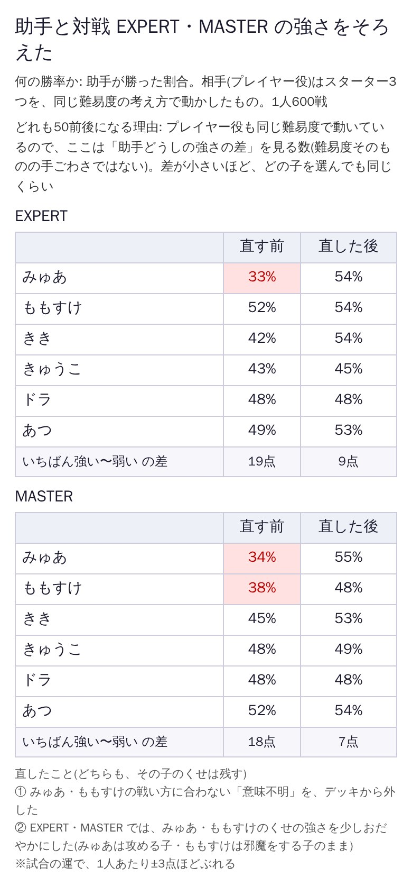
- どれも50前後になるのは、プレイヤー役も同じ難易度の考え方で動いているから。ここは「助手どうしの強さの差」を見る数で、難易度そのものの手ごわさではない。

## パックの絵と開ける演出(社長 台帳 #3503・見本)

- パックの絵: 新しい画像は足さず、画面の中で組み立てる(`CardPackArt`・87)。弾ごとの色の地に光の筋、その弾で出る種族の立ち絵(カードの絵が無い子は立ち絵)を5体並べる。上に「第N弾 / 混血」、下に「ブースターパック / 混血パック」。マーケットのパックの欄のアイコンもこの絵。
  写真(390幅・デバッグ → パックの絵の見本): 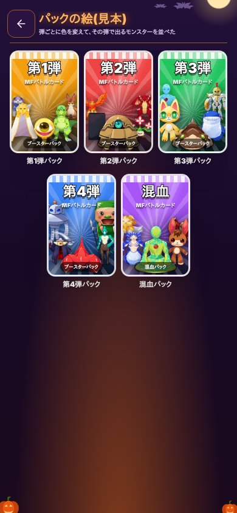
- 開ける演出(`CardPackOpen`): パックを押す → 揺れて上の帯が破れて光る(0.9秒・必殺技の音)→ 裏向きのカードが配られる → 1枚ずつめくる(カードの音)。キラ・別絵キラは裏が光って揺れ、めくると画面が光って音(キラはレベルアップ、別絵キラは合体の音)。「全部めくる」で残りを順にめくる。
  動画(デバッグ → パックを開ける見本。1パック目の最後は別絵キラ・2パック目はキラ): `card-battle/pack-open.mp4`(撮る道具 `node tools/card/card-pack-video.js <フォルダ>`)
- 保存は何もしない(見本)。社長の返事のあとで仕上げる。
- 2回目(カゲあつくん「絵はいい、演出は『派手に』にもう一歩」の4つを足した):
  1. 開ける瞬間: 破れた所から光の柱が立ち、画面が一瞬白く光ってから配る(`CARD_PACK_TEAR_MS` 1.15秒)
  2. キラ・別絵キラは、めくった瞬間に真ん中へ大きく出して1.5秒止め、並びへ戻す(タップで早く戻る)。「全部めくる」もキラ以上ではそこで待つ
  3. 別絵キラは虹色(裏の光・縁・光の筋・画面の光・札)。キラは金色のまま
  4. パックの絵: 真ん中の1体はそのまま、後ろの4体を左右へ広げ、奥の2体は高い所から顔を出す(`CARD_PACK_SLOTS`)
  場面の写真(光の柱・白く光る・別絵キラ・キラ): 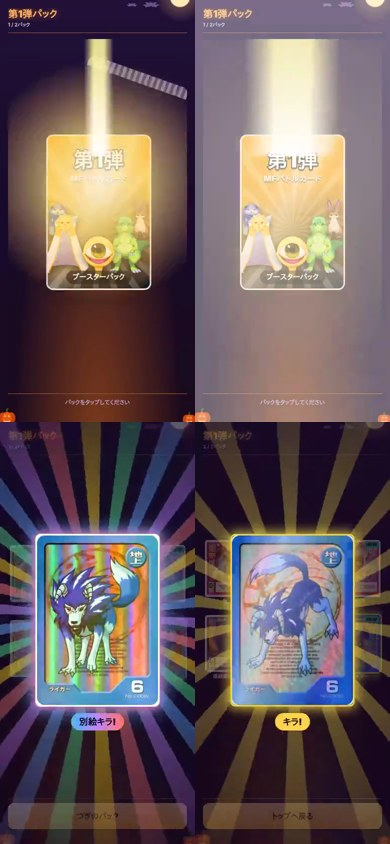

## トップをほかのモードと同じ作りに・ランキング(社長 台帳 #3513)

- トップ: モンヒロビートのモードえらび・モンヒロバトルの入口と同じ部品で組み直した(84)。助手の立ち絵とひとこと(場面 `cardTop`・6人ぶん)・「立ち絵/コメント」の札(`mh_card_top_assist_v1`)・大きい札 2×2(対戦・デッキ編成・マーケット・ランキング)・小さいボタン(カード図鑑・ルール(練習試合)・記録・オプション)。カードポイントは見出しの右、いまのデッキは札の上に小さく。
- 記録: 戦績(助手と対戦)・難易度ごとの勝ち負け・ランキングの記録(今週の勝ち・いまの連勝・最高の連勝)。戦績はトップから記録へ移した。
- オプション: トップの助手の出し入れ。対戦のBGMと演出は「準備中」の札(いまは相手の助手に合わせて曲が変わる)。
- ランキング(90-card-rank.jsx): 勝ち数(今週・通算 × EASY〜MASTER)・連勝・図鑑・マルチ(準備中)。表 `card_battle_ranks` は新しく足すだけ(SQL: `docs/sql/card-battle-ranks/CARD_BATTLE_RANKS_APPLY.sql`。窓口が流す)。
  送るのは公開後のふつうの対戦だけ(`EVENT_REPLAY_RELEASE_FLAGS.cardBattle` が真で、デバッグの人でなく、デバッグの入口でもない)。いまは「見本です」と出して送らない。表が無くても「ランキングは準備中です」と出て壊れない。
- 写真(390幅): `card-battle/top-13.jpg`・`card-battle/ranking-13.jpg`
