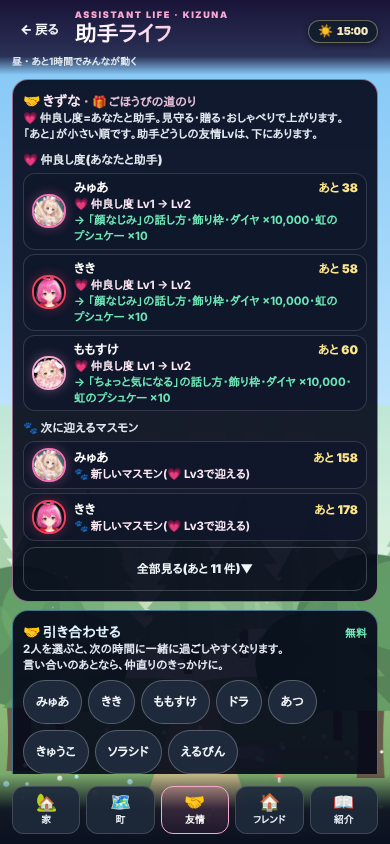
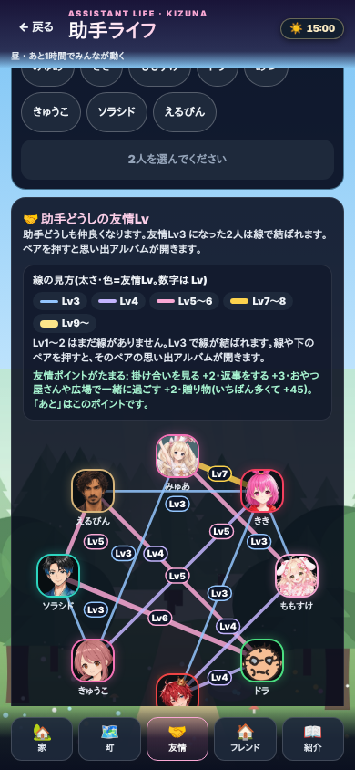
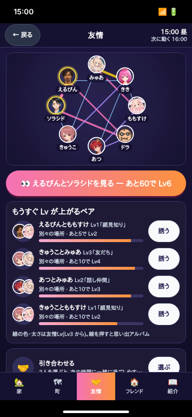
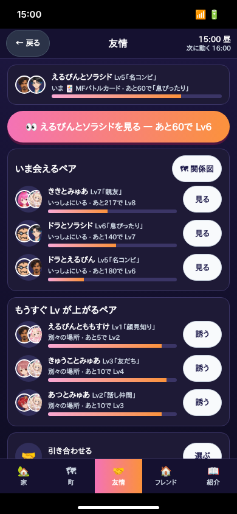
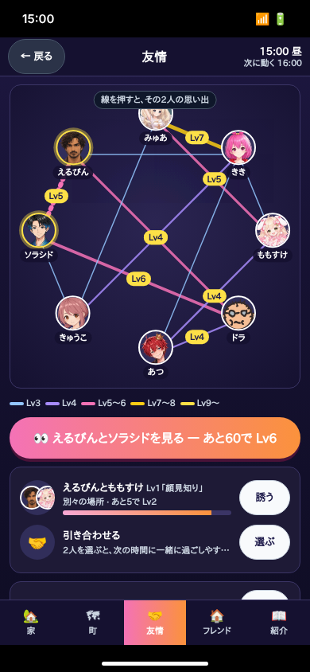

# 助手ライフの作り直し 段10: 友情を型に載せる — 社長に選んでもらう案(2026-11-22 ナカヨシ)

- 元: 仕様書 [`ASSISTANT_LIFE.md`](../../../spec/ASSISTANT_LIFE.md) §5「友情(助手どうし): **いちばん友情Lv が上がりそうなペアを『見る』** / 次に押す物: 関係図の線 / にぎわいの札は家だけ」・§8 段10・型 [`ASSISTANT_LIFE_UI.md`](../../../spec/ASSISTANT_LIFE_UI.md)・前の分かりやすさの直し [`friendship/PLAN.md`](../friendship/PLAN.md)(r1114-091 の A+B: あと◯ポイント・線の Lv)
- 止め絵はどれも縦 390×844・**iPhone の切り欠きあり(上47px・下34px。黒い帯)**・同じ場面(15:00 昼。みゅあ・ききがおやつ屋さん、ドラ・ソラシド・えるびんがMFバトルカード、ももすけがモンヒロバトル、きゅうこが図書室、あつが家)
- 前は本物の画面(before-1・before-2 は送った続き)。案は見本([`mock.html`](mock.html)・本物の型の見た目 `ALU_CSS`・顔の絵)。友情ポイントは [`pairs.json`](pairs.json)(前の画面を開いて読んだ値)。撮り直し: `node tools/assistant/life-friend-plan-shoot.js`
- 3案とも、字は 11・13・16・20px の4段だけ(15px は切り欠きの帯の見本の時刻)・上の帯 48px・下のタブ5つ・主なボタン1つ(366×52)

## 止め絵

| 前(いま) | 前(送った続き) | 案A 型どおり(図は3割) | 案B 一覧が主(図は窓) | 案C 図を大きく |
| --- | --- | --- | --- | --- |
|  |  |  |  |  |

## 案ごとの違い(一言)

- **案A 型どおり(関係図は画面の3割)**: 上に小さめの関係図(線は Lv3 から・上がりそうな2人に黄色の縁)→ 主なボタン「👀 えるびんとソラシドを見る — あと60で Lv6」→「もうすぐ Lv が上がるペア」の行(あと◯の棒・見る/誘う)→ 引き合わせる → ごほうびの道のり(畳む)
- **案B 一覧が主(関係図は「🗺 関係図」で窓に)**: いちばん上に上がりそうな2人の札(棒つき)→ 主なボタン →「いま会えるペア」(同じ場所にいる組・見る)→「もうすぐ上がるペア」(別々の組・誘う)。だれとだれを見ればいいかが一番早く読めるが、図は開くまで見えない
- **案C 関係図を大きく(中身の半分)**: いまの図に近い大きさで、線の上に Lv の札・下に線の色の見かた → 主なボタン → 行は1つ+引き合わせる。つながりの全体は一番見えるが、行は送らないと出ない(町の案A と同じく「場面の絵は3割まで」を外す案)

どの案も: 前の「きずな・ごほうびの道のり」(あなたと助手の 💗)は友情の画面の下に畳む(家の「次のごほうび」と同じ中身のため)。「引き合わせる」は1行(選ぶ → 前と同じ窓)。思い出アルバムは線・行を押すと開く(前と同じ)。

## 突き合わせ表

| 決めごと・参考 | 中身 | 前 | 案A | 案B | 案C |
| --- | --- | --- | --- | --- | --- |
| §5 友情のいちばん押してほしい物 | いちばん友情Lv が上がりそうなペアを「見る」(主なボタン1つ) | 無い(上に 💗 の道のり・図は2画面目) | 図の下 | いちばん上の札の下 | 図の下 |
| §5 次に押す物は関係図の線 | 線を押せる | 2画面目の図 | 3割の図・行 | 「🗺 関係図」で窓 | 大きい図 |
| §5 にぎわいの札は家だけ | 友情に出さない | 出ていない | 出さない | 出さない | 出さない |
| r1114-091 あと◯ポイント・線の Lv | 「あと◯で Lv◯」・線の色と太さ = Lv | 図の上の凡例・カードに「あと◯」 | 行に「あと◯で Lv◯」と棒・図の下に1行 | 行と札に同じ | 線の上に Lv・凡例 |
| r1119-098 切り欠き | 上の帯の「戻る」が時刻に重ならない・下のタブとボタンが隠れない | **「戻る」が上47pxの中**(古い見出しが切り欠きの変数を見ていない) | 帯は切り欠きの下・タブは下34pxの上 | 同じ | 同じ |
| 2026-11-14 言葉の途中で折らない | 行・札の文 | — | 1行(はみ出しは …) | 1行 | 1行 |
| UI §1 下のタブ・5つ目は「📖 紹介」(r1119-075 ①) | | 下に5つ | 下に5つ | 下に5つ | 下に5つ |
| UI §1 時刻の話は上の帯だけ | 「15:00 昼 · 次に動く 16:00」 | 見出しの下に「昼・あと1時間で…」 | 上の帯の右 | 同じ | 同じ |
| UI §2 字は4段・10px 未満なし | | 図の名前・凡例の小さい字 | 11/13/16/20px | 同じ | 同じ |
| UI §5 場面の絵は画面の高さの3割まで | | 図が画面いっぱい | 満たす(約30%) | 満たす(図は窓) | **外れる**(約50%) |
| r1119-039 社長より先に気付く(数字で測る) | 字の段・主なボタンの大きさ・切り欠き | — | 撮る道具が字の段・主なボタン(120×44 以上)・下のタブの下端(810 まで)を測る | 同じ | 同じ |

## 決まったら(段10の画面でやること)

- 選ばれた案で、新UIの友情タブ(`56-assistant-life-house.jsx` の `tab === 'friends'`)を型(`AluFrame`)に載せる。部品は `56-assistant-life-house-typed.jsx` に足す。旧UI は今のまま
- 「いちばん上がりそうなペア」= いまいっしょにいる組のうち、次の Lv まであとが一番少ない組(いっしょにいる組が無いときは、あとが一番少ない組を「引き合わせる」)。計算だけで、保存は何もしない
- 測る道具 `life-house-typed-shoot.js` に友情の場面を足し、切り欠きありの縦横で撮る

## 段10のうち、案を待たずに済ませたもの

- **けんかを rel の1つに**: 3か所に分かれていたけんかの台本の集め方(前からの言い合い・助手たちの今の言い合い・原因つきのけんか)を `56-assistant-life-rel.jsx` の `assistantLifeRelQuarrels` 1つにまとめた
- **台本を data/ へ**: 関係の出来事の台本 `ASSISTANT_LIFE_REL_TALKS`(403本)を `56-assistant-life-rel.jsx` から `data/assistants.js` へ移した(書くのは今までどおり `tools/assistant/life-rel-talks-import.js`)
- 見張り `tools/assistant/life-script-count-check.js`: 思い出アルバムの台本(印 偽 332本・真 1581本)・けんか/仲直り(偽 16本・真 296本)の id・並び・中身が前と同じか
