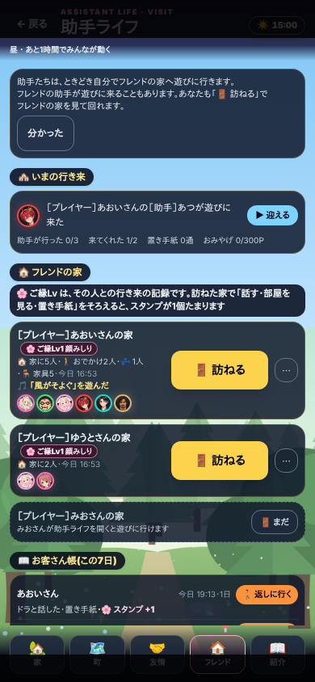
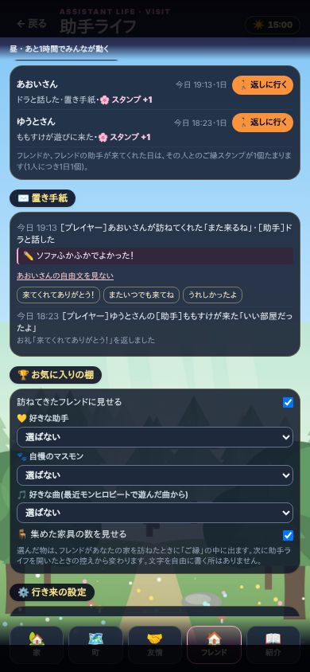
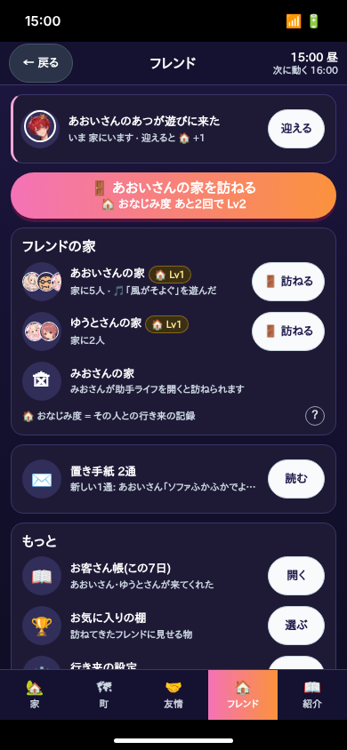
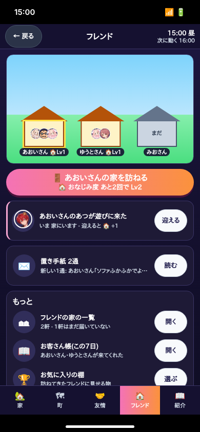
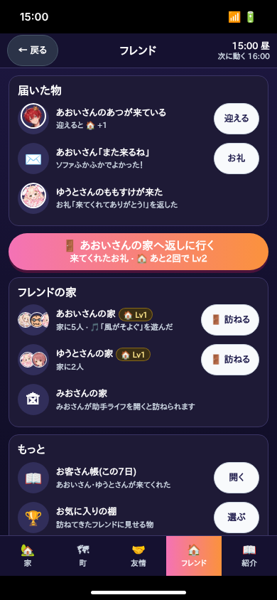
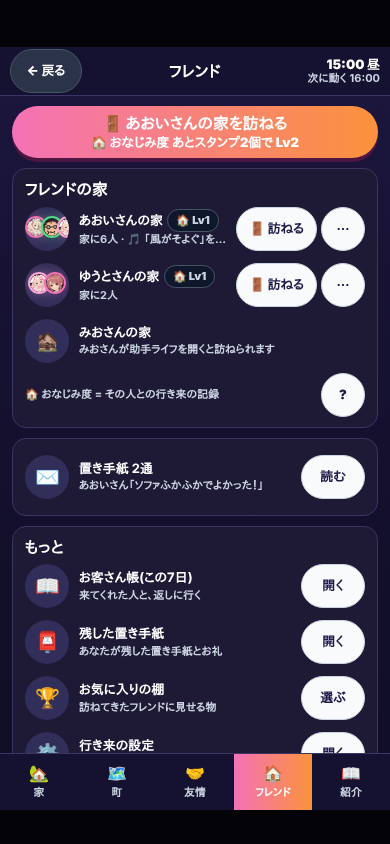
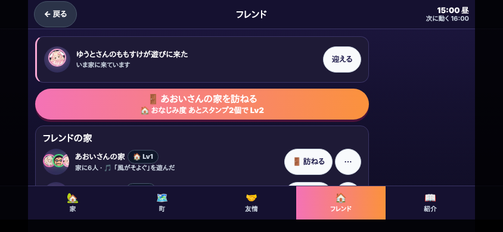
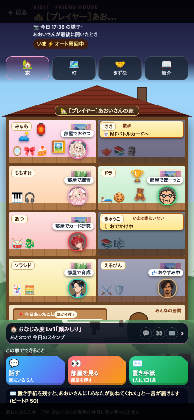
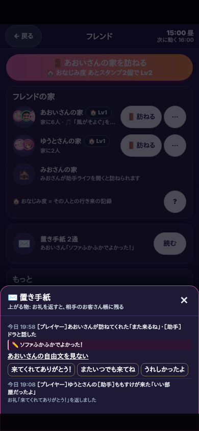
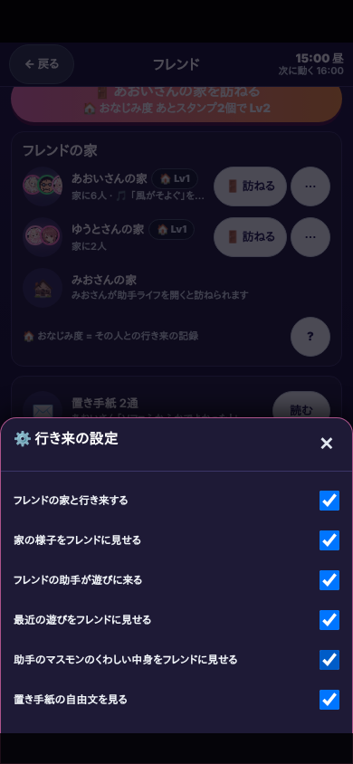

# 助手ライフの作り直し 段11: フレンドを型に載せる(2026-11-22 ナカヨシ・**社長が案A「型どおり」を選んだ**)

- 元: 仕様書 [`ASSISTANT_LIFE.md`](../../../spec/ASSISTANT_LIFE.md) §5「フレンド: **🚪 訪ねる** / 次に押す物: 置き手紙 / 説明の黄色い『分かった』→『?』へ」・§8 段11・型 [`ASSISTANT_LIFE_UI.md`](../../../spec/ASSISTANT_LIFE_UI.md)・名前「🏠 おなじみ度」(r1119-043 ②。案を待たずに入れる)
- 止め絵はどれも縦 390×844・**iPhone の切り欠きあり(上47px・下34px)**・同じ場面(15:00 昼。フレンドは あおい・ゆうと・みお(家がまだ届いていない)。あおいさんのあつが遊びに来ている・置き手紙2通)
- 前は本物の画面。案は見本([`mock.html`](mock.html)・本物の型の見た目 `ALU_CSS`)。撮り直し: `node tools/assistant/life-visit-plan-shoot.js`
- 3案とも、字は 11・13・16・20px の4段だけ・上の帯 48px・下のタブ5つ・主なボタン1つ(366×52)

## 止め絵

| 前(いま) | 前(送った続き) | 案A 型どおり | 案B 家並みの絵 | 案C 届いた物が主 |
| --- | --- | --- | --- | --- |
|  |  |  |  |  |

## 案ごとの違い(一言)

- **案A 型どおり**: 来ている知らせ1行(迎える)→ 主なボタン「🚪 ◯◯さんの家を訪ねる — 🏠 おなじみ度 あと◯回で Lv◯」→ フレンドの家の行(1軒1行・右に訪ねる)→ 置き手紙1行(読む → 窓)→ もっと(お客さん帳・お気に入りの棚・行き来の設定 → 窓)。説明は「?」に畳む
- **案B 家並みの絵(画面の3割)**: 上にフレンドの家を絵で並べる(家の中にいる助手の顔・おなじみ度の札。押すと訪ねる)→ 主なボタン → 知らせ → 置き手紙 → もっと。家の数が多い(10軒〜)と絵が混む
- **案C 届いた物が主**: 来てくれた・置き手紙をいちばん上に集めてその場で迎える/お礼 → 主なボタンは「返しに行く」(来てくれた人がいなければ「訪ねる」)→ 家の行 → もっと。行き来の返事は早いが、訪ねるが2枚目より下になる日がある

どの案も: 主なボタンの相手 = 今日まだ訪ねていない家のうち、来てくれた人 → おなじみ度があと少ない人 の順。迎える・置き手紙・お客さん帳・お気に入りの棚・行き来の設定の中身と保存は今のまま(窓に入れるだけ)。訪ねた家の中(`AlfFriendHouseView`)は今のまま。

## 突き合わせ表

| 決めごと・参考 | 中身 | 前 | 案A | 案B | 案C |
| --- | --- | --- | --- | --- | --- |
| §5 フレンドのいちばん押してほしい物 | 🚪 訪ねる(主なボタン1つ) | 家ごとの黄色いボタン(主が決まらない) | 知らせの下 | 家並みの下 | 届いた物の下(返しに行く) |
| §5 次に押す物は置き手紙 | | 3画面目 | 主なボタンの2つ下 | 2つ下 | いちばん上 |
| §5 説明の黄色い「分かった」→「?」 | | 一番上に説明の箱 | 「?」 | 「?」 | 「?」 |
| r1119-043 ② 🏠 おなじみ度 | 「ご縁Lv」を言い換え | ご縁Lv | 🏠 Lv | 🏠 Lv | 🏠 Lv |
| r1119-098 切り欠き | 「戻る」が時刻に重ならない・下のタブが隠れない | **「戻る」が上47pxの中** | 帯は切り欠きの下 | 同じ | 同じ |
| UI §2 字は4段・10px 未満なし | | 9〜10.5px の字あり | 11/13/16/20px | 同じ | 同じ |
| UI §5 場面の絵は画面の高さの3割まで | | — | 絵なし | 約28% | 絵なし |
| UI §1 時刻の話は上の帯だけ | | 見出しの下に「昼・あと1時間で…」 | 上の帯の右 | 同じ | 同じ |

## 決まったら(段11の画面でやること)

- 新UIのフレンドタブ(`56-assistant-life-house.jsx` の `tab === 'visit'`)を型(`AluFrame`)に載せる。部品 `AssistantLifeVisitTyped` は `56-assistant-life-friend.jsx` の後ろに足す(段10の `56-assistant-life-house-typed.jsx` と別のファイルにして、#7205 とぶつからないようにする)。旧UI は今のまま
- 撮って測る: `node tools/assistant/life-visit-plan-shoot.js --after`(切り欠きの縦横・押したときの動き)

## 入れた後(案A・本物の画面・切り欠きあり)

| 縦 | 横 | 訪ねる(主なボタン) | 置き手紙の窓(下まで送った) | 設定の窓 |
| --- | --- | --- | --- | --- |
|  |  |  |  |  |

- 案の見本との違い: 「送った置き手紙」はヘルプと同じ「📮 残した置き手紙」、「⋯」の中は前と同じ「来ないようにする」。主なボタンの下の行は「あとスタンプ◯個で Lv◯」(スタンプは1軒1日1個のため)
- 窓(`AluSheet`)の中の下の余白に、下の切り欠きの分を足した(縦だけ。友情・部屋の窓も同じ部品)
- 訪ねた家の中(`AlfFriendHouseView`)は前の画面のまま。上の余白は `env(safe-area-inset-top)` で取っていて、撮る道具の切り欠きのまね(CSS の変数)が効かないため、止め絵では「戻る」が上の帯に入って見える(実機は未確認)
