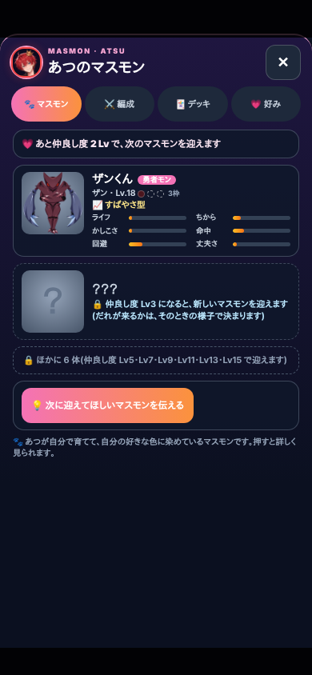
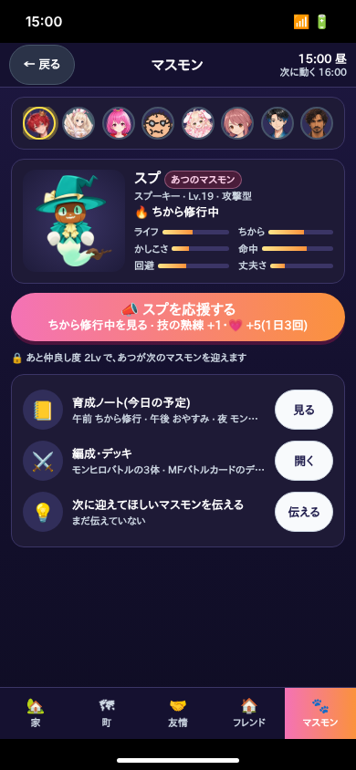
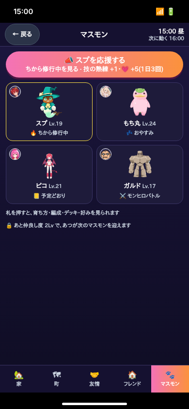
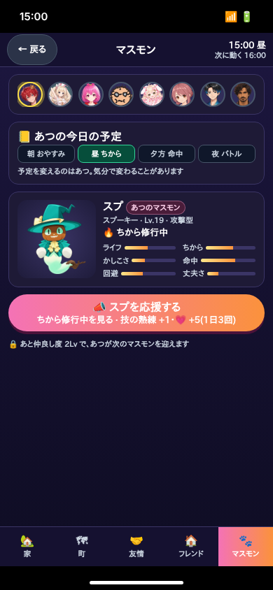

# 助手ライフの作り直し 段12: 下のタブ「🐾 マスモン」の画面 — 社長に選んでもらう案(2026-11-22 ナカヨシ)

- 元: 仕様書 [`ASSISTANT_LIFE.md`](../../../spec/ASSISTANT_LIFE.md) §5「マスモン: **いるマスモンの札(大)と『応援する』** / 次に押す物: 予定(育成ノート) / 7つの『?』の枠 → 1行『あと Lv◯ で次』」・§8 段12・r1119-075 ①(段12で下のタブ5つ目を「📖 紹介」から「🐾 マスモン」へ)・型 [`ASSISTANT_LIFE_UI.md`](../../../spec/ASSISTANT_LIFE_UI.md)
- 止め絵はどれも縦 390×844・**iPhone の切り欠きあり(上47px・下34px)**・15:00 昼。前は本物の画面(あつの部屋 → もっと見る → 🐾 あつのマスモン)。案は見本([`mock.html`](mock.html)・本物の型の見た目 `ALU_CSS`)。撮り直し: `node tools/assistant/life-masmon-plan-shoot.js`
- 3案とも、字は 11・13・16・20px の4段だけ・上の帯 48px・下のタブ5つ(5つ目が 🐾 マスモン)・主なボタン1つ(366×54)
- 主なボタン「📣 ◯◯を応援する」の得は今の応援と同じ(技の熟練 +1・💗 +5・見る/応援を合わせて1日3回)。応援できない時間(助手がモンヒロバトルにいない)は「👀 ◯◯の育ち方を見る」に替わる

## 止め絵

| 前(いま・助手ごとのシート) | 案A 選ぶ列+大きい札 | 案B 全員の札を2列 | 案C 予定が上 |
| --- | --- | --- | --- |
|  |  |  |  |

## 案ごとの違い(一言)

- **案A 型どおり(助手を選ぶ列 + いるマスモンの札(大))**: 顔の列で助手を選ぶ → 大きい札(絵・Lv・型・いま何をしているか・6つの棒)→ 主なボタン「📣 応援する」→ 1行「🔒 あと仲良し度 ◯Lv で次のマスモン」→ 育成ノート・編成とデッキ・次に迎えてほしいマスモンを伝える(窓)
- **案B 全員の札を2列で**: いちばん上に主なボタン → 助手全員のマスモンを札で並べる(応援できる札に黄色の縁)→ 札を押すと今のシート(マスモン・編成・デッキ・好み)が窓で開く。全員の様子は一目で分かるが、1体の育ち方は1回押さないと見えない
- **案C 予定が上**: 顔の列 → 今日の予定(朝・昼・夕方・夜)→ 大きい札 → 主なボタン。予定(育成ノート)は一番見えるが、主なボタンが画面の半分より下になる

どの案も: 今の「?」の枠7つは1行「あと仲良し度 ◯Lv で次のマスモン」に畳む(§5)。中身(育ち方・編成・デッキ・好み・伝える)と保存は今のまま。モンサクの手動の試合(`MonsucMonCard`・`AmbwPanel`)は触らない。部屋の「もっと見る」の「🐾 ◯◯のマスモン」は残す(押すとこのタブのその助手を開く)。

## 突き合わせ表

| 決めごと・参考 | 前 | 案A | 案B | 案C |
| --- | --- | --- | --- | --- |
| §5 いるマスモンの札(大)と応援する | 札は小さい・応援は別の画面 | 大きい札の下 | 札は中・主なボタンは一番上 | 大きい札の下 |
| §5 次に押す物は予定(育成ノート) | 別の画面 | もっとの1行目 | 札の窓の中 | 一番上 |
| §5 「?」7つ → 1行 | 「???」の枠と「ほかに6体」 | 1行 | 1行 | 1行 |
| r1119-075 ① 下のタブ5つ目 | (シートにタブ無し) | 🐾 マスモン | 同じ | 同じ |
| r1119-098 切り欠き | 下のタブの代わりに何もない・✕ | 帯は切り欠きの下 | 同じ | 同じ |
| UI §2 字は4段・10px 未満なし | 9〜10.5px の字あり | 11/13/16/20px | 11/13/16px | 11/13/16px |
| TERMS 「子」と呼ばない | 「次の子」 | 「次のマスモン」 | 同じ | 同じ |
