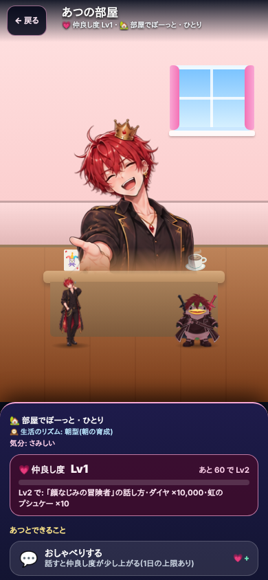
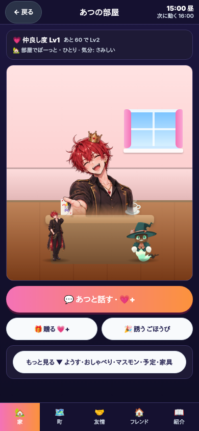
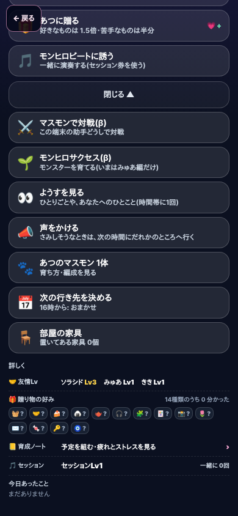
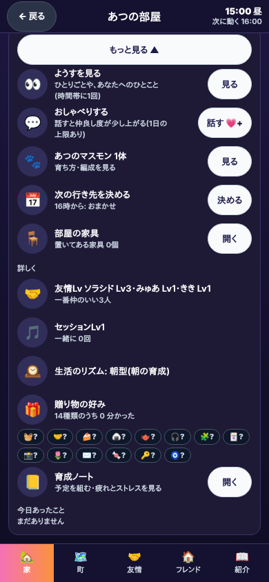
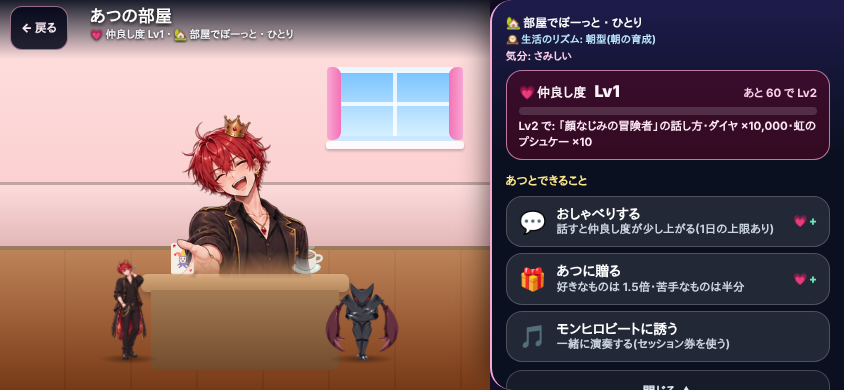
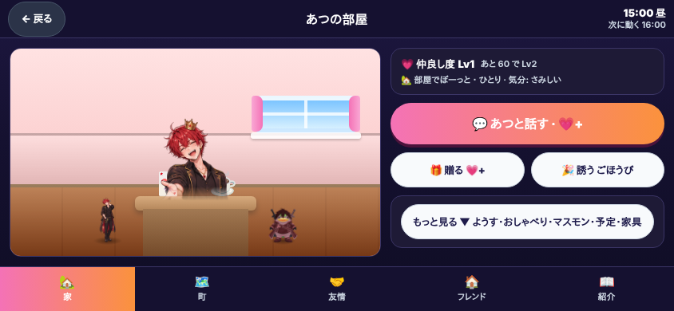
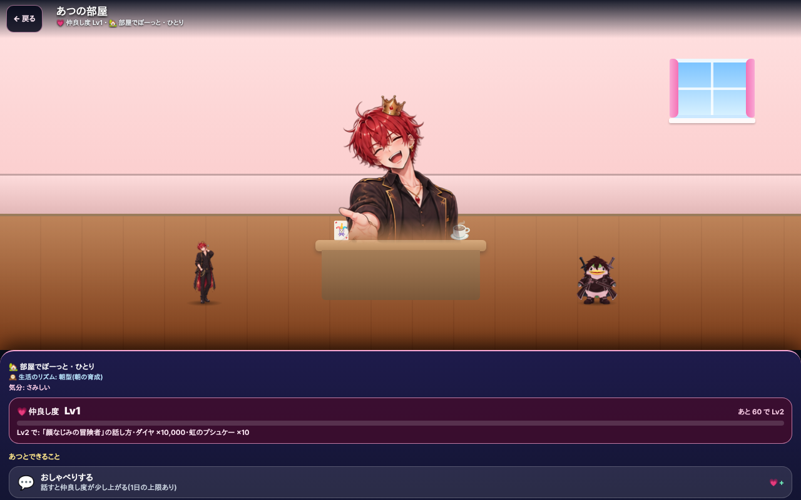
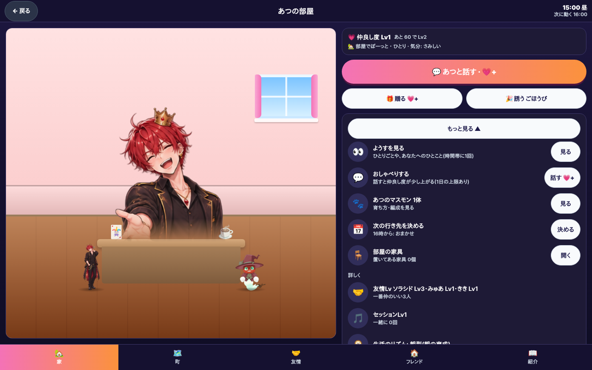

# 助手ライフの作り直し 段8: 部屋を型に載せる(2026-11-22 ナカヨシ)

- 元: [`ASSISTANT_LIFE.md`](../../../spec/ASSISTANT_LIFE.md) §5・§8 段8 / 型 [`ASSISTANT_LIFE_UI.md`](../../../spec/ASSISTANT_LIFE_UI.md) / 配置図 [`overhaul-design/layout-room.png`](../overhaul-design/layout-room.png)
- 止め絵: `before/`(段8の前)・`after/`(段8の後)・`sleep/`(23時・寝ている部屋。ベッドの作りは変えていない)。どれも 15:00・偽のデータ(あつがひとりで部屋にいる)
- 撮り直し: `node tools/assistant/life-house-typed-shoot.js --out docs/progress/assistant-life/step8-room/after`(寝ている部屋は `--phone --hour 23 --rooms dra,kiki,kyuko --out …/sleep`)

| 縦 | 前 | 後 |
| --- | --- | --- |
| 開いたところ |  |  |
| もっと見る |  |  |

| 横・PC | 前 | 後 |
| --- | --- | --- |
| 横 |  |  |
| PC |  |  |

## 配置図との突き合わせ

| 配置図の行 | 段8の後 |
| --- | --- |
| 上の帯「← 戻る / ◯◯の部屋 / 15:00 昼」 | 型の上の帯(部屋の絵の中の題と「← 戻る」は出さない) |
| 💗 Lv・あと◯で次・🌡 調子 | いちばん上の札。2行目に「いまどこで何を・ひとり/だれと・気分」 |
| 部屋の絵(全身が左右で切れない幅) | 前と同じ部屋の絵(縦は画面の半分ほど・PC と横は左の段いっぱい) |
| 💬 話す(主なボタン) | 「💬 ◯◯と話す」(寝ているときは「💤 そっと話しかける」)。場面のあとに結果の1枚 |
| 🎁 贈る・🎉 誘う | 白いボタン2つ。誘うは窓(モンヒロビート・MFバトルカード・マスモン対戦・サクセス) |
| もっと ▼ 予定・マスモン・家具・紹介 | もっと見る ▼(ようす・おしゃべり・マスモン・予定・家具)+ 詳しく(友情Lv・セッション・生活のリズム・贈り物の好み・育成ノート・今日あったこと) |
| 下のタブ5つ | 型の下のタブ(5つ目は段12まで「📖 紹介」) |

## 測った結果(`after/measure.json`)

縦・幅320・横・PC の room・room-more の8枚とも、字は 11・13・16・20px だけ・主なボタン1つ(120×44px 以上)・帯とタブ・はみ出しなし・下の空き 20% まで。

## 残り(次の段で)

- 「📖 ◯◯のこと(紹介)」を「もっと見る」に入れていない(紹介は段12でマスモンのタブに替わるので、そのときに)
- 喧嘩中の札(`AssistantLifeRelSheetRow`)・施設の得(`AssistantLifePlacePerk`)・家具の窓・模様替えは前の部品のまま(字の段は前のまま。段10・段13で)
