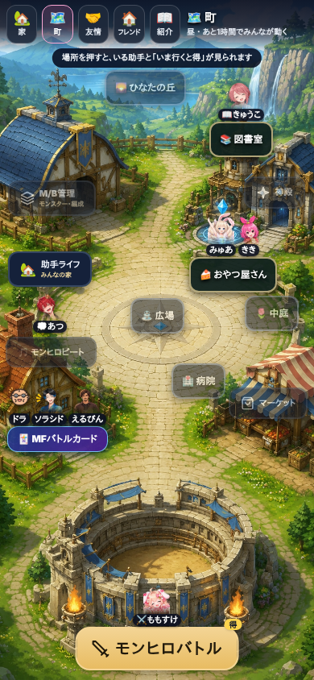
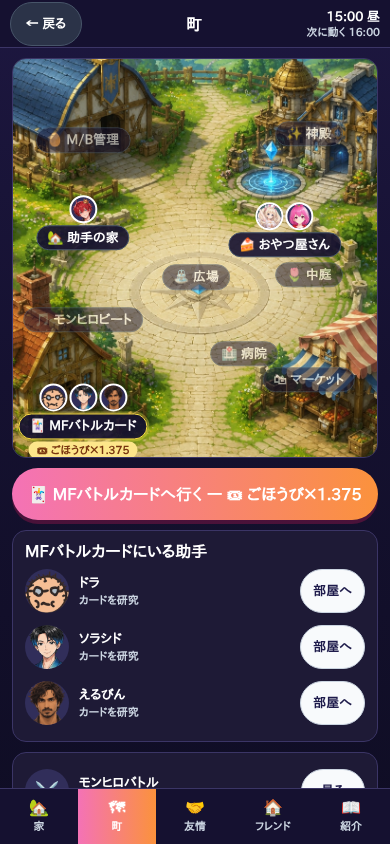
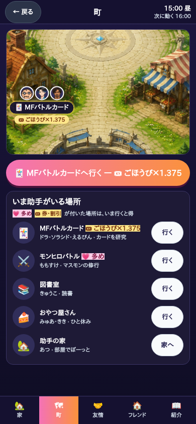
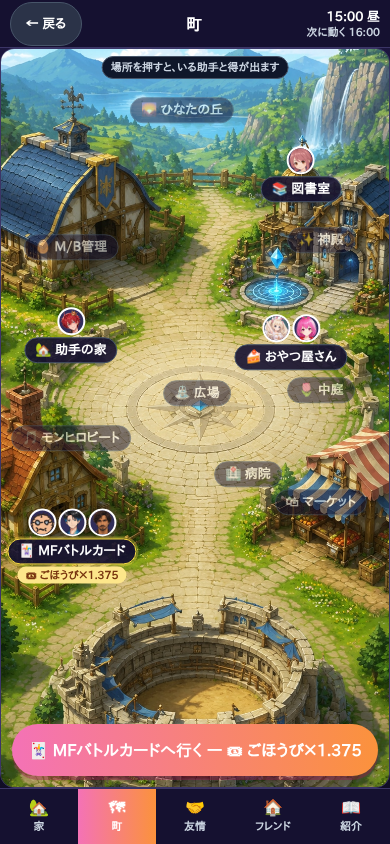

# 助手ライフの作り直し 段9: 町を型に載せる — 社長に選んでもらう案(2026-11-22 ナカヨシ)

- 元: 仕様書 [`ASSISTANT_LIFE.md`](../../../spec/ASSISTANT_LIFE.md) §5「町: **いま行くと得のいちばん大きい場所へ『行く』** / 次に押す物: 場所の札 / 1人の行の5つのボタン → 『部屋へ』1つ」・§3 の38「いま行くと得(6種)→ 2種類(💗 多め・🎟 券・割引)」・§8 段9・型 [`ASSISTANT_LIFE_UI.md`](../../../spec/ASSISTANT_LIFE_UI.md)・配置図 [`layout-town.png`](../overhaul-design/layout-town.png)
- 止め絵はどれも縦 390×844・同じ場面(15:00 昼。ドラ・ソラシド・えるびんがMFバトルカード、ももすけがモンヒロバトル、きゅうこが図書室、みゅあ・ききがおやつ屋さん、あつが家)
- 前は本物の画面。案は見本([`mock.html`](mock.html)・本物の型の見た目 `ALU_CSS` と同じ地図の絵・顔の絵。場所の位置は前の画面で測った [`places.json`](places.json))。撮り直し: `node tools/assistant/life-town-plan-shoot.js`
- 3案とも、字は 11・13・16・20px の4段だけ(10px 未満なし)・上の帯 48px・下のタブ5つ・主なボタン1つ

## 止め絵

| 前(いま) | 案A 地図を大きく | 案B 型どおり(地図は3割) | 案C 地図いっぱい |
| --- | --- | --- | --- |
|  |  |  |  |

## 案ごとの違い(一言)

- **案A 地図を大きく**(配置図どおり): 地図が中身の半分。その下に主なボタン「行く」と、行き先にいる助手の行(部屋へ)。地図も一覧も見えるが、地図の下の方(モンヒロバトルなど)は切れ、送ると続きが出る
- **案B 型どおり(地図は3割)**: 地図は行き先のあたりだけ小さく切り出し、下に「いま助手がいる場所」の一覧(得の札つき・行く)。どこに誰がいて何が得かが一目で読めるが、町の全体は見えない(町の地図は3割の高さに縮めきれないため)
- **案C 地図いっぱい**: いまと同じく町全体を地図で見せ、主なボタンだけ地図の下に浮かせる。場所を押すと型の窓(いる助手の行・行く)。町を歩く感じは一番残るが、誰がどこにいるかの一覧は窓を開くまで出ない

(どの案も、得の札は「💗 多め」「🎟 券・割引」の2種類だけ。いまの「得」の丸い印・6通りの書き方はやめる。いまの得の6つは 🎟 = ビートの券なし・カードのごほうび×1.375・マーケットの1割引き / 💗 = 神殿・モンヒロバトルの修行・M/B管理 に分ける案)

## 突き合わせ表

| 決めごと・参考 | 中身 | 前 | 案A | 案B | 案C |
| --- | --- | --- | --- | --- | --- |
| §5 町のいちばん押してほしい物 | 得のいちばん大きい場所へ「行く」を主なボタン1つで | 無い(地図の札だけ・下にモンヒロバトルの大きい札) | 地図の下「🃏 MFバトルカードへ行く — 🎟 ごほうび×1.375」 | 地図の下に同じ | 地図の下に浮かせて同じ |
| §5 次に押す物は場所の札 | 場所の札を押せる | 地図の札 | 地図の札+行き先の助手の行 | 一覧の行「行く」+地図の札 | 地図の札(押すと窓) |
| §5 1人の行の5つのボタン → 「部屋へ」1つ | 行は右にボタン1つ | 窓の中に5つ | 行「部屋へ」1つ | 行「行く」1つ(場所ごと) | 窓の行「部屋へ」1つ(段9で作る) |
| §3 38 得は2種類 | 💗 多め・🎟 券・割引 | 6通りの文と丸い「得」の印 | 札の下「🎟 ごほうび×1.375」 | 一覧の札「🎟」「💗 多め」と見方の1行 | 札の下に同じ |
| UI §1 下のタブ(町も下)・5つ目は「📖 紹介」(r1119-075 ①) | | 町だけタブが上 | 下に5つ | 下に5つ | 下に5つ |
| UI §1 時刻の話は上の帯だけ | 「15:00 昼 · 次に動く 16:00」 | 帯に「昼・あと1時間でみんなが動く」 | 上の帯の右 | 同じ | 同じ |
| r1119-044 時間帯の呼び名 | 15時は「昼」 | 昼 | 昼 | 昼 | 昼 |
| UI §2 字は4段・10px 未満なし | | 地図の札の小さい字(M/B管理の下の行など) | 11/13/16/20px | 11/13/16/20px | 11/13/16px |
| UI §5 場面の絵は画面の高さの3割まで | | 地図が画面いっぱい | **外れる**(地図 400px=約47%。町は地図そのものが中身なので外す案) | 満たす(250px=約30%) | **外れる**(地図が画面いっぱい) |
| UI §5 下の空きは20%まで | | — | 中身が下へ続く | 約8% | 地図が埋める |
| r1115-031 地図の上の顔の大きさをそろえる | 同じ大きさ | ばらつきは直した後 | 顔は全員 28px | 28px | 28px |
| 2026-11-14 言葉の途中で折らない | 札・行の文 | — | 「カードを研究」は1行 | 一覧の注は1行 | 札は1行 |
| r1119-039 社長より先に気付く(数字で測る) | 字の段・大きさ | — | 撮る道具が字の段を数える | 同じ | 同じ |

## 決まったら(段9でやること)

- 選ばれた案で `56-assistant-life-map.jsx` の新UIの町を型(`AluFrame`)に載せる。旧UI・フレンドの町は今のまま
- 得の2種類の分け方(上の 🎟/💗)を `assistantLifePerkRows` の行に印として足す(判定は今のまま・保存は何もしない)
- 測る道具 `life-house-typed-shoot.js` に町の場面を足し、型の①〜⑦で測る(案A・C を選んだときは「場面の3割」を町だけ外す)
