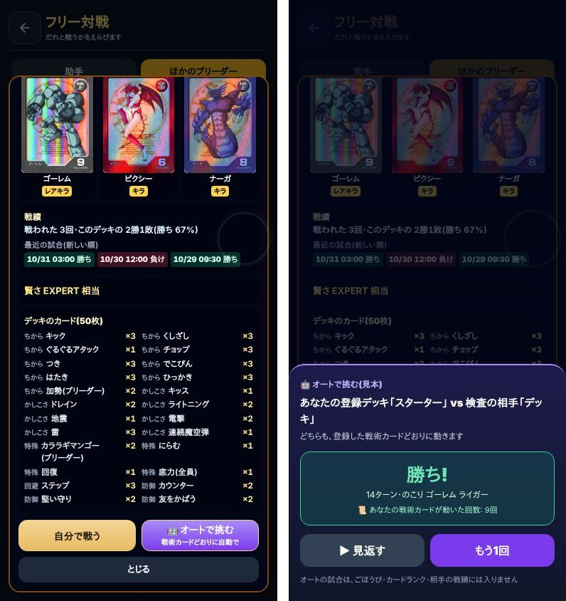
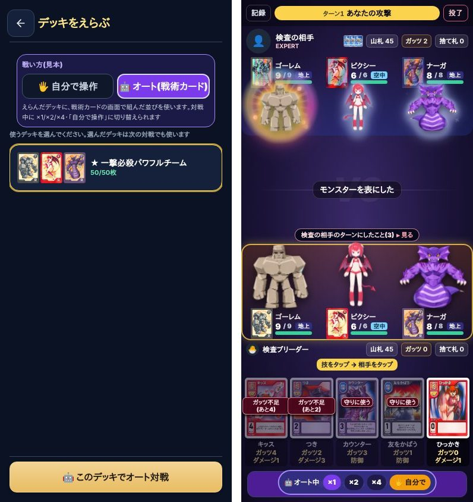
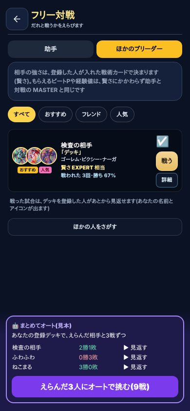

# 戦術カード入りの登録デッキで、こちらからオート対戦を挑む(案・2026-11-02 カード部ソランド)

テスターさんの要望:「バトルカードで、戦術カードを組み入れた登録デッキで、こちらからオートバトルを挑めるようにしてほしい」。
社長が案を選ぶまでは作らない。絵は本物の画面に見本の部品を重ねて撮ったもの(数字・名前は仮)。

## いまの作り(調べた結果)

| 聞かれたこと | いま |
| --- | --- |
| 登録デッキに戦術カードが入っていると、何ができないか | 使えなくなる遊び方は無い。ただ、自分の戦術カードが働くのは「ほかの人が自分の登録デッキと戦うとき」(相手役として動く)と「個人杯・公式杯のオート」だけ。自分が戦うときは、フリー対戦・マルチ対戦とも必ず手で打つので、自分の戦術カードの動きを自分で見る方法が無い(デッキ登録の画面の「おまかせ」が裏で試しに戦わせるだけ) |
| こちらから挑む入口はあるか | 無い。「ほかのブリーダー」の「戦う」は、相手は戦術カードで動き、自分は手で打つ |
| オートの側は戦術カードを使えるか | 使える。個人杯・公式杯のオートと「おまかせ」は、両方の戦術カードで最後まで戦わせている(82 の cardSharePolicy・cardAiChooseAction)。同じ仕組みを、端末の中でそのまま回せる |

つまり、新しいルールは要らない。「自分の側も戦術カードで動かす」入口と、見せ方を作るだけ。

## 戦術カードの使わせ方(3案とも同じ)

- 自分の側も相手の側も、今の相手役と同じ仕組みで動く: 戦術カードの行を上から順に見て、条件が合った最初の行の動きをする。どの行にも合わなければ、その人の「くせ」(助手の打ち方)で動く。切り札(3枚まで)は今と同じ扱い
- 自分の側に使う並びは、案A・C は「登録した並び」、案B は「戦術カードの画面でいま組んでいる並び」(登録前に試せる)
- 自分の戦術カードが動いた回数・どの行で動いたかを、結果と見返しに出す(📜。今の相手の「戦術カードで動いた記録」と同じ出し方)

## 案

### 案A(おすすめ) 詳細から「オートで挑む」→ 結果 → 見返す

- 相手の「詳細」の下を「自分で戦う」「🤖 オートで挑む」の2つにする。オートは自分の登録デッキで、一瞬で最後まで戦わせ、結果(勝ち負け・ターン・戦術カードが動いた回数)を出す。「見返す」で今の見返しの画面で1手ずつ見られる
- 良い所: 入口がわかりやすい・作る所が少ない(見返しの画面をそのまま使う)。悪い所: 登録していないと使えない(「先にデッキ登録を」と案内する)

### 案B デッキ選びで「自分で操作 / オート」を切り替え、対戦画面でそのまま見る

- 「戦う」のあとのデッキ選びで戦い方を選ぶ。オートなら、ふだんの対戦画面で自分の側も勝手に動き、×1/×2/×4 で速さを変えられる。途中で「🖐 自分で」に切り替えもできる
- 良い所: 試合の流れをいつもの画面で見られる・登録前の並びも試せる。悪い所: 作る所が多い(対戦画面の自動送り・切り替え)。途中で手に切り替えられるので、ごほうびの扱いを決める必要がある

### 案C 一覧で何人かえらんで「まとめてオート」

- 一覧で相手にチェックを入れ、3戦ずつまとめて戦わせ、相手ごとの勝ち負けを表で出す。気になる試合だけ見返す
- 良い所: 戦術カードの組み方を何人もの相手で試せる。悪い所: 1回にたくさん回すので端末が少し重い(9戦で数秒)。案A のあとに足すこともできる

## ランキング・記録・保存データへの影響(3案とも)

- **オートの試合は、ビートP・経験値(カードランク)・ランキング・デイリーには入れない**(何回でも回せるので。手で戦う今の「戦う」は今のまま)
- **相手の戦績(戦われた回数・勝ち・最近の試合)にも入れない**。サーバ(card_deck_entries・card_deck_replays)へは何も送らない。SQL は要らない
- 保存: 今のキー(mh_*)は変えない・消さない。結果を残すなら、新しいキー(例 mh_card_auto_log_v1・最近20戦だけ)を足す。残さないなら保存は何も増えない
- 個人杯・公式杯・マルチ対戦は変わらない

## 社長に決めてほしいこと

1. 案A / 案B / 案C(部のおすすめは案A。あとから案C の「まとめて」を足せる)
2. オートの試合で、ごほうび(ビートP・経験値)を少しでも出すか(おすすめは出さない)
3. オートの結果を端末に残すか(残すなら新しいキーで最近20戦)
