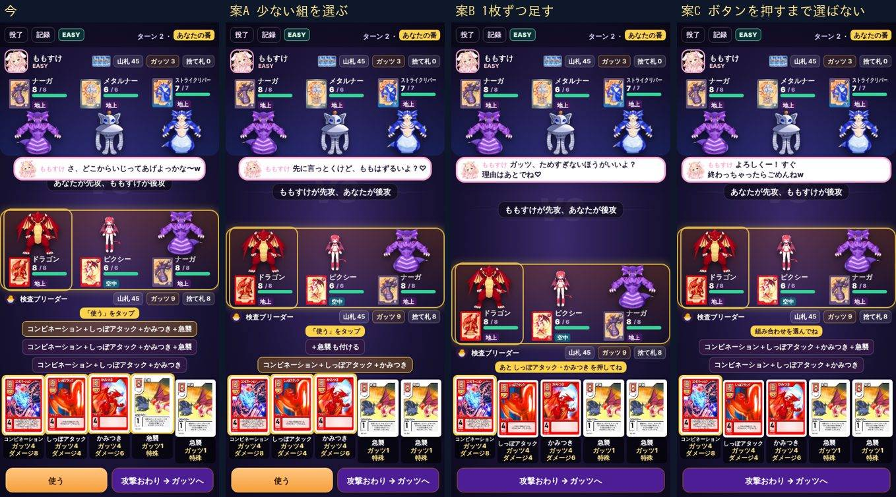
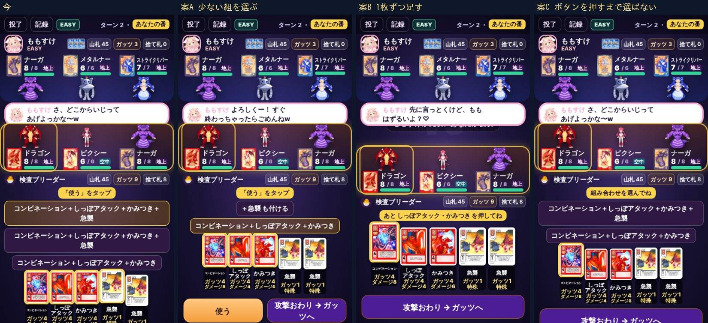

# MFバトルカード 組み合わせの選び方の案(ブレイブくん・2026-10-28)

社長の報告は「組み合わせる系が勝手に選ばれるのが使いにくい」です。場面は MASTER 対ももすけのターン8、手札は次のとおりです。

- コンビネーション(しっぽアタック・かみつきと同時に出す)
- しっぽアタック
- かみつき
- 急襲×2

写真は、本物の画面でコンビネーションを押したところです。案A〜Cは、試しに作った画面で撮りました(まだ作っていません)。
左から「今」「案A」「案B」「案C」の順です。

## 今の何が困るか

- 押した札1枚で出せないと、いちばん枚数の多い組(「＋急襲」まで付いた組)が選ばれる(84 の `setChosen` が `sets[0]` を取る)
- 組み合わせのボタンは、手札の番号の並びで分けている。急襲が2枚あると「コンビネーション＋しっぽアタック＋かみつき＋急襲」が2つ並び、見分けがつかない
- 320×568 では、ボタンが3段になって手札が下へ押され、「使う」のボタンが画面の下で切れる(写真の左)

## どの案にも入れること

- 名前の並びが同じボタンは1つにまとめる(同じ名前の札は、手札の番号の小さいほうを使う)。写真の案A〜Cは、まとめたあとの形
- 助手(AI)の手の選び方は変えない(画面で選ぶ所だけ)

## 案A いちばん少ない組を選ぶ

- 1枚で出せない札を押したら、いちばん少ない組(コンビネーション＋しっぽアタック＋かみつき)に枠を付ける
- 「＋急襲 も付ける」は別のボタンにする。付けたいときだけ押す
- 変わる所: 押した直後に付く札が、必要なぶんだけになる。そのまま「使う」で出せる。ボタンの並びは、少ない組を先にする(写真は逆になっているので、作るときに直す)

## 案B 1枚ずつ足す

- 押した札だけに枠を付ける。付ける札は、手札を1枚ずつ押して足す
- 足りないうちは「あと しっぽアタック・かみつき を押してね」と出す。そろったら「使う」が出る
- 変わる所: 勝手に付く札が無くなる。ボタンの並びも出ない(320 でいちばん低い)。そのかわり、押す回数が2〜3回増える

## 案C ボタンを押すまで選ばない

- 押した札のほかには枠を付けない。「組み合わせを選んでね」と出し、組み合わせのボタンを押すまで選ばれない
- 変わる所: 勝手に選ばれない。ただ、毎回ボタンを1回押す必要がある。320 では、ボタンが2段になる

## 作るときに触る所(84)

- `sets` を作る所: 名前の並びでまとめる
- `setChosen` の決め方: 案A=少ない組/案B・C=選ばない
- 組み合わせのボタンの並び: 案Aの「＋◯◯ も付ける」の言い方。案Bは出さない
- 案内の帯: 案B「あと◯◯を押してね」/案C「組み合わせを選んでね」
- 案Bだけ: 手札を押したときに、組に足す/外すの動き(今の「付ける札を押す」の動きと合わせる)
- 82 と助手の手の選び方は触らない
