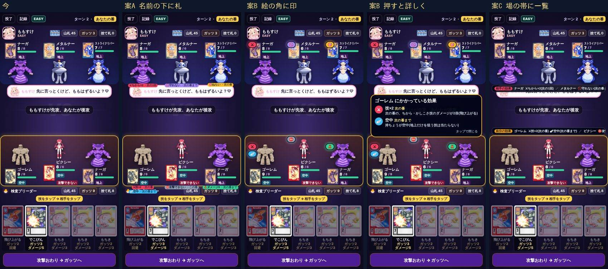
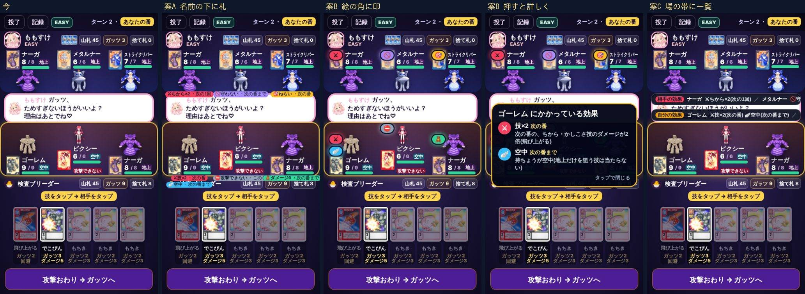

# MFバトルカード 場の子にかかっている効果の見せ方の案(ブレイブくん・2026-10-28)

社長の頼みは「こういう効果がかかってるやつがわからない。バフとかデバフとか」です。例は「飛び上がる」で、効果は次の3つです。

- ちから技を回避する
- 次のターンの自分のちから・かしこさ技のダメージが2倍になる
- 次のターン終了まで、持ちょうを空中にする

写真は、本物の画面に案の飾りを重ねて撮った見本です(まだ作っていません。ルールも変えません)。
左から「今」「案A」「案B」「案B を押したところ」「案C」の順です。

見本の場面では、6体に次の効果を付けています。

| 子 | 効果 |
| --- | --- |
| 自分のゴーレム | 次の番の技×2・空中(飛び上がる) |
| 自分のピクシー | 攻撃できない |
| 自分のナーガ | 次の番までダメージを受けない |
| 相手のナーガ | 次のちから技×2(ためた) |
| 相手のメタルナー | 次の番まで守れない |
| 相手のストライクリパー | ねらいの固定 |

## 今

出ているのは「攻撃できない」と持ちょう(空中・水中)の札だけです。技×2・ダメージを受けない・守れない・ねらいの固定は、画面のどこにも出ません。

## 見せる効果(ルールの項目から拾った。どれも読むだけ)

| 印 | 効果 | ルールの項目 | いつまで |
| --- | --- | --- | --- |
| 技×2 | 次の番の技が◯倍(飛び上がる・怒り) | `mons[].mult` | その番 |
| ちから×2 | 次のちから・かしこさ技が◯倍(ためる) | `mons[].charge` | 次の1回(ダメージを受けると消える) |
| 空中・水中 | 持ちょうが変わる | `airUntil` / `waterUntil` | ◯の番まで |
| 攻撃できない | | `stunTurn` | その番 |
| ダメージ0 | ダメージを受けない(ぬいぐるみ) | `safeUntil` | ◯の番まで |
| 守れない | 回避・防御を出せない | `noGuardUntil` | ◯の番まで |
| まゆ | 羽化のほかは出せない | `cocoon` | 羽化まで |
| ねらい | 相手の攻撃は、この子だけを狙える(狙えない) | `st.taunts` | 次の番 |
| (ブリーダーの帯に) | ガッツを減らされない/回避・防御を使えない/番を飛ばす | `gutsGuardUntil` / `st.forbid` / `st.skip` | |

「◯の番まで」は、「次の番まで」「この番」「次の1回」のように、遊ぶ人の言葉にして出します。

## 案A 名前の下に小さな札

- 子の枠の下に「⚔技×2・次の番」「🪽空中・次の番まで」のような札を並べる
- よいところ: 押さなくても全部読める
- 気になるところ: 1体に2〜3個付くと枠からあふれる。320×568 では、まんなかの吹き出しや下の帯にかかる(写真)

## 案B 絵の角に丸い印・押すと詳しく(すすめ・320でもぶつからない)

- 子の絵の左上に、効果ごとの丸い印を縦に並べる。色で分ける(強くなる=赤・弱くなる/できない=灰と紫・守り=緑・持ちょう=水色・ねらい=金)
- 子を長押し(または印を押す)と「◯◯にかかっている効果」の窓が出る。効果の名前・いつまで・ひとことの説明を並べる
- よいところ: 名前の欄とライフの欄を使わないので、320×568 でもぶつからない。自分・相手・観戦で同じ形
- 気になるところ: 印だけでは中身が分からないので、はじめは押してもらう必要がある。ヘルプに印の一覧を載せる

## 案C 場の帯に一覧

- 自分の場と相手の場の帯に「相手の効果: ナーガ ちから×2(次の1回)/メタルナー 守れない(次の番まで)…」を1行で出す。押すと全部
- よいところ: 子の枠を触らない
- 気になるところ: 1行に入り切らない(写真でも切れている)。どの子の効果かを、名前で読み合わせる必要がある

## 作るときに触る所(84)

- `CardMonSlot`: 絵の左上に印の列を足す(案B)。`guardTag`・当たりの結果(#4165)とは場所を分ける
- 新しい部品: `cardMonStatuses(db, st, p, m)`(上の表から、その子の効果を並べて返す。読むだけ)と、`CardStatusSheet`(押したときの窓)
- 長押しは、今ある `press` の仕組みに乗せる。カードの長押し(詳しい画面)とは、対象が違うのでぶつからない
- 観戦(94): `CardMonSlot` を使っている所は、そのまま同じ印が出る。横の小さい表示(`CardWatchMonMini`)は、観戦の作り直しで同じ部品をつなぐ
- 82 は触らない
