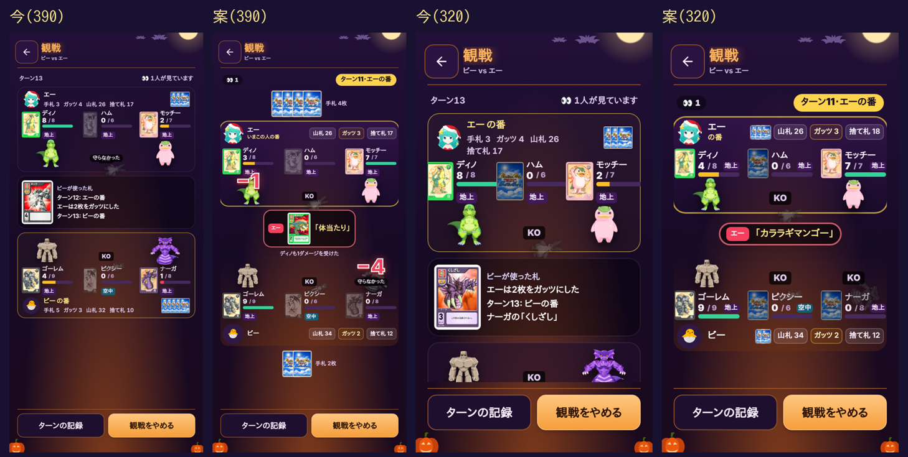

# 観戦の画面を、対戦の画面と同じ見た目にする案(2026-10-27・カード部ナガメ)

社長の方針「観戦画面が見づらい → 実際に遊ぶ対戦の画面にできるだけ似せる。手札は両方とも裏のまま」の案。
写真は左から「今(390)」「案(390)」「今(320)」「案(320)」。同じ試合の途中を写した(ターンは写した時で違う)。

## 変わる所
1. いちばん上に「ターン◯・◯◯の番」を金色の札で大きく出す(対戦の画面の「あなたの番」と同じ札)。番の人の場は金の枠で囲む
2. 2人の場を、対戦の画面と同じ並びにする(顔・名前・山札/ガッツ/捨て札の丸札の帯 → モンスター → まんなか → モンスター → 帯)。320 の幅では対戦の画面と同じ小さい形にして、下の人の場まで画面に収める(今は 320 で下の場が画面の外に出て、左の札も切れている)
3. まんなかは、対戦の画面と同じ「使った技の箱」(だれ・札の絵・「技名」。上の人=赤・下の人=金)。ダメージの数字や「守らなかった」も対戦の画面と同じに出る。決着したら、まんなかに決着の帯(「◯◯さんが投了しました」「△△さんの勝ち！」。止めてある直し claude/card-watch-end をこの形に合わせて入れる)

## 手札の伏せ方
- 両方とも裏のまま。表は一度も出さない(今と同じ。山札も全部仮の札で、観戦の知らせには手札の中身が流れない作りはそのまま)
- 390 の幅: 上の人の手札は場の上、下の人の手札は場の下に、裏の札を並べて「手札 ◯枚」
- 320 の幅: 帯の中に小さい裏の札で並べる(対戦の画面で相手の手札を出しているのと同じ形)
- 横向き(844×390 など)は、今の小さい形のまま(このあと同じ部品で合わせる)

## 更新履歴の文の案
**マルチ対戦の観戦が見やすくなりました**
観戦の画面を、対戦の画面と同じ並びにしました。いまどちらの番かが上に大きく出て、使われた技はまんなかに大きく出ます。
投了や時間切れで終わったときも、だれの勝ちかがまんなかにはっきり出ます。手札はこれまでどおり、両方とも伏せたままです。

## ヘルプの文の案(MFバトルカード → マルチ対戦 → 観戦)
観戦の画面は、対戦の画面と同じ並びです。上の金色の札で、いまどちらの番かが分かります。使われた技はまんなかに出ます。
手札は両方とも伏せたままで、枚数だけが見えます。対戦が終わると、まんなかにだれの勝ちかが出ます。
