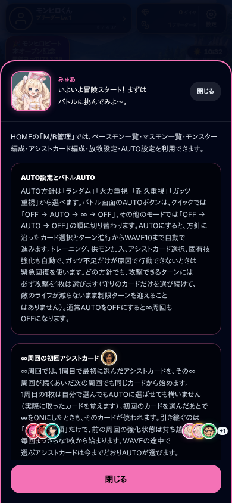
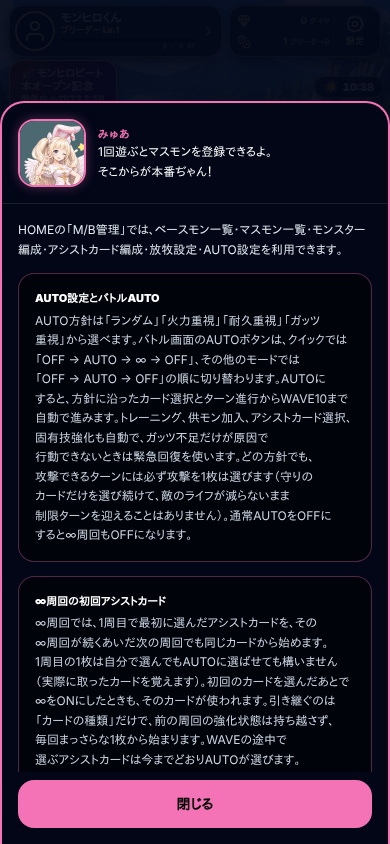
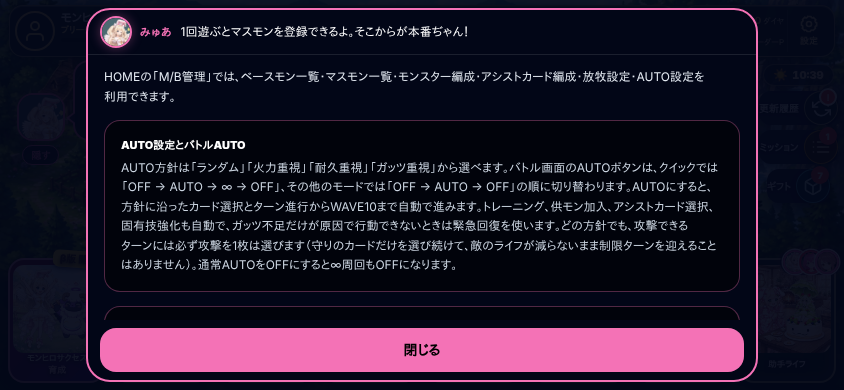

# まとまり2 HOME の助手の説明の窓(r1119-080・点検 #7059 screens/home.md)

| 前 | 後 |
| --- | --- |
|  |  |
|  |  |

- 右上の小さい「閉じる」を消し、下の大きな「閉じる」1つに
- 窓を document.body へ出し、HOME の札に重ねた助手の顔の束が本文の上に出なくなった
- 横の低い画面: 顔 32px・セリフ1行・閉じる 44px・窓を真ん中に置き下に余白。本文が3行 → 約8行見える
- 「OFF → AUTO → ∞ → OFF」「∞周回」を折らない(ヘルプ画面も同じ部品なので一緒に直る)
- 助手の吹き出しの名前 9px → 11px(どの画面の吹き出しも)

横の「上が安全な領域にかかる」は、点検でも空振りとした件(横の切り欠きは左右)。窓は実機の安全な領域(--mh-sa-top)を空ける。
