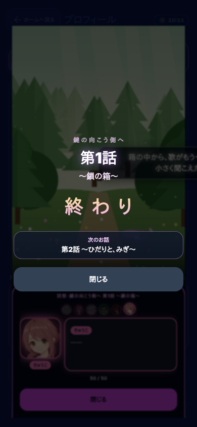
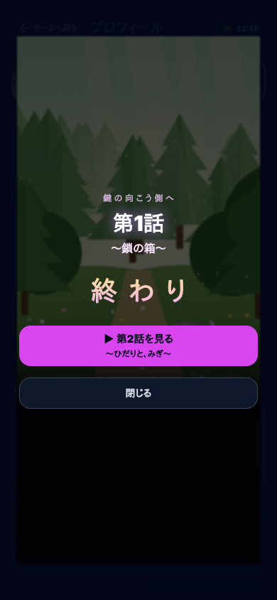
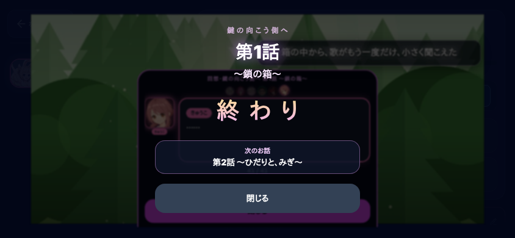
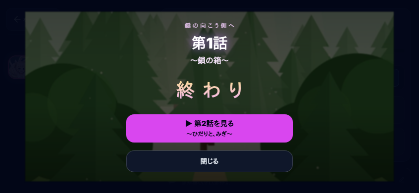
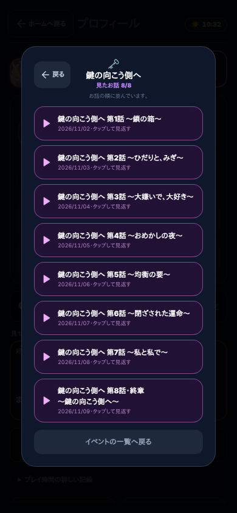
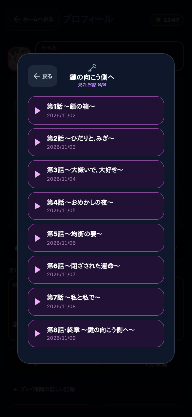
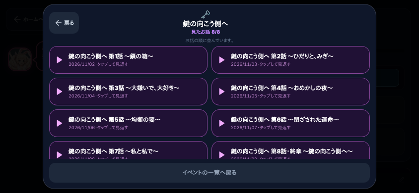
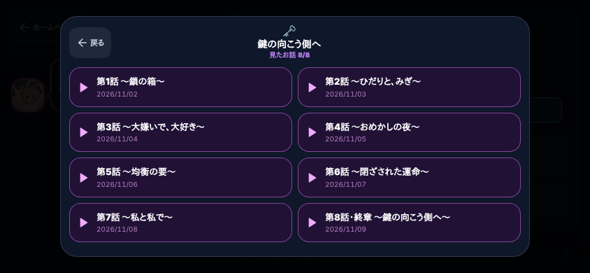

# まとまり3 回想の締めと回想の一覧(r1119-080・点検 #7059 screens/home.md)

| 前 | 後 |
| --- | --- |
|  |  |
|  |  |
|  |  |
|  |  |

お話の締め(終わりの札)
- 締めのあいだは台詞の窓と場面の説明の帯を消す(半透明の幕ごしに「閉じる」と題が二重に見えていた)
- 回想で、次のお話をもう見たことがあれば「▶ 第2話を見る」を色付きの主ボタンにして、そのまま次を流す。「閉じる」は控えめに
  (本編で流したときと、まだ見ていない次のお話は今までどおり予告の札)
- 「終 わ り」「鍵 の 向 こ う 側 へ」の字間の分の中心ずれを直す(幕開けの札も)

回想の一覧(まとまりを開いた所)
- 下の「イベントの一覧へ戻る」を外し、戻るは左上の1つに
- 9px の「お話の順に並んでいます。」を外す
- 続きものの行は「第1話 ～鎖の箱～」だけを大きく出し、「タップして見返す」を外す(▶ の印で押せる)

残し: 縦の締めの下の空き(主役の立ち絵を置く案)は見た目の作りが変わるので、社長の確認があれば別に。
