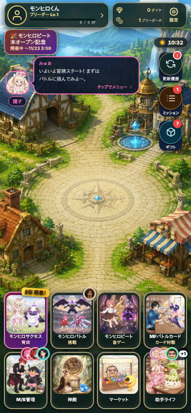
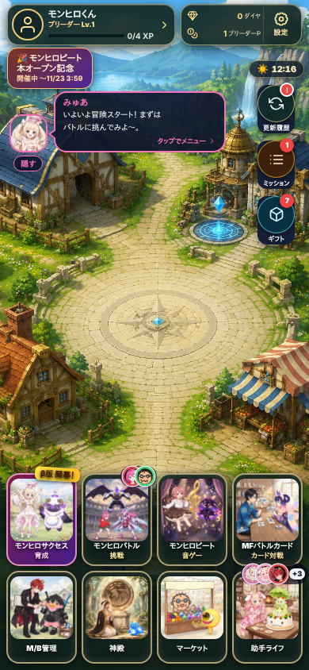
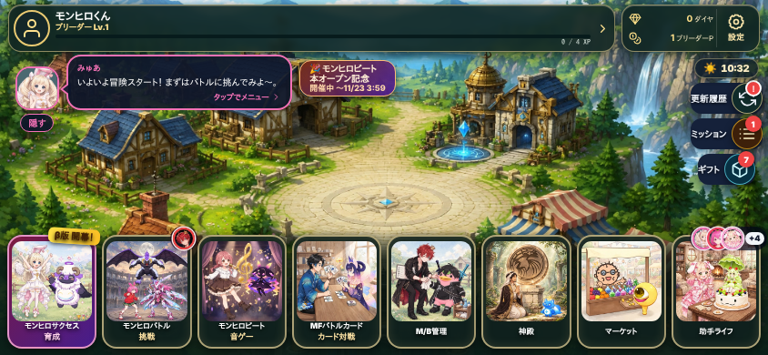
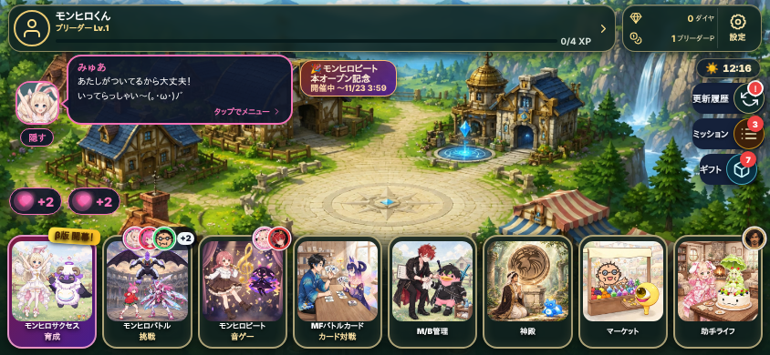
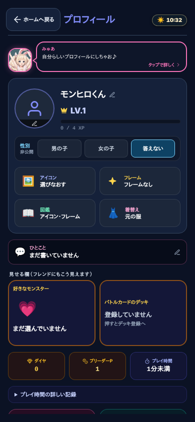
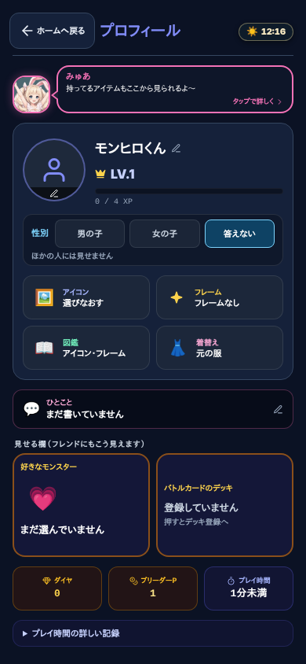
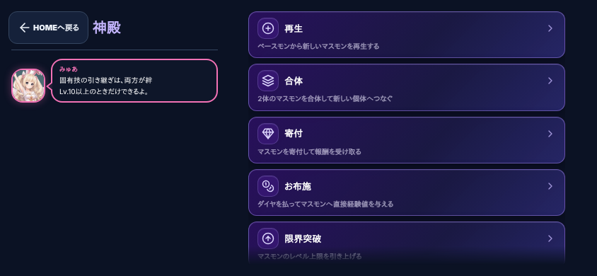
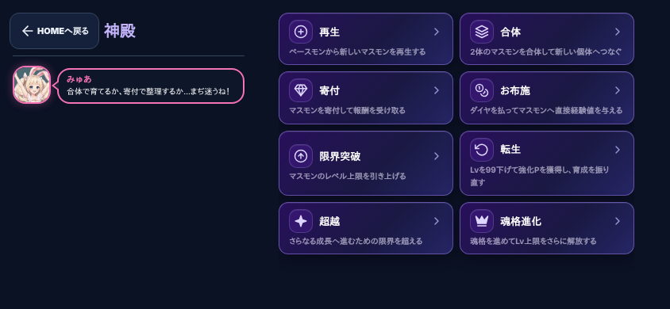

# まとまり4 HOME の上の帯・プロフィール・神殿(r1119-080・点検 #7059 screens/home.md)

| 前 | 後 |
| --- | --- |
|  |  |
|  |  |
|  |  |
|  |  |

- HOME の上の帯: 「0 / 4 XP」(8px の等幅)を、XP の棒の右に 10px で並べる。札の高さは変えない
- HOME の「設定」を 43×42 → 44×44
- プロフィール: 性別の左の「非公開」(「答えない」と同じ意味に読めた)を外し、下に「ほかの人には見せません」
- 神殿: 横の低い画面は入口を2列に(5つ目から先が切れていた)
- 更新履歴が開かない件: 今の撮影では開いている(前の撮影の手順のせい)。直す物なし

残し(社長の確認か別の部): 時刻の札が押せるかの見分け・横の右のボタンの形(縦とそろえる)・「ダイヤ」の 8px・HOME の大きな配置替え。
