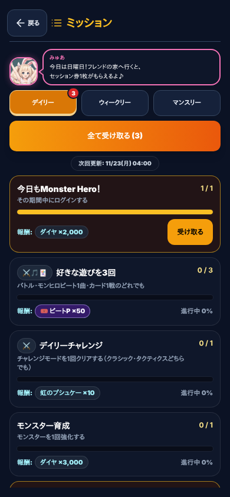
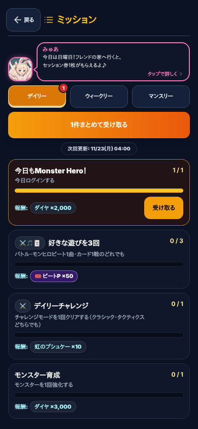

# 吹き出しの「タップで詳しく」(r1119-080)

| 前 | 後 |
| --- | --- |
|  |  |

- ミッションのデイリーの吹き出しにも説明(ミッション)を付け、「タップで詳しく」で開くように。ギフト・プロフィールとそろう
- 神殿は、神殿全体の説明のヘルプが無いので付けていない(ヘルプの項目を新しく作るかは窓口の判断)
- HOME は「タップでメニュー」(おしゃべりと説明の2つ。r1119-050 の決め)のまま
- 「タップで詳しく」の字を 9px → 10px(行の高さは前と同じ)
