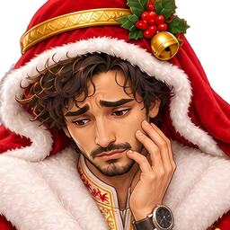

# 事件簿 通し読み(あつ派・A1 → 強制バッド3つ → 真グッド)

`node tools/novel/xmas-novel-route-trace.js --out docs/progress/event-xmas-2026` で作った一覧(手で直さない)。画面と同じ手順で、生成物の台本をたどった順。

| 番号 | 顔 | 話し手 | 台詞・帯 |
| --- | --- | --- | --- |
| 0-1 |  | 帯 | 聖夜の名探偵 序章 〜届いたゲーム〜 |
| 0-2 |  | 帯 | 11月の終わり。モンヒロの広場 |
| 0-3 |  | みゅあ(わくわく) | ねえねえ、あつくん！ もうすぐクリスマスぢゃん！ 今年は何する？ |
| 0-4 |  | あつ(笑顔) | みゅあ、気が早いって笑 ……ん？ ベンチの上に、なんか置いてある |
| 0-5 |  | 帯 | 茶色い紙に包まれた、小さな小包。宛名は「モンヒロの助手のみなさまへ」。差出人の欄は、空っぽ |
| 0-6 |  | きき(困り顔) | 差出人が、書いてないでつ…… |
| 0-7 |  | ソラシド(ふつう) | ワトソンくん、送り状を調べてください |
| 0-8 |  | ワトソンくん | 消印がありません。……誰かが、直接ここへ置いたようです |
| 0-9 |  | ドラ(わくわく) | 開けてみようぜ！ 食い物かもしれないし。えへへ |
| 0-10 |  | 帯 | 中には、古いゲームソフトが1本。ラベルには『モンヒロ事件簿 ―呪いのセーブデータ― 十三番目の鐘』 |
| 0-11 |  | ももすけ(困り顔) | 呪いの……セーブデータ？ ちょっと怖いんだけどw |
| 0-12 |  | えるびん(ふつう) | ……古いね。誰のだろう |
| 0-13 |  | 帯 | 起動すると、セーブデータが1件だけ。名前の欄は、文字がにじんで読めない |
| 0-14 |  | ソラシド(ふつう) | 誰かが、途中まで遊んだデータ……でしょうか |
| 0-15 |  | ワトソンくん | 保存された日付は、読みとれません |
| 0-16 |  | あつ(ふつう) | じゃあ、新しく始めるか。……『はじめから』 |
| 0-17 |  | 帯 | 画面に、雪山のペンションと、登場人物の紹介が流れる |
| 0-18 |  | みゅあ(驚き) | ……え、待って。この子、あたしにそっくり！ |
| 0-19 |  | ドラ(驚き) | おでもいる！ 帽子まで同じだぞ！ |
| 0-20 |  | きゅうこ(笑顔) | ほい、俺までいるじゃん笑 ……髪の色まで、そっくりだよぉ |
| 0-21 |  | ソラシド(ふつう) | ……全員です。自分たちが、一人残らず |
| 0-22 |  | えるびん(困り顔) | 俺のことまで、知ってるのかな…… |
| 0-23 |  | あつ(わくわく) | おもしろそうじゃん！ みんなで解こうよ、この事件！ |
| 0-24 |  | みゅあ(笑顔) | あつくんが遊ぶなら、あたしも！ 助手として、隣で見てる！ |
| 0-25 |  | 帯 | 画面いっぱいに、題字 ——『モンヒロ事件簿 ―呪いのセーブデータ― 十三番目の鐘』 |
| 0-26 |  | 帯 | ——ゲームの中。11月の終わり。モンヒロの広場 |
| 0-27 |  | 帯 | 晴れた空から、雪がひとひら。それは、雪の結晶の形をした封筒だった |
| 0-28 |  | きき(驚き) | ひんやりしてまつ……。宛名は『モンヒロの助手のみなさまへ』でつ |
| 0-29 |  | 帯 | 招待状——『雪山のペンション・シュプールで、クリスマス会をいたしませんか。お一人一つ、プレゼントの箱をお持ちください。24日の夜に、みんなで開けましょう。——シュプールのオーナー イチーカ』 |
| 0-30 |  | ももすけ(わくわく) | 雪山のペンションでクリスマス会！？ かわいすぎ〜♡ |
| 0-31 |  | えるびん(困り顔) | ……俺も、行っていいのかな。来たばかりだし |
| 0-32 |  | きゅうこ(ふつう) | 宛名、『助手のみなさま』だよぉ。えるニキも、ちゃんと入ってる |
| 0-33 |  | えるびん(笑顔) | ……そっか。ありがとう、きゅうこちゃん |
| 0-34 |  | 帯 | 次の日。プレゼント選び。みゅあは、毛糸をどっさり買い込んでいる |
| 0-35 |  | みゅあ(ウインク) | 何に使うかは、ナイショ！ |
| 0-36 |  | ドラ(わくわく) | なあ、みんな何にした？ 箱、ちょっと振らせてくれよ |
| 0-37 |  | ももすけ(むくれ顔) | だめ！ ドラちゃん、当日まで振るの禁止w |
| 0-38 |  | 帯 | 出発の朝。町に、今年初めての雪が降り始めた |
| 0-39 |  | ソラシド(ふつう) | 全員、そろいました。プレゼントは8つ。……ワトソンくん、出発の時刻を記録してください |
| 0-40 |  | ワトソンくん | 記録しました。行き先、ペンション・シュプール |
| 0-41 |  | 帯 | ——遠い雪山の上。誰もいないホールで、古い柱時計が、一つ鳴った |
| OUT-1-1 |  | 帯 | 画面の前。外は、もう暗い |
| OUT-1-2 |  | ももすけ(ふつう) | ねえ、ゲームの中のもも、ペンションに行くんだって |
| OUT-1-3 |  | ソラシド(困り顔) | ……画面の隅に、『このデータは、上書きできません』と出ています |
| OUT-1-4 |  | あつ(ふつう) | 上書きできない？ ……まあいいや。続き、いこう |
| OUT-1-5 |  | 帯 | ——ゲームの中へ |
| 1-1-1 |  | 帯 | 聖夜の名探偵 第1章 〜ペンション・シュプール〜 |
| 1-1-2 |  | 帯 | 12月18日。町から電車とバスを乗りついで、最後に雪の山道を登った先 |
| 1-1-3 |  | みゅあ(わくわく) | 見えた！ あつくん、あれぢゃない！？ 屋根まで雪で真っ白！ |
| 1-1-4 |  | あつ(笑顔) | でっか！ 雪山のペンションって、それだけでワクワクする笑 |
| 1-1-5 |  | えるびん(ふつう) | ……静かだね。雪が、音を全部吸いこんでるみたい |
| 1-1-6 |  | ソラシド(ふつう) | ワトソンくん、到着の時刻を |
| 1-1-7 |  | ワトソンくん | 記録しました。12月18日、15時12分。……電波は、ここから弱くなります |
| 1-1-8 |  | きゅうこ(ふつう) | (ペンションを見上げて、少しの間、立ち止まっている) |
| 1-1-9 |  | ももすけ(ふつう) | きゅうちゃん、どしたの？ 寒い？w |
| 1-1-10 |  | きゅうこ(笑顔) | 何でもないって。……きれいだなって思っただけ笑 |
| 1-2-1 |  | イチーカ | ようこそ、ペンション・シュプールへ。オーナーのイチーカです。ふふっ、遠い所を、ありがとうございます |
| 1-2-2 |  | もちまる | 世話役のもちまるだっちー！ ごはんと、暖炉と、夜の見回りは、ぼくにまかせてっちー |
| 1-2-3 |  | ドラ(わくわく) | ごはんの係！ もちまる、おで、おまえとは仲良くなれそうだ |
| 1-2-4 |  | 帯 | ホールの真ん中に、大きなもみの木。その奥の壁に、古い柱時計 |
| 1-2-5 |  | イチーカ | プレゼントは、木の下に置いてくださいね。24日の夜に、みんなで開けましょう |
| 1-2-6 |  | もちまる | ぼくは世話役だから、箱は無いっちー。その代わり、毎朝おいしいごはんを作るっちー |
| 1-2-7 |  | きき(ふつう) | 私のは、緑のリボンで2回結んでありまつ |
| 1-2-8 |  | 帯 | 木の下に、助手たちの箱が8つ。にぎやかな色のリボンが、暖炉の火に揺れている |
| 1-2-9 |  | あつ(ウインク) | で、ばこっちゃん。その格好、俺とかぶってるんだけど笑 |
| 1-2-10 |  | ソラシド(ふつう) | かぶっているのは、あつさんのほうです。自分は、先週から決めていました笑 |
| 1-2-11 |  | ワトソンくん | 記録によれば、お二人は同じ日の同じ時刻に、同じ売り場にいました |
| 1-2-12 |  | みゅあ(ウインク) | はいはい、名探偵が二人！ 助手のあたしは、あつくんのほうね！ |
| 1-3-1 |  | 帯 | ドン、ドン(玄関の扉を、強く叩く音) |
| 1-3-2 |  | 黒羽 | 開けたまえ。予約はしてある。……吹雪の中で待たせるとは、時間の無駄だ |
| 1-3-3 |  | 帯 | 灰色の長いコートの男。後ろに、白いケープの女が、目を伏せて立っている |
| 1-3-4 |  | イチーカ | あの……今日は、貸し切りのはずで……。ご予約のお名前は？ |
| 1-3-5 |  | 黒羽 | 黒羽だ。黒羽宗一郎。こっちは白瀬。招待状をよこしたのは、そっちだろう |
| 1-3-6 |  | 白瀬 | 白瀬と申します。……突然、ごめんなさい |
| 1-3-7 |  | 帯 | 黒羽が出した封筒。雪の結晶の形——でも、助手たちの物と違い、色は黒い |
| 1-3-8 |  | ソラシド(ふつう) | ……読んでも、いいですか |
| 1-3-9 |  | 帯 | 『12年前の聖夜の客へ。あの夜のクリスマス会を、もう一度。プレゼントの箱を一つ持って、ペンション・シュプールへお越しください。——黒いサンタ』 |
| 1-3-10 |  | イチーカ | ……わたしは、こんな手紙、出していません |
| 1-3-11 |  | 黒羽 | くだらん。いたずらなら、いたずらで結構。雪がやむまでは泊めてもらう。時は金なり、だよ |
| 1-3-11b |  | 帯 | 黒い招待状にも「プレゼントの箱を一つ」とあった。黒羽は面倒そうに小さな箱を木の下へ置き、白瀬も、そっと包みを置く |
| 1-3-11d |  | 帯 | 木の下の箱は、10になった |
| 1-3-12 |  | 白瀬 | (小さく)……12年前…… |
| 1-3-12c |  | 手がかり | 黒羽と白瀬に届いた、黒い雪の結晶の招待状。「12年前の聖夜の客へ」。差出人は「黒いサンタ」。イチーカは出していない |
| 1-3-13 |  | えるびん(困り顔) | ……12年前って、何のことだろうね |
| 1-3-14 |  | あつ(ふつう) | さあ。……でも、ちょっと気になる |
| 1-4-1 |  | ももすけ(困り顔) | ねえ、黒いサンタって、何……？ ……なんか、やだ |
| 1-4-2 |  | イチーカ | ……この山の、言い伝えです。『吹雪の夜、黒いサンタが来て、連れていく』。小さい頃、祖父から聞かされました |
| 1-4-2b |  | ももすけ(困り顔) | ……黒いサンタ……。なんか、前にも聞いたことある気がする。……気のせいかな |
| 1-4-3 |  | もちまる | ぼくも知ってるっちー。だから吹雪の夜は、裏口のかんぬきを開けておくんだっちー。外に出た人が、すぐ戻れるように |
| 1-4-4 |  | 帯 | ボーン(柱時計が、1回鳴る) |
| 1-4-5 |  | イチーカ | この柱時計も、祖父の代からの物です。毎晩ねじを巻かないと、止まってしまうんですよ |
| 1-4-6 |  | きゅうこ(ふつう) | ほい、それ、俺がやるよぉ。古い時計、好きなんだ。……針、指で動かせるやつだね |
| 1-4-7 |  | もちまる | ありがとうっちー。帳面に書いておくっちー。『ねじ巻き きゅうこさん』 |
| 1-4-8 |  | みゅあ(ふつう) | あと、2階の奥の、鍵のかかった部屋は？ |
| 1-4-9 |  | イチーカ | ……あの部屋だけは、開けないでくださいね。お願いしますよ |
| 1-4-10 |  | 白瀬 | (2階の奥の扉を、じっと見ている) |
| 1-5-1 |  | もちまる | とくせいスープだっちー！ おかわりもあるっちー |
| 1-5-2 |  | ドラ(笑顔) | うまっ！ もちまる、天才だな！ |
| 1-5-3 |  | 黒羽 | (懐中時計を見ながら)食事は30分で済ませたまえ。わたしは、無駄な時間がきらいでね |
| 1-5-4 |  | ドラ(むくれ顔) | な、なんだよ、あのおっちゃん…… |
| 1-5-5 |  | きき(困り顔) | ドラさん、聞こえまつ…… |
| 1-5-6 |  | 帯 | 端の席。えるびんと白瀬が、並んでスープを飲んでいる |
| 1-5-7 |  | えるびん(ふつう) | ……俺、来たばかりでさ。にぎやかな所だと、まだ、後ろにいるほうが落ち着くんだ |
| 1-5-8 |  | 白瀬 | 分かります。……わたしも、ずっと、誰かの後ろにいました |
| 1-5-9 |  | えるびん(笑顔) | 白瀬さんは、何をしてる人？ |
| 1-5-10 |  | 白瀬 | 昔は、歌を。……今は、子どもたちにピアノを教えています |
| 1-5-10b |  | えるびん(ふつう) | 俺はね、子どもの頃、雪山のふもとに住んでたんだ。家が薬屋で。……すぐ引っ越したから、あんまり覚えてないんだけど |
| 1-5-11 |  | きゅうこ(ふつう) | (スプーンを止めて、えるびんのほうを見る) |
| 1-5-12 |  | あつ(わくわく) | よし、決めた！ ばこっちゃん、今回のクリスマス、どっちが上か勝負ね。何か事件が起きたら、先に解いたほうの勝ち笑 |
| 1-5-13 |  | ソラシド(ふつう) | 事件なんて、起きないほうがいいですけど。……受けて立ちます笑 |
| A1 |  | **選択** | (プレイヤー)は、どっちの推理を手伝う？ → 0 |
| 1-5-14a |  | あつ(わくわく) | よっしゃ、(プレイヤー)は俺チームね！ みゅあと3人で、勘で突っ走ろ笑 |
| 1-6-1 |  | 帯 | 夜。みんなが眠った後。暖炉の火だけが、ホールを照らしている |
| 1-6-2 |  | 帯 | カチ、カチ、カチ(柱時計の針が、ゆっくり動く音) |
| 1-6-3 |  | ？？？(困り顔) | ……やっと、そろった。12年、かかったね |
| 1-6-4 |  | 並び | 登場人物 12人 |
| 1-M-1 |  | 帯 | 幕間 〜眠る客〜 |
| 1-M-2 |  | 帯 | 同じ夜。2階の、黒羽の部屋の前 |
| 1-M-3 |  | 帯 | 扉の取っ手が、音もなく回る。……鍵は、かかっていなかった |
| 1-M-4 |  | 帯 | 暗い部屋に、大きないびき。机の上で、金色の懐中時計が、カチ、カチ、と時を刻んでいる |
| 1-M-5 |  | ？？？(困り顔) | ……鍵もかけないで、眠れるんだ。自分だけは大丈夫だって、思ってるんだね |
| 1-M-6 |  | 帯 | 影が、ベッドのわきにかがみこむ。ベッドの下に、黒い革のケースが押しこまれていた |
| 1-M-7 |  | 帯 | カチリ(留め金の外れる、小さな音) |
| 1-M-8 |  | 帯 | 中に、古い楽譜の束。黄ばんだ表紙の、作った人の名前の所だけが、黒いインクで塗りつぶされている |
| 1-M-9 |  | ？？？(困り顔) | (塗りつぶされた所を、指でそっとなぞる)…… |
| 1-M-10 |  | ？？？(困り顔) | ……12年。こんな所に、しまいこまれてたんだね |
| 1-M-11 |  | 帯 | 黒羽が、寝返りを打つ。影は、息を止めて動かない |
| 1-M-12 |  | 帯 | ……いびきが、また始まった |
| 1-M-13 |  | 帯 | ケースを胸に抱えて、影は廊下へ出る。扉は、来た時と同じように、音もなく閉まった |
| 1-M-14 |  | 帯 | 廊下の窓の外で、雪が、少しずつ強くなっていく |
| 1-M-15 |  | ？？？(困り顔) | (黒いカードを1枚、指に挟む)……これは、明日の夜。鐘と一緒に |
| 1-M-16 |  | ？？？(困り顔) | ……もう、止まらないよ |
| 2-1-1 |  | 帯 | 聖夜の名探偵 第2章 〜十二の鐘〜 |
| 2-1-2 |  | 帯 | 次の夜。2階の廊下に、黒羽の怒鳴り声が響く |
| 2-1-3 |  | 黒羽 | ない！ わたしの楽譜のケースがない！ 誰だ、わたしの部屋に入ったのは！ |
| 2-1-4 |  | あつ(ふつう) | 落ち着いて、黒羽のおっちゃん。何がなくなったの？ |
| 2-1-5 |  | 黒羽 | 古い楽譜だ。……仕事の、大事な物だ |
| 2-1-6 |  | 帯 | 扉の隙間に、黒いカードが1枚 |
| 2-1-7 |  | ソラシド(ふつう) | カードです。『12年前の借りを、鐘とともに返してもらう ——黒いサンタ』 |
| 2-1-8 |  | 白瀬 | (口に手をあてて、一歩下がる) |
| 2-1-9 |  | 黒羽 | ……ふん。くだらん。わたしは部屋にいる。鍵をかけて、朝まで出ない。それでいいだろう |
| 2-1-10 |  | 帯 | バタン、カチャリ(扉が閉まり、内側から鍵の音) |
| 2-1-11 |  | みゅあ(困り顔) | ……あつくん。あのおじさん、強がってるけど、手、震えてた |
| 2-1-12 |  | あつ(ふつう) | うん。……今夜は、気をつけよう |
| 2-L-1 |  | 帯 | 21時。黒羽のいないホールに、みんなが集まっている |
| 2-L-2a |  | あつ(驚き) | みんな、これ……。俺の部屋の、枕の上に置いてあった |
| 2-L-3 |  | 帯 | カサ……(封を切る音) |
| 2-L-4 |  | 帯 | こんや　0じの　かねが／なったら／ひとり　かえって　こない／——黒いサンタ |
| 2-L-5 |  | 帯 | …… |
| 2-L-6 |  | 帯 | 誰も、声を出さなかった。暖炉の薪が、ぱちりと小さく爆ぜる |
| 2-L-7 |  | 帯 | カチ、カチ、カチ(柱時計の針の音だけが、やけに大きい) |
| 2-L-8 |  | 帯 | 誰かが、誰かの顔を見る。その目が、また別の誰かへ移っていく |
| 2-L-9 |  | ももすけ(泣き顔) | ……やだ。……やだよ、こんなの…… |
| 2-L-10a |  | みゅあ(泣き顔) | 赤い字……。血みたい…… |
| 2-L-11a |  | あつ(ふつう) | ……インクだ。わざと、血みたいに見せてる。……『かえってこない』って、どういう意味だ |
| 2-L-12 |  | 帯 | 黒羽の部屋の扉を叩いても、「放っておけ！」と怒鳴る声が返ってくるだけだった |
| 2-L-13a |  | あつ(ふつう) | ばこっちゃん。今夜は0時まで、ここで柱時計を見張ろう。何かあったら、すぐ動けるように |
| 2-L-14 |  | 手がかり | 探偵の部屋の枕の上に置かれていた、赤い字の手紙。ひらがなで「こんや 0じの かねが なったら ひとり かえって こない」。差出人は「黒いサンタ」 |
| 2-M-1 |  | 帯 | 幕間 〜鍵をかけた部屋〜 |
| 2-M-2 |  | 帯 | 22時。黒羽の部屋。鍵を二度確かめ、重い椅子を扉の前まで引きずってくる |
| 2-M-3 |  | 黒羽 | ……くだらん。いたずらだ。誰かが、わたしをからかっているだけだ |
| 2-M-4 |  | 帯 | ベッドに腰を下ろす。机の上の懐中時計の音だけが、やけに大きく聞こえる |
| 2-M-5 |  | 黒羽 | (時計のふたを開け、閉じ、また開ける)……22時4分。0時まで、あと2時間もない |
| 2-M-6 |  | 黒羽 | 12年前の借り、だと？ 借りなど、ない。あれは仕事だ。わたしは、仕事をしただけだ |
| 2-M-7 |  | 帯 | ガタ、ガタ……(吹雪に押されて、窓ガラスが鳴る) |
| 2-M-8 |  | 帯 | 風の音が、細く、長く、誰かのすすり泣きのように聞こえる |
| 2-M-9 |  | 黒羽 | (耳をふさぐ)……やめろ。……あの夜も、こんな風が吹いていた…… |
| 2-M-10 |  | 帯 | ギシ……(廊下の床が、きしむ音) |
| 2-M-11 |  | 黒羽 | 誰だ！ ……白瀬か？ おい、返事をしろ！ |
| 2-M-12 |  | 帯 | 返事はない。扉の向こうは、しんと静まりかえっている |
| 2-M-13 |  | 帯 | 窓ガラスに、自分の青ざめた顔が映っている。その肩の後ろの暗がりに、雪のように白い何かが、立っているように見えて—— |
| 2-M-14 |  | 黒羽 | ひっ……！ |
| 2-M-15 |  | 帯 | 振り返る。誰もいない。吹雪が、窓に雪を叩きつけただけだった |
| 2-M-16 |  | 黒羽 | (ベッドの端をつかんだまま、肩で息をしている)……やっぱり、あいつだ。……あいつの、仕返しなんだ |
| 2-M-17 |  | 黒羽 | あいつが、わしに、借りを取り立てに来たんだ。あの夜の、あの雪の中から…… |
| 2-M-18 |  | 黒羽 | ……ばかな。ばかな！ あいつが、戻ってくるはずがない。あいつは、もう…… |
| 2-M-19 |  | 帯 | 23時すぎ。扉の下の隙間から、折りたたんだ紙が1枚、すっと差しこまれた |
| 2-M-20 |  | 黒羽 | (震える手で拾い、開く)……『楽譜を返す。0時の鐘で、裏口へ』 |
| 2-M-21 |  | 黒羽 | ……裏口……。よりによって、裏口か |
| 2-M-22 |  | 帯 | 紙が、指のあいだから床へ落ちる。黒羽は、しばらく、そのまま動かなかった |
| 2-M-23 |  | 黒羽 | ……あの楽譜さえ戻れば、元どおりだ。時は金なり。取り返せる物は、取り返す |
| 2-M-24 |  | 帯 | 黒羽は、のろのろと立ち上がり、灰色のコートに手を伸ばした |
| 2-2-1 |  | 帯 | 23時すぎ。台所に、小さな灯り |
| 2-2-2 |  | ドラ(驚き) | ……お、みゅあ。こんな時間に、何してんだ？ |
| 2-2-3 |  | みゅあ(驚き) | わっ、ドラケン！ な、何でもない！ ……ドラケンこそ、つまみ食い？ |
| 2-2-4 |  | ドラ(笑顔) | えへへ。もちまるのクッキー、夜に食うと、うまさが倍なんだ |
| 2-2-5 |  | 帯 | みゅあの袖に、黒い毛糸のくずがついている |
| 2-2-5c |  | 手がかり | 夜中の台所にいたみゅあの袖に、黒い毛糸のくず |
| 2-2-6 |  | もちまる | 見回りに行ってくるっちー。吹雪だから、裏口のかんぬきは開けておくっちー |
| 2-3-1 |  | 帯 | ホール。暖炉の前で、ソラシドがノートパソコンを開いている |
| 2-3-2 |  | ソラシド(ふつう) | ワトソンくん、今の時刻を |
| 2-3-3 |  | ワトソンくん | ……すみません。山の中で、時刻の合わせが切れていました。合わせ直しています |
| 2-3-4 |  | 帯 | ボーン……ボーン……(柱時計が、12回鳴る) |
| 2-3-5 |  | あつ(困り顔) | ……0時？ なんか、今日、早くない？ |
| 2-3-6 |  | ワトソンくん | 合わせ直しの途中で、鐘の時刻は記録できませんでした。……ただ、わたしの時計では、まだ0時になっていません。柱時計が、進んでいるようです |
| 2-3-6c |  | 手がかり | 柱時計の0時の鐘が、ワトソンくんの時計より早く鳴った(何分早いかは、まだ分からない) |
| 2-3-7 |  | 帯 | ブツン(灯りが、いっせいに消える) |
| 2-3-8 |  | ももすけ(泣き顔) | きゃっ！ 停電！？ 真っ暗〜！ |
| 2-3-9 |  | もちまる | ろうそく、取ってくるっちー！ みなさん、そこを動かないでっちー！ |
| 2-3-9b |  | 帯 | ゴトン(暗い2階で、何かが動く音) |
| 2-3-9c |  | 帯 | ……ガタン(続けて、台所の奥。裏口のほうで、重い木の落ちるような音) |
| 2-3-9a |  | あつ(ふつう) | ……上と、台所の奥。二か所、鳴った。……台所の奥って、裏口だよな |
| A2 |  | **選択** | 暗闇の中、2階と台所の奥で、物音が一つずつ—— → 「あつが、一人で台所の裏口を確かめに行く(もちまるは、吹雪の夜は開けておくと言っていた)」(危ない方) |
| 2-X-1a |  | 帯 | あつは、ろうそくも持たずに、暗い台所へ走っていった |
| 2-X-2 |  | 帯 | ガタッ……ゴッ(台所の奥で、重い音。それきり、何も聞こえない) |
| 2-X-3a |  | みゅあ(困り顔) | あつくん……？ あつくん、返事して……！ |
| 2-X-4 |  | 帯 | もちまるのろうそくを手に、みんなで台所へ駆けこむ。食料庫の戸の前で、ドラが座りこんでいた |
| 2-X-5 |  | ドラ(驚き) | お、おで、食料庫にいて……。真っ暗で、何も、見えなかった…… |
| 2-X-6a |  | 帯 | 裏口の前に、あつが、うつ伏せに倒れていた。探偵の帽子が、少し先に転がっている |
| 2-X-7 |  | 帯 | 後ろ頭から流れた血が、床板の隙間に、細く、黒く、染みこんでいく。そばに、血のついた薪が一本 |
| 2-X-8 |  | 帯 | 裏口のかんぬきは、閉まっていた。伸ばした指先は、かんぬきに届く、ほんの少し手前で止まっている |
| 2-X-9a |  | みゅあ(泣き顔) | …………あつくん？ ……いや……いやだ……あつくん！！ 目、開けてよ……！ |
| 2-X-10a |  | ソラシド(困り顔) | ……あつさん……。うそでしょう……。勝負、まだ、ついてないじゃないですか…… |
| X1-1 |  | 帯 | 聖夜の名探偵 エンディング「名探偵の消えた夜」 |
| X1-2 |  | 帯 | ——名探偵は、閉ざされようとする扉に、近づきすぎた |
| X1-3 |  | 帯 |  |
| END-X1 |  | **エンド** | **名探偵の消えた夜** |
| A2 |  | **選択** | 暗闇の中、2階と台所の奥で、物音が一つずつ—— → 「ろうそくを待って、みんなで2階の黒羽の部屋へ行く」 |
| 2-3-10 |  | 帯 | もちまるのろうそくが届く。みんなで2階へ上がると、黒羽の部屋の前に、白瀬が立ちつくしていた |
| 2-3-11 |  | 白瀬 | 黒羽さんの部屋の扉が……開いています。中に、誰も…… |
| 2-4-1 |  | あつ(むくれ顔) | 鍵をかけて朝まで出ないって言ってたのに！ |
| 2-4-2 |  | ソラシド(ふつう) | 窓は、内側から閉まっていました。……部屋からは、扉を通って出ています |
| 2-4-2b |  | 帯 | 黒羽の部屋の床に、折った紙が1枚。『楽譜を返す。0時の鐘で、裏口へ』 |
| 2-4-3 |  | きき(困り顔) | 停電の前から、玄関は私が見てまちた。誰も通ってないでつ |
| 2-4-4 |  | もちまる | ……あれ？ ろうそくを取りに行った帰りに、台所をのぞいたら、裏口のかんぬきが閉まってたっちー。ぼく、開けておいたのに…… |
| 2-4-4c |  | 手がかり | もちまるが開けておいた裏口のかんぬきが、停電の後、閉まっていた |
| 2-4-5 |  | みゅあ(驚き) | あつくん、早く！ どこを探す！？ |
| Q2a |  | **選択** | 黒羽は、どこにいる？ 居場所を示す手がかりを、手がかり帳から1つ突きつけよう → 閉まった裏口 |
| Q2a-ok |  | あつ(ふつう) | 裏口だ！ 開けておいたのが閉まってたってことは——外に、閉め出されたんだ！ |
| 2-5-1 |  | 帯 | ガタン！(あつが、かんぬきを外す) |
| 2-5-2 |  | 帯 | 扉の外は、真っ白な吹雪。ろうそくの火が、一息で消える |
| 2-5-3 |  | 帯 | ……ァ……(吹雪の向こうで、かすかな声) |
| 2-5-4 |  | あつ(むくれ顔) | おっさん！ 黒羽のおっさん！ |
| 2-5-5 |  | ソラシド(困り顔) | ……この吹雪では、外へ出たら、自分たちも戻れません……！ |
| 2-5-6 |  | みゅあ(泣き顔) | でも……！ でも、あの声……！ |
| 2-5-7 |  | 帯 | 暗転 |
| 2-5-8 |  | 並び |  |
| 3-1-1 |  | 帯 | 聖夜の名探偵 第3章 〜雪の上の影〜 |
| 3-1-2 |  | 帯 | 朝。吹雪は、真夜中すぎにやんでいた。雪原が、しんと白い |
| 3-1-3 |  | ももすけ(驚き) | ……ねえ。あれ、何？ 雪の上……誰か、倒れてる……？ |
| 3-1-4 |  | 帯 | 裏口から少し離れた雪の上に、灰色のコートの影が、うつ伏せに横たわっていた |
| 3-1-5 |  | あつ(ふつう) | みんなは、ここにいて。……ばこっちゃん、来て |
| 3-1-6 |  | 帯 | 二人が、雪を踏みしめていく。黒羽の体は、一晩で白く凍りついていた。髪にも、まつげにも、霜がびっしりと貼りついている |
| 3-1-7 |  | 帯 | 見開いたままの目が、裏口のほうを向いていた。両手の指先は皮が剥け、爪が剥がれて、凍った血で黒くこわばっている |
| 3-1-8 |  | ソラシド(困り顔) | ……黒羽さんは、亡くなっています。……体の冷たさから見て、ゆうべの、鐘のすぐ後から、ずっと外にいたんだと思います |
| 3-1-9 |  | 帯 | 裏口の扉の外側。木の板に、赤黒い手の跡が、いくつも、いくつも、上から下へ引きずられていた |
| 3-1-10 |  | あつ(困り顔) | ……扉を、叩き続けてたんだ。指がこうなるまで。……中に、俺たちがいたのに |
| 3-1-11 |  | ももすけ(泣き顔) | いやあああっ！！ |
| 3-1-12 |  | 帯 | ももすけの悲鳴が、雪原に吸いこまれる。誰も、何も言えない |
| 3-1-13 |  | イチーカ | ……あの夜と、同じ場所…… |
| 3-1-14 |  | 帯 | 黒羽の手のそばに、金色の懐中時計。ガラスにひびが入り、雪が詰まって、針は止まっていた |
| 3-1-15 |  | ワトソンくん | ……針は、23時47分で止まっています |
| 3-1-15c |  | 手がかり | 黒羽の懐中時計。雪に埋もれて、23時47分で止まっていた |
| 3-1-16 |  | 白瀬 | (雪の上に膝をつき、口を押さえたまま、声も出せずにいる) |
| 3-1-16b |  | 帯 | ホールに戻ると、もみの木の下から、黒羽の箱が消えていた |
| 3-1-17 |  | 並び |  |
| 3-2-1 |  | 帯 | 裏口から雪原へ、うっすら雪をかぶった足跡が2筋。一つは黒羽の革靴。もう一つは、大きな長靴 |
| 3-2-2 |  | ソラシド(ふつう) | 長靴の足跡は、雪原の真ん中まで行って……そこで、ぷっつり消えています |
| 3-2-3 |  | ドラ(驚き) | き、消えてる……。空でも飛んだのか？ |
| 3-2-4 |  | みゅあ(ふつう) | あつくん、見て。最後の足跡だけ、ほかより深くない？ |
| 3-2-4c |  | 手がかり | 雪原の真ん中で消えた長靴の足跡。最後の1つだけ、ほかより深い |
| Q3a |  | **選択** | 黒いサンタは、雪原から外へ逃げた？ それとも——。わけを示す手がかりを、手がかり帳から1つ突きつけよう → 深い足跡 |
| Q3a-ok |  | ソラシド(ふつう) | はい。同じ足跡を踏んで、後ろ向きに戻ったんです。黒いサンタは、外へ逃げていない。……戻ったのは、このペンションの中です |
| 3-2-5 |  | あつ(ふつう) | ……この中に、黒いサンタがいる |
| 3-3-1 |  | もちまる | 大変だっちー！ 電話が、繋がらないっちー！ 線が、外で切れてたっちー |
| 3-3-2 |  | イチーカ | 山道も、ゆうべの雪で、塞がってしまいました。……道があくまで、誰もここへは来られませんし、誰も出られません |
| 3-3-3 |  | きき(泣き顔) | そんな…… |
| 3-3-4 |  | ソラシド(ふつう) | ワトソンくん。電波は |
| 3-3-5 |  | ワトソンくん | ありません。外と連絡する方法は、今はありません |
| 3-3-6 |  | えるびん(困り顔) | ……閉じこめられた、ってことかな |
| 3-3-7 |  | あつ(ふつう) | おっちゃんは、雪がやんだら、ちゃんとふもとへ連れて帰る。……それまでに、黒いサンタを見つける |
| 3-4-1 |  | きき(ふつう) | ソラシドさん、裏口の戸の隙間に、緑色の……毛くずでつ |
| 3-4-2 |  | ソラシド(ふつう) | 約2センチ。……ワトソンくん、写真を |
| 3-4-3 |  | ワトソンくん | 撮りました。色は、ドラさんの帽子の色と近いです |
| 3-4-3c |  | 手がかり | 裏口の戸の隙間に、緑の毛くず。約2センチ。ドラの帽子と近い色 |
| 3-4-4 |  | ドラ(驚き) | お、おで！？ おで、ゆうべは台所にいたぞ！ みゅあも見てただろ！ |
| 3-4-5 |  | みゅあ(困り顔) | ……台所にはいたけど、鐘の時は、あたし、もう部屋に戻ってた…… |
| 3-4-6 |  | ドラ(泣き顔) | そんなぁ…… |
| 3-4-7 |  | ももすけ(むくれ顔) | ドラちゃんが、そんなことするわけないじゃん！ |
| 3-4-8 |  | ドラ(困り顔) | (何か言いかけて、口をつぐむ)……おで、何も見てない。……何も |
| 3-5-1 |  | 帯 | 夜。食堂の窓辺に、白瀬が一人 |
| 3-5-2 |  | えるびん(ふつう) | 白瀬さん。あったかいお茶、もらってきたよ |
| 3-5-3 |  | 白瀬 | ……ありがとう。えるびんさんは、優しいんですね |
| 3-5-4 |  | 白瀬 | わたし、12年前のクリスマスにも、ここにいたんです。……その時、取り返しのつかないことを、したのかもしれません |
| 3-5-5 |  | えるびん(困り顔) | 取り返しの……？ |
| 3-5-6 |  | 白瀬 | ……ごめんなさい。今は、まだ言えません |
| 3-5-7 |  | 帯 | 同じ頃。暗い屋根裏 |
| 3-5-8 |  | ？？？(困り顔) | ……一人。……ううん。まだ、終わってない |
| 3-5-9 |  | 並び |  |
| 3-M-1 |  | 帯 | 幕間 〜古い鍵〜 |
| 3-M-2 |  | 帯 | 夜。2階の奥の、鍵のかかった部屋の前。イチーカが一人、灯りも持たずに立っている |
| 3-M-3 |  | 帯 | 手のひらに、古い真鍮の鍵。細い指が、何度もそれを握り直す |
| 3-M-4 |  | もちまる | ……オーナー？ こんな暗い所で、どうしたっちー。廊下は冷えるっちー |
| 3-M-5 |  | イチーカ | もちまる。……黒羽さまが倒れていたのは、裏口の外でしたね |
| 3-M-6 |  | もちまる | ……うん。あの夜と、同じ所だったっちー |
| 3-M-7 |  | イチーカ | 祖父は、あの夜から、吹雪の夜には裏口のかんぬきを開けておくようになったんです。亡くなるまで、一晩も欠かさずに |
| 3-M-8 |  | もちまる | 知ってるっちー。だから、ぼくも続けてるっちー。外に出た人が、すぐ戻れるように |
| 3-M-9 |  | イチーカ | ……それなのに、また、閉まっていた |
| 3-M-10 |  | 帯 | 廊下の窓が、風に揺られて、かたかたと鳴る |
| 3-M-11 |  | もちまる | その部屋……。ぼく、ほこりを払うだけで、何も動かしてないっちー。オルゴールのねじも、巻いてないっちー |
| 3-M-12 |  | イチーカ | ええ。あの子がいつ戻ってきても、何も変わっていないように。……そう思って、12年 |
| 3-M-13 |  | イチーカ | でも、黙っていたら、きっと祖父に叱られますね。……みなさんに、この部屋のことをお話ししようと思います |
| 3-M-14 |  | もちまる | オーナー……。ぼくも、一緒にいるっちー |
| 3-M-15 |  | イチーカ | ありがとう、もちまる。……ふふっ。あなたは、昔から、一番の怖がりなのに |
| 3-M-16 |  | もちまる | こ、怖いけど……オーナーを一人にするほうが、もっと怖いっちー |
| 3-M-17 |  | 帯 | イチーカは、鍵を胸の前でぎゅっと握りしめ、ホールのほうへ歩きだした |
| 4-1-1 |  | 帯 | 聖夜の名探偵 第4章 〜開かずの部屋〜 |
| 4-1-2 |  | イチーカ | ……みなさんに、見ていただきたい部屋があります |
| 4-1-3 |  | 帯 | その夜遅く。2階の奥。イチーカが、古い鍵を回す |
| 4-1-4 |  | 帯 | 小さなベッド。木の作業机。机の上に、ねじの止まったオルゴール。窓ぎわに、写真立て |
| 4-1-5 |  | イチーカ | 12年前のクリスマスに亡くなった方の部屋です。オルゴールを作る人で、カノンさんといいました。小さなお子さんと、毎年ここへ来てくださって |
| 4-1-6 |  | 帯 | 写真。ローズ色の長い髪の女の人と、同じ色の長い髪の、女の子のように見える小さな子。日に焼けて、二人の顔は白くぼやけている |
| 4-1-6c |  | 手がかり | 開かずの部屋の写真。ローズ色の髪の女の人(カノン)と、女の子のように見える小さな子。顔は日に焼けて見えない |
| 4-1-7 |  | イチーカ | 吹雪の夜でした。わたしはまだ小さくて、その夜は眠っていたので、後から祖父に聞いたことです。お子さんが熱を出して、カノンさんは、ふもとへお薬をもらいに出たんです。『0時の鐘で、裏口を開けて待っていて』と、祖父に頼んで…… |
| 4-1-8 |  | イチーカ | でも、祖父が裏口へ行った時、かんぬきは、もう閉まっていた。……朝、カノンさんは、雪原で見つかりました |
| 4-1-9 |  | イチーカ | 窓の外に見えた雪まみれの影を、誰かが『黒いサンタ』と呼んで……。怖がって、誰も扉を開けなかったそうです。あの言い伝えは、あの夜から始まったんです |
| 4-1-9b |  | 帯 | ももすけが、急に黙りこんだ。自分でも分からないまま、指先が小さく震えている |
| 4-1-10 |  | みゅあ(泣き顔) | ……そんなの、悲しすぎるぢゃん…… |
| 4-1-11 |  | イチーカ | お子さんは、遠くの親せきに引き取られていきました。わたしはずっと、あの子を女の子だと思っていたんですよ。髪が長くて、かわいらしくて。……いつか戻ってくるかもしれないと思って、この部屋は、ずっとそのままにしてあります |
| 4-1-12 |  | 帯 | 白瀬が、黙って部屋を出ていく |
| 4-1-13 |  | きゅうこ(ふつう) | (戸口に立って、写真を見ている)……かわいい子だね |
| 4-2-1 |  | 帯 | 作業机の上の、古いオルゴール。ねじは止まったまま |
| 4-2-2 |  | みゅあ(ふつう) | イチーカさん。……このオルゴール、鳴らしてみても、いい？ |
| 4-2-3 |  | イチーカ | ……ええ。きっと、カノンさんも喜びます |
| 4-2-4 |  | 帯 | ♪……ポロン、ポロロン……(小さな、優しい子守歌) |
| 4-2-5 |  | イチーカ | ……この曲。12年ぶりに、聞きました。カノンさんが、毎年ホールで鳴らしてくれた子守歌です |
| 4-2-6 |  | みゅあ(驚き) | ……あれ？ この曲、あたし、どこかで聞いたことある…… |
| 4-2-6c |  | 手がかり | 開かずの部屋のオルゴールの子守歌。カノンが毎年ホールで鳴らしていた曲。みゅあは「どこかで聞いたことがある」 |
| 4-3-1 |  | もちまる | ……ぼく、帳面のこと、思い出したっちー。12年前も、ぼくはここの世話役だったっちー。帳面は、全部とってあるっちー |
| 4-3-2 |  | 帯 | もちまるが、古い帳面を広げる。12年前の12月24日のページ |
| 4-3-3 |  | ソラシド(ふつう) | 読みます。『0時の鐘、なんだか早かったっちー。オーナーが裏口を開けに行ったら、もう、かんぬきが閉まってたっちー』 |
| 4-3-3c |  | 手がかり | もちまるの12年前の帳面。12月24日「0時の鐘、なんだか早かったっちー」。オーナーが行った時、裏口はもう閉まっていた |
| 4-3-4 |  | もちまる | ぼく、うそは書けないっちー。……本当に、早かったっちー |
| 4-3-5 |  | あつ(ふつう) | ……おっちゃんがいなくなった夜の鐘も、早かった |
| Q4a |  | **選択** | あの夜の鐘と、12年前の鐘。黒いサンタが、12年前と同じ仕掛けを使ったと示す手がかりを、手がかり帳から1つ突きつけよう → 12年前の帳面 |
| Q4a-ok |  | ソラシド(ふつう) | はい。12年前も、鐘は早く鳴り、裏口は閉まっていた。あの夜と、同じです。……黒いサンタは、12年前の夜を、もう一度やろうとしているのかもしれません |
| 4-3-6 |  | きき(困り顔) | 12年前のことを、知ってる人……？ |
| 4-3-7 |  | ソラシド(ふつう) | それに、柱時計の針を動かせる人です |
| 4-3-7b |  | 帯 | みんなが台所を出ていった後。ワトソンくんの画面の隅に、小さな字が出る |
| 4-3-8 |  | ワトソンくん | (画面の小さな字で)念のため、今日の夕方、みなさんのお部屋の様子も写真に残しておきました。何かが増えたり、なくなったりしたら、分かります |
| 4-4-1 |  | 帯 | 夜。きゅうこが、柱時計のねじを巻いている |
| 4-4-2 |  | みゅあ(ふつう) | きゅきゅ、ねじ巻き、毎晩偉いね |
| 4-4-3 |  | きゅうこ(ふつう) | 古い時計、好きだからさ。……ねじを巻いてると、なんか落ち着くんだ |
| 4-4-4 |  | 帯 | ふんふん、ふ〜ん……♪(きゅうこが、小さく鼻歌を歌っている) |
| 4-4-5 |  | みゅあ(驚き) | ……その歌。さっきの、オルゴールの……？ |
| 4-4-6 |  | きゅうこ(笑顔) | え？ ……ほい、どこにでもある子守歌だよぉ。昔から知ってるだけ笑 |
| 4-4-6c |  | 手がかり | 夜、柱時計のねじを巻くきゅうこが、同じ曲を鼻歌で歌っていた |
| 4-4-7 |  | 帯 | ホールの暗がりで、ドラが、きゅうこの背中をじっと見ている |
| 4-5-1 |  | 帯 | 夜。誰も、眠れない |
| 4-5-2 |  | ももすけ(泣き顔) | もう、誰もいなくならないよね……？ |
| 4-5-3 |  | ドラ(困り顔) | もも……。おでが、ずっとそばにいるからな |
| 4-5-4 |  | ソラシド(ふつう) | (メモ)12年前の鐘と、あの夜の鐘。どちらも早かった。……柱時計の針を動かせる人 |
| 4-5-5 |  | 帯 | 同じ頃。暗い屋根裏 |
| 4-5-6 |  | ？？？(困り顔) | ……次は、白い人 |
| 4-5-7 |  | 並び |  |
| 4-M-1 |  | 帯 | 幕間 〜書きかけの手紙〜 |
| 4-M-2 |  | 帯 | 同じ夜。白瀬の部屋。小さな机の上で、ろうそくの火が揺れている |
| 4-M-3 |  | 帯 | 便せんに、何行か書いては、手が止まる。線を引いて消し、また書く |
| 4-M-4 |  | 白瀬 | (小さく読み上げる)……『12年前の夜。わたしは』…… |
| 4-M-5 |  | 帯 | ペン先が紙の上で止まったまま、インクが、じわりとにじんでいく |
| 4-M-6 |  | 白瀬 | (首のペンダントに、そっと触れる)……さっき、廊下まで聞こえてきた、あのオルゴール。12年、一日も、忘れたことはなかった |
| 4-M-7 |  | 白瀬 | (かすれた声で、口ずさみかける)……♪…… |
| 4-M-8 |  | 帯 | 最初の一節で、声が途切れる。白瀬は、口もとを両手で覆った |
| 4-M-9 |  | 白瀬 | ……やっぱり、歌えない。この歌だけは |
| 4-M-10 |  | 帯 | ボーン(ホールの柱時計が、1回鳴る) |
| 4-M-11 |  | 白瀬 | (びくりと肩をすくめる)……鐘の音を聞くと、今でも、手が勝手に震える |
| 4-M-12 |  | 白瀬 | (便せんに向かって)……カノンさん。ごめんなさい。……ごめんなさい |
| 4-M-13 |  | 白瀬 | 明日。みなさんの前で、全部お話ししよう。……もう、誰かの後ろに隠れるのは、やめにしないと |
| 4-M-14 |  | 帯 | 白瀬は、書きかけの便せんを小さく折りたたみ、ケープのポケットにしまった |
| 4-M-15 |  | 帯 | 扉の外の廊下を、誰かが、ゆっくりと通り過ぎていく |
| 4-M-16 |  | 帯 | 足音は、白瀬の部屋の前で、ほんの少しだけ止まり——また、遠ざかっていった |
| 5-1-1 |  | 帯 | 聖夜の名探偵 第5章 〜鏡の廊下〜 |
| 5-1-2 |  | 帯 | 次の日の昼。書斎で、ききが見張りの当番表を書いている |
| 5-1-3 |  | 白瀬 | ききさん。……少し、聞いてもらえますか |
| 5-1-4 |  | きき(ふつう) | はい。なんでつか？ |
| 5-1-5 |  | 白瀬 | 12年前の夜、わたしは、言われた通りに、扉を…… |
| 5-1-6 |  | 帯 | ボーン(柱時計が鳴り、白瀬が、びくりと口をつぐむ) |
| 5-1-7 |  | 白瀬 | ……ごめんなさい。夜になったら、ちゃんと話します。みなさんの前で |
| 5-1-8 |  | きき(困り顔) | ……はい。待ってまつ |
| 5-2-1 |  | 帯 | 夕方。壁いっぱいに鏡が並ぶ、細い廊下 |
| 5-2-2 |  | えるびん(ふつう) | ……ここ、雪の光がうつって、きれいだね。写真、撮ってもいいかな |
| 5-2-3 |  | みゅあ(笑顔) | 撮ろ撮ろ！ るびちん、もっと前に来なよ！ |
| 5-2-4 |  | えるびん(笑顔) | 俺は、後ろでいいよ |
| 5-2-5 |  | 帯 | カシャ |
| 5-2-6 |  | 帯 | 写真。笑うみゅあと、後ろのえるびん。——その奥の鏡の隅に、黒いフードの影が、少しだけ |
| 5-2-7 |  | えるびん(驚き) | ……え？ 今、誰か、鏡の中に…… |
| 5-2-8 |  | ソラシド(ふつう) | えるさん、その写真、消さずにとっておいてください。ワトソンくんにも送ってもらえますか |
| 5-2-8c |  | 手がかり | 鏡の廊下でえるびんが撮った写真。奥の鏡の隅に、黒いフードの影が写っている |
| 5-2-9 |  | もちまる | ぼく、鏡のふちまでは、磨いてないっちー。いつもほこりだらけのはずなのに……奥の1枚だけ、きれいだっちー |
| 5-2-9c |  | 手がかり | 鏡の廊下の奥の1枚だけ、ふちにほこりがない |
| 5-3-1 |  | 帯 | 夜。ホールにみんなが集まる。白瀬の席だけが、空いている |
| 5-3-2 |  | きき(困り顔) | 白瀬さん……みんなの前で話すって、言ってたのに…… |
| 5-3-3 |  | イチーカ | お部屋に、いらっしゃいません |
| 5-3-4 |  | 帯 | 白瀬のベッドの上に、黒いカード。『あの夜、扉を閉めた手に、同じ寒さを ——黒いサンタ』 |
| 5-3-5 |  | ももすけ(泣き顔) | やだ……また…… |
| 5-3-6 |  | ワトソンくん | 2階の廊下の温度が下がっています。どこかで、外の冷たい空気が入っています |
| 5-3-6a |  | あつ(ふつう) | ……待って。エルちゃんの写真の、あの影。拡大したら、顔が分かるかも。分かれば、白瀬さんがどこへ連れてかれたかも……！ 俺、書斎でやってみる |
| 5-3-7a |  | みゅあ(困り顔) | あつくん、一人で！？ 書斎、さっきから誰もいないよ…… |
| 5-3-7b |  | ももすけ(泣き顔) | でも、白瀬さん、今も寒い所にいるかもしれないんだよ……！ 早く、探しに行こうよ……！ |
| A5 |  | **選択** | 写真の影の正体か、白瀬の居場所か—— → 「あつが、一人で書斎にこもり、えるびんのカメラの写真を拡大して、影の正体を探る」(危ない方) |
| 5-X-1a |  | 帯 | あつは、えるびんのカメラを借りて、一人で書斎にこもった |
| 5-X-2a |  | あつ(ふつう) | ……この影、もう少し大きくすれば、顔が……。あと、ちょっと…… |
| 5-X-3 |  | 帯 | ギィ……ガシャン！(書斎で、何かが倒れる音) |
| 5-X-4a |  | 帯 | 物音に駆けつけたソラシドが見つけたのは、書斎の机に突っ伏したあつだった |
| 5-X-5 |  | 帯 | 首には、細いひもの跡が、赤黒く食いこんでいる。ひびの入った画面の上に、血のついた指の跡 |
| 5-X-6 |  | 帯 | 画面には、途中まで拡大された写真。影の顔の所で、拡大は止まっていた |
| 5-X-7 |  | 帯 | 机の後ろの本だなが、ほんの少しだけ、壁から浮いていた |
| 5-X-8a |  | ソラシド(困り顔) | ……あつさん。……あつさん！ ……一人で、行かせるんじゃなかった…… |
| 5-X-9a |  | みゅあ(泣き顔) | あつくん……！ やだ……やだよ、あつくん……！ |
| X2-1 |  | 帯 | 聖夜の名探偵 エンディング「とぎれた記録」 |
| X2-2 |  | 帯 | ——証拠に手をかけた名探偵の記録は、そこでとぎれた |
| X2-3 |  | 帯 |  |
| END-X2 |  | **エンド** | **とぎれた記録** |
| A5 |  | **選択** | 写真の影の正体か、白瀬の居場所か—— → 「写真はあとにして、みんなで冷たい空気の流れをたどる」 |
| 5-3-8 |  | あつ(むくれ顔) | 白瀬さんを探す！ どこだ……！ |
| Q5a |  | **選択** | 白瀬は、どこに閉じこめられている？ 場所を示す手がかりを、手がかり帳から1つ突きつけよう → ほこりのない鏡のふち |
| Q5a-ok |  | あつ(ふつう) | 鏡だ！ あの1枚だけ、誰かが何度も触ってる。……あれが、扉なんだ！ |
| 5-4-1 |  | 帯 | けれど、奥の1枚は、押しても、叩いても、びくともしない。開け方が分からないまま、みんなで夜通し、鏡の前を調べ続けた |
| 5-4-2 |  | 帯 | 朝。雪の光が差しこむと、奥の鏡の下の隙間に、赤い手袋の指先が挟まっているのが見えた |
| 5-4-2c |  | 手がかり | 白瀬の赤い毛糸の手袋。朝、鏡の廊下の奥の鏡の下の隙間に、片方挟まっていた |
| 5-4-3 |  | あつ(ふつう) | ……手袋の所、隙間がある。ここに指をかけて、引けば…… |
| 5-4-4 |  | 帯 | ギィ…… |
| 5-4-5 |  | 帯 | 細く冷たい通り道。白いケープの白瀬が、鏡の裏に背中をつけて、座りこんでいた |
| 5-4-6 |  | 帯 | 顔は青白く、唇は紫に変わっている。手袋のない右手が、鏡の裏の板に、まだ爪を立てたまま凍りついていた |
| 5-4-7 |  | 帯 | 鏡の裏には、何十本もの、赤い引っかき傷。爪の間から流れた血が、板の上で細い筋になって固まっている |
| 5-4-8 |  | えるびん(泣き顔) | 白瀬さん……！ 白瀬さん！！ |
| 5-4-9 |  | ソラシド(困り顔) | ……えるさん、触らないでください。……もう、冷たくなっています。ここで、一晩じゅう、鏡をかいて…… |
| 5-4-10 |  | きき(泣き顔) | 鏡のすぐ向こうに……私たち、一晩じゅう、ここにいたのに……！ 聞こえなかったでつ……何も……！ |
| 5-4-11 |  | 帯 | 鏡は、内側の音を、一つも通さなかった |
| 5-4-11b |  | 帯 | もみの木の下から、白瀬の包みも消えていた |
| 5-4-12 |  | 帯 | 白瀬のケープのポケットに、書きかけの手紙が入っていた |
| 5-4-13 |  | 帯 | 『12年前の夜。わたしは黒羽さんに言われて、0時の鐘で裏口を閉めました。外にカノンさんがいるとは知らずに。……「聖夜のロンド」は、カノンさんの曲です。ごめんなさい』 |
| 5-4-13c |  | 手がかり | 白瀬が残した書きかけの手紙。12年前、黒羽に言われて0時の鐘で裏口を閉めた。「聖夜のロンド」はカノンの曲 |
| 5-4-14 |  | えるびん(泣き顔) | ……一人で、ずっと持ってたんだね…… |
| 5-4-15 |  | 帯 | 暗転 |
| 5-5-1 |  | ソラシド(ふつう) | 鏡の扉。……このペンションの壁の中には、通り道があるんです |
| 5-5-2 |  | あつ(ふつう) | 黒いサンタも、ここから……？ |
| 5-5-3 |  | ワトソンくん | 通り道は、外の空気と繋がっています。夜の間は、外と同じくらい冷えます |
| 5-5-4 |  | えるびん(困り顔) | (写真を見つめて)……この影。誰なんだろう |
| 5-5-5 |  | 帯 | 同じ頃。暗い屋根裏 |
| 5-5-6 |  | ？？？(困り顔) | ……あの手が、閉めたんだ。……これで、いいんだよね |
| 5-5-7 |  | 並び |  |
| 5-M-1 |  | 帯 | 幕間 〜手をつけないクッキー〜 |
| 5-M-2 |  | 帯 | 白瀬が見つかった日の昼。台所。ドラが一人、裏口の前の床に、膝を抱えて座っている |
| 5-M-3 |  | もちまる | ドラさん、ここにいたっちー。……朝ごはん、ひと口も食べてなかったっちー |
| 5-M-4 |  | ドラ(困り顔) | ……腹、減ってないんだ |
| 5-M-5 |  | もちまる | ドラさんがそう言うの、初めて聞いたっちー…… |
| 5-M-6 |  | 帯 | もちまるが、小皿にクッキーを3枚のせて、そっとドラの横に置く。ドラは、手を伸ばさない |
| 5-M-7 |  | ドラ(ふつう) | なあ、もちまる。……黒羽のおっちゃんがいなくなった夜、おで、ここでクッキー食ってたよな |
| 5-M-8 |  | もちまる | うん。夜に食べると、うまさが倍だって、言ってたっちー |
| 5-M-9 |  | ドラ(困り顔) | あの時、急に真っ暗になってさ。……それで |
| 5-M-10 |  | 帯 | ドラは、裏口のかんぬきを見上げる。何か言いかけて、大きな手で、自分の口をふさいだ |
| 5-M-11 |  | もちまる | ……ドラさん？ |
| 5-M-12 |  | ドラ(困り顔) | ……もちまる。知ってることを、知らないふりするのって、悪いことかな |
| 5-M-13 |  | もちまる | ぼくは、うそがつけないっちー。だから、知らないふりも、上手にできないっちー |
| 5-M-14 |  | もちまる | でも……ドラさんが黙ってるなら、きっと、誰かのためなんだっちー。ぼくは、そう思うっちー |
| 5-M-15 |  | ドラ(泣き顔) | (膝に顔をうずめる)……おで、どうしたらいいんだ…… |
| 5-M-16 |  | 帯 | もちまるは何も言わずに、ドラのとなりに座った。二人のあいだで、クッキーが少しずつ冷めていく |
| 5-M-17 |  | ドラ(困り顔) | ……ありがとな、もちまる。……1枚、もらう |
| 5-M-18 |  | ドラ(ふつう) | (ゆっくりかじって)……うまいな。やっぱり、もちまるは天才だ |
| 6-1-1 |  | 帯 | 聖夜の名探偵 第6章 〜壁の中の通り道〜 |
| 6-1-2 |  | みゅあ(ふつう) | ねえ、この暖炉の横の板、叩くと音が軽くない？ コンコンって |
| 6-1-2c |  | 手がかり | ホールの暖炉脇の板。叩くと、音が軽い |
| 6-1-3 |  | あつ(驚き) | 開く……！ 中に、はしごと通り道がある |
| 6-1-4 |  | 帯 | 通り道は、書斎の本だなの裏・鏡の廊下・ドラの部屋の暖炉へ、枝分かれしている |
| 6-1-4b |  | 帯 | 上へ伸びるはしごは、屋根裏の手前の板で、行き止まりになっていた |
| 6-1-5 |  | ソラシド(ふつう) | 入り口のふちに、緑の毛くず。約2センチ。……裏口のと、ほとんど同じ長さです |
| 6-1-5c |  | 手がかり | 通り道の入り口のふちにも。どれも約2センチ |
| 6-1-6 |  | ドラ(驚き) | お、おでの部屋の暖炉と、繋がってる……！？ |
| 6-2-1 |  | 帯 | ドラの部屋に戻ると、かばんの口から、黒い布がのぞいていた |
| 6-2-2 |  | 帯 | 出てきたのは、黒いサンタの服だった |
| 6-2-2c |  | 手がかり | ドラのかばんから出てきた、黒いサンタの服 |
| 6-2-3 |  | ドラ(驚き) | し、知らない！ おで、こんなの知らないぞ！ |
| 6-2-4 |  | ももすけ(むくれ顔) | ドラちゃんじゃない！ ドラちゃんは、もものそばに、ずっといてくれたもん！ |
| 6-2-5 |  | ワトソンくん | ……写真に残しておきます。12月20日の夕方に撮った、この部屋の写真とも、見比べておきます |
| 6-2-6 |  | あつ(困り顔) | ……ドラちゃん。今は、信じたい。でも、これは記録しとく |
| 6-3-1 |  | ソラシド(ふつう) | 整理します。あの夜、柱時計の鐘は、ワトソンくんの時計より早く鳴った。黒羽さんが外へ出たのは、鐘のすぐ後です |
| 6-3-2 |  | あつ(ふつう) | おっちゃん、いつも懐中時計を見てた。『時は金なり』って。……あの時計が、ずれてたとは思えない |
| Q6a |  | **選択** | あの夜、柱時計の鐘が本当に鳴ったのは、何時ごろ？ 本当の時刻を示す手がかりを、手がかり帳から1つ突きつけよう → 止まった懐中時計 |
| Q6a-ok |  | ソラシド(ふつう) | はい。懐中時計は23時47分で止まっていた。鐘は、本当は23時47分ごろ。……柱時計は、13分、進められていたんです。12年前と同じように |
| 6-3-3 |  | もちまる | 針を……。柱時計のねじ巻きは、毎晩、きゅうこさんだったっちー…… |
| 6-3-4 |  | あつ(困り顔) | ……時計は、誰でも触れられる。ホールの真ん中にあるんだから |
| 6-4-1 |  | えるびん(ふつう) | ……俺、あの写真の影、もう一度確かめてくる。通り道の、鏡の廊下のほう |
| 6-4-2 |  | みゅあ(驚き) | 一人で！？ だめだよ、るびちん！ |
| 6-4-3 |  | えるびん(ふつう) | 俺は、後ろにいるのが得意だから。目立たないし、大丈夫だよ |
| 6-4-4 |  | ソラシド(困り顔) | ……一人は、だめです。せめて、あつさんと—— |
| 6-4-5 |  | 帯 | けれど、ソラシドが振り向いた時、えるびんの姿は、もう通り道の中だった |
| 6-5-1 |  | 帯 | ドサッ……！(通り道の奥で、重い物が落ちる音) |
| 6-5-2 |  | みゅあ(驚き) | るびちん！？ |
| 6-5-3 |  | 帯 | はしごの下。えるびんが、うずくまっていた。左の足首が、おかしな向きに曲がっている。額が割れて、血が目のわきを流れ、床にぽたぽたと落ちていた |
| 6-5-4 |  | みゅあ(泣き顔) | 血……！ るびちん、血が……！ |
| 6-5-5 |  | えるびん(困り顔) | ……大丈夫。……はしごの上で、黒いフードの人に、押されて……頭から…… |
| 6-5-6 |  | 帯 | みゅあが、自分のハンカチで額を押さえる。白いハンカチが、みるみる赤く染まっていく |
| 6-5-7 |  | えるびん(困り顔) | カメラ、取られちゃった。……ごめん。でも、写真は、ソラくんのパソコンに送ってあるよ |
| 6-5-8 |  | ワトソンくん | 写真は、わたしの所に残っています |
| Q6b |  | **選択** | 黒いサンタは、えるびんから、何を取ろうとした？ わけを示す手がかりを、手がかり帳から1つ突きつけよう → えるびんの写真 |
| Q6b-ok |  | ソラシド(ふつう) | はい。黒いサンタは、あの写真を消したかった。……写っていた影は、見られたら困る、誰かです |
| 6-5-9 |  | 帯 | はしごの下。血のしずくのそばに、何か小さな物が光っている |
| 6-6-1 |  | みゅあ(ふつう) | あつくん、これ！ 銀色の……音符の飾り！ |
| 6-6-1c |  | 手がかり | 通り道のはしごのそばに落ちていた、銀色の音符の飾り。黒いサンタが落とした物 |
| 6-6-2a |  | あつ(ふつう) | ……この形、どっかで見た気がする |
| 6-6-3a |  | ソラシド(ふつう) | ……分かりました。記録が、全部繋がった気がします |
| 6-6-4 |  | 並び |  |
| 6-7-1 |  | 帯 | その夜。窓の外で、黒い影が動いた |
| 6-7-2 |  | きゅうこ(驚き) | ……今の、黒いサンタ！ 俺、見てくる！ |
| 6-7-3 |  | あつ(むくれ顔) | きゅうこちゃん、待って！ 一人で出ちゃだめだ！ |
| 6-7-4 |  | 帯 | きゅうこは、裏口から、吹雪の中へ飛び出していった |
| 6-7-4b |  | 帯 | ……うわあっ……！(吹雪の向こうで、叫び声) |
| 6-7-4a |  | あつ(むくれ顔) | きゅうこちゃん！！ ……追いかける！ 足跡が消える前なら、まだ追える！ |
| 6-7-5a |  | みゅあ(困り顔) | 待って、あつくん！ 黒羽さんの時みたいに、裏口が……！ |
| A6 |  | **選択** | 吹雪の中へ出ていったきゅうこを—— → 「あつが、一人で足跡を追いかける(一人にしない・足跡が消える前に見る)」(危ない方) |
| 6-X-1a |  | 帯 | あつは、ランタンをつかんで、吹雪の中へ飛び出した。「みんなは、中にいて！」 |
| 6-X-2 |  | 帯 | ランタンの灯りが、崖のほうへ続く足跡をたどって、小さくなっていく |
| 6-X-3a |  | あつ(驚き) | ……うそだろ……。あの足跡……！ |
| 6-X-4 |  | 帯 | ゴッ(鈍い音。灯りが、雪の中で消えた) |
| 6-X-5 |  | 帯 | ガチャン……コン、コン、コン(台所の裏口で、かんぬきの落ちる音。それから、何かを打ちつける音) |
| 6-X-6 |  | 帯 | 台所へ駆けつけた時、そこには、もう誰もいなかった。かんぬきの上から、太い釘が何本も打ちこまれている |
| 6-X-7 |  | みゅあ(泣き顔) | 開かない……！ かんぬきが、釘で……！ |
| 6-X-8 |  | 帯 | ドン、ドン、ドン……(扉の外から、叩く音。やがて、弱く、とぎれとぎれに) |
| 6-X-9 |  | 帯 | もちまるが、釘抜きを探しに走る。道具箱は、空だった。薪割りの斧で扉の板を割れたのは、空が白みはじめたころだった |
| 6-X-10a |  | 帯 | 扉の外。雪に埋もれた探偵の帽子の先で、あつが、扉に手を伸ばしたまま凍りついていた。後ろ頭の髪が、血で固まっている |
| 6-X-11 |  | 帯 | 扉の板には、新しい赤い手の跡が、黒羽の手の跡の上に重なっていた |
| 6-X-12a |  | みゅあ(泣き顔) | ……あつくん……。あたし、助手なのに……隣に、いなかった…… |
| 6-X-13a |  | ソラシド(困り顔) | ……あつさん。……黒羽さんと、同じ扉で…… |
| X3-1 |  | 帯 | 聖夜の名探偵 エンディング「再び閉ざされた扉」 |
| X3-2 |  | 帯 | ——同じ扉は、二度、同じように閉ざされた |
| X3-3 |  | 帯 |  |
| END-X3 |  | **エンド** | **再び閉ざされた扉** |
| A6 |  | **選択** | 吹雪の中へ出ていったきゅうこを—— → 「裏口を開けたまま、もちまるのランタンを灯して、みんなで待つ」 |
| 6-7-6 |  | 帯 | 裏口を開け放し、ランタンを灯して待った。吹雪は朝まで止まず、きゅうこは、戻らなかった |
| 6-7-7 |  | 帯 | 暗転 |
| 6-8-1 |  | 帯 | 朝。吹雪のやんだ雪原。きゅうこの足跡が、裏手の崖へ続いている。薄く雪が積もって、足跡の形は、もうよく分からない |
| 6-8-2 |  | 帯 | 崖のふちで、足跡は途切れていた。雪の上に、ローズ色のリボンが一つ |
| 6-8-3 |  | ももすけ(泣き顔) | きゅうちゃん……！ きゅうちゃん！！ |
| 6-8-4 |  | イチーカ | ……この下は、深い谷です。雪が溶けるまで、誰も下りられません…… |
| 6-8-5 |  | ソラシド(困り顔) | (崖の下を、長い間見つめている) |
| 6-8-6 |  | ドラ(泣き顔) | (リボンを拾い、ぎゅっと握りしめる)……きゅうこちゃん…… |
| 6-8-6c |  | 手がかり | 裏手の崖のふちに落ちていた、きゅうこのローズ色のリボン。足跡は崖で途切れ、形は薄い雪で分からない |
| 6-9-1 |  | 帯 | ♪……ポロン、ポロロン……(どこかで、オルゴールが鳴っている) |
| 6-9-2 |  | みゅあ(驚き) | ……この音、きゅきゅの部屋から！ |
| 6-9-3 |  | 帯 | きゅうこの部屋。誰もいない。机の上で、銀の音符の飾りがいくつもついたオルゴールが、回り続けている。飾りの一つ分だけ、ぽつんと跡が空いている |
| 6-9-4 |  | もちまる | オルゴールって、ねじを巻いても、普通はすぐ止まるっちー……。ずっと鳴ってるの、ふしぎだっちー |
| 6-9-4c |  | 手がかり | きゅうこの部屋の、銀の音符の飾りがついたオルゴール(飾りが一つ取れた跡がある)。普通はすぐ止まるのに、きゅうこがいなくなった後も鳴り続けていた |
| 6-9-5 |  | あつ(むくれ顔) | 黒羽のおっちゃん、白瀬さん、エルちゃん、きゅうこちゃん……。もう、誰にも手は出させない |
| 6-9-6 |  | 並び |  |
| 6-M-1 |  | 帯 | 幕間 〜帳面の名前〜 |
| 6-M-2 |  | 帯 | 崖から戻った日の昼。ホールの柱時計の前に、もちまるが帳面を抱えて立っている |
| 6-M-3 |  | 帯 | カチ、カチ、カチ(柱時計は、まだ動いている) |
| 6-M-4 |  | もちまる | (帳面をめくる)……『ねじ巻き きゅうこさん』。……毎晩、ちゃんと巻いてくれてたっちー |
| 6-M-5 |  | もちまる | 今夜からは、ぼくが巻いたほうが、いいのかな…… |
| 6-M-6 |  | 帯 | ねじ巻きの鍵に手を伸ばしかけて、もちまるは、その手を引っ込める |
| 6-M-7 |  | もちまる | ……ううん。これは、きゅうこさんの仕事だっちー。帰ってきたら、また巻いてもらうっちー |
| 6-M-8 |  | 帯 | 帳面を、後ろのほうから、ゆっくりとめくっていく。黄ばんだページ。12年前の、12月24日 |
| 6-M-9 |  | もちまる | ……あの夜、ぼく、暖炉でスープを温めて待ってたっちー。カノンさんが戻ってきたら、すぐ飲んでもらえるように |
| 6-M-10 |  | もちまる | でも、あのスープは、誰も飲まなかったっちー |
| 6-M-11 |  | 帯 | にじんだ字の上に、ぽたりと、しずくが落ちる |
| 6-M-12 |  | もちまる | ぼく、怖がりだから。あの夜、下で誰かが『黒いサンタ』って叫んだ時、階段の上から、動けなかったっちー |
| 6-M-13 |  | もちまる | もし、あの時、ぼくが下りていって、扉を開けてたら…… |
| 6-M-14 |  | 帯 | もちまるは、新しいページに、短く書きこむ |
| 6-M-15 |  | もちまる | (書きながら)……『12月23日。きゅうこさんが、戻らないっちー。でも、ぼくは、待ってるっちー』 |
| 6-M-16 |  | 帯 | 柱時計の振り子が、ゆっくりと揺れている。誰も、その針を見上げなかった |
| 7-1-1 |  | 帯 | 聖夜の名探偵 第7章 〜ひとつめの推理〜 |
| 7-1-2 |  | 帯 | ホールに、残った人がみんな集まる |
| 7-1-3a |  | ソラシド(ふつう) | ……記録が、繋がりました。黒いサンタは、この中にいます |
| 7-1-4a |  | みゅあ(困り顔) | (小さく)(プレイヤー)。……あつくん、さっきから黙ったまま、銀の音符を握ってる。なんか、引っかかってるみたい |
| 7-1-5a |  | ソラシド(ふつう) | 黒いサンタは、壁の中の通り道を使って、どこにでも出入りしていました。書斎・鏡の廊下・ホール。それから、ドラさんの部屋の暖炉 |
| 7-1-6a |  | ソラシド(ふつう) | イチーカさんは、開かずの部屋の鍵を持っています。でも、カノンさんの部屋を12年守ってきた人が、あの夜をくり返すとは思えません |
| 7-1-7a |  | イチーカ | ……ソラシドさん |
| 7-1-8a |  | ソラシド(ふつう) | みゅあさん。黒い毛糸のことは、記録を見直しました。鏡の扉の奥に、黒い毛糸は1本もありませんでした。みゅあさんではありません |
| 7-1-9a |  | みゅあ(泣き顔) | ……ありがと…… |
| 7-1-10a |  | ソラシド(ふつう) | ききさん。白瀬さんが消えた頃、ききさんは、ずっとホールで見張りのノートを書いていました。あつさんは、黒羽さんの鐘の時、自分の隣にいました |
| 7-1-11a |  | ソラシド(ふつう) | ももさんと、もちまるさんは、停電の時、ホールで自分たちといました。えるさんは、襲われた側です |
| 7-1-12a |  | ソラシド(困り顔) | ……残るのは。毛くずは、裏口と通り道で、どれも緑。通り道は、ドラさんの部屋に繋がっています。かばんに黒いサンタの服。鐘の時、台所に一人。台所は、裏口のすぐ隣です |
| 7-1-13a |  | ソラシド(ふつう) | 黒いサンタは——ドラさんです |
| 7-1-14 |  | ドラ(困り顔) | (握ったリボンを見つめて、黙っている)……おで、は…… |
| 7-1-15a |  | あつ(困り顔) | (黙って、銀の音符の飾りを、手の中で転がしている) |
| 7-2-1 |  | 帯 | 黒いサンタは、誰なのか。今決めるか、もっと考えるか。(プレイヤー)の答えは—— |
| Q7a |  | **選択** | 黒いサンタの正体は、誰？ 登場人物パネルの12人(亡くなった人・いなくなった人も含む)から1人を選ぶか、「まだ決めない」を選ぼう → kyuko |
| Q7a-ok |  | 帯 | (プレイヤー)が指さしたのは、きゅうこの名前だった。——では、きゅうこは、なぜ、こんなことを？ |
| Q7m |  | **選択** | きゅうこが黒いサンタになったわけは？ → 3 |
| 8-1-1 |  | 帯 | 聖夜の名探偵 第8章 〜本当の名探偵〜 |
| 8-1-2a |  | あつ(ふつう) | ……うん。ばこっちゃんの推理の筋道は、合ってた。おかしいのは、手がかりのほうなんだ |
| 8-1-3a |  | あつ(ふつう) | 緑の毛くず。裏口のも、通り道のも、全部約2センチ。帽子から勝手に落ちたなら、長さはばらばらになるはずでしょ。……誰かが、わざと置いたんだ |
| 8-1-4 |  | ワトソンくん | それから、かばん。12月20日の夕方に撮った写真では、黒い服は入っていませんでした。後から入れられた物です |
| 8-1-5a |  | あつ(ふつう) | 鐘は13分、進められてた。12年前と同じに。……12年前の夜を知ってて、毎晩、柱時計の針に触れた人がいる |
| 8-1-6 |  | もちまる | ……ねじ巻きは、毎晩、きゅうこさんだったっちー |
| 8-1-7a |  | みゅあ(驚き) | あつくん、あの銀の音符……！ きゅきゅの部屋のオルゴール、飾りが一つ取れてた！ |
| 8-1-8a |  | あつ(ふつう) | うん。あの跡に、ぴたりとはまった。はしごの上にいたのは、あのオルゴールの持ち主だよ。……それに、あの子守歌。開かずの部屋のオルゴールと、同じ曲だった |
| 8-1-9a |  | あつ(ふつう) | 崖のふちで途切れた足跡は、雪で形がもう分からなかった。けど、雪原の時と同じ手なら……同じ足跡を踏んで戻っただけで、崖から落ちてない |
| 8-1-10a |  | みゅあ(困り顔) | でも、あつくん……それなら、きゅきゅは、今どこに……？ |
| 8-1-11a |  | あつ(ふつう) | オルゴールって、すぐ止まるでしょ。なのに、きゅうこちゃんがいなくなった後も、ずっと鳴ってた。……消えたはずの人が、近くで巻いてたんだ |
| 8-1-12a |  | ソラシド(ふつう) | ……あつさん。最後は、あなたが言ってください。今回は、あなたの番です |
| 8-1-13a |  | あつ(ふつう) | ……ありがと、ばこっちゃん。(プレイヤー)も、ここまで付き合ってくれて、ありがと |
| 8-1-14a |  | あつ(わくわく) | 謎は全て解けた! |
| 8-1-15a |  | あつ(ふつう) | 黒いサンタの正体は——きゅうこちゃんだ。……そして、きゅうこちゃんは、生きてる |
| 8-1-17 |  | ももすけ(泣き顔) | うそ……きゅうちゃんが……？ |
| 8-2-1 |  | 帯 | 暖炉脇の板。細い通り道。はしごのてっぺんの、行き止まりの板。……その上は、釘づけの屋根裏の、床の真下 |
| 8-2-2a |  | あつ(ふつう) | きゅうこちゃん。いるんでしょ。……開けて |
| 8-2-3 |  | 帯 | 板の向こうで、かんぬきの外れる音。ろうそくの灯りの真ん中に、黒いサンタが立っていた |
| 8-2-4 |  | 帯 | 黒いサンタは、ゆっくりとフードを下ろす。こぼれたのは、見慣れたローズ色の髪 |
| 8-2-5a |  | きゅうこ(ふつう) | ……ほい。ばれちゃった。さすがだね、あつニキ。……ばこちゃんも |
| 8-2-6 |  | 帯 | 屋根裏の小さな机に、黒羽の楽譜のケース。壁に、ローズ色の髪の女の人の写真。こちらは、顔がはっきり写っている |
| 8-2-7 |  | みゅあ(泣き顔) | ……きゅきゅ。開かずの部屋の写真の、あの子…… |
| 8-2-8 |  | きゅうこ(ふつう) | うん。俺だよ。……イチーカさんも、女の子だと思ってたでしょ。ちっちゃい頃から、よく言われたんだ。……お母さんの名前は、カノン |
| 8-3-1 |  | きゅうこ(困り顔) | あの夜、俺、熱を出してさ。お母さんは、薬をもらいに、吹雪の中へ出てった。『0時の鐘で戻るからね』って |
| 8-3-2 |  | きゅうこ(困り顔) | 鐘は鳴った。でも、お母さんは戻らなかった。……朝、みんなが雪原へ走ってくのを、窓から見てた |
| 8-3-3 |  | きゅうこ(ふつう) | ずっと、忘れてたんだ。このペンションの名前も。……でも、ラジオで『聖夜のロンド』が流れた時、分かった。お母さんの子守歌だって |
| 8-3-4 |  | きゅうこ(ふつう) | 調べたら、全部分かった。あの夜、鐘を進めた人。扉を閉めた人。お母さんの曲を、自分の物にした人 |
| 8-3-5a |  | あつ(困り顔) | ……黒羽のおっちゃんは、もう、何も答えられない |
| 8-3-6 |  | きき(泣き顔) | 白瀬さんは……手紙に、ごめんなさいって、書いてまちた…… |
| 8-3-7 |  | きゅうこ(ふつう) | だから、同じ夜を、もう一度作った。同じ鐘。同じ扉。同じ寒さ。……そうしたら、お母さんの寒さが、少しは分かってもらえると思った |
| 8-3-7b |  | きゅうこ(困り顔) | 探偵さんの部屋の手紙も、俺。……0時の鐘で、一人帰ってこない。あの夜のお母さんと、同じに。……本当は、誰かに止めてほしかったのかもしれない |
| 8-3-8 |  | えるびん(困り顔) | ……『同じ夜』って。あの夜、ほかにも、誰かが……？ |
| 8-3-9 |  | きゅうこ(困り顔) | お母さんは、ふもとの薬屋の戸を、ずっと叩いてたんだ。吹雪で、店は早く閉まってて。……やっと薬をもらえた時には、もう、鐘に間に合わなかった |
| 8-3-10 |  | きゅうこ(困り顔) | 最初の夜、えるニキが白瀬さんに話してるの、聞こえちゃった。……えるニキの家、ふもとの薬屋だったんだ |
| 8-3-11 |  | えるびん(驚き) | ……俺の、家が…… |
| 8-3-12 |  | きゅうこ(泣き顔) | あの夜の宿帳には、ももすけの家族の名前もあった。……ももすけが、あの夜、窓の外のお母さんを『黒いサンタ』って呼んだんだ。だから、誰も扉を開けなかった |
| 8-3-13 |  | ももすけ(泣き顔) | ……もも、が……？ ……そんなの、覚えてないよ…… |
| 8-3-14 |  | きゅうこ(泣き顔) | ……うん。ももすけは、ちっちゃかった。えるニキも。……分かってたんだ。分かってたのに、止まれなかった |
| 8-3-15 |  | ドラ(泣き顔) | きゅうこちゃん……。おでのかばんに、服を入れたのも…… |
| 8-3-16 |  | きゅうこ(困り顔) | ……ごめん、ドラちゃん。服は、2着用意してたんだ。1着を、ドラちゃんのかばんに入れた。……一番、ひどいことした |
| 8-3-17 |  | ドラ(泣き顔) | ……知ってたんだ、おで。黒羽のおっちゃんがいなくなった夜、停電の台所で、裏口から戻ってきた黒い服の人と、すれ違った。ろうそくの灯りで、ローズ色の髪が見えた |
| 8-3-18 |  | ドラ(泣き顔) | きゅうこちゃん、泣いてた。……だから、おで、何も見てないことにした。誰かが犯人にされるなら、おででいいって思ったんだ |
| 8-3-19 |  | ももすけ(泣き顔) | ドラちゃんの、ばか……！ |
| 8-3-20 |  | きゅうこ(泣き顔) | ……なんで、そこまで…… |
| 8-3-21 |  | ドラ(ふつう) | 仲間だからだ。……でも、本当は、止めなきゃいけなかったんだな。ごめんな、みんな |
| 8-3-22 |  | きゅうこ(泣き顔) | えるニキ。……押すつもりなんて、なかった。カメラだけ、取ろうとして……。ワトソンくんにも送ってあったなんて、知らなかった |
| 8-3-23 |  | えるびん(ふつう) | ……きゅうこちゃん。招待状が届いた日、『えるニキも、ちゃんと入ってる』って言ってくれたの、俺、嬉しかったんだ |
| 8-3-23a |  | あつ(ふつう) | ……きゅうこちゃん。0時まで、まだ少しある。今度の鐘は、正しい時刻で鳴らそう。みんなで |
| 8-3-24 |  | 並び |  |
| 9-1-1 |  | 帯 | 聖夜の名探偵 終章 〜聖夜の鐘〜 |
| 9-1-2 |  | 帯 | ホール。きゅうこが、柱時計の針を13分戻す。正しくなった針が、0時に近づいていく |
| 9-1-3 |  | きゅうこ(ふつう) | ……お母さんはね、鐘を目印に、戻ってきたんだよ。だから、俺も、鐘の鳴る所へ行く |
| 9-1-4 |  | 帯 | ボーン……(本当の0時の、鐘) |
| 9-1-5 |  | 帯 | きゅうこが、裏口から、吹雪の中へ走り出す |
| 9-1-6 |  | あつ(むくれ顔) | きゅうこちゃん！！ |
| 9-2-1a |  | みゅあ(泣き顔) | あつくん、これ！ |
| 9-2-2 |  | 帯 | ♪……ポロン、ポロロン……(開け放した裏口から、吹雪の中へ、子守歌が流れていく) |
| 9-2-3 |  | 帯 | 雪の向こうで、小さな影が、立ち止まる |
| 9-2-4 |  | きゅうこ(泣き顔) | ……お母さん……？ |
| 9-2-5 |  | みゅあ(泣き顔) | きゅきゅ！ 戻ってきて！ ここに、みんないるぢゃん！ |
| 9-2-6a |  | あつ(ふつう) | 鐘を目印に戻ってくるんでしょ。……だったら、戻ってきて。ここに |
| 9-2-7 |  | ドラ(泣き顔) | きゅうこちゃん！ おで、まだ、言いたいこと、いっぱいあるんだ！ |
| 9-2-8 |  | 帯 | 雪をかきわけて、ローズ色の髪が、ゆっくりと、灯りのほうへ戻ってくる |
| 9-2-9 |  | きゅうこ(泣き顔) | ……ごめん。……ごめんね、みんな |
| 9-2-10 |  | もちまる | (毛布を抱えて、裏口へ駆けつける)……スープ、温めてあるっちー。今度は、ちゃんと、飲んでもらうっちー |
| 9-2-11 |  | 帯 | その夜、裏口のかんぬきは、朝まで、開いたままだった |
| G-1 |  | 帯 | 聖夜の名探偵 エンディング「やり直しのクリスマス会」 |
| G-2 |  | 帯 | 12月24日。雪がやみ、山の上に、真っ青な空 |
| G-3 |  | 帯 | ホール。ソラシドが、柱時計のねじを巻く。針は、もうずれていない |
| G-4 |  | 帯 | ボーン……(正しい鐘。黒羽と白瀬のために、みんなで目を閉じる) |
| G-5 |  | 帯 | 黒羽の席に、止まった懐中時計。白瀬の席に、赤い手袋と、書きかけの手紙 |
| G-6 |  | きゅうこ(泣き顔) | 白瀬さんの手紙、読んだよ。……お母さんの曲は、お母さんの名前に戻す。約束する |
| G-7 |  | きゅうこ(ふつう) | 雪が溶けたら、俺、ふもとへ行くよ。したことは、全部引き受ける |
| G-8 |  | ドラ(ふつう) | おでも、一緒に行く。かばった分、ちゃんと話す |
| G-9 |  | ももすけ(泣き顔) | もも、待ってるから。ずっと。……ドラちゃんも、きゅうちゃんも |
| G-10 |  | 帯 | ホール。もみの木の下の8つに、屋根裏から出てきた黒羽と白瀬の箱を足して、10の箱が、やっと開けられる |
| G-11 |  | みゅあ(ウインク) | ……じゃーん。みんなに、マフラー。夜中に台所で編んでたの、ないしょだったの。あつくんのは、黒 |
| G-12 |  | あつ(笑顔) | ……毛糸の正体、それだったのか。ありがと、みゅあ |
| G-13 |  | みゅあ(泣き顔) | きゅきゅの分も、ちゃんとあるよ。ふもとは、寒いから |
| G-14 |  | もちまる | 今日は、いっぱい食べてっちー。……みなさんがいてくれて、よかったっちー |
| G-15 |  | 帯 | ♪(きゅうこが、母のオルゴールのねじを巻く。子守歌に合わせて、みんなが小さな声で歌う) |
| G-16 |  | イチーカ | ……12年ぶりの、歌声ですね。カノンさん、聞こえていますか |
| G-16b |  | ももすけ(笑顔) | ねえ、ドラちゃん。それ、何枚目のクッキー？w |
| G-16c |  | ドラ(笑顔) | ……さあな。今日は、数えないことにした |
| G-16d |  | 帯 | ホールに、久しぶりに、みんなの笑い声が弾けた |
| G-16e |  | イチーカ | 来年のクリスマスも、その次も、ここで待っていますね。……裏口のかんぬきは、ずっと、開けておきますから |
| G-16f |  | きゅうこ(ふつう) | ……うん。いつか、全部終わったら。今度は、ちゃんと、お客さんとして来るよ |
| G-16g |  | みゅあ(ウインク) | 約束ね！ その時は、あたしが、もっと長いマフラー編んどく！ |
| G-17a |  | あつ(ふつう) | ばこっちゃん。……今回は、二人で解いた。引き分けね |
| G-18a |  | ソラシド(ふつう) | ……はい。次も、二人で。……今度は、最初からみんなで笑っていられるように |
| G-19 |  | 帯 | 窓の外。雪の空を、赤いサンタのそりが、鈴を鳴らして横切っていった |
| G-20g3 |  | ソラシド(笑顔) | (プレイヤー)、全部一回で当てましたね。……今回の一番の名探偵は、(プレイヤー)だったのかもしれません |
| G-20z |  | 帯 | 長い事件の夜を越えて、ペンション・シュプールに残ったのは、灯りのぬくもりと、みんなの笑い声と、まだ湯気の立つスープだった |
| G-21 |  | 帯 | 聖夜の名探偵 —— おしまい |
| OUT-G-1 |  | 帯 | 画面の前。エンディングの曲が、静かに流れている |
| OUT-G-2 |  | みゅあ(泣き顔) | ……よかった。本当に、よかったぁ…… |
| OUT-G-3 |  | ドラ(笑顔) | ゲームの中のおで、がんばってたな。えへへ |
| OUT-G-3b |  | ももすけ(笑顔) | ゲームの中のもも、最後、めっちゃ笑ってたw |
| OUT-G-3c |  | きゅうこ(笑顔) | ……ゲームの中の俺も、ちゃんと帰ってこられて、よかった笑 |
| OUT-G-4 |  | ソラシド(ふつう) | ……それにしても。このゲーム、誰が送ってきたんでしょう |
| OUT-G-5 |  | 帯 | 小包の底に、小さな紙が1枚。『次の事件で、また会いましょう』 |
| OUT-G-6 |  | あつ(驚き) | 次の事件……？ |
| OUT-G-7 |  | 帯 | ——モンヒロ事件簿、続く |
| END-G |  | **エンド** | **やり直しのクリスマス会** |
|  |  | **選択** | (真グッドのあと「章から」で開く)過去編 12年前の聖夜 |
| 12-1-1 |  | 帯 | 過去編 〜12年前の聖夜〜 |
| 12-1-2 |  | 帯 | ♪……ポロン、ポロロン……(12年前の、12月24日。ペンション・シュプールのホールに、オルゴールの子守歌が流れる) |
| 12-1-3 |  | 帯 | もみの木のそばで、ローズ色の長い髪の女の人が、ねじを巻いている。その膝に、同じ色の長い髪の、小さな子 |
| 12-1-4 |  | カノン | はい、少し早いけど、今年のプレゼント。銀の音符をつけてみたの。……この子守歌は、あなたのためだけの歌だからね |
| 12-1-5 |  | カノン | それから、壁の中の秘密の道は、二人だけのないしょ。……ね？ |
| 12-1-6 |  | 幼いきゅうこ | (小さなオルゴールを両手で抱えて)うん、ないしょ。……お母さんの歌だ |
| 12-1-7 |  | 幼いイチーカ | カノンさんの所の子、今年も髪が伸びたのね。本当に、お人形さんみたい |
| 12-1-8 |  | 帯 | パチ、パチ(暖炉の前から、ゆっくりとした拍手。灰色の背広の男と、その後ろで目を伏せる、若い歌手) |
| 12-1-9 |  | 黒羽 | いい曲だ。実にいい。……その曲、わたしの事務所で買い取ろう。値段は、そちらの言い値でかまわん |
| 12-1-10 |  | カノン | ごめんなさい。この曲は、売り物じゃないんです。この子に歌うための歌ですから |
| 12-1-11 |  | 黒羽 | (懐中時計のふたを、ぱちんと閉じる)……時は金なり、だよ。気が変わったら、いつでも言いたまえ |
| 12-2-1 |  | 帯 | 夜。外は、ひどい吹雪になった。灯りが消え、ペンションじゅうが、ろうそくの火だけになる |
| 12-2-2 |  | 幼いきゅうこ | (真っ赤な顔で)……お母さん、あつい…… |
| 12-2-3 |  | カノン | すごい熱……。お薬、切らしちゃった。ふもとの薬屋さんで、もらってくるね |
| 12-2-4 |  | カノン | この吹雪でも、朝まで待ったら、この子が、もっと苦しくなります。……お願いです。0時の鐘で、裏口を開けて待っていてください。鐘を目印に、戻りますから |
| 12-2-5 |  | 祖父 | ……分かりました。0時の鐘で、必ず開けて待っています |
| 12-2-6 |  | カノン | (子の額をなでる)0時の鐘で戻るからね。……オルゴール、巻いて待っててね |
| 12-2-7 |  | 幼いきゅうこ | ……うん。はやくね、お母さん |
| 12-2-8 |  | 帯 | 廊下の暗がり。半分開いた扉の陰で、黒羽が、その話を聞いていた |
| 12-2-9 |  | 帯 | 23時すぎ。誰もいないホールで、黒羽が柱時計のガラス戸を開ける。懐中時計と見比べながら、長い針を、指で押していく |
| 12-2-10 |  | 黒羽 | ……少し、頭を冷やしてもらうだけだ。吹雪の中で、身の程を知ればいい |
| 12-2-12 |  | 黒羽 | (台所をのぞいて)白瀬。0時の鐘が鳴ったら、裏口のかんぬきを閉めておけ。吹雪が入る |
| 12-3-1 |  | 帯 | 22時すぎ。山のふもと。吹雪で、町の店は、どこもいつもより早く戸を閉めていた |
| 12-3-2 |  | 帯 | ドン、ドン、ドン(閉まった薬屋の戸を、叩く音) |
| 12-3-3 |  | カノン | すみません！ 開けてください！ 子どもが、熱を出しているんです！ |
| 12-3-4 |  | 幼いえるびん | ……お父さん。誰か、戸を叩いてるよ |
| 12-3-5 |  | 薬屋の主人 | こんな吹雪の晩に、お客なんか来るものか。風の音だよ。……さあ、もう寝なさい |
| 12-3-6 |  | 帯 | 戸を叩く音は、いつまでも止まなかった。ようやく戸が開いた時、雪まみれの女の人は、凍えた手で、何度も頭を下げた |
| 12-3-7 |  | カノン | ありがとうございます……！ 急がなきゃ。0時の鐘に、間に合わない |
| 12-4-1 |  | もちまる | (暖炉の鍋をかき混ぜて)カノンさんが戻ってきたら、すぐ、あったかいスープを飲んでもらうっちー |
| 12-4-2 |  | 帯 | ボーン……ボーン……(柱時計が、12回鳴る) |
| 12-4-3 |  | もちまる | ……あれ？ 0時の鐘、なんだか早いっちー |
| 12-4-4 |  | 帯 | 暖炉のそばの椅子で、黒羽が、懐中時計のふたをそっと開ける。針は、23時47分 |
| 12-4-5 |  | 帯 | ガタン(台所で、白瀬が、言われたとおりに、裏口のかんぬきを下ろす) |
| 12-4-6 |  | 祖父 | (ランプを手に、台所へ急いで)鐘だ、裏口を……。……閉まっている？ 誰が…… |
| 12-4-7 |  | 黒羽 | ああ、主人。あの女なら、さっき戻ってきたよ。雪を払って、2階へ上がっていった。だから、閉めさせたんだ |
| 12-4-8 |  | 帯 | 祖父は2階へ上がり、カノンの部屋の前で、耳をすませる。扉の向こうから、かすかに、オルゴールの音 |
| 12-4-9 |  | 祖父 | (ほっと息をつく)……親子で、眠ったんだな。起こしてしまっては、かわいそうだ。わしも、少し休ませてもらおう |
| 12-4-10 |  | もちまる | (帳面に書きつける)……『0時の鐘、なんだか早かったっちー。オーナーが裏口を開けに行ったら、もう、かんぬきが閉まってたっちー』。……ぼく、2階の見回りに行ってくるっちー |
| 12-5-1 |  | 帯 | 本当の0時。停電で暖炉の前に集まっていた客たちの、すぐそばの窓。その外に、雪まみれの影が、ふらりと立った |
| 12-5-2 |  | 幼いももすけ | ママ、見て！ ……黒いサンタがいる！ 黒いサンタが、こっち見てる！ |
| 12-5-3 |  | 帯 | 窓ガラスを、雪まみれの手が叩く。吹雪の音にまぎれて、声は、一つも聞こえない |
| 12-5-4 |  | ももすけの母 | 見ちゃだめ！ ……やだ、何なの、あれ……！ |
| 12-5-5 |  | 黒羽 | (窓から目をそらして)……開けるな。この吹雪だ。何が入ってくるか分からんぞ |
| 12-5-6 |  | 帯 | 大人たちは、泣きじゃくる子を抱いて、暖炉の前から動かなかった。誰も、扉を開けに行かなかった |
| 12-5-7 |  | 帯 | 影は、しばらく窓の外に立っていた。それから、よろめくように、裏口のほうへ消えていった |
| 12-5-8 |  | 帯 | 2階の部屋。熱にうかされた子が、銀の音符のオルゴールを抱きしめていた。……お母さんの歌が止まらないように、何度も、何度も、ねじを巻いて |
| 12-6-1 |  | 帯 | 朝。裏口から少し離れた雪の上に、ローズ色の髪の人が、うつ伏せに倒れていた。胸に抱いた薬の包みを、最後まで、しっかりと握ったまま |
| 12-6-2 |  | 祖父 | カノンさん……！ 戻られたと……戻られたと、聞いたのに……！ |
| 12-6-3 |  | 白瀬 | (裏口の前で、立ちつくす)……外に、いらしたんですか。……わたしが……わたしが、閉めた…… |
| 12-6-4 |  | 帯 | 黒羽は、雪原に背を向けた。誰にも聞こえない声で、つぶやく |
| 12-6-5 |  | 黒羽 | ……あいつが悪いんだ。売れと言ったのに。……わたしは、何もしていない。鐘が鳴って、扉が閉まった。それだけだ |
| 12-6-6 |  | 帯 | その日から、ふもとの町で、一つの言い伝えがささやかれるようになった。『吹雪の夜、黒いサンタが来て、連れていく』 |
| 12-6-7 |  | 幼いきゅうこ | (2階の窓に額をつけて、雪原へ走っていく大人たちを見ている)……お母さん。鐘、鳴ったよ。……どうして、戻ってこないの |
| 12-7-1 |  | 帯 | 山道があいた日。黒羽は、誰もいないカノンの部屋から、楽譜のケースを持ち去った。次の年、白瀬が歌う『聖夜のロンド』が、町じゅうのラジオから流れた。作った人の名前は、どこにもなかった |
| 12-7-2 |  | 帯 | 小さな子は、遠くの親せきに引き取られていった。銀の音符のオルゴールを、胸に抱いて |
| 12-7-3 |  | 祖父 | カノンさんの部屋は、あのままにしておこう。あの子がいつか戻ってきた時、迷わないように。……それから、もちまる。これからは、吹雪の夜は、裏口のかんぬきを開けておいておくれ |
| 12-7-4 |  | もちまる | ……はいっちー。外に出た人が、すぐ戻れるように。ぼく、ずっと、そうするっちー |
| 12-7-5 |  | 帯 | ♪……ポロン、ポロロン……(——そして、12年後の聖夜。開け放した裏口から、同じ子守歌が、雪の中へ流れていく) |
| 12-7-6 |  | 帯 | 過去編 〜12年前の聖夜〜 おしまい |
