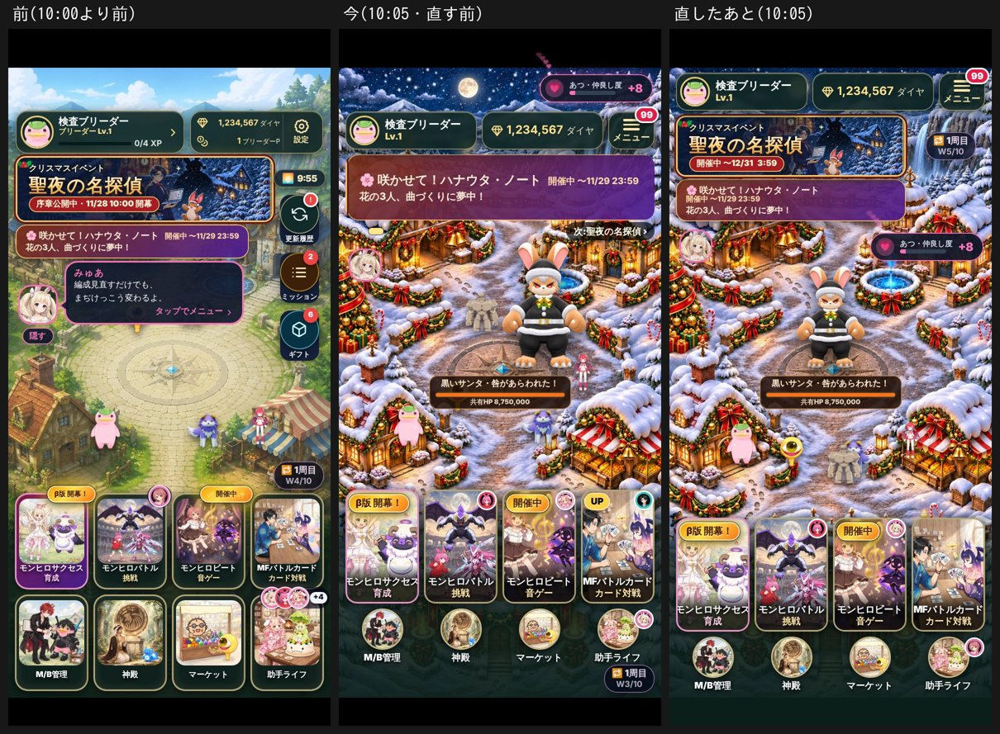

# HOME のイベント表示を前の形に戻す・崩れの直し(台帳 r1126-088・追跡表 r1128-013・2026-11-28)

社長「ホームのイベント表示の画像まえのほうがよくない？」→「前の形に戻す」。あわせて窓口が見つけた崩れ①〜⑤を直した。
ほかの新しい HOME の作り(上の1段・メニュー・入口・助手の小さい顔)は変えていない。

- 撮り方: `SHOT_DIR=docs/progress/home-event-restore-r1126-088 PREFIX=after TIMES=1005,1201 SIZES=tate,se,yoko node tools/browser/home-event-restore-shoot.js`
  (iPhone 縦 390×844・切り欠きの余白 上47/下34・歩くマスモン5体・クリスマスのレイドのボス・裏クイックの周回中。時刻は 11/28 9:55・10:05、12/1 12:00)
- 「前」と「今」は main のまま撮った(`before-0955-tate.jpg`・`now-1005-tate.jpg`)

## 止め絵

| 場面 | iPhone 縦(390×844) | 小さい縦(375×667) | 横(844×390) |
| --- | --- | --- | --- |
| 前(10:00 より前・main) | [前](before-0955-tate.jpg) | — | — |
| 今(10:05・直す前・main) | [今](now-1005-tate.jpg) | — | — |
| 直したあと 10:05(花のイベント開催中) | [縦](after-1005-tate.jpg) | [小](after-1005-se.jpg) | [横](after-1005-yoko.jpg) |
| 直したあと 12/1(花のイベントの後) | [縦](after-1201-tate.jpg) | [小](after-1201-se.jpg) | [横](after-1201-yoko.jpg) |

## 突き合わせ表(決めごと → 止め絵のどこで満たすか)

| 決めごと | 中身 | 止め絵のどこで満たすか | 満たす |
| --- | --- | --- | --- |
| r1126-088 本文 | クリスマスの絵の札を前の大きさ・切り方で | `after-1005-tate`: 札は前の形(`before-0955-tate` と同じ置き方・同じ縦横の比なので絵の見える範囲も同じ)。大きさは追記1で少し小さく | ○ |
| r1126-088 追記1 | 「イベントバナーをもう少し横幅小さくして」 | 札 312×80 → 278×74、細い帯も札と同じ幅まで(`after-1005-tate`) | ○ |
| r1126-088 追記1 | 「上部空いてるのってなんだっけ？」 | 時刻の段のすぐ下に上の1段(空きは 6px)。原因は下の「上の空き」 | ○ |
| r1126-088 本文 | その下に花のイベントの細い帯 | `after-1005-tate`: 札のすぐ下に「咲かせて！ハナウタ・ノート」の細い帯(前と同じ作り。幅を札に合わせたので期間が2行目に折れる) | ○ |
| r1126-088 本文 | 画面いっぱいの帯1枚を左右に送る形(「次:〜」の札・点)はやめる | どの「after」の絵にも、送る帯・点・「次:〜」の札が無い | ○ |
| r1126-088 本文 | 上の1段・メニュー・入口・助手の小さい顔はそのまま | 上の段(名前・ダイヤ・メニュー☰)、遊ぶ4つの札・小さな丸4つ、入口の右上の助手の顔は「今」と同じ | ○ |
| r1126-088 ① | まん中で黒いサンタ・歩くモンスター・HP の札が重なる | `after-1005-tate`・`after-1201-tate`: マスモン5体は HP の札の下を歩く。横(`after-1005-yoko`)はボスの右の外 | ○ |
| r1126-088 ② | サンタが右寄りで大きすぎる | サンタは札(HP)のまん中の上。高さ 135% → 110%(縦で 152px → 124px) | ○ |
| r1126-088 ③ | 入口の段の下に暗い余白、その下が黒い帯 | 小さな丸の名前の下は 8px(前の HOME と同じ)。その下の安全域はドックの下の端と同じ色で、黒い帯は無い | ○ |
| r1126-088 ④ | 左上の点・星の飾りが助手の顔にかぶる、「次:〜」の札が絵の上に浮く | 帯の下の点と「次:〜」の札が無くなり、助手の顔のまわりに重なる物が無い | ○ |
| r1126-088 ⑤ | 右の「1周目 W3/10」の札が1つだけ浮く | 縦: クリスマスの札の右の空き(前の HOME の時計の列の所)に、札と同じ高さで並ぶ。横・クリスマスの札が無いときは今までどおり隅 | ○ |
| r1126-073 追記2 | 細い帯はモンヒロビートへ直に入る | 行き先は変えていない(押すとモンヒロビート) | ○ |
| r1126-014 | クリスマスの入口は目立つ大きな札 | 札は上の段のすぐ下・いちばん大きいイベントの表示 | ○ |
| r1119-131 | 細い帯の1行目に題と期間 | `after-1005-tate`: 1行目「咲かせて！ハナウタ・ノート 開催中 〜11/29 23:59」 | ○ |
| r1126-080 | 画面の数は算用数字 | 新しい文は足していない | ○ |
| CLAUDE.md ⑦ | 保存のキーは変えない | 新しいキー・書き込みなし(見た目と置き場所だけ) | ○ |

## 上の空き(追記1)の原因

上の1段の上の余白に切り欠きの高さ(`env(safe-area-inset-top)`・約47pt)を足していたが、body(`index.html`)が同じ分をもう空けているので二重になり、時刻の段の下に約50pt の空の絵だけの空きが出ていた。
上の1段の上の余白は 6px だけにした(時刻の段は body の空けで避けるので、ホーム画面に置いたときも Safari で開いたときもかからない)。メニューの窓・横向きの帯と助手の顔の位置も同じ二重を外した。

## 何を変えたか

- `69-screen-home.jsx`(新しい HOME): 送る帯をやめ、前の HOME と同じ「クリスマスの札 → 細い帯(公式杯とは5秒ごとに切り替え)」に。
  ドックの下の余白から安全域の分を外し(body がもう空けている)、HOME を出している間だけ下の安全域をドックの色で塗る。
  クリスマスのボスの絵の寄せ方を transform から margin:auto に(跳ねる動きの transform が上書きして右へずれていた)・高さ 110%
- `16-ranking-detail-and-widgets.jsx`(歩くマスモン): 次に行く所を選ぶとき、レイドのボス(HP の札ごと)と重ならない所を選ぶ。下が無理なら左右の外
- `45-quick-anywhere-float.jsx`(裏クイックの札・音ゲー部の部品): 画面が置き場所の枠 `[data-quick-anywhere-slot]` を出していれば、まずそこへ置く口を足した(枠が無い画面は今までどおり)
- `tools/browser/home-event-restore-shoot.js`: 上の止め絵を撮る道具
