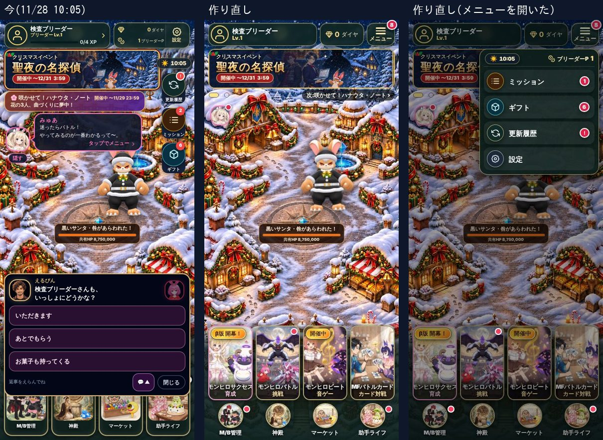
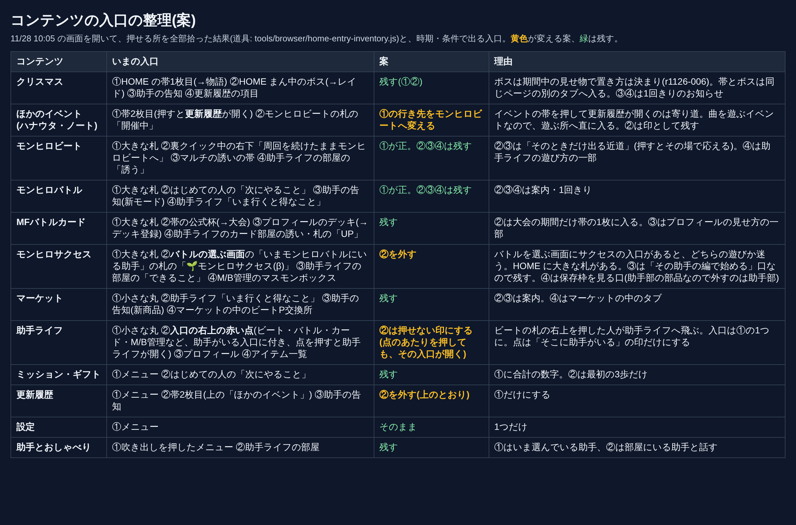

# HOME の作り直し(案A＋Bの入口)の止め絵と突き合わせ表(r1126-073・2026-11-27)

社長の選択「A＋Bの入口」(点検と見本: [`../home-review-2026-11/`](../home-review-2026-11/README.md))。
案Aを土台に、上は「名前・ダイヤ・メニュー☰」の1段とイベントの帯1枚。入口は遊ぶ4つを大きく、たまに行く4つを小さな丸に(案B)。
すぐできる直し1〜8も入れた。**クリスマスの開幕(11/28 10:00)のあとに出す。**

- 撮り直し: `SHOT_DIR=docs/progress/home-rebuild-2026-11/shots node tools/browser/home-rebuild-shoot.js`
  (時刻 t1=11/27 19:07・t2=11/28 10:05・t3=11/30 0:05 × スマホ縦/横・タブレット縦/横 × 形 fold=はじめの形・say=吹き出し・menu=メニュー・peer=仲間の会話)
- 比べ絵: [`compare-phone-tate.jpg`](compare-phone-tate.jpg)(左が今、右が作り直し)

## 止め絵

| 場面 | スマホ縦 | スマホ横 | タブレット縦 | タブレット横 |
| --- | --- | --- | --- | --- |
| 開幕後(t2)・はじめの形 | [縦](shots/t2-1128-1005-phone-tate-fold.jpg) | [横](shots/t2-1128-1005-phone-yoko-fold.jpg) | [縦](shots/t2-1128-1005-tablet-tate-fold.jpg) | [横](shots/t2-1128-1005-tablet-yoko-fold.jpg) |
| 開幕後(t2)・メニューを開いた | [縦](shots/t2-1128-1005-phone-tate-menu.jpg) | [横](shots/t2-1128-1005-phone-yoko-menu.jpg) | [縦](shots/t2-1128-1005-tablet-tate-menu.jpg) | [横](shots/t2-1128-1005-tablet-yoko-menu.jpg) |
| 開幕後(t2)・仲間の会話を開いた | [縦](shots/t2-1128-1005-phone-tate-peer.jpg) | [横](shots/t2-1128-1005-phone-yoko-peer.jpg) | [縦](shots/t2-1128-1005-tablet-tate-peer.jpg) | [横](shots/t2-1128-1005-tablet-yoko-peer.jpg) |
| 開幕後(t2)・吹き出しを開いた | [縦](shots/t2-1128-1005-phone-tate-say.jpg) | [横](shots/t2-1128-1005-phone-yoko-say.jpg) | [縦](shots/t2-1128-1005-tablet-tate-say.jpg) | [横](shots/t2-1128-1005-tablet-yoko-say.jpg) |
| 花のイベントの後(t3) | [縦](shots/t3-1130-0005-phone-tate-fold.jpg) | [横](shots/t3-1130-0005-phone-yoko-fold.jpg) | [縦](shots/t3-1130-0005-tablet-tate-fold.jpg) | [横](shots/t3-1130-0005-tablet-yoko-fold.jpg) |

## 突き合わせ表(決めごと・参考の絵 → 止め絵のどこで満たすか)

| 決めごと・参考 | 中身 | 止め絵のどこで満たすか | 満たす |
| --- | --- | --- | --- |
| r1126-073 案A | 上は「名前・ダイヤ・メニュー☰」の1段 | どの絵も最上段。Lv は名前の下に小さく、XP の棒は外した(プロフィールで見る) | ○ |
| r1126-073 案A | イベントの帯1枚・2つ目は横に送る | 帯は1枚。下に点と「次:咲かせて！ハナウタ・ノート ›」。指で横に送る・点・「次:」で切り替わる。触らなければ7秒で次へ | ○ |
| r1126-073 案A | 右の列(時計・更新履歴・ミッション・ギフト)と設定はメニューへ。赤い数字は合計 | `menu` の絵: 時刻・ブリーダーP・ミッション(2)・ギフト(6)・更新履歴(!)・設定。☰の数字 9 = 2+6+1 | ○ |
| r1126-073 案B | 遊ぶ4つを大きく、たまに行く4つを小さく | 縦: 遊ぶ4つは 89×150 の絵の札、たまに行く4つは 50px の丸。横・タブレット: 1列で遊ぶ4つを幅広に | ○ |
| 直し1 | 仲間の会話の窓を勝手に開かない。顔の丸に💬・押したら開く | `fold` の絵: 顔の丸の右下に💬。`peer` の絵: 押した後だけ窓が出る | ○ |
| 直し2 | 吹き出しは畳んだ形から・新しい一言で点・タブレットは幅 360px まで | `fold` の絵は顔だけ。新しい一言があるときは赤い点。吹き出しの幅は最大 360px | ○ |
| 直し3 | 入口の札は左上・同じ高さ・同じ形。顔の丸は赤い点1つ | β版 開幕！・開催中・近日公開・UP を札の左上の内側に同じ形で。助手の顔の束は右上の赤い点1つ | ○ |
| 直し4 | 右の列を減らす・時計は外す・更新履歴は奥へ | 右の列は無くなった。時計と更新履歴はメニューの中 | ○ |
| 直し5 | たまに行く4つを低く | 縦で 117px → 丸 50px+名前(約70px) | ○ |
| 直し6 | 横向きでも2つ目の帯の場所をそろえる | 横も帯は1枚(左上)。2つ目は同じ帯を送る形なので、縦と横で場所が同じ | ○ |
| 直し7 | 小さい字を 11px に | 名前・Lv・ダイヤ・メニュー・入口の名前と下の言葉・札・帯の下の字は 11px 以上(ブリーダーP の数は 13px) | ○ |
| 直し8 | 仲良し度の知らせを1枚に | HOME では小さい知らせの札を1枚ずつ出す(残りは前の札が消えたあと) | ○ |
| r1126-073 | 期間中のボスと共有HPの置き方は今のまま | ボスはまん中(44%)のまま。帯・入口と重ならない(t2・t3 の各絵) | ○ |
| r1126-073 | 保存のキーは変えない | 新しいキーなし。`mh_home_assistant_comment_v1` は値の意味(true=入・false=切)を変えず、保存が無いときの既定だけ「切」に | ○ |
| r1126-073 | 他部の部品は出し方の位置だけ | 助手ライフの顔の束は点1つに・仲間の会話は印から開くだけ。中身(会話・加算)は触っていない | ○ |
| r1126-014 | クリスマスの入口は目立つ大きな帯 | 帯の1枚目はクリスマスの大きな帯(ポスターの絵)のまま | ○ |
| r1119-081 | 助手の吹き出しは HOME の上で出し入れ | 顔を押すと開く・「隠す」で閉じる | ○ |
| r1119-050 | おしゃべりは吹き出しを押したメニューの中 | 変えていない | ○ |
| r1119-131 | イベントの帯の1行目に題と期間 | 花のイベントの帯(t1・横の絵)で、1行目に題と期間、2行目に副題 | ○ |
| r1119-130 | サクセスの札はビートの「開催中」と同じ部品 | 同じ部品のまま、置き場所を左上にそろえた | ○ |
| r1121-026(r1119-080 の HOME の画面の行) | 8枚が同じ大きさ・XP 8px・横の右の列・設定 44px 未満・顔の束が押しにくい・吹き出しの幅 660px | 遊ぶ/たまに行くで大きさを分けた・XP は外した・右の列はメニューへ・設定はメニューの 46px の行・顔の束は点に・幅は 360px まで | ○(HOME の画面の分。更新履歴・プロフィールなど残り9場面は別) |
| 見本 plan-a / plan-b | 上の1段・帯1枚・遊ぶ4つ大 | 比べ絵の右 | ○ |

## 検査

- `tools/home-layout-check.js` を新しい形に合わせた(遊ぶ4つは同じ大きさ・たまに行く4つも同じ大きさ・遊ぶほうが1.4倍以上・丸・字 10.5px 以上)
- `tools/assistant/life-browser-shared.js` の見張りを、顔の束から赤い点に合わせた(イベントの帯・メニュー・助手の顔も重なりを見る)

## 入口の整理(r1126-073 追記1・追記2)— 社長の選択「3つともやる」で作った

道具 `node tools/browser/home-entry-inventory.js`(11/28 10:05 に時計をずらし、HOME から17の画面を開いて、見えている押す所を全部拾う)の結果
[`entries/inventory.json`](entries/inventory.json) と画面ごとの絵(`entries/*.jpg`)に、時期・条件で出る入口(告知・誘いの帯・裏クイック・助手ライフ)をコードから足した。

変えた3つ(どれも保存のキーは変えない。②③は助手部の部品で、窓口の判断で出し方だけを変えた):

1. **ほかのイベントの帯の行き先**: 押すと更新履歴が開く → モンヒロビートへ直に入る([`entries/home.jpg`](entries/home.jpg) の帯2枚目)
2. **バトルの選ぶ画面のサクセスの入口を外す**: 「いまモンヒロバトルにいる助手」の札の「🌱モンヒロサクセス(β)」([`entries/battle.jpg`](entries/battle.jpg) の下)。助手部の部品なので、外すのは助手部と相談
3. **入口の右上の赤い点を押せない印にする**: いまは点を押すと助手ライフが開く。点のあたりを押してもその入口が開くようにし、助手ライフへは小さな丸1つから(助手部の部品)

## 分析の API の点検(r1126-073 追記1・r1126-081)

- 送った物: [`api-system.md`](api-system.md)・[`api-prompt.md`](api-prompt.md)・止め絵20枚(`tools/browser/home-rebuild-api.js` の PICK)。claude-opus-5-5・effort xhigh・Batch・出力上限 32000
- 答え: [`api-answer.md`](api-answer.md)(入力 18,150・出力 24,964 トークン)。**使った額 約 $0.29**(上限 $20)
- 指摘を止め絵とコードで確かめた結果:

| 指摘 | 確かめ | どうしたか |
| --- | --- | --- |
| 1 スマホで会話の窓が出ない | 外れ。会話は毎回は始まらない(HOME で4割)。スマホ縦で開くのは確かめ済み(`t2-…-phone-tate-peer` は会話が始まらなかった回) | 直さない |
| 2 入口の赤い点がお知らせに見える | 見え方の指摘として当たり。ただし「赤い点1つ」は社長の選択(すぐできる直し3・追記2の③) | 窓口へ(色を変えるかは社長の判断) |
| 3 会話の窓が顔から遠い | 当たり。窓は助手部の部品(画面の下に出る作り) | 窓口へ(助手部の部品) |
| 4 ☰の数の「!」が1つに数えてある | 当たり(更新履歴の未読を1と数える)。タブレット横だけ9なのはミッションの数が違う回だったため | 決まり(合計)のまま |
| 5・6 ボスがずれる・共有HPの字が小さい | 前からある。ボスの部品(バトル部)で、置き方は「今のまま」の決まり | 窓口へ(バトル部) |
| 7 予告中のクリスマスが1枚目で、開催中の花のイベントが隠れる | 当たり | **直した**: 予告のあいだは開催中のイベントを1枚目に(`t1-…` の絵) |
| 8 💬の印が見えにくい | 当たり | **直した**: 白地で大きく(24px)・ゆっくり脈打つ |
| 9〜18 | 小さい・前からある物(吹き出しの「隠す」・会話の窓の字・終わりの時刻の書き方など)。18 の切り欠きは撮り比べの道具で確かめ、横持ちの左右に安全な余白を足した | 18 は直した。ほかは残り |
