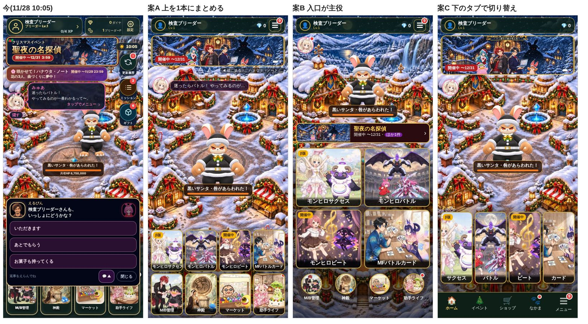

# HOME の見やすさ点検と整理の案(r1126-070・2026-11-27 19:25)

社長「ホームなんか見にくくない？」→「ホームの情報量多すぎるからもっと整理したいね」。
撮影と分析の API で点検し、**情報を減らして整理する**案と見本を出す。今回は案と見本まで(ゲームは直していない)。

- 撮影: `tools/browser/home-review-shoot.js`(時計をずらす・3時刻 × 4大きさ × 吹き出しあり/なし = 24枚)
  - t1 = 11/27 19:07(クリスマスは序章だけ) / t2 = 11/28 10:05(クリスマス開幕・ボスが出る) / t3 = 11/30 0:05(花のイベントの後)
  - スマホ縦 390×844・スマホ横 844×390・タブレット縦 820×1180・タブレット横 1180×820
- 分析: claude-opus-5-5・effort xhigh。20枚(上限)を1回で送った。答えの全文は [`api-answer.md`](api-answer.md)、指示文は [`api-prompt.md`](api-prompt.md)
- API の指摘は、止め絵と測った位置(撮影の道具が残す部品の位置)で**自分で当たり外れを確かめてから**載せた(下の表の「確かめ」)

## 使った額

| 回 | 結果 | 額 |
| --- | --- | --- |
| 1回目(その場で返す口) | 150秒の時間切れで返事なし | 見積りは最大 $0.53(記録されたかは不明。多めに数える) |
| 2回目(Batch・出力上限 24000) | xhigh の考える分で上限を使い切り、本文が空 | $0.28 |
| 3回目(Batch・出力上限 32000・xhigh と予備の high の2本) | 両方とも最後まで返った。xhigh の方を使った | $0.45 |
| **合計** | | **約 $1.26 以下**(上限 $20) |

次からの教え: 絵20枚 + xhigh は、その場で返す口では時間切れになる。Batch で出力上限 32000 にする。

## いちばん大きな発見(社長の見立てに足すもの)

1. **仲間の会話の窓(助手ライフ)が HOME の上に勝手に開き、入口やイベントの帯やボスを隠す。** 24枚のうち10枚で開いていた。
   スマホ縦では入口の上の段4つが丸ごと隠れる([`shots/t2-1128-1005-phone-tate-say.jpg`](shots/t2-1128-1005-phone-tate-say.jpg))。
   スマホ横では、クリスマスの帯が右端100pxしか見えず、花の帯は見えない([`shots/t1-1127-1907-phone-yoko-nosay.jpg`](shots/t1-1127-1907-phone-yoko-nosay.jpg))。
   11/30 にはボスが丸ごと隠れる([`shots/t3-1130-0005-phone-yoko-say.jpg`](shots/t3-1130-0005-phone-yoko-say.jpg))。
   本番でどのくらいの間隔で開くかは確かめていない。検査の初期データで、開いて数秒のうちに出た。
2. 上の3割に、名前・ダイヤ・クリスマスの帯・花の帯・吹き出し・時計・右の列3つが集まっている。いっぽう、街のまん中(縦スマホの y300〜590)は空いている([`shots/t1-1127-1907-phone-tate-say.jpg`](shots/t1-1127-1907-phone-tate-say.jpg))。
3. 下の入口8つが**全部同じ大きさ**なので、毎日遊ぶ所(サクセス・バトル・ビート・カード)と、たまに行く所の差が見えない。

## HOME に置いてある物の全部と、3つの分け方

①いつも見せる ②まとめる・畳む ③HOME から外して、ほかの画面やメニューへ移す

| 部品 | いま(縦スマホ) | 毎日使う | 分け | どうする |
| --- | --- | --- | --- | --- |
| 入口・遊ぶ4つ(サクセス・バトル・ビート・カード) | 下の段 各89×117 | 高 | ① | **大きくして主役にする** |
| 開催中のイベント(クリスマス) | 上 312×80 | 高 | ① | 帯は1本だけ |
| 期間中のボスと共有HP(t2・t3) | まん中 | 高(期間中) | ① | 空いているまん中を使う、今の置き方で良い |
| 名前・Lv | 左上 212×52 | 中 | ① | Lv だけ小さく。XP の棒は押した先へ |
| ダイヤ | 右上 | 中 | ① | ダイヤだけ残す |
| 入口の札(β版 開幕！・開催中・UP) | 入口の上端 | 中 | ① | 形・色・位置を1種類にそろえる |
| 2つ目のイベント(花のハナウタ・ノート) | クリスマスの下 282×40 | 中 | ② | クリスマスの帯と同じ枠で、横に送る切り替え式にする |
| ミッション・ギフト | 右の列 各47×61 | 高 | ② | 右の列をやめて、メニュー1つ(赤い数字は合計)にまとめる。または2つだけ残す |
| 入口・たまに行く4つ(M/B管理・神殿・マーケット・助手ライフ) | 下の段 各89×117 | 中〜低 | ② | 遊ぶ4つより小さくする |
| 助手(みゅあ)の吹き出し | 217×77(タブレットは 518×61) | 低 | ② | 畳んだ形(顔の丸だけ)を初めの形にする。話すときは1行だけ |
| 入口の上の仲間の顔の丸・「+3」 | 入口の右上 最大3つ+数字 | 低 | ② | 赤い点1つにする(顔は助手ライフの中で見せる) |
| 仲良し度の知らせ(♥ +2) | 左右の下 2〜3枚 | 低 | ② | 1枚にまとめる |
| 仲間の会話の窓 | まん中 375×245 | 低 | ③ | 勝手に開かない。助手の顔の丸に💬の印だけ出し、押したら開く(または助手ライフの中だけ) |
| 更新履歴 | 右の列 | 低 | ③ | メニュー(または設定)の中へ |
| 時計(🌙19:07) | 右上 70×22 | 低 | ③ | 外す(昼と夜は街の絵で分かる) |
| 設定 | 右上 44×44 | 低 | ③ | メニューの中へ |
| ブリーダーP・XP の棒 | 右上・左上 | 低 | ③ | 名前を押した先・マーケットで見せる |

## すぐできる小さな直し(効き目の大きい順)

| 順 | 何を・どう | 効き目 | 確かめ |
| --- | --- | --- | --- |
| 1 | **仲間の会話の窓を勝手に開かない。** 助手の顔の丸に💬の印だけ出し、押したら開く | 入口・帯・ボスが隠れる問題がまとめて消える | 当たり(24枚中10枚で隠れていた) |
| 2 | **助手の吹き出しは畳んだ形を初めの形にする**(新しい一言があるときだけ点を付ける)。タブレットでは幅を 360px までにする | 上が約80px 空く。タブレットで 518〜661px の1行を目で追わなくてよくなる | 当たり(測った幅) |
| 3 | **入口の札を「左上・同じ高さ・同じ形」の1種類にそろえ、顔の丸は赤い点1つにする** | ビートの「開催中」札が顔の丸の下で7割ほど隠れていたのが消える。どれが特別かが分かる | 当たり(t1 縦スマホ・t1 タブレット横) |
| 4 | **右の列を2つ(ミッション・ギフト)にする。** 更新履歴は設定の中へ移して赤い点を設定に付け、時計は外す | 右上の重なりが消える。右の列が 200px → 130px | 当たり(時計とクリスマスの帯: 縦スマホ 7px・タブレット 13px 重なる) |
| 5 | **入口の下の段(たまに行く4つ)を低くする**(縦スマホで 117px → 80px くらい) | 遊ぶ4つとの差が付き、毎日の入口がひと目で分かる | 判断(API とミハリ両方の勧め) |
| 6 | 横向きでも、花の帯をクリスマスの帯のすぐ下にそろえる | 縦と横で帯の場所が同じになる。スマホ横でボスの頭に重ならない | 当たり(t2 スマホ横で接している) |
| 7 | いちばん小さい字(「設定」「ダイヤ」「Lv」「XP」「育成」「挑戦」「共有HP」が 9px くらい)を 11px にする | 小学生も読める | 当たり(「設定」は 9px と測れた) |
| 8 | 仲良し度の知らせを1枚にまとめる | 端の散らかりが減る | 一部空振り(スマホ横で名前が出ないのは、わざと縮めた形の見込み) |

API の指摘のうち載せなかった物: 「吹き出しとボスの耳が 5〜10px 重なる」(t2 縦スマホ。測ると吹き出しの下端 263px でボスの絵の上端とほぼ接するだけ・小さい)。「右端に赤い印がはみ出す」(会話の窓の後ろの、助手ライフの入口の印。1を直せば消える)。

## 作り直しが要る大きな直し(見本3案)

どれも今より**見える物がはっきり少ない**。見本は本物の絵で作った HTML を縦スマホで撮った物(作り: [`mock/`](mock/)・撮り直し: `node docs/progress/home-review-2026-11/mock/shoot-mock.js`)。

| 案 | 考え方 | 減らした物 → 行き先 | 良い点 | 気になる点 |
| --- | --- | --- | --- | --- |
| **A 上を1本にまとめる**([`plan-a.jpg`](plan-a.jpg)) | 上は「名前・ダイヤ・メニュー」の1段と、イベントの帯1枚だけ。帯は横に送ると次のイベント | 花の帯 → 帯の2枚目 / 右の列4つ(時計・更新履歴・ミッション・ギフト)と設定 → メニュー☰1つ(赤い数字は合計) / 吹き出し → 1行 / 会話の窓・顔の丸 → 出さない | 今の部品をほぼそのまま使える。上が 183px → 142px、右の列が無くなり街が広い | 2枚目のイベントを見落としやすい(送る印が要る)。ミッションとギフトが1手奥になる |
| **B 入口が主役**([`plan-b.jpg`](plan-b.jpg)) | 遊ぶ4つを 2×2 の大きな札にし、たまに行く4つは小さな丸の列。イベントは細い帯1本(「ほか1件」付き) | クリスマスの大きな絵 → 押した先のイベント画面 / 花の帯 → 「ほか1件」 / 右の列と設定 → メニュー☰ / 吹き出し → 顔の丸だけ | 何をして遊ぶかが一番はっきり。子どもが迷わない | イベントの絵の告知が弱い。ボスのいない時期は街が寂しい |
| **C 下のタブで切り替え**([`plan-c.jpg`](plan-c.jpg)) | 下にタブ(ホーム・イベント・ショップ・なかま・メニュー)。ホームには、イベント1枚・ボス・遊ぶ4つだけ | 花の帯 → イベントのタブ / マーケット・神殿 → ショップのタブ / M/B管理・助手ライフ → なかまのタブ / 右の列と設定 → メニューのタブ | 見える物が3案でいちばん少ない。スマホのゲームでよくある形で、物が増えても崩れにくい | 作り直す量がいちばん多い。たまに行く4つが1手奥になる |

横向きとタブレット(見本は縦スマホだけ。並べ方の目安):

- A: 上の1段の下に帯(幅は最大 600px)・入口は今どおり1列8つで、遊ぶ4つを幅広にする
- B: 左に街、右に遊ぶ4つを 2×2。たまに行く4つは右下に小さく
- C: スマホ横はタブを左の縦の列にする。タブレットは今のまま下に置く

**ミハリの勧め: A を土台に、B の「遊ぶ4つを大きく・たまに行く4つを小さく」を足す**(API も同じ勧め)。
順番は、まず小さな直しの 1〜4 を入れて社長に見てもらい、そのあと上の帯を1本にまとめる。

## 置いた物

- `shots/` … 根拠の止め絵7枚(24枚の全部は撮影の道具で撮り直せる)
- `now-1128-phone-tate.jpg` … 比べ絵の「今」(2倍)
- `plan-a.jpg` / `plan-b.jpg` / `plan-c.jpg` / `compare-phone-tate.jpg` … 見本
- `api-system.md` / `api-prompt.md` / `api-answer.md` … API へ送った物と、返ってきた答え
