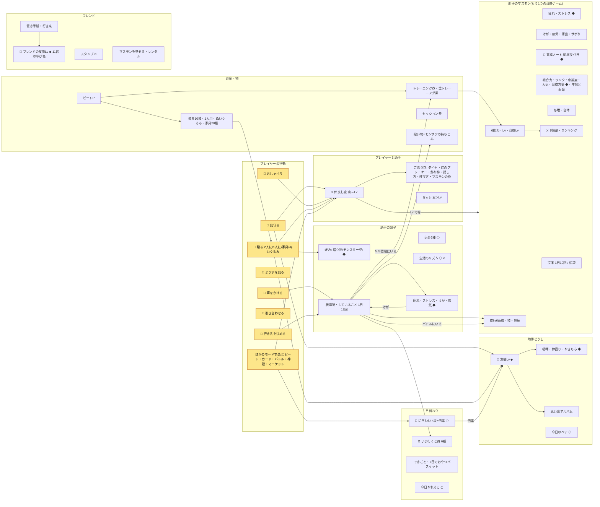
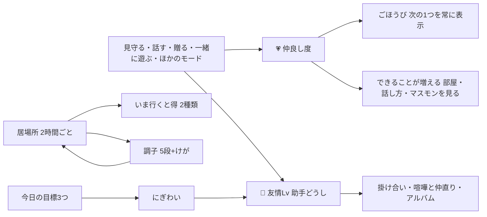

# 助手ライフの総点検(全部作り直すとしたら)— 2026-11-20 ミハリ

- 依頼: 窓口(モンヒロくん)/ 社長「助手ライフは見た目からシステムまで全てがごちゃついていて、分かりづらすぎる。かなりしっかり改善する必要があると思うので、そういう目で見てほしい」
- 見た範囲: 地図・部屋と家・家具/贈り物/道具・助手どうしと喧嘩・助手のマスモン(対戦と修行を見るを含む)・フレンドの家・アルバムとプロフィール(紹介)・提案・説明とヘルプ
- **監査だけ。ゲームのコードは変えていない。** 基準 main `2121e529`
- 撮り方: 偽のデータでページの中だけ(Supabase は偽物・フレンド2人の控えの家つき)。本番のサーバーへは何も送っていない。デバッグの合言葉は使っていない。
  道具 `node tools/browser/visual-life-shoot.js --out <置き場> --sizes tate,pc`(今回つくった。15時・初めての人・23時の3通り)と、前からある `tools/assistant/life-walkthrough.js`
- 大きさ: 縦 390×844 と PC 1280×800(横は今回は見ていない)。**ブラウザの大きさをまねただけで、実機ではない**
- 仕組みと作りは、コードを `ctx.js find/read/toc` と grep で要る所だけ読んで洗い出した(2MB・2万行。全文は開いていない)
- API(Claude)の見た目の点検は、今日の上限が $25 のままだったので**送っていない**(§7 に明日の見積り)。使った額 **$0**
- 前の点検と重なる件は「既知」と書いた: [uiux-audit-2026-11](../uiux-audit-2026-11/README.md)(r1118-001)・[ux-audit 2026-11-11](../../assistant-life/ux-audit/README.md)・[IMPROVE-2026-11-11](../../assistant-life/IMPROVE-2026-11-11.md)

## 1. 結論(5行)

1. **助手ライフは「1つの遊び」ではなく、2週間(11/7〜11/15)に約10の担当が足した約15の小さな遊びの寄せ集め**になっている。プレイヤーが覚える値・状態は **約55種類**、保存キーは **約60個**、公開の印は **29個(全部が真)**。
2. いちばんの問題は**「何のためにやるのか」が1本の線になっていない**こと。仲良し度を上げる元が40種類あり(会話 +4 から家具 +120 まで30倍の差)、上げた先のごほうびは家からは見えない。
3. **同じ名前で別の物・別の名前で同じ物**が多い(友情Lv が2つ・疲れとストレスが2つ・育成方針が2つ・好みが3つ・予定の表が2つ・場所の名前が2つずつ・時間の刻みが5種類)。
4. 画面は**1画面にやることが多すぎる**(家の最初の画面に押せる所 19個、部屋の「できること」12行、助手のマスモンだけで M/B管理とモンサクに並ぶ3つ目の育成ゲーム)。ヘルプは助手ライフの節だけで和字1万5千字・注48個。
5. 直すなら**継ぎ足しでなく、値を「仲良し度・友情・助手の調子・マスモン」の4本に畳む土台の作り直し**が要る。先に、名前と数の食い違い・時間の刻み・入口の重なりを1つにそろえる(§4 の10件)と、作り直しの前でも分かりやすさは大きく上がる。

## 2. 仕組みの関係図

### 2-1. 今(コードから洗い出した全部)

印: **◆ 重なり**(同じ名前で別の物・同じことをする別の物)/ **◇ 効き目が見えない**(上がる・下がるが画面のどこにも出ないか、遠い)/ **✕ 説明が無い**(画面に説明が無く、ヘルプにしか無い)

**値の一覧(約55種類)と印**

| まとまり | 値・状態 | 何で上がる/変わる | 何に効く | 印 |
| --- | --- | --- | --- | --- |
| プレイヤーと助手 | 💗 仲良し度(点・Lv) | **40種類の行動**(`data/assistants.js` の表)。会話 +4・掛け合いを見る +2・神殿 +30・道具 最大+60・**家具 最大+120(1日 1440 まで)** | ごほうび(ダイヤ・虹のプシュケー・飾り枠・話し方・呼び方)・マスモンを迎える枠・紹介の Lv | ◇(ごほうびは部屋ときずなの中だけ。家の最初の画面からは見えない) |
| | セッションLv | モンヒロビートで一緒に演奏 | 部屋の「詳しく」に1行だけ | ◇✕ |
| 助手どうし | 🤝 友情Lv | 見守る・贈る・同じ場所で過ごす・掛け合い | 掛け合い・特別なお話・アルバム・喧嘩の起き方 | ◆(フレンドの友情Lv と同じ名前) |
| | 今日のペア | 掛け合いを3回見る(`ASSISTANT_PEER_DAILY_GOAL`) | 仲良し度 +20 | ◇(掛け合いの隅の 9px の札だけ) |
| | 喧嘩・仲直り・やきもち・ないしょ話 など9種 | 時間と組み合わせで起きる | 友情Lv(仲直りで+5)。台本403本 | ◆(仕組みが `56-assistant-peer.jsx` の quarrel と `56-assistant-life-rel.jsx` の2か所) |
| 助手の調子 | 気分(ご機嫌・さみしい・そわそわ・すねてる・ねむい・やる気) | 時間で変わる | 行き先の重み・声かけ | ◇(部屋に「気分: さみしい」と出るが、何に効くかは出ない) |
| | 生活のリズム(朝型〜夜型) | 夜に誘うと夜型へ | 行き先の重み | ◇✕(部屋に1行。変わることは画面に出ない) |
| | 助手の疲れ・ストレス・けが・病気 | 居場所と予定 | サボり・病院・予定が通るか | ◆(マスモンにも同じ名前の別の値) |
| | 好み: 贈り物の好み14種 / モンスターの好き苦手(-100〜+100)/ 好きな色 | 贈る・一緒に勝つ・育てる | 仲良し度の倍率・マスモンの選び方 | ◆(3種類が「好き・苦手」で1つに見える。分かった数が「0/14」と「0/12」で食い違う=既知) |
| | 居場所・していること | 1日12回(2時間ごと)に自分で決める | いま行くと得・修行・チケット・拾い物 | — |
| | 予定表(行き先のお願い) | プレイヤーが決める | 居場所(気分で通らないこともある) | ✕(通りやすさの値 `ASSISTANT_LIFE_PLAN_TRUST` は画面に出ない) |
| 日替わり | 🎉 にぎわい(静か×1・ふつう×1.25・にぎやか×1.5・お祭り×2) | ほかのモードで遊ぶ・見守る | 友情Lv の上がり方 | ◇(何の倍かは ⓘ を押さないと出ない=既知) |
| | 続けて遊んだ日数 | 毎日開く | にぎわいの始まり +5/+10 | ◇✕ |
| | いま行くと得(6種類: ビート券なし・カード×1.375・神殿 仲良し度+30・修行を見る・マーケット1割引き・M/B管理でチケット) | 助手の居場所 | 場所ごとにばらばらの得 | ◆(得の種類が場所ごとに全部違い、覚えられない) |
| | できごと・7日でおやつバスケット | 時間帯ごとの場面を見る | 道具1個 | — |
| | 今日やれること(見守る・声をかける・贈る・ビート) | — | — | ◆(上の「助手ライフの得」の今日の行と二重=既知) |
| お金・物 | ビートP | ほかのモード | 道具・家具・ぬいぐるみ・券 | — |
| | 道具(2人に10種・1人に・ぬいぐるみ)・家具20種・チェキ | ビートPで買う・拾う | 仲良し度・友情Lv・好みが分かる | ◆(贈る入口が「2人に・1人に・家具・ぬいぐるみ」の4つ) |
| | トレーニング券・重トレーニング券・セッション券 | — | マスモン・ビート | — |
| | 拾い物(モンサクの持ちこみアイテム) | 帰宅 8%・家 4%・マスモン 5%(1日2個) | モンサク | ◇(拾ったことの出方が小さい) |
| 助手のマスモン | 枠(最大8)・6能力・Lv・育成Lv・型 | 1日3回(朝・昼・夜)の自主育成 | 対戦 | — |
| | 疲れ・ストレス・けが・病気・家出・サボり | 育成ノートの予定 | 伸び | ◆ |
| | 育成ノート(朝昼夜×7日・段1〜5) | プレイヤーが組む | 伸び・冬眠の枠 | ◆(助手の予定表とは別の表) |
| | 修行6系統・技・熟練・見習い | バトルにいる回 | 技 | ◇ |
| | 総合力・ランク・忠誠度・人気・育成方針(叱る/褒める)・年齢と寿命・成長の型とピーク | 計算(`MASMON_CALC`) | 対戦の強さ | ◆(「育成方針」が型〈攻撃型など〉と叱る/褒めるの2つの意味。画面の札は `amgbOn()` で「得意な伸ばし方」に言い換えて逃げている) |
| | 冬眠・合体 | プレイヤー | 枠の入れ替え | ✕ |
| | 対戦β(ランキング・週) | — | — | — |
| | 提案(名前・色・勇者モン・迎える種類・デッキ、1日10回)/ 助手からの相談 | — | マスモンの中身 | ✕(相談の文 `AMGT_ASK_TEXT` は「仮の文」のまま公開) |
| フレンド | フレンドの友情Lv(はじめまして〜かけがえのない友 11段)・スタンプ | その家で3つする | 呼び名だけ | ◆✕ |
| | 置き手紙・行き来(行く・来る・訪ねる)・マスモンを見せる・レンタル | — | 仲良し度 +6〜10 | — |

**時間の刻みが5種類ある**(これがいちばん分かりにくさを生んでいる)

| 刻み | どこで | 15:00 の呼び方 |
| --- | --- | --- |
| 見た目の4段(朝・昼・夕・夜) | 上の題「昼・あと1時間でみんなが動く」 | **昼** |
| できごとの6段(深夜・朝・昼・午後・夕方・夜) | 「☀️ 午後のできごと」 | **午後** |
| 移動 1日12回(2時間ごと) | 「次にみんなが動くのは 16:00」・予定表の12行 | 14〜16時 |
| マスモンの1日3回(朝・昼・夜) | 育成ノート | 昼 |
| 日替わり(朝4時) | 1日の上限・今日あったこと | — |

同じ15時に、上の題は「昼」、すぐ下は「午後」と書いてある(`tate-01-house-open.png`)。

### 2-2. 作り直すならの案(残す・まとめる・消す)

**芯の1本**: 「助手と仲良くなる(💗)→ 助手ができることが増える(部屋・話し方・マスモン)」。ほかは全部この線に乗せるか、外へ出す。

| 扱い | 何を | どうする |
| --- | --- | --- |
| **残す(芯)** | 💗 仲良し度 | 唯一の「プレイヤーと助手」の値。上げる元は**5つの行動**(見守る・話す・贈る・一緒に遊ぶ・ほかのモード)にまとめ、1回の量は同じ桁にそろえる(家具 +120 と会話 +4 のような30倍の差をなくす)。次のごほうびを家の一番上に常に1行 |
| **残す** | 🤝 友情Lv(助手どうし) | 名前はこのまま。**フレンドの方は「おなじみ度」など別の名前**へ |
| **残す** | 居場所(1日12回) | 刻みは「移動 12回」1つにし、見た目・できごと・マスモンの刻みも同じ2時間に合わせる(呼び方は朝・昼・夕方・夜・深夜の5つ) |
| **まとめる** | 気分・生活のリズム・疲れ・ストレス・けが・病気 | **「調子」1本(元気〜へとへと の5段+けが・病気の印)**。気分は台詞の色づけだけにして値として見せない |
| **まとめる** | 贈り物の好み・モンスターの好き苦手・好きな色 | 紹介の「好き・苦手」1か所に。贈り物の好みと、モンスターの好みを見出しで分ける |
| **まとめる** | 予定表(助手)と育成ノート(マスモン) | 「予定」1つの表(行は時間・列に助手の行き先とマスモンの過ごし方) |
| **まとめる** | にぎわい・続けた日数・今日のペア・できごと7日・今日やれること | **「今日の目標」3つ**(例: 見守る1回・贈る1回・ほかのモードで1回)+ 達成でにぎわいが1段上がる、の1本に |
| **まとめる** | いま行くと得(6種類) | 得の種類を2つに(「💗 仲良し度が多め」「🎟 券・割引」)そろえ、場所ごとの違いは文の1行で |
| **まとめる** | 喧嘩(2か所のコード) | 1つの仕組み(`rel`)に。peer の quarrel は rel の1種類として読む |
| **外へ出す(社長の判断が要る)** | 助手のマスモンの育成(育成ノート・修行・冬眠・合体・総合力・忠誠度・寿命・提案・対戦β) | 助手ライフの中に、M/B管理とモンサクに並ぶ**3つ目の育成ゲーム**がある。作り直すなら「助手が育てている子を見る・応援する」だけを助手ライフに残し、育てる仕組みはモンサク(または M/B管理)と1つにする |
| **消す候補(社長の判断が要る)** | 旧UI(設定の「助手ライフの画面」で前の画面を選べる) | 2つの画面を保ち続けている(家の画面のファイルだけで新旧の印が49か所)。新しい画面を作り直すなら旧UIは終える |
| **消す** | 公開の印 29個(全部が真) | 「印が偽のとき」の道は使われていない。作り直しのときに外す |
| **消す** | 使われていない部品 `AssistantLifeBand`(`56-assistant-life.jsx:1015`)・`AssistantLifeNowPerks`(`56-assistant-life-ux.jsx:180`) | 呼ぶ所が無い |

作り直したあとの形(案):

## 3. 観点ごとの問題一覧

優先度: **高** = 遊ぶ人が迷う・誤る・数が食い違う / **中** = 分かりにくい・見にくい / **低** = 気になる。止め絵は `shots/`(縦 390×844・PC 1280×800。時刻はどれも 15:00、`tate-first-*` は初めての人)。

### 3-1. 仕組みの分かりやすさ

| # | 画面 | 再現手順 | 起きること | なぜダメか | 改善案 | 優先度 |
| --- | --- | --- | --- | --- | --- | --- |
| S-1 | 全体 | §2-1 の表 | 値・状態が約55種類。家の最初の画面だけで「にぎわい・育成ノート・今日あったこと・できごと・7日でバスケット・助手ライフの得・今日の予定表・今日やれること」の8つの帯が並ぶ(`tate-03-house-scroll-end.jpg`) | 何を目当てに遊べばよいか1本にならない。どの帯も「今日」の話で、違いが分からない | §2-2 のとおり「仲良し度 → できることが増える」の1本に畳む。家の上は「次のごほうび1行+今日の目標3つ」だけ | 高 |
| S-2 | 部屋・紹介・きずな・フレンド | フレンド → お客さん帳/きずな | 「友情Lv」が助手どうし(友だち〜親友…)とフレンドごと(はじめまして〜かけがえのない友 11段)の2つ。「親友」「はじめまして」は仲良し度・友情Lv・フレンドの3つの段の呼び名で重なる(`tate-60-friend-tab.jpg`・`tate-52-profile-detail-scroll.jpg`) | 同じ名前の値が別の物を指す | フレンドの方を別の名前に。段の呼び名は値ごとに重ならない言葉にする | 高 |
| S-3 | マスモン | 部屋 → 🐾 マスモン / 家の 📒 育成ノート | 「疲れ・ストレス」が助手(予定表 `tate-16-room-plan.jpg`)とマスモン(育成ノート `tate-17b-house-note.jpg`)の2つにあり、上限・効き目が別 | どちらの疲れか見分けられない | 助手の方は「調子」1本に畳み(§2-2)、「疲れ・ストレス」はマスモンだけの言葉にする | 高 |
| S-4 | マスモン | マスモン → くわしく / 育成ノート | 「育成方針」が型(攻撃型など `AMG_POLICY`)と、叱る/褒めるの方針(`AmgbPanel`)の2つの意味。札は印しだいで「得意な伸ばし方」に言い換えている(`56-assistant-life-masmon-grow.jsx:431`) | 呼び名が場面で変わる | 型は「得意な伸ばし方」で固定、方針は叱る/褒めるだけに | 中 |
| S-5 | 部屋の贈る・マスモンの好み・紹介 | 部屋 → あつに贈る / マスモン → 好み | 「好み」が3つ(贈り物の好み14種・モンスターの好き苦手・好きな色)。マスモンのタブ「💗 好み」はモンスターの話、贈る窓の「好み？」は道具の話(`tate-18-masmon-tab-taste.jpg`・`tate-14-room-solo-gift.jpg`) | 1つの言葉に3つの中身 | 紹介の「好き・苦手」に1か所で集め、見出しで「もらってうれしい物」「好きなモンスター・色」に分ける | 中 |
| S-6 | 家の上・予定表・育成ノート | 家を開く | 時間の刻みが5種類(§2-1 の表)。15:00 に上の題は「昼」、下は「午後のできごと」(`tate-01-house-open.jpg`) | 時刻の言葉が1画面の中で食い違う | 刻みは2時間の移動1つに。呼び名は1つの表から引く | 高 |
| S-7 | 仲良し度 | `data/assistants.js` の加算表 | 仲良し度の元が40種類。1回の量が +2(掛け合い)〜+120(家具)、1日の上限が 8〜1440。家具を買えば会話の数百日分が1日で入る(`tate-15-room-furn.jpg`「💗 +80(好みで変わる)」) | 「話す・見守る」の価値が見えない。お金で解決する形になっている | 元を5つに畳み、1回の量を同じ桁に。家具は「部屋に置ける物」として仲良し度の主役から外す | 高 |
| S-8 | にぎわい | 家の「🎉 にぎやか ×1.5 ⓘ」を押す | 押すと「今日 🤝 友情Lv の上がり方が ×1.5」と出る(`tate-05-tier-help.jpg`)。押す前は何の倍か分からない。続けた日数の上乗せは画面に出ない | 毎日来る理由の数字が隠れている(**既知** IMPROVE #4) | 「今日の目標」と1本にし、倍率の対象を札の中に書く | 中 |
| S-9 | 気分・生活のリズム | 部屋を開く | 「気分: さみしい」「生活のリズム: 朝型(朝の育成)」が出るが、何に効くか・どうすると変わるかが無い(`tate-11-room-alone` 相当 `pc-11-room-alone.jpg`) | 値を見せているのに使い道が無い | 気分は台詞の色づけだけにして値として出さない。リズムは紹介の「人となり」へ | 中 |
| S-10 | いま行くと得 | 町 → 場所を順に押す | 得の種類が場所ごとに全部違う(券なし・×1.375・仲良し度+30・修行を見る・1割引き・チケット)。M/B管理は人がいないと得が書かれず、病院は書かれる(`tate-30-town-clinic.jpg`) | 覚えられない・場所によって説明が抜ける | 得は2種類にそろえ、どの場所も同じ形の1行 | 中 |
| S-11 | 予定表 | 部屋 → 次の行き先を決める | 「たいてい聞いてくれますが、気分で別の場所へ行くこともあります」。通りやすさの値は見えない | 決めても通るか分からず、通らなかった理由も出ない | 通る確率を「◎/○/△」で出すか、決めたら必ず通るようにする | 低 |
| S-12 | 助手のマスモン | 部屋 → マスモン・家 → 育成ノート | 1画面に「総合力 2,967・F・疲れ14・ストレス3・今日の伸び31/45・まかせる・計画して育てる・眠らせる」。ノートの段・冬眠(0/10)・チケットのタブ(`tate-17b-house-note.jpg`) | 助手ライフの中にもう1つの育成ゲームがある。M/B管理・モンサクと並んで3つ目 | §2-2 の「外へ出す」。社長の判断が要る | 高 |
| S-13 | 提案・相談 | マスモン → 💡 提案する | プレイヤー→助手の提案(1日10回)と、助手→プレイヤーの相談の2方向。相談の文は「仮の文(公開の前に社長の『この文で』をもらう)」のまま(`56-assistant-life-masmon-train.jsx:431`) | 仮の文が本番に出ている | 文を社長に見てもらう。提案は1つの入口に | 中 |
| S-14 | 喧嘩 | — | 喧嘩の仕組みが2か所(`56-assistant-peer.jsx` の quarrel と `56-assistant-life-rel.jsx`)。rel は「今の流れに乗せる」とある | 直すとき2か所を見る必要がある | 1つに(§5) | 低 |

### 3-2. 流れ(初めての人が迷う所・行き止まり・入口の重なり)

| # | 画面 | 再現手順 | 起きること | なぜダメか | 改善案 | 優先度 |
| --- | --- | --- | --- | --- | --- | --- |
| F-1 | HOME | 初めての人が HOME を開く | 助手ライフを開く前に「初めての 🧺 おやつバスケット!」の窓が出て、「2人の友情Lv」「あなたとの仲良し度」「好み」「1日1回・合わせて1日3回」を一度に言う(`tate-first-00-home.jpg`) | まだ何も知らない人に、知らない言葉が4つ | 窓を出すのは、助手ライフで初めて「贈る」を押したとき | 高 |
| F-2 | 家(初めて) | 初めて開く | 案内の1枚(3行)・育成ノート・家・今日やれること4枚・下のタブ5つが同時に出る。押せる所 19個(道具 life-walkthrough。目安は12個まで)(`tate-first-01-house-open.jpg`) | 最初に押す所が光っていても、ほかが多すぎる(**一部既知** IMPROVE #1) | 初めての日は「見守る」と部屋だけを出し、ほかは見守ったあとに開く | 高 |
| F-3 | 見守る | 家 → 👀 見守る → 掛け合いを最後まで | 終わると、立ち絵と「🎁 贈る」「🏡 家へ戻る」だけが残る。上がった量は右上の札が数秒出るだけ。上と下に「家へ戻る」が2つ(`tate-07-watch.jpg`) | 何が得られたか残らない。次に何をすればいいか出ない | 終わりに「💗 +2・🤝 +3。次は ◯◯」の結果の1枚(MONSUC_UI §3 の結果の形) | 中 |
| F-4 | 入口の重なり | — | 同じ所へ行く入口が複数: **贈る**(家の札・部屋の行・アルバム・道具の一覧の「買って贈る」)/ **予定表**(家の帯・部屋の行・町の窓の「選ぶ」の3つ)/ **マスモン**(家の育成ノート・部屋の行・部屋の「詳しく」・紹介の「マスモンをくわしく見る」)/ **マスモンで対戦**(部屋・町の窓)/ **モンヒロサクセス**(部屋・町の窓・HOME) | どれが本当の入口か分からない。入口ごとに開く窓が少しずつ違う(部屋の「あつに贈る」は1人用、家の「贈る」は2人用+1人用) | 入口は1つの物に1つ。ほかからは同じ窓を開く | 中 |
| F-5 | 部屋 | 家 → あつの部屋 → 下へ | 「できること」が12行(おしゃべり・マスモンで対戦・モンヒロサクセス・贈る・ようすを見る・声をかける・ビートに誘う・マスモン・次の行き先・家具…)+「詳しく」に同じ物がもう一度(`tate-12-room-alone-scroll.jpg`) | 縦に2画面。「見守る・ようすを見る・声をかける・おしゃべり」の違いが分からない | 動きを「話す・贈る・誘う」の3つに。ほかは「部屋の中を見る」へ | 高 |
| F-6 | 出かけている助手の部屋 | 家 → ドラの部屋 | 空の部屋に「MFバトルカードへ」の札だけ。画面の上半分が空(`tate-21-room-away.jpg`) | 開いても見る物が無い(**既知** ux-audit #18) | 出かけている助手は押すとその場所(町)へ | 中 |
| F-7 | 町 → 場所 | 町 → モンヒロバトル | 1人の行に「部屋へ・修行を見る・応援する・マスモンで対戦(β)・モンヒロサクセス(β)」の5つ。上に「いま行くと得」と「行く ›」も(`tate-30-town-battle.jpg`) | 何を押せばよいか分からない。「モンヒロサクセス(いまはみゅあ編だけ)」が ももすけ の行に出る | 1人の行は「部屋へ」1つ。場所の得のボタンを1つ | 中 |
| F-8 | 修行を見る | 町 → モンヒロバトル → 修行を見る | 相手が「かげ」の黒い影。「いまはひとりで稽古中なので、修行の伸びが半分になります」(`tate-34-watch-train.jpg`) | 見ても何が起きたか分かりにくい(**一部既知** r1115-027) | 結果の1枚に寄せる | 低 |
| F-9 | 声をかける | 家 → 声をかける | 3人とも「ひとりで◯◯」だけ。さみしそうな助手(あつ)に印が無い(`tate-08-call.jpg`) | (**既知** ux-audit #10) | 行に「さみしそう」の印と上がる物 | 中 |
| F-10 | 予定表 | 部屋 → 次の行き先を決める | 窓の地が透けて、裏の部屋の行(「おしゃべりする」「モンヒロビートに誘う」)の字が読める(`tate-16-room-plan.jpg`) | 字が二重に見えて読みにくい | 窓の地を不透明に | 中 |
| F-11 | マスモンの窓 | 部屋 → マスモン | 窓の上に部屋の「← 家へ」と「おしゃべりする」の行が透けて残る(`tate-17-room-masmon.jpg`) | (**既知に近い** uiux-audit A-2) | 窓を部屋の上の層に | 中 |

### 3-3. 画面の質(余白・揃え・字の大きさ・情報量・統一感)

| # | 画面 | 再現手順 | 起きること | なぜダメか | 改善案 | 優先度 |
| --- | --- | --- | --- | --- | --- | --- |
| V-1 | 全体 | コード | 字の大きさが約25段(`text-[8.5px]`〜`text-[46px]`、10.5・11.5・12.5・13.5 の半端も)。10px 未満の指定が61か所。家の最初の画面は 10px 未満が 92字(life-walkthrough) | 型が無く、画面ごとに字の大きさがばらばら | MONSUC_UI のように「見出し・本文・注」の3段+数字の段だけに | 高 |
| V-2 | 戻る・閉じる | 家・きずな・部屋・マスモン・育成ノート・紹介・場所の窓 | 「← 閉じる」(家)/「← 家へ戻る」(きずな・紹介・フレンド)/「← 家へ」(部屋)/右上「閉じる」(マスモン)/左上「閉じる」(育成ノート)/「← 一覧へ」(紹介)/下の大きい「閉じる」(場所の窓・予定表)/「← 戻る」(修行・対戦) | 8通り(**既知** uiux-audit M-7) | 上の帯の左は「← 戻る」、窓は右上 ✕ の2つだけに | 中 |
| V-3 | タブの位置 | 家 → 町 | 家・きずな・紹介・フレンドは下のタブ、町だけ上に小さいタブ(`tate-30-town.jpg`) | 場所が変わって迷う(**既知** ux-audit #17) | 町も同じ下のタブ | 中 |
| V-4 | PC | PC で開く | 家・部屋・きずなは真ん中の 480px、町は 1024px。部屋は左右の6割が黒(`pc-01-house-open.jpg`・`pc-30-town.jpg`・`pc-11-room-alone.jpg`) | (**既知** uiux-audit M-8) | PC は2段組(左に家・部屋の絵、右に中身) | 低 |
| V-5 | モンスターの見せ方 | 部屋 → マスモン / 育成ノート / 対戦 | 助手ライフはモンスターの札を画面ごとに作っている(丸い顔・四角の全身・点線の「まだ」・「?」の枠)。**共通の型 `MonsucMonCard` を1か所も使っていない**。編成は「1/8」で7つが「?」の鍵の枠(`tate-18-masmon-tab-team.jpg`) | MONSUC_UI §8 の「点線は使わない」「大きさは3つだけ」と合わない。モンサクと同じ子が別の形で出る | 助手のマスモンも `MonsucMonCard` に載せる。まだ迎えていない枠は1行「あと Lv3 で次の子」 | 中 |
| V-6 | 対戦β | 部屋 → マスモンで対戦 | 試合前の比べっこが能力6本+種類の等級3本+間合い適性…と縦に長い(`tate-14b-room-masmon-battle.jpg`) | 何で勝てるのか読み取れない | 比べっこは総合力と得意2つだけ。詳しくは押して | 低 |
| V-7 | 家の空き | 家を下へ | 「助手ライフの得」の下に大きな空き(「ほか1件 ▼」と「今日・次のごほうび ▼」の間)(`tate-03-house-scroll-end.jpg`) | 畳んだ中身の分の空きが残っている | 畳んだら高さも詰める | 低 |
| V-8 | 家の部屋の札 | 家を開く | 昼は8部屋のうち7部屋が留守。留守でも明るい部屋と名札が並ぶ | (**既知** IMPROVE #3・r1115-136) | — | — |

### 3-4. 文言(揺れ・誤字・用語の混在)

| # | 画面 | 起きること | 改善案 | 優先度 |
| --- | --- | --- | --- | --- |
| W-1 | 場所の名前 | 1つの場所に名前が2つ: 「モンヒロビート/練習スタジオ」「M/B管理/育成場」「MFバトルカード/カード部屋」(`ASSISTANT_LIFE_BODY_LABEL`)。ドラの部屋は1画面に「MFバトルカードでカード研究」と「カード部屋にいる助手と対戦」(`tate-21-room-away.jpg`) | 画面に出す名前は施設の正式名称だけに(CLAUDE.md ⑤ の「正式名称」) | 高 |
| W-2 | タブと値の名前 | 下のタブ「🤝 きずな」の中身は「💗 仲良し度」と「🤝 友情Lv」。紹介には「いまのきずな」。コードの「絆」はマスモンの総合力・忠誠度など(`56-assistant-life-masmon-bond.jsx`)。「なかよく」(ひらがな)も残る(`ASSISTANT_LIFE_BODY_PERK`) | タブの名前を中身に合わせる(「仲良し」など)。コードの名前も合わせる | 中 |
| W-3 | 動きの名前 | 「見守る」「ようすを見る」「声をかける」「おしゃべり」「誘う」「引き合わせる」「遊びに連れていく」「応援する」「修行を見る」の9つ | 「見る・話す・贈る・誘う」の4つに | 中 |
| W-4 | フレンド | 「[プレイヤー]ゆうとさんの[助手]きゅうこが遊びに来た」のような角かっこの札が文の中に出る(`tate-60-friend-tab.jpg`) | かっこの札は顔の印に置きかえる | 低 |
| W-5 | 場所の窓 | 「HOME の『モンヒロバトル』のボタン」「町の場所。HOME では『🏡 助手ライフ』のボタンの下に顔が出ます」(`tate-30-town-clinic.jpg`)。作りの説明が遊ぶ人に出ている | 消す | 低 |
| W-6 | 喧嘩 | 画面の文は「喧嘩」にそろっている(r1115-186)。コードの注釈にだけ「けんか」が残る | 問題なし(確認済み) | — |

### 3-5. 作り(コード)

| # | どこ | 起きていること | 直すなら | 優先度 |
| --- | --- | --- | --- | --- |
| K-1 | `src/parts/56-assistant-*.jsx` 36本 | 合計 **約2.1MB・2万行**。大きい順に rel 255KB(大半は台本403本)・masmon 209KB・house 202KB・friend 147KB・battle-beta 110KB・gifts 104KB・peer 95KB。`60-app.jsx` にも助手ライフの結線が98か所 | §5 の順で土台から分ける | 高 |
| K-2 | 保存キー | 助手ライフだけで `mh_*` が約60個。同じ「1日の数」を道具・贈る・家具・今日のペア・できごと・神殿・マーケットが別々のキーに持つ | **新しい形を足すときも既存のキーは消さない(CLAUDE.md ⑦)**。読む側を1つの「今日の記録」の入れ物にまとめ、古いキーは読んで写すだけ(一度きりの印つき) | 高 |
| K-3 | 朝4時区切りの日付 | 日付の計算の写しが少なくとも8か所(`assistantLifeDayKey`・`assistantPeerDayKey`・`alfDay`・`alfMsDay`・`assistantMasmonToday`・`assistantLifeGiftToday`・`assistantLifePerkDay`・`assistantBubbleDayKey`)。日の差の計算も3か所、前の日も2か所 | `jstDayKey4` 1つを呼ぶ | 中 |
| K-4 | 部品どうしの呼び方 | `typeof X === 'function' ? X() : 代わり` が助手ライフだけで **829か所**(家の画面だけで121)。読む順に頼った結びつきで、どれがどれを使うか追えない | 部品の出入り口を決め、1つの「助手ライフの土台」から呼ぶ | 高 |
| K-5 | 入れ物 | `*_STORE` が22個。どれも「読む・正す・書く」を自分で書いている | 1つの作り方(正規化+保存)を共有する | 中 |
| K-6 | 公開の印 | 助手ライフの印29個がすべて真。「偽のとき今と同じ」の道が全部残る | 外す | 中 |
| K-7 | 旧UI | 新UI/旧UI の印が家の画面(`56-assistant-life-house.jsx`)だけで49か所、ux・peer にも | 作り直すなら旧UIを終える(社長の判断) | 中 |
| K-8 | 使われていない部品 | `AssistantLifeBand`(`56-assistant-life.jsx:1015`)・`AssistantLifeNowPerks`(`56-assistant-life-ux.jsx:180`) | 消す | 低 |
| K-9 | 場当たりの数値 | 移動が6回→12回になったとき得を ×0.75 する `ASSISTANT_LIFE_SLOT_GAIN_RATE`・マスモンの1日の伸び `AMG_DAY_CAP = 15`(「仮」)・家の札の字の幅を1文字 10.8px/8.8px で割って字の大きさを決める計算(`56-assistant-life-house.jsx:524`) | 数は1つの表へ。字の収め方は CSS(`cqw`)で | 中 |
| K-10 | 台本がコードの中 | 喧嘩の台本403本(rel 255KB の大半)・フレンドの台詞・拾い物の台詞などが jsx の中 | `data/` へ出す(取り込み道具はもうある) | 低 |
| K-11 | よそからの借り | モンサクの手動の試合(`56-monhero-success-manual.jsx`・`r3-cup`)が、助手のマスモンの観戦の部品 `AmbwPanel`(`56-assistant-masmon-battle-view.jsx`・デバッグの試作)を使っている | 作り直しで助手側の観戦を消すとモンサクが壊れる。先に共通の部品へ移す | 中 |
| K-12 | 仕様書が無い | `docs/spec/` に助手ライフ全体の仕様が無い(チャット・マスモン対戦だけ)。決まりは `docs/progress/` の計画書30本以上と台帳に散っている | 作り直しの前に1枚の仕様(§2-2 の形)を置く | 高 |

### 3-6. 説明とヘルプ

| # | どこ | 起きていること | 改善案 | 優先度 |
| --- | --- | --- | --- | --- |
| H-1 | ヘルプ「助手ライフ」 | この節だけで **和字1万5千字・注48個・段落8・表6**。マスモンの対戦のきまり(命中・ガッツ・間合い…)まで同じ節 | 「はじめに(1画面)」「仲良し度」「助手どうし」「マスモン」「フレンド」に分け、はじめには5行 | 中 |
| H-2 | 画面の中の説明 | 部屋・贈る・家具・予定表・町の窓のどれも、上に2〜4行の説明文。贈る窓は「1人に贈ると、上がるのは仲良し度だけです(友情Lv は2人に贈ると上がります)」など、きまりの文が窓ごとに違う | 説明は「？」に畳み、窓は1行で何が上がるか | 中 |

## 4. 先に直すべき10件(作り直しの前でも効く順)

| 順 | 件 | 何をする | 効く理由 | 持ち場の見込み |
| --- | --- | --- | --- | --- |
| 1 | S-6 時間の呼び方 | 15時を「昼」と「午後」で言い分けない。呼び名を1つの表から引く | 1画面で食い違いがすぐ見える。直す所が小さい | ナカヨシ |
| 2 | W-1 場所の名前 | 1つの場所に1つの名前(施設の正式名称) | 用語の決まり(CLAUDE.md ⑤)の違反。表1つで直る | ナカヨシ |
| 3 | S-2 友情Lv の名前 | フレンドの方を別の名前に。段の呼び名を値ごとに重ならない言葉へ | 同じ言葉が別の値を指す混乱を断つ | オトズレ |
| 4 | F-1 初めてのおやつバスケット | 助手ライフで初めて「贈る」を押すまで出さない | 初めての人が最初に見る窓 | ナカヨシ |
| 5 | F-5 部屋の「できること」 | 12行 → 「話す・贈る・誘う」+「もっと見る」。「詳しく」の重なりを消す | いちばん触る画面の情報量が半分になる | ナカヨシ(部屋) |
| 6 | F-10・F-11 窓の透け | 予定表・マスモンの窓の地を不透明に・部屋の上の層へ | 字が二重に見える | ナカヨシ |
| 7 | F-3 見守ったあとの結果 | 終わりに「上がった物・次にすること」の1枚 | 毎回する動きの得が残る | ナカヨシ |
| 8 | V-2 戻る・閉じる | 「← 戻る」と右上 ✕ の2つに(既知 M-7 の続き) | 全画面で迷いが減る | 全体(ナカヨシ) |
| 9 | S-13 仮の文 | 相談の文 `AMGT_ASK_TEXT` を社長に見てもらう | 「仮」のまま本番に出ている | キズナ |
| 10 | S-7 仲良し度の元の差 | 家具 +120・1日 1440 を、ほかの元と同じ桁へ(数の表の直しだけ。**保存データは変えない**) | 「話す・見守る」に意味が戻る。作り直しの芯の前準備 | 社長の判断 → ナカヨシ |

既知の高い件(先に直すべきのまま): uiux-audit **A-0 アルバムの裏の帯が押せる**・**A-1 にぎわいの吹き出しが消えない**・**C-1 ブラウザの戻るで外へ出る**。

## 5. 作り直すなら、土台から直す部品とその順番

**守ること**: 既存の保存キー(約60個)は消さない・名前を変えない・意味を変えない。新しい形は新しいキーに足し、古いキーは一度きりの印つきで読んで写すだけ(CLAUDE.md ⑦)。旧UI を終えるか・マスモンの育成を外へ出すかは社長の判断。

| 順 | 部品(新しく作る物) | 中身 | 置きかえる今のファイル |
| --- | --- | --- | --- |
| 0 | 仕様書 `docs/spec/ASSISTANT_LIFE.md` | §2-2 の値の図・用語の表(画面に出す名前・時間の呼び名・場所の名前)・数の表 | (新しく) |
| 1 | 時間と日付の土台 | 2時間の刻み・朝4時の日付・時間帯の呼び名を1つの部品に | `56-assistant-life.jsx` の SLOTS/日付、`-house` の TOD_LOOK、`-masmon-grow` の朝昼夜、各ファイルの日付の写し8か所 |
| 2 | 保存の土台 | 1つの「助手ライフの記録」の入れ物(正規化・1日の数・一度きりの写し)。22個の STORE を載せる | `56-assistant-life*.jsx` の `*_STORE` 22個・`56-assistant-peer.jsx` の保存 |
| 3 | 値の土台 | 💗 仲良し度・🤝 友情Lv・調子(疲れ/けが)・好みの4つと、その上がり方の表 | `-gifts`・`-body`・`-masmon-taste`・`-taste-gift`・`56-assistant-peer.jsx` の友情、`data/assistants.js` の加算表の助手ライフの行 |
| 4 | 居場所の決め方 | いまの `assistantLifeDecide` を残し、気分・リズム・調子を「重み」の入力として1か所で | `56-assistant-life.jsx`・`-plan`・`-body` |
| 5 | 画面の型 | 上の帯(← 戻る・題・時刻)・下のタブ・窓(右上 ✕・結果の1枚)・行(左に絵・中に1行・右に1つのボタン)・字の3段。MONSUC_UI と同じ考え方で `docs/spec/` に | `-house`(202KB)・`-ux`・`-map`・`-roomview` の画面の部分 |
| 6 | 家・町・部屋を型に載せ直す | 家=いまの家の絵+次のごほうび+今日の目標3つ/町=得2種類/部屋=話す・贈る・誘う | `-house`・`-map`・`-roomview`・`-ux`・`-guide` |
| 7 | 助手どうし | 掛け合い・喧嘩・アルバムを1つに(台本は `data/` へ) | `56-assistant-peer.jsx`・`-rel` |
| 8 | フレンド | 名前を分けた「おなじみ度」と行き来 | `-friend*` 6本 |
| 9 | マスモン(社長の判断のあと) | 見る・応援するだけを残すか、育成の仕組みをモンサクと1つにするか。**先に `AmbwPanel` をモンサクと共通の部品へ移す**(K-11) | `-masmon*` 10本・`56-assistant-masmon-*` 3本 |
| 10 | 片づけ | 公開の印29個・旧UI・使われていない部品を外す。ヘルプを分ける | 全体・`data/help.js` |

## 6. 確認済み(問題が見つからなかった所)

- ページのエラー: 124枚の撮影のあいだ 0件
- 画面の文の「喧嘩」の表記: 決めごと r1115-186 どおり(残りはコードの注釈だけ)
- 公開の印が真のときの入口(部屋・町の窓・HOME)は、どれも開ける

## 7. API の見た目の点検(送っていない・明日の分)

- 今日の上限を確かめた: `{"day_cap":25, "usd_used":14.93}`(2026-11-20)。依頼どおり 40 未満なので**送っていない**
- 送るときの量: 止め絵 124枚(縦 62・PC 62)を、1本 = 6場面 × 2つの大きさ = 12枚で約11本。モンサクの通し(35本で $6.04・1本約 $0.17)から**多めに見て1本 $0.30 × 11本 ≈ $3.3**(上限 $7 の内)
- 送り方: `tools/browser/visual-api-monsuc.js` はモンサク専用の場面の名前と頼みの文を持つので、助手ライフ用の頼みの文(`prompts/` に、§3 の観点5つ)を足して送る。撮るのは `node tools/browser/visual-life-shoot.js --out <置き場>`

## 8. 確かめられなかったこと

- 横の大きさは今回見ていない(依頼どおり)
- マスモンの「くわしく」・町の窓からの予定表・フレンドの家の中の部屋は、撮影の道具が押せず撮れていない(`shots/shots.json` の6件)。フレンドの家の中は前の検査 `assistant-life-friend-browser-check.js --shots` で撮れる
- 仕組みの効き目(気分・リズム・調子・にぎわい)は、コードと画面の字から読んだ。何日か遊んだときの数の動きは試していない
- 実機(iPhone)での見え方
