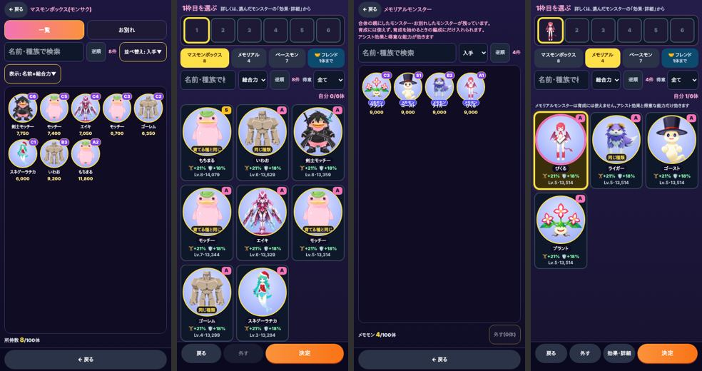
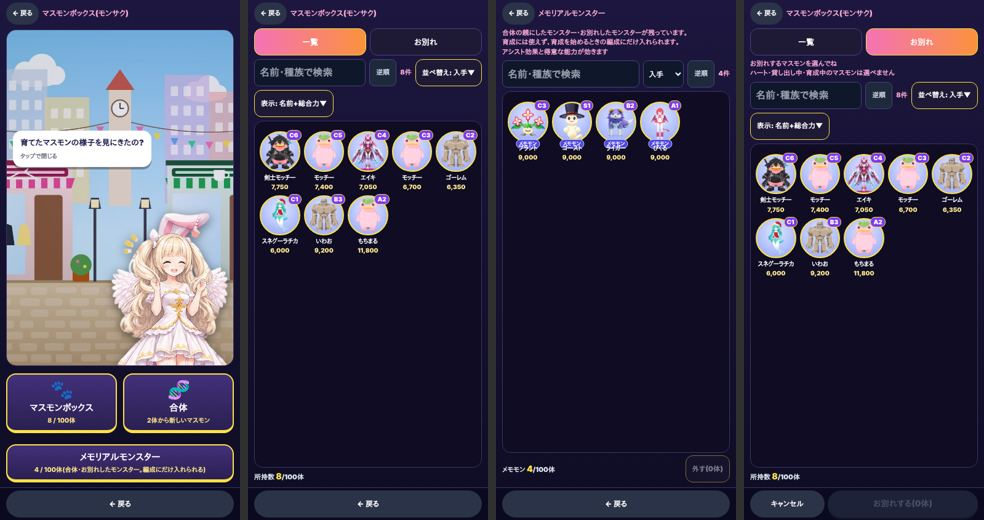
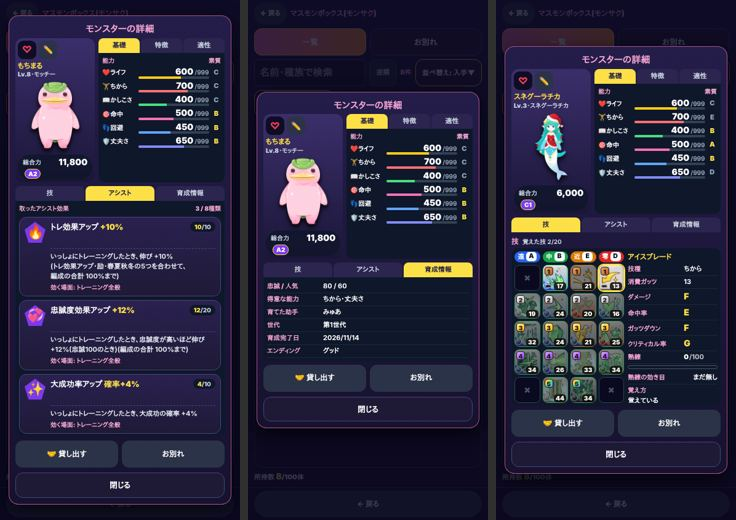
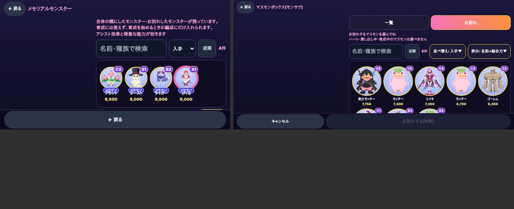

# マスモンボックスまわりの点検のやり直し(2026-11-20・ミハリ)

社長が実機で4件を見つけた(メモモンの名前が札に隠れる/メモモンを押しても詳細が開かずアシスト能力が見られない/合体の窓がマスモンの一覧と違う見せ方/モンスターの詳細で「閉じる」と後ろの「← 戻る」が二重)。
社長「こういう目線で見てって言ったのにまだちゃんと確認してないの?」。⑩の点検(`docs/progress/kensa/monsuc-unverified-2026-11/README.md`)で見落としたので、範囲を絞ってやり直した。**上の4件は⑥と④が直すので、ここには書かない。**

- 基準: main `52c2a0f3`(2026-11-20 06:21 JST 時点)。監査だけで、ゲームのコードは変えていない
- 範囲: マスモンボックス(入口・一覧・お別れ・表示の切り替え・名前と染色)・メモモン(一覧・外す)・合体(親えらび・見通し・演出)・モンスターの詳細(基礎/特徴/適性 × 技/アシスト/育成情報 の全部のタブ・技を押した所)・編成の候補(マスモンボックス・メモリアルのタブ)・助手の説明(入口の吹き出し)
- 大きさ: 縦 390×844・横 844×390・小さい横 568×320(**iPhone の実機ではない**)
- 開き方: `tools/success/success-r3-shoot.js` の写しで、ボックスに8体・メモモンに4体を入れた偽の保存(ページの中だけ)から30場面 × 3つの大きさを開いた。各場面で「見えている閉じる・戻る」「画面の外のボタン」を測り、止め絵を目で見た
- 見方: プレイヤーが初めて触ったとき(名前・数字が読めるか/押して見たい物が見られるか/閉じる・戻るが1つで分かるか/ほかの画面とそろっているか/説明が足りているか)

## 件数

| 優先度 | 件数 | 番号 |
| --- | --- | --- |
| 高 | 3 | B-1〜B-3 |
| 中 | 7 | B-4〜B-10 |
| 低 | 6 | B-11〜B-16 |
| 合計 | **16** | (社長の4件と、前の点検で既知の件は数えていない) |

## 先に直すべき物(上位10件)

1. B-1 同じモンスターの総合力とランクが、画面によって違う(ボックスの一覧と編成の候補)
2. B-2 メモモンを外す確認に、どの子かが出ない(元に戻せない操作)
3. B-3 ボックスのどの画面にも「← 戻る」が上と下に2つある
4. B-4 育成情報の「忠誠 / 人気 80 / 60」が分数に読める
5. B-5 アシスト効果の札の「10/10」「12/20」が何の数か分からない
6. B-6 ボックスに、合体・メモモン・お別れの説明が無い(みゅあの吹き出しはあいさつだけ・ヘルプへの入口も無い)
7. B-7 メモモンの一覧は「押す=外す選び」で、ボックスの「一覧/お別れ」のタブの作りとそろっていない
8. B-8 アシスト効果の説明に「励」「春夏秋冬の5つ」など、初めての人に分からない言葉
9. B-9 お別れのタブで、左上の「← 戻る」と下の「キャンセル」が同時に出る
10. B-10 小さい横で、メモモンの「外す」ボタンが下の帯に半分隠れる

## 問題の一覧

### 高

#### B-1 同じモンスターの総合力とランクが、画面によって違う — 高
- 画面: マスモンボックスの一覧/メモリアルモンスターの一覧/育成をはじめる → 編成の枠 → 候補(マスモンボックス・メモリアルのタブ)
- 起きること:
  - ボックスの一覧では、もちまるは「A2」・11,800。編成の候補では、同じもちまるが「S」・Lv.8・14,079
  - メモモンの一覧では C3・S1・B2・A1 と4体とも違う段で、どれも 9,000。編成の候補では4体とも「A」・13,514
- 原因(コードで確かめた): 一覧は引退したときに保存した `score`・`grade` を出し、編成の候補(`56-monhero-success-start.jsx` 116 行付近)は今の能力から `SUC.evaluate` で計算し直した `power`・`rank` を出す
- なぜダメか: 「さっき見た子と同じなのに数字も段も違う」は、一目でおかしい。どちらを信じればよいか分からない
- 注意: 偽の保存では、保存した点数と能力の値をそろえていないので、差が大きく出ている。本物のセーブでも、引退のあとに総合力の式や上限が変わった子(r1115-103 の上限アップなど)では食い違う(推測)。段の名前の付け方(一覧は「A2」、候補は「A」)はどのセーブでも違う
- 改善案: 1体の数字と段は、どの画面でも同じ値(保存した値か、計算し直した値のどちらか1つ)を出す。段は「A2」の形にそろえる
- 受け持ちの候補: ④(r1119-011 アシモン専用の見せ方で編成の札を作り直す所)
- 止め絵: `b1-power-rank-mismatch.jpg`(左から ボックスの一覧・編成の候補(ボックス)・メモモンの一覧・編成の候補(メモリアル))

#### B-2 メモモンを外す確認に、どの子かが出ない — 高
- 画面: メモリアルモンスター → 1体を押す → 「外す(1体)」
- 起きること: 窓は「1体をメモリアルモンスターから外しますか? 外したモンスターは元に戻せません」だけで、名前も顔も出ない。お別れの確認(「いわおとお別れしますか?」と名前の札)とそろっていない
- なぜダメか: 元に戻せない操作なのに、何を外すのかを確かめられない。押した子の印(桃色の輪)は窓の暗い幕の下で見えない
- 改善案: お別れの確認と同じ形にする(「◯◯をメモリアルモンスターから外しますか?」+名前の札と顔)
- 受け持ちの候補: ⑦
- 止め絵: `b3-remove-confirm.jpg`(左 = メモモンの外す確認、右 = お別れの確認)

#### B-3 ボックスのどの画面にも「← 戻る」が上と下に2つある — 高
- 画面: マスモンボックス(モンサク)の入口・一覧・メモリアルモンスター(4つの大きさの全部)
- 起きること: 左上の「← 戻る」と、下の帯いっぱいの「← 戻る」が同時に出る(測った位置: 縦で 10,4 と 10,796)。お別れのタブでは、左上が「← 戻る」、下が「キャンセル」(B-9)
- なぜダメか: 社長の4件目(詳細の「閉じる」と「← 戻る」の二重)と同じ形が、ボックスの画面そのものにある。どちらを押せばよいか迷い、2つが同じ動きかどうかも分からない
- 改善案: 戻るは左上の1つにする(下の帯は消すか、その画面の主な操作に使う)。⑥の共通の戻るの部品に載せる
- 受け持ちの候補: ⑥
- 止め絵: `b2-two-back.jpg`(左から 入口・一覧・メモモン・お別れのタブ)

### 中

#### B-4 育成情報の「忠誠 / 人気 80 / 60」が分数に読める — 中
- 画面: モンスターの詳細 → 下のタブ「育成情報」
- 起きること: 1行目が「忠誠 / 人気  80 / 60」。「60 のうち 80」と読める
- 改善案: 「忠誠 80」「人気 60」の2行に分ける
- 受け持ちの候補: ⑦
- 止め絵: `b4-detail-words.jpg` の2枚目

#### B-5 アシスト効果の札の「10/10」「12/20」「4/10」が何の数か分からない — 中
- 画面: モンスターの詳細 → 下のタブ「アシスト」
- 起きること: 効果の札の右上に「10/10」「12/20」「4/10」。何の数(段・ポイント・上限)かの説明が無い。上の「3 / 8種類」も何の8か出ない
- 改善案: 「Lv 10/10」のように頭に名前を付ける。参考(`assist-card-8-detail-2026-11-19.png`)は、効果の札に解放の丸を並べて見せている
- 受け持ちの候補: ④(r1119-011 アシモン専用の見せ方)
- 止め絵: `b4-detail-words.jpg` の1枚目

#### B-6 ボックスに、合体・メモモン・お別れの説明が無い — 中
- 画面: マスモンボックス(モンサク)の入口
- 起きること: みゅあの吹き出しは「育てたマスモンの様子を見にきたの?」のあいさつだけ。合体するとどうなるか(親2体はいなくなりメモモンになる)・メモモンは何に使えるか・お別れとの違いは、合体の見通しの窓を開くまで出ない。ヘルプ(「引退と評価・マスモンボックスと合体・ゲームオーバー」)への入口もこの画面に無い
- 改善案: 初めて開いたときだけ、みゅあが3つ(合体・メモモン・お別れ)を1行ずつ説明する。右上に「?」(ヘルプのそのページ)を置く
- 受け持ちの候補: ⑦

#### B-7 メモモンの一覧は「押す=外す選び」で、ボックスの作りとそろっていない — 中
- 画面: メモリアルモンスターの一覧
- 起きること: ボックスは「一覧/お別れ」のタブで、一覧では押すと詳細、お別れのタブでは押すと選ぶ。メモモンはタブが無く、押すといきなり外す選びになる(桃色の輪と「外す(1体)」)。押すと外す選びになることは、どこにも書かれていない
- 社長の2件目(詳細が開かない)の元はここ。直すときは、ボックスと同じ「一覧/外す」のタブに分けると、詳細と外すの両方がそろう
- 受け持ちの候補: ⑥(社長の2件目と一緒に)

#### B-8 アシスト効果の説明に、初めての人に分からない言葉 — 中
- 画面: モンスターの詳細 → アシスト(縦では3つとも同じ言い回し)
- 起きること: 「いっしょにトレーニングしたとき、伸び +10%(トレ効果アップ・励・春夏秋冬の5つを合わせて、編成の合計 100%まで)」。「励」「春夏秋冬の5つ」「編成の合計 100%まで」が何か分からない
- 改善案: 1行目は「いっしょにトレーニングすると、上がる量が +10%」だけにし、上限の話は押して開く説明へ
- 受け持ちの候補: ④(r1119-011)

#### B-9 お別れのタブで、左上の「← 戻る」と下の「キャンセル」が同時に出る — 中
- 画面: マスモンボックス → お別れのタブ
- 起きること: 左上「← 戻る」(ボックスの入口へ)と下「キャンセル」(お別れの選びをやめる)が並び、どちらが何をするか分からない
- 改善案: お別れの選び中は左上を「← やめる」にし、下は「お別れする(◯体)」だけにする
- 受け持ちの候補: ⑥

#### B-10 小さい横で、メモモンの「外す」ボタンが下の帯に半分隠れる — 中
- 画面: メモリアルモンスター(568×320)
- 起きること: 「外す(1体)」が下の「← 戻る」の帯の裏に半分もぐる。横でも左半分が空いたまま(前回 U-7 と同じ形)
- 受け持ちの候補: ⑥(B-3 の下の帯を消すと一緒に直る)
- 止め絵: `b5-memo-small.jpg`(左 = 小さい横のメモモン、右 = 横のお別れのタブ)

### 低

#### B-11 メモモンの一覧に「並べ替え」「表示」が無い — 低
- ボックスの一覧にはある(「並べ替え: 入手▼」「表示: 名前+総合力▼」)。メモモンは「入手」の選ぶ欄と「逆順」だけ。⑦

#### B-12 詳細のハート・鉛筆の印に名前が無い — 低
- 左上の ♡ と ✏ が何をするか(お気に入り=お別れで選べなくなる/名前と染色)が、押すまで分からない。⑦

#### B-13 顔の右上の「C6」「A2」「S1」が何か分からない — 低
- ボックス・メモモン・合体の顔に付く。評価(育成グレード)だが、一覧のどこにも名前が出ない。表示の切り替えに「評価」があるので、札の色だけでもそろえるとよい。⑦

#### B-14 詳細の下のタブが、前に開いたタブのまま開く — 低(要確認)
- 別の子を開いても「アシスト」や「育成情報」のまま開く。意図した作りなら問題なし(覚えておく作り)。毎回「技」から始まるほうが迷わない。⑦

#### B-15 合体の見通しの言葉が難しい — 低
- 「型: 普通(生まれたモンスターの種類の型)」「主血統は、主の親から受け継ぎます。成長の型は、…」。⑦

#### B-16 既存の見張りで、ボタンの字が真ん中に無い NG が8件 — 低
- `success-r3-shoot.js` の「描いた画素でも字・記号がボタンの真ん中」が、外す(A3)・お別れする(F1)・合体中…(F4・F5 の小さい横)で NG。⑨(または⑥)

## 確かめて問題が無かった所

- お別れの確認は、名前の札が出て、取り消しと決めるが並ぶ(B-2 の手本になる)
- 表示の切り替え(顔の下に出す物)は、8つとも読め、選んだ物に印が付く
- 詳細の 基礎・特徴・適性 のタブは、縦で能力6つ・素質の段・説明が読める。技の升目は覚えていない技も押すと詳細が出る
- 合体の親えらびは、ボックスと同じ顔の升目で、名前も読める(数字の行が無いのは社長の3件目に含まれる)

## 既知の件(ここでは数えていない)

- 社長の4件(メモモンの名前が札に隠れる・メモモンの詳細が開かない・合体の窓の見せ方・詳細の閉じると戻るの二重)— ⑥・④
- 横で左半分が空く(前回 U-7)・横で窓の閉じる・決めるが画面の外(U-12)・名前の無い子の見分け(U-21)・「同じ種類」の札(U-17)

使い捨ての台本と生の止め絵は scratchpad にだけ置き、コミットしていない。
