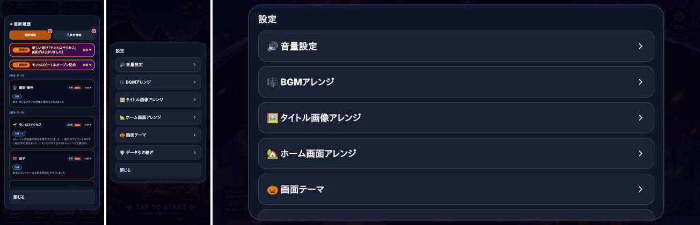
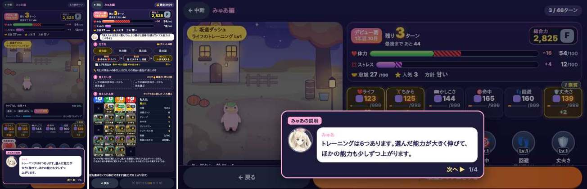

# モンサク全体の品質点検(r1119-004・2026-11-19・ミハリ)

社長の言葉(2026-11-19): 「モンサクで大会ボタンを押したら謎のSEが鳴ったり、バトルに勝ったらファンファーレがあるのに謎のSEが鳴ったりとか、いろいろだめ。
先週モンサクの開発をほとんど sonnet でやったことから、全体的にクオリティの低さを感じる。そういう目線で、全部一新するくらいの目線で点検してほしい」

**監査だけ。ゲームのコードは変えていない。**

- 本物のブラウザ(Chromium・Playwright)で、HOME の「モンヒロサクセス」の札から開いて遊んだ(デバッグの入口は使っていない)。
  保存はページの中だけの偽のデータ。Supabase への通信はすべてページの中で空の返事に差し替え、本番へは何も送っていない
- 通しで遊ばせたのは `tools/success/monsuc-play10.js` を写した使い捨ての台本(scratchpad・コミットしない)。
  縦 390×844 で 4 周(うち1周は 45 ターン目の引退まで・ヒーローズファイナル1回戦まで勝ち抜け)。途中の保存を入れて、横 844×390・小さい横 568×320・PC 1363×936 で同じ場面を撮った
- **iPhone の実機ではない**(タッチの機械として開いた Chromium)。音は鳴らした回数・順番・呼んだ関数を記録したもので、耳で聞いてはいない
- 音の記録: ページの中で `Audio_.fgSe.*`・`Audio_.se.*`・`playBGM`・`stopBGM`・`setBgmOnce`・`playJingle`・`playSeFile` を包み、
  「音の ID・時刻・呼んだ関数(スタックの上から)・直前に押したボタン・裏の音を止める印(Q)」を残した
- 前回の点検(`../uiux-audit-2026-11/README.md` の C-1・M-1〜M-9)と、前回のすり合わせの X-1〜X-4 などは**既知**として数えない
- バトル画面の「モンスターの大きさ・距離感」は別の会話が見ているので、気づいた事だけ一言(Q-2-6)

優先度: **致命** 遊べない・データが壊れる / **高** 多くの人が気づく・作品の質を明らかに下げる / **中** 気づけば避けられる・分かりにくい / **低** 見た目・揃え

## 件数

| 観点 | 致命 | 高 | 中 | 低 |
| --- | --- | --- | --- | --- |
| 1 音 | 0 | 4 | 4 | 1 |
| 2 演出と手触り | 0 | 1 | 4 | 1 |
| 3 画面の質 | 0 | 2 | 4 | 2 |
| 4 流れとわかりやすさ | 0 | 2 | 3 | 0 |
| 5 文言 | 0 | 0 | 3 | 2 |
| 6 作りの質 | 0 | 2 | 3 | 0 |
| 計(38件) | 0 | 11 | 21 | 6 |
| 追加 B・C・D・E(文書の後半) | 0 | 7 | 3 | 0 |

---

## 社長の2件の正体(再現して特定した)

### ① 大会のボタンを押すと鳴る謎の SE = `join`(仲間が加わった音)

- 再現: 育成の画面で「🏆 大会 今月の大会」を押す。デビュー戦・期末の大会の日は「本番 🏆 大会 デビュー戦」の札を押す
- 記録: 押した 3ms 後に `fgSe.join`(大会の受付を開いた回はすべて)。そのあと「はい」で `♪monsuc_cup`
- 呼んだ所:
  - `56-monhero-success-r3-cup.jsx:152` 大会の受付(月の大会を選ぶ画面)の `useEffect(() => SuccessSound.se('cupEntry'), [])`
  - `56-monhero-success-r3-cup.jsx:500` 決まった日の大会の受付 `MsxR3PreDesk` の同じ形
  - → 表 `data/success-sounds.js` の `cupEntry: { bgm: 'monsuc_cup', se: 'join' }` の `se`
  - 音の中身は `14-audio.jsx:897` の `join`(三角波の和音。ほかでは「仲間が加わった」「マスモン対戦の交代」に使う音)
- なぜ謎に聞こえるか: 受付の画面は「育成中の曲のまま」にする決め(2026-11-14 社長)なので、曲は替わらず**効果音だけが単独で鳴る**。
  しかもボタンの音(`tap`)はモンサクの中では鳴らない(Q-1-3)ので、「大会」だけに知らない音が付いて聞こえる。音の意味(仲間が加わる)とも合わない
- あるべき音: 「決定」の音1つ(カードバトル・HOME と同じ `tap`、または全体でそろえた決定音)。画面を開いた合図の音は要らない

### ② 勝ったときにファンファーレと一緒に鳴る謎の SE = `victory`(カードバトルの勝ちの音)

- 再現: 大会の試合に勝つ(オートでよい)
- 記録(1試合目の例): 決着の瞬間に `fgSe.victory` → **1.7 秒後**に `♪monsuc_win`(社長の持ち込みの勝利ジングル・1回だけ)。通しの周で勝った試合 5 回すべて同じ。
  負けでは `fgSe.trainingFail` → 1.7 秒後に `♪monsuc_lose`
- 呼んだ所:
  - `victory`: `56-monhero-success-arena.jsx:1538-1542` 試合の部品が決着で自分で鳴らす `if (sound) msaSe(win === 'A' ? 'victory' : 'trainingFail')`
    (`msaSe` は `Audio_.fgSe` を直接呼ぶ口・同ファイル 439 行)
  - `♪monsuc_win`: `56-monhero-success-r3-cup.jsx:572` `useSuccessScene(cupSound)` で見せる部品の段が `win` になったとき(表の `cupWin`)
- 悪さが2つ重なっている:
  1. 勝ちの音が2系統(試合の部品の `victory` と、大会の画面の `monsuc_win`)から別々に出る。同じ「勝った」に2つの音
  2. `victory` の中身(`14-audio.jsx:898`)は**流れている曲を止める**(`stopOthers(null); currentKey = null`)。試合の曲がブツッと切れ、
     1.7 秒の無音のあとジングルが始まる
- 同じ部品の `MsaFinish`(`56-monhero-success-arena.jsx:2062-2064`)は `victory` + 0.65 秒後に `rankFanfare` を鳴らす作り。今回の流れでは呼ばれなかった(記録に無い)が、
  別の入口(マスモン対戦など)で同じ部品を使うと3つ重なる見込み(推測・未計測)
- あるべき音: 決着の音は大会の画面(`SuccessSound`)の1か所だけ。モンサクの中では試合の部品の決着音を出さない(部品に「音は親が出す」の口を付ける)。
  曲を止めるのはジングルに切り替えるときだけ

---

## 音の表(記録したもの・縦 390×844・オート)

「Q」= 裏の音を止める印が立っている(`Audio_.se.*` は鳴らない。`fgSe.*` は鳴る)。モンサクの中はずっと Q だった。

| 場面・操作 | 鳴った音(順・間) | 呼んだ所 | 重なり・問題 | あるべき音 |
| --- | --- | --- | --- | --- |
| HOME → モンヒロサクセスの札 | `se.tap`(Q で無音)→ `♪monsuc_menu` | 60-app の全ボタン共通 / `useSuccessSound` | ボタンの音が出ない | 決定音 + 曲 |
| モンサクの中のボタン全部(次へ・戻る・はじめる6段・トレーニングを選ぶ…) | `se.tap` が Q で**無音** | `60-app.jsx:7139-7148` | 押しても音が無い。カードバトルは全ボタンで鳴る | 決定・戻るの音 |
| 育成を始める | `♪original_home_2` + 約0.1秒で `levelUp` | 表 `main` / 円盤石の演出 | — | よい |
| トレーニングをする | `♪monsuc_training` → 結果の「次へ」で `♪original_home_2` | 表 `training`→`main` | 1ターンに曲が2回替わる(Q-1-5) | 曲は育成の曲のまま・演出の音だけ |
| 休む | `♪monsuc_rest` + `heal` + 0.1秒以内にもう一度 `heal` | 表 `rest` の se + ゲージの演出 | **同じ音が二重** | `heal` 1回 |
| 遊ぶ | `♪ichika_home` + `trainingGood` + 11ms 後に `heal` | 表 `play` の se + ゲージの演出 | 2つの音がほぼ同時 | 1つ |
| 修行する | `♪original_prep` + `trainingDecide` → 戻ると `♪original_home_2` + `trainingFail`(覚えなかった) | `56-monhero-success-r3-quest.jsx:25,28` | 曲が2回替わる | — |
| 🏆 大会(受付を開く) | `fgSe.join` | r3-cup.jsx:152 / :500 | **社長①** | 決定音のみ |
| 出場 → はい | `♪monsuc_cup` | `useSuccessScene('cupPre')` | — | よい |
| 準備完了(試合が始まる) | `card` + `♪ichika_battle` + `trainingDice` + 1.75秒後 `trainingDecide` | arena.jsx:1382 / 表 `cupMatch` の se | **3つが 1ms 以内に重なる**。`trainingDice`(さいころ)は試合と無関係 | 曲 + 開始の合図1つ |
| 試合中 | ため・移動・気合に `trainingGood`・`trainingBad`・`trainingMove`(トレーニングの音の流用)、KO に `enemyCharge` | arena.jsx:1371-1382 | 試合なのに育成の音。KO が「ため」の音 | 試合用の音 |
| 勝ち | `victory`(曲を止める)→ 1.7秒の無音 → `♪monsuc_win` | arena.jsx:1541 / r3-cup.jsx:572 | **社長②** | ジングル1つ |
| 負け | `trainingFail` → 1.7秒後 `♪monsuc_lose` | 同上 | 2系統 | ジングル1つ |
| 勝ち・負けのあと「次へ」(期の区切り) | `♪monster_hero_theme` + `rankFanfare` | `56-monhero-success-main.jsx:559` `kiShow` | ジングル(6.9秒)を 0.2〜0.3秒で切る。**負けた直後でもファンファーレ** | ジングルを待つ(`sceneAfterOnce`)・負けたあとは控えめに |
| ヒーローズファイナル 決勝の受付 | `fgSe.join` | r3-cup.jsx:500 | ①と同じ | — |
| 引退へ | `♪original_result` + `rankFanfareGrand` | `56-monhero-success-r3-retire.jsx:81` | — | よい |
| ホームへ | `♪monsuc_menu` | — | — | よい |
| 試合の中の ×1・×2・×4・飛ばす・オート | `fgSe.tap` | arena.jsx:1847-1890 | モンサクでここだけボタンが鳴る | 全体とそろえる |

比べた所(コードで数えた・未計測): カードバトル(`84-screen-card-battle.jsx`)はボタンで `fgSe.tap` を 45 か所から鳴らし、勝ちは `victory` 1つ。
HOME などは 60-app の共通の `tap`。モンヒロビートは画面のボタンに効果音を付けていない。**モンサクは「ボタンは無音・場面が替わると効果音」で、ほかのどのモードとも違う。**

---

## 問題の一覧

### 1 音

#### Q-1-1 大会の受付を開くたびに `join` が鳴る(社長①) — 高
- 画面: 育成 → 🏆 大会 / 決まった日の大会の受付 / 再現手順: 上の「社長の2件」
- なぜダメか: 意味の違う音が、押した物と関係なく「画面が出た」ことに鳴る。ほかのボタンは無音なので目立つ
- 改善案: `cupEntry` の `se` を外す(受付の2か所の `useEffect` も消す)。押した音はボタン共通の決定音に任せる(Q-1-3)

#### Q-1-2 勝ち・負けの音が2系統から鳴り、曲がいったん止まる(社長②) — 高
- 画面: 大会の試合の決着 / 再現手順: 試合に勝つ・負ける
- 起きること: 決着で `victory`(または `trainingFail`)、1.7秒後に `monsuc_win`(`monsuc_lose`)。`victory` は試合の曲を止める
- 改善案: 試合の部品に「決着の音を出さない」口(例 `sfx: 'none'` か `sound` を偽)を付け、モンサクから使うときは切る。
  勝ちの音は表の `cupWin`・`cupLose` だけにする。`victory` の「曲を止める」は勝利ジングルを持たない画面だけの動きにする

#### Q-1-3 モンサクの中ではボタンを押しても音が出ない — 高
- 起きること: 60-app の「全ボタンのタップに共通 SE」は `Audio_.se.tap`(裏の音を止める印で消える口)で鳴らす。モンサクは入ると印を立てる
  (`14-success-sound.jsx` の `enter`)ので、**モンサクのボタンはすべて無音**。印が立つのは裏のバトルの音を止めるためで、ボタンの音まで止める意図は見当たらない(推測)
- 例外は試合の中のボタン(×4・飛ばす など)だけで、こちらは部品が `fgSe.tap` を直接鳴らす → 同じモンサクの中で鳴る所と鳴らない所がある
- なぜダメか: 押した手ごたえが無い。カードバトル・HOME は鳴る。「無音の画面に、場面の効果音だけがときどき鳴る」形が「謎の SE」の土台になっている
- 改善案: 共通のタップ音を `quickAnywhereSeQuietRef` と同じように「サクセスの画面を開いているあいだは `fgSe` で鳴らす」(60-app の 1 行)。
  決定・戻る・押せない、の3つを全モードでそろえる

#### Q-1-4 試合の開始で3つの音が同時に鳴る(`card`+`trainingDice`+曲の切り替え) — 高
- 起きること: 「準備完了」で、試合の部品の `card`、表 `cupMatch` の `trainingDice`(さいころの音)、`♪ichika_battle` が 1ms 以内に重なる。1.75秒後にまた `trainingDecide`
- 改善案: `cupMatch` の `se` を外す。開始の合図は試合の部品の1つだけ

#### Q-1-5 1ターンの中で曲が何度も替わる — 中
- 起きること: トレーニング `monsuc_training` → 結果で `original_home_2`、遊ぶ `ichika_home` → 戻る、休む `monsuc_rest` → 戻る、修行 `original_prep` → 戻る。
  縦の通し 45 ターンで `playBGM` が 129 回。各曲は数秒しか鳴らず、毎回頭から始まる
- なぜダメか: 曲の頭ばかりを聞かされ、落ち着かない。参考(LINE MF)も行動ごとに曲は替えない(推測: REF-MAP の動画では未確認)
- 改善案: 曲は「育成中」「大会」「大事な場面(覚醒・エンディング)」の3段に絞り、行動は効果音とジングルで表す

#### Q-1-6 負けた直後に期の区切りのファンファーレ(`rankFanfare`)が鳴り、負けのジングルを切る — 中
- 再現: 期末の大会に負ける → 「次へ」/ 記録: `♪monsuc_lose` の 0.3秒後に `♪monster_hero_theme` + `rankFanfare`
- 勝ったときも `monsuc_win`(6.9秒)を 0.2秒で切る。エンディングには「ジングルを待つ」作り(`sceneAfterOnce`)があるのに、期の区切りは使っていない
- 改善案: 期の区切りも `sceneAfterOnce` で入る。負けたあとの区切りはファンファーレを外す

#### Q-1-7 休む・遊ぶで同じ種類の音が二重に鳴る — 中
- 起きること: 休む `heal` ×2(表の `rest` とゲージの演出)/ 遊ぶ `trainingGood` + `heal`(11ms 差)
- 改善案: ゲージの演出の音か表の音か、どちらか1つにする(11/14 のクラフト12「休む・遊ぶ・通院にもゲージの変化と音」を足したときに表の音を外し忘れた見込み)

#### Q-1-8 試合の効果音がトレーニングの音の流用 — 中
- `trainingGood`(ため)・`trainingBad`(すねる)・`trainingMove`(移動)・`enemyCharge`(KO)。KO で「ため」の音が鳴る
- 改善案: 試合の音を決める表を `success-sounds.js` と同じ形で作り、試合の部品はそこから引く

#### Q-1-9 `join` が「受付」「交代」「中身が出た」「NEXT」「博士が飛びこむ」に共用されている — 中
- 表の中で `join` が 5 場面、`levelUp` が 6 場面、`fusion` が 5 場面。音の意味がばらばら
- 改善案: 音の ID を「意味」で選び直す(決定・成功・大成功・失敗・回復・出現 …)。表に「意味」の列を足す

#### Q-1-10 マスモン対戦の決着の大写し `MsaFinish` は `victory` + `rankFanfare` を重ねる — 低(推測・未計測)
- `56-monhero-success-arena.jsx:2062-2064`。今回の大会の流れでは呼ばれなかった。マスモン対戦の側で同じ重なりになる見込み

### 2 演出と手触り

#### Q-2-1 勝利の一瞬が「止まる→無音→ジングル」で、盛り上がりの頂点が抜ける — 高
- Q-1-2 の音に加え、決着から大写しまでの 1.7 秒は画面の変化も小さい(止め絵 `msq-result-title.jpg` の左)
- 改善案: 決着の瞬間(最後の一撃)で止め絵1枚の溜め → ジングルの頭に合わせて「優勝!」を出す、の1本の流れに作り直す

#### Q-2-2 結果の札の大見出し(「優勝!」「勝ち抜け!」「負けた…」)が札の上で切れる・薄い — 中
- 止め絵: `msq-result-title.jpg`。「優勝!」は札の上の端で半分切れて薄く、「勝ち抜け!」も上が札の縁にかかる
- 改善案: 見出しを札の内側に収め、本体の絵の上に重ねない

#### Q-2-3 試合の入り(大会名の大写し)の画面がほぼ暗いまま — 中
- 止め絵: `msq-match-intro.jpg`。大会名の大文字と、暗い幕の下に薄くモンスター。中段の 300px ほどが何もない暗がり
- 改善案: 両者の立ち絵を左右から入れる VS の形にする(参考の LINE MF の試合前の札を REF-MAP で引いて合わせる)

#### Q-2-4 毎月の「月めくり」で1回「次へ」を押させる — 中
- 止め絵: `msq-small-month.jpg`(小さい横)。月が替わるたび全画面の月の札 + 「次へ」
- 46 ターンで約 40 回。情報は「この期の残り◯ターン」と「期末の大会まで」だけ
- 改善案: 1秒で自動で消える帯にし、期が替わる月だけ全画面にする

#### Q-2-5 賞金ランクの段の表が1ターンに2回出る — 中
- 止め絵: `msq-rank-twice.jpg`。大会の結果の中に段の表、次の「次へ」でもう一度同じ表(「ランク UP!」)。どちらも画面の半分を使う
- 改善案: 段が上がったときだけ1回にまとめる

#### Q-2-6(一言)バトルのモンスターの大きさ・距離感 — 低(別の会話の受け持ち)
- 縦の試合で、両者が画面の上半分の真ん中に小さく寄っていて、中段から下は技の札と速さの帯(`msq-match-intro.jpg` の右)。深掘りはしていない

### 3 画面の質

#### Q-3-1 説明の吹き出し(みゅあの説明)が、説明している物そのものを隠す — 高
- 止め絵: `msq-bubble-stays.jpg`・`msq-yoko-event-bubble.jpg`
- 起きること: 画面の下 1/3 を幕つきの吹き出しが覆う。説明の対象(出来事の選択肢・賞金ランクの表・能力ポイントの振り分け・決定ボタン)が吹き出しの下に隠れる。
  横・小さい横では選択肢の文がほぼ全部隠れる
- 改善案: 吹き出しは対象と重ならない側(上か、対象の横)に出し、対象を明るく抜く(指さしの形)

#### Q-3-2 PC では、画面の真ん中の細い列にすべてが入り、両側が空く(前回 M-8 の続き・別の画面でも) — 高
- 止め絵: `msq-pc-main.jpg`(1363×936)。育成の画面は横の並び(左に絵・右に数字)になるが、文字が大きく、右の 1/3 と下が空く。画面によって縦の並びのままの物もある
- 改善案: PC の幅の決まりを1つ作る(最大幅 960px の2段組みなど)。`docs/spec/MONSUC_UI.md` に足す

#### Q-3-3 小さい横で月の札の数字が切れる・期の帯がはみ出す — 中
- 止め絵: `msq-small-month.jpg`(568×320)。「5月」の 5 が札の上下で切れ、期の帯は「プロ」で切れて「最後」が見えない
- 改善案: 高さ 440px 以下では札を横長の1行にする

#### Q-3-4 はじめる画面の「育てるモンスター」で、一覧と絵の間に大きな空き — 中
- 止め絵: `msq-start-steps.jpg` の左。7体の一覧の下に 200px ほどの何もない帯。7体に検索窓・並び替え・逆順が付いていて道具が多すぎる
- 改善案: 一覧の数が少ないうちは検索と並び替えを畳む。空きは絵を大きくして埋める

#### Q-3-5 文字の大きさが 9〜11px に寄っている — 中
- `style={{ fontSize }}` の直書きで 9・9.5・10・10.5・11px が約 20 か所(モンサクの部品だけ)。修行の画面・引退の数字・技の札は縦で読むのがつらい
- 改善案: 文字の大きさを 4 段(12・14・16・20)のトークンにし、直書きをやめる

#### Q-3-6 持ち物を持っていない人にも「持ちこみ」の段で 20 個の灰色の札を並べる — 中
- 止め絵: `msq-start-steps.jpg` の3枚目。全部が×0 で押せず、画面全体が灰色
- 改善案: 持っていないときは段ごと飛ばすか、「持ち物は町のお店で買えます」の1行だけにする

#### Q-3-7 時をもどす(やり直し)の選択肢が、持っていなくても大きく出る — 低
- 止め絵: `msq-result-title.jpg` の右。×0 の砂時計2つが大きな札で並び、押せるのは「あきらめる」だけ
- 改善案: 持っていない物は小さく畳む

#### Q-3-8 助手を選ぶ段で、8人中7人が「準備中」の黒い影 — 低
- β のあいだの見せ方として、横一列の影が目立つ。改善案: 「ほかの助手は近日」の1枚にまとめる

### 4 流れとわかりやすさ

#### Q-4-1 育成を始めるまでの画面が多い(ストーリー選択 + 6段) — 高
- 止め絵: `msq-start-steps.jpg`。ストーリー選択 → 1 育てる子 → 2 編成 → 3 助手(選べるのは1人)→ 4 持ちこみ(持っていなければ空)→ 5 名前と染色 → 6 確認
- 初めての人は 7 画面すべてを読まされ、うち 2 段(助手・持ちこみ)は β では選ぶものが無い
- 改善案: 「おまかせで始める」を最初に置き、細かく選ぶ人だけ6段に入る。選ぶ物が無い段は飛ばす

#### Q-4-2 説明の吹き出しが画面をまたいで残る・同じ説明が何度も出るように見える — 高(要確認)
- 止め絵: `msq-bubble-stays.jpg`。「育成はここまでです…(1/3)」がアシストポイント → 能力ポイント → 引退の3つの画面に続けて出る。
  「試合は、自分で操作できます(1/3)」も1回目の試合とヒーローズファイナルで出た。「大会の案内が出てきました(1/2)」も2回出た
- 注意: 台本は吹き出しの裏のボタンを押して先へ進んだ(要素を直接押す)。**吹き出しを最後まで読まずに進むと、また出る作りなのか、台本の押し方のせいなのかは切り分けていない**
- 改善案: 説明は「一度出したら見た印を付ける」(最後まで読んだかどうかで分けない)。画面が替わったら閉じる

#### Q-4-3 ターンの数え方が3つある — 中
- 上の帯「10 / 46ターン」、能力の札「残り 8 ターン・最後まで あと 37」、月の札「この期の残り 8 ターン」。
  最後のターンの画面は「終了」と出ながら「最後まで あと 2」
- 改善案: 見出しは「◯年目◯月・残り◯ターン」の1つにし、期の残りは帯の中に小さく

#### Q-4-4 負けた理由「意味不明な行動で4回技を出さなかった(忠誠が低いと言うことを聞かない)」が、そのときの忠誠 64 と合わないように読める — 中(推測)
- 止め絵: `msq-result-title.jpg` の右。忠誠 64/100 で「忠誠が低い」と出る。どの値から低いかが画面に無い
- 改善案: 「忠誠 64(80 未満だと、ときどき言うことを聞かない)」のように境目を出す

#### Q-4-5 戻る・中断・閉じるが場所で替わる(前回 M-7 の続き) — 中
- 今回の通しで見た左上: 「← 戻る」「← 中断」「← 閉じる」「← 表へ」。同じ画面の左上と下の帯に「戻る」が2つある所も残る

### 5 文言

#### Q-5-1 「賞金ランク」と「賞金の段」が混ざる — 中
- 大会の受付の帯「賞金の段 腕利き」、結果の表「賞金ランク」、説明の吹き出し「賞金ランクが上がります。1段上がるたびに…」
- 改善案: 画面の名前は「賞金ランク」に1つ。段は「ランク」で呼ぶ

#### Q-5-2 「アシストポイント」「能力ポイント」「能力」が引退の流れで続けて出る — 中
- 引退の前に「アシストポイント 141/141」→「能力ポイント 270/270」。どちらも「ポイント」で、何に使うかが見出しで分からない
- 改善案: 見出しに使い道を入れる(「アシスト能力を覚える」「能力値に振り分ける」)。能力ポイントと能力値を混ぜない決まりは守れていた

#### Q-5-3 負けたわけの文が長い一文(句点なしで2つの理由をつなぐ) — 中
- 「モッチーが 意味不明な行動で、4回 技を出さなかった(忠誠が低いと言うことを聞かない)」
- 改善案: 「4回、言うことを聞かなかった」+ 下に小さく「忠誠を上げると聞くようになる」

#### Q-5-4 「SKIP ▸▸」「⏭ 飛ばす」「⏩ 結果へ ▶」「短縮 ⏭」「早送り ⏩」が並存 — 低
- 同じ「先へ進める」に5つの書き方。英語の「SKIP」はモンサクでここだけ
- 改善案: 「飛ばす ⏭」1つにそろえる

#### Q-5-5 「育成イベント」「育成の出来事」「出来事」「イベント図鑑」が混ざる — 低
- 画面の札は「育成イベント」、説明は「こんなふうに出来事が起きます」、ホームは「イベント図鑑」。改善案: 「イベント」に1つ

### 6 作りの質(コードを少し見た)

#### Q-6-1 音を鳴らす口が3つあり、決まりを見張る検査が画面を見ていない — 高
- `14-success-sound.jsx` の先頭に「画面は SuccessSound を呼ぶ。Audio_ を直接触らない」とあるが、
  試合の部品 `56-monhero-success-arena.jsx` は `msaSe`(439 行)で `Audio_.fgSe` を直接約 20 か所から鳴らす。60-app の共通タップは別の口
- 見張りの `tools/success/success-sound-check.js` は表と口(14-success-sound.jsx・14-audio.jsx)だけを読み、画面のファイルを見ない → 社長の2件はどちらも検査をすり抜けた
- 改善案: 「モンサクの部品(56-monhero-success-*・56-monsuc-*)は `Audio_` を直接呼ばない」を検査に足す。試合の音も表から引く

#### Q-6-2 見た目が CSS と直書きの両方に散らばる — 高
- モンサクの部品の合計 1.4MB のうち、CSS の文字列だけで `56-monhero-success-css.jsx` 143KB + `56-monhero-success-r3-css.jsx` 37KB + 各部品の `<style>` 10 か所。
  さらに `style={{…}}` の直書きが main 105・r3-cup 61・start 51・arena 35・trainfx 30・r3-retire 30 か所
- 「回2」の CSS(`.v-*`)と「回3」の CSS(`r3-css`)が同じ部品を2回書いている所があり、直すたびに片方だけ直る形(推測: 2つの CSS の重なりを全部は突き合わせていない)
- 改善案: 色・文字・余白・札の形のトークンを1つの CSS にまとめ、直書きを消す

#### Q-6-3 待ち時間の数値が部品ごとの直書き — 中
- `setTimeout(…, 650)`・`1750`・`7200`(ジングルの長さ)・`9000`・`7000` など、演出の間が各部品に散らばる。ジングルの長さ(6.9秒)は `14-success-sound.jsx` の `ONCE_MS = 7200` に手で写している
- 改善案: 演出の間を1つの表にし、ジングルの長さは曲の表(`13-bgm-and-rhythm-settings.jsx`)から引く

#### Q-6-4 大会が「回2」と「回3」の二重の作り — 中
- `56-monhero-success-cup.jsx`(788 行・見せる部品 `MonsucCupShow`)と `56-monhero-success-r3-cup.jsx`(813 行・受付と画面の進行)が段(組み合わせ表・札・試合・決着)を
  `showOn`・`showView`・`showDbg` の3つの印で分け合っている(r3-cup.jsx:558-572)。音の段も印によって2通りに決まる
- 改善案: 大会の進行(段)を1つの状態にまとめ、見せる部品はそれを受け取るだけにする

#### Q-6-5 大きいファイル — 中
- arena 179KB・css 143KB・main 140KB・start 95KB・r3-cup 85KB。1つの部品に画面・進行・音・説明が混ざる
- 改善案: 下の「作り直すなら」の順で割る

---

## 「作り直すなら」の提案

### 小さく直すもの(今の作りのままで直る)

1. `cupEntry` の `se`・`cupMatch` の `se` を外す(Q-1-1・Q-1-4)。受付の2か所の `useEffect` を消す
2. 試合の部品の決着音をモンサクの中で切る口を付ける(Q-1-2)
3. 共通タップ音をサクセスの画面では `fgSe` で鳴らす(Q-1-3・60-app の1行)
4. 期の区切りを `sceneAfterOnce` で入る(Q-1-6)。休む・遊ぶの二重の音を1つに(Q-1-7)
5. 結果の見出しの切れ(Q-2-2)・小さい横の月の札(Q-3-3)・文言の揺れ(Q-5-1・Q-5-4・Q-5-5)

### 土台から作り直すもの(順番)

1. **音の土台**(最初): 「意味」で引く音の表を1つ(決定・戻る・成功・大成功・失敗・回復・勝ち・負け・試合の各動き)。
   モンサクのすべての部品は表から引き、`Audio_` を直接呼ばない。検査で画面のファイルまで見張る(Q-6-1)。曲は3段(育成・大会・大事な場面)に絞る(Q-1-5)
2. **見た目の土台**: 色・文字の大きさ(4段)・余白・札の形のトークンと、縦・横・小さい横・PC の4つの並べ方を1つの CSS に。回2/回3 の CSS を統合し直書きを消す(Q-3-2・Q-3-5・Q-6-2)
3. **説明の土台**: 説明の吹き出しを1つの部品にし、「対象を隠さない位置」「見た印は出した時点で付ける」「画面が替わったら閉じる」を部品が守る(Q-3-1・Q-4-2)
4. **大会の進行**: 受付 → 組み合わせ表 → 札 → 試合 → 決着 → ごほうび を1つの状態で進め、音・演出・画面はその段を見るだけにする(Q-6-4・Q-2-1)
5. **流れの整理**: はじめる段の「おまかせ」、月めくりの帯化、ターンの数え方の統一(Q-4-1・Q-2-4・Q-4-3)

## 先に直すべき10件(最初の版。追加分を合わせた版は文書の終わり)

1. Q-1-2 勝ちの音の二重と曲の途切れ — 社長が名指しした。勝つたびに毎回起きる
2. Q-1-1 大会の受付の `join` — 社長が名指しした。毎月の大会で毎回起きる
3. Q-1-3 モンサクのボタンが無音 — 「謎の SE」が目立つ土台。60-app の1行で全ボタンが直る
4. Q-1-4 試合の開始の3音の重なり — 大会のたびに毎回。表の1行で直る
5. Q-6-1 音の検査が画面を見ていない — 直しても同じ形がまた入るのを止める
6. Q-1-6 負けた直後のファンファーレ・ジングルの切れ — 期末の大会のたびに起き、気持ちと逆の音が鳴る
7. Q-3-1 説明の吹き出しが対象を隠す — 初めての人ほど全画面で当たる
8. Q-4-2 説明が画面をまたいで残る・繰り返す(要確認) — 本当なら初めての人以外にも毎回出る。まず切り分け
9. Q-4-1 始めるまでの7画面 — 1周ごとに通る入口。「おまかせ」1つで大きく縮む
10. Q-1-7 休む・遊ぶの二重の音 — 毎ターン起きる。直しは1行

## 確認済みの観点(見つけたふりをしない)

- 縦 390×844 で、HOME の札 → はじめる6段 → 46 ターン(トレーニング・休む・遊ぶ・修行・出来事・お話・大会 8 回・ヒーローズファイナル)→ 引退 → おつかれさま会 → モンサクのホーム まで、
  止まらず進めた(ページのエラー 0)。台本の自動の見張り(はみ出し・横スクロール・画像が読めない・画像の伸び)は 0 件。字の切れは「ウンディーネ」の名前の札の 2 件だけ(前回までに既知)
- 音: 上の表の場面はすべて記録で確かめた。モンサクの中で裏の音を止める印(Q)はずっと立っていた
- 文言: 「能力ポイント」と「能力値」の混同は今回の通しの画面では見つからなかった。ネタバレ(まだ出ていない敵の数字)は見つからなかった
- 横 844×390・小さい横 568×320・PC 1363×936 は、10 ターン目の保存から「続きから」→ 月めくり → 出来事の画面までを撮った

## 確かめられなかったこと(推測のまま・未確認)

- **耳で聞いていない**(音の呼び出しの記録だけ。ヘッドレスのため実際の音量・長さ・音色は未確認)。`victory` の長さと、無音の 1.7 秒の聞こえ方は推測
- 横・小さい横・PC での大会の一覧・試合・結果の画面は撮れていない(台本が出来事の説明で止まったため。小さい横の大会の確認窓は前回 M-1 で既知)
- 覚醒・イッサ博士・ゲームオーバー・優勝のエンディング・ランキング β1/β2・マスモンボックス・助手の説明・ヘルプの該当ページは、今回の通しで通らなかったか、通ったが見ていない
- Q-4-2 の「説明が繰り返す」は台本の押し方のせいの可能性を切り分けていない
- 参考(LINE MF)の実物との突き合わせ(REF-MAP)はしていない。Q-1-5・Q-2-3 の「参考は〜」は推測
- 使い捨ての台本と記録は scratchpad にだけ置き、コミットしていない

---

# 追加の点検(窓口経由・社長の追加の止め絵と指摘 2026-11-19)

目線は「プレイヤーが見て一目でおかしいと分かるもの」を最優先にした。参考資料(`docs/reference/line-mf/`)は REF-MAP で行を引き、
動画から要所のコマを抜き出して(育成の動画 v1 の 3・19 秒、v3 の 22・28 秒、バトルの動画の 20・30・38 秒)今のモンサクと並べた。
抜き出したコマは scratchpad にだけ置き、リポジトリには入れていない(絵・名前・文言は写さない。見せ方だけを物差しにする)。

## A. 最近の一括変更による崩れ

対象: `f4010fa7`/`e46bc01c`「戻る系ボタンの統一(言葉と場所・形)」(parts 42 ファイル)、`40cc44ca`〜`748e0d4c`「統合バッチ(11/18夜): 実機フィードバック修正10件」、
`ed2db125`/`0554876b`「修行画面の技一覧を作り替え」。どれも窓口と別の目の確認(ミハリ)を通っていない(`gate` は新機能・保存データ・ランキングでないので「要らない」になる形)。

#### B-1 更新履歴の窓の「閉じる」が、メニューの1行の形(幅いっぱい・左寄せ・太字)で出る — 高(社長の止め絵を再現)
- 画面: HOME → 更新履歴 / 縦 390×844(止め絵 `msq-changelog-close.jpg` 左から 更新履歴・タイトルの設定(縦)・同(横))



- 原因: `f4010fa7` の `60-app.jsx`。窓の見出しの右上の「×」を消し、窓の下に `<button className="mh-dialog-choice" onClick={closeChangelog}>閉じる</button>` を足した。
  `mh-dialog-choice` は設定の窓の「🔊 音量設定 ›」のような**メニューの行**の形(`70-bootstrap.jsx` の `.mh-dialog-choice{display:flex;justify-content:space-between;padding:14px;…}`)で、
  ボタンの形(中央寄せ・塗り)ではない。同じ置き換えがタイトルの「設定」「データ引き継ぎ」などの窓にも入っている(タイトルの設定の窓では「閉じる」がメニューの7行目に並び、項目の1つに見える)
- 参考ではこうなっている: 窓の閉じるは右上の「×」か、下の中央の丸いボタン1つ(te 系の窓のスクショ)
- 改善案: 窓の閉じるは共通の `ModalCloseButton`(中央寄せ・高さ 48px)にそろえる。`mh-dialog-choice` を閉じるに使わない
- 「タブのすぐ下に上が切れたオレンジの枠」は、窓を開いた直後の位置では出なかった(一覧の先頭はオレンジの枠の「開催中」の札2枚で、上は切れていない)。
  送ったあとに一覧の札が送り箱の上端で切れて見えるのだと思われる(**推測・送った状態は撮っていない**)。送り箱の上端に区切り(影・線)が無いので、切れた札が「壊れた枠」に見える

#### B-2 横持ちで、タイトルの「設定」の窓が画面に入らず「閉じる」が画面の外 — 高
- 画面: タイトル → 設定 / 横 844×390
- 測った値: 窓の「閉じる」の上端 y=425(画面の高さ 390)。窓の項目の1行が高さ 54px・幅 686px で、6行で画面を使い切る
- 改善案: 横では窓の幅を 480px までにして行を詰める。閉じるは右上に固定

#### B-3 戻るの言葉が画面で揃っていない(統一したはずの所) — 中
- 測った値(縦・横とも同じ): 設定「HOMEへ戻る」(左上・113×46)/ マーケット「戻る」(左上・68×46)/ 助手ライフ「← 閉じる」(縦は左上、**横は右上** x=562)/ モンサク「← 中断」「← 戻る」「← 閉じる」「← 表へ」
- 設定の画面のいちばん下(y=2002・送った先)にもう1つ「タイトルへ戻る」
- 改善案: 「行き先の名前+へ戻る」に統一するなら、全画面を同じ部品(`ScreenHead`)に載せる。今は部品を使う画面と、自前の戻るの画面が混ざっている

#### B-4 修行の画面の作り替え(統合バッチ)は「1画面で見られる」と更新履歴にあるが、縦 390×844 以外では送らないと見えない — 中
- 測った値: 縦 390×844 は収まる(本文 734px)。横 844×390 は本文 284px に中身 361px、小さい横 568×320 はさらに足りない
- 下の「技を選ばなくても修行できます(能力だけ上がります)」の1行が本文の外(足の帯の上)に出て、左右の余白なしで画面の端から始まる(縦 y=774)
- 社長の止め絵(縦・技の一覧と詳細が切れる)は、ここで測った縦 844 より背の低い機種の見え方だと思われる(推測)

#### B-5 統合バッチの残りの項目 — 確かめた範囲
- 「トレーニング画面の表示を見やすくしました」: 下の C-1 のとおり、空きと重複が残る
- 「大会の試合で、技をうつときにモンスターが画面の端で切れない」: バトル部の結果(P6 寄りのカメラで場の外へ出る瞬間)と食い違う。別の会話の測定を正とする
- そのほかの項目(染色の −/+・顔アイコンの位置・能力のアイコン・名前の見分け・賞金額・技を覚える条件)は、**今回は見ていない**

## B. 編成の固定(合体できない)— 社長の指摘を確かめた

#### B-6 育成を終えても、前回の編成に入れた子が合体に使えないまま — 高
- 原因(コードで確かめた):
  - 育成を始めるとき、`56-monhero-success-main.jsx`(357 行付近)が「いつもの編成」として `mh_monsuc_meta_v1` の `team`(`[{box}|{assist}|{base}]` ×6)に書く
  - 合体の窓へ渡す「使えない子」は `56-monhero-success-mm.jsx:160` の `teamIds = meta.team の box`(+ 貸し出し中 + 育成中の子)。**育成中かどうかを見ていない**
  - `meta.team` を書き換えるのは「育成を始める」ときだけ。育成の外(マスモンボックス・合体の窓)から外す手段は無い
  - → 一度でも編成に入れた子は、次に別の編成で育成を始めるまで合体できない
- 画面の文言は「編成・貸し出し・育成中のモンスターは合体に使えません」(`56-monsuc-fuse.jsx:70`)で、「いつもの編成に残っているだけ」の子も同じ扱い
- 改善案(保存データを壊さない形):
  1. 合体の固定は「いま育成中の run の編成」(`mh_monsuc_run_v1` の `s.team`)だけにする。`meta.team` は次の育成の初期値として残し、キーも形も変えない
  2. 合わせて、マスモンボックスの子の詳細に「いつもの編成から外す」を置く(`meta.team` の該当の枠を空きにするだけ・ほかの値は触らない)
- 止め絵の「同じゴーレムが2体」は再現できなかった(今回の保存では6枠とも別の種)。空きの枠は「育てる子と別の種のベースモン」で埋める作り(start.jsx 436 行)なので、
  ボックスのゴーレムと空き埋めのベースモンのゴーレムが並ぶと同じ子が2体に見える(推測)
- 枠の中の文字は5行(名前・能力2行・親密度とタッグ・「ベースモン ✎選ぶ」)で 9〜10px。参考の編成(assist-card)は顔と★と1行だけで、詳しさは押してから

## C. トレーニングと修行の画面(社長の止め絵・作り直すならの中心)

### C-1 トレーニング画面の寸法(縦 390×844・3ターン目・坂道ダッシュを選んだ状態)

止め絵: `msq-train-shugyo.jpg`(左から 縦のトレーニング・縦の修行・横のトレーニング)



| 領域 | 上端 | 高さ | 割合 | 中身 |
| --- | --- | --- | --- | --- |
| 上の帯(中断・編・ターン) | 0 | 40 | 5% | |
| 状態の箱 | 45 | 124 | 15% | 期・残り・総合力・体力・ストレス・忠誠・人気・方針 |
| 場(モンスター) | 175 | 365 | 43% | うち下の 75px(21%)を「タッグなし 効果×1 失敗0% 基本▶編成+0%▶ライフ+12」の帯が覆う。モンスターは場の左下に小さく |
| 能力の6札 | 552 | 61 | 7% | 各札に「+12」など上がる量 |
| トレーニングの丸6つ | 621 | 124 | 15% | 丸と名前の下が空く |
| 上がる量の1行 | 752 | 31 | 4% | 「ライフ +12・ちから +4・丈夫さ +…」 |
| 決定の帯 | 791 | 53 | 6% | ← 戻る / 坂道ダッシュをする |

- **同じ「上がる量」が3か所**(能力の札の「+12」/ 場の下の帯「▶ライフ+12」/ 下の1行「ライフ +12・…」)。失敗率も2か所(帯と丸の上)
- モンスターに使える高さは 365−75 = 290px(画面の 34%)。参考は子が画面の約半分(v1 3 秒・目測 50〜55%)で、上がる量は能力の行の上に1回だけ
- 横 844×390: 本文 301px に中身 378px。場(367px)の下 71px が足の帯の裏に隠れる / 小さい横 568×320: 本文 231px、場の下 136px が隠れる
- 初回は説明の吹き出し(1/4)がトレーニングの丸6つの上に出て、説明している丸が見えない(Q-3-1 と同じ)
- アシモンの札(場の上「スエゾー 編成の効き +0% 親密度 0」)は押しても何も出ない。何をしてくれる子か(アシスト能力)が分からない。
  参考では右上に来ている子の顔+親密度の棒だけで、押すと詳細(assist-card のアシスト効果)が出る

### C-2 修行画面の寸法(縦 390×844・同じ保存)

| 領域 | 上端 | 高さ | 割合 | 中身 |
| --- | --- | --- | --- | --- |
| 上の帯 | 0 | 40 | 5% | |
| 状態の箱 | 43 | 104 | 12% | トレーニングと同じ8項目(修行には体力とチケット以外ほぼ要らない) |
| みゅあの一言 | 150 | 32 | 4% | |
| ① 行き先 | 184 | 143 | 17% | 4つの場所 + 第1段▶第2段▶さいごに の3札 + 上がる見込み + 間合いの説明 |
| ② 覚えたい技 | 330 | 72 | 9% | 空の点線の枠2つ |
| ③ 覚えられる技 | 405 | 360 | 43% | 間合い4札 + 技の札4列×5段 + 右に詳細の箱 + 注意の2行 |
| はみ出した1行 | 774 | 17 | 2% | 左右の余白なし |
| 決定の帯 | 791 | 53 | 6% | ← 戻る / 修行する(チケット0では押せない) |

- 技の札は 4 列で、名前を札の中に入れているため長い名前が折り返す。割合の札が名前に重なる(社長の止め絵)
- 「×」の空き枠が升目に混ざる。戻るが上と下に2つ
- 参考ではこうなっている(v3 22・28 秒): 上に師匠の絵と吹き出し、その下に**選んだ技2つを1行**、升目は**絵と率だけ**(名前は選んで出る札で読む)、下に「修行する 3→2」。
  行き先・段の札・上がる見込みは画面に無い(または行き先は前の画面)

### C-3 体力とストレスの帯の長さがそろわない(社長の指摘を測った)

| 大きさ | 体力の帯 左端・幅 | ストレスの帯 左端・幅 | 変化の数字が出たとき |
| --- | --- | --- | --- |
| 縦 390×844 | 57・234 | 70・221 | 変わらない |
| 横 844×390 | 395・350 | 408・337 | 変わらない |
| 小さい横 568×320 | 284・189 | 297・176 | **4px 縮む**(185・172) |
| PC 1363×936 | 479・364 | 492・351 | 変わらない |

(メイン・トレーニング・修行で同じ。休みの画面は測っていない)

- どの大きさでも**ストレスの帯は体力より 13px 右から始まり 13px 短い**(「体力」と「ストレス」の字の幅の差)
- 同じ形(中身の文字の長さで部品の大きさが変わる)を見た所: 帯の右の数字(−16・+4・−30)、能力の6札(「+12」の有無で札の中の行がずれる)、
  技の札(名前の長さで折り返しの行数が変わる)、編成の6枠(能力の行数が子で違う)、大会の札(賞金の桁)
- 直し方の型: 帯の行は「ラベルの列(固定幅・2〜4字の最長に合わせる)| 帯(残り全部)| 変化の列(固定幅・等幅の数字)| 値の列(固定幅)」の4列の grid にする。
  変化が無いときも列は空けておく。数字は `font-variant-numeric: tabular-nums`

### C-4 作り直し案: 「育成の1画面の型」(トレーニング・修行・大会の一覧で共通)

上の状態は小さく・真ん中は主役(モンスターか選ぶ物)を大きく・下は「選ぶ物の行 + 決定」。説明・上がる量は1か所だけ。

縦(390×844 の目安)
```
┌──────────────────────────────┐
│← 戻る   みゅあ編      3/46ターン│ 40
│体力 ████████░░ 54  ストレス ██ 12│ 28  ← 1行に2本(同じ幅)。忠誠・人気・方針は「詳しく」へ
├──────────────────────────────┤
│                    [アシモンの顔] │     ← 右上に来ている子の顔(押すとアシスト能力の札)
│                              │
│        モンスター(大きく)          │ 50%
│                              │
├──────────────────────────────┤
│ライフ ちから かしこさ 命中 回避 丈夫 │ 56  ← 能力6つを1行。選んだトレーニングの「+12」はここにだけ出す
│ 123   125   144   165  160  139  │
│ +12   +4               +8      │
├──────────────────────────────┤
│ (○)(○)(◎)(○)(○)(○)  失敗0% 体力−16│ 84  ← 選んだ丸が持ち上がる。失敗率と体力はこの行の右に1回だけ
│ [ 坂道ダッシュをする ]            │ 56
└──────────────────────────────┘
```

横(844×390 の目安): 左 45% にモンスターの場(全高)、右 55% に「状態1行・能力1行・丸6つ・決定」。足の帯は右の列の中に入れ、場を隠さない。

修行も同じ型に載せる:
- 上の状態は「体力・チケット」だけの1行
- 真ん中: 師匠(助手)の絵 + 吹き出し(**吹き出しは設定で 1 行/オフ**を選べる)
- 主役: 選んだ技2つを1行の札(率・ガッツ・覚える条件の済/未)
- 選ぶ物の行: 行き先は小さい切り替え(1行のタブ)。第1段・第2段の札はやめて「上がる見込み」1行にまとめる。技の升目は絵と率だけ・名前は選んだ札で出す・空き枠「×」は詰める
- 詳細は押したときに下から出す(送らずに1画面)

大会の一覧も同じ型(状態1行 → 主役=今月の大会の札 → 選ぶ物の行=月の切り替え → 決定)。
同じ「詰められる/重複している」形は、休む(ゲージの演出と結果の札で体力の増え方を2回)・大会の結果(賞金ランクの表を結果と次の画面で2回・Q-2-5)にもある。

## D. 助手別ストーリー(社長「何がなんだか分からない・しょぼい」)

#### 台本の量(数えた)

| 助手 | 台本の行 | 話の種類 |
| --- | --- | --- |
| みゅあ | 749 | 始まり8・第1〜4話(14・18・15・14 行)・特別10・助手だけの出来事 uq 52(4つ)・ヒーローズファイナル 42・β 32・打ち上げ 21・結末 18・大会 6+6 |
| ソラシド | 756 | 第1〜4話(22・20・19・18)・特別14・大会 10 |
| あつ・キキ・モモスケ・ドラ・キュウコ・エルビン | 各 253〜254 | 第1〜4話(各 8〜10 行)・特別6・大会3 |

- みゅあ以外の6人は**行の数と話の割り振りがほぼ同じ写し**(各話 8〜10 行)。いま遊べるのはみゅあだけ(β)

#### 育成で出た場面(縦の通し 45 ターン・忠誠 71 まで)
- 出たお話は5つ: 「みゅあ編のはじまり」「みゅあの『夜の電話』」(助手だけの出来事・出る率 35%)「ヒーローズファイナル」「試合のあとで」「くやしい夜」
- 番号つきの第1〜4話(デビュー・ジュニア・ミドル・プロの各期・親密度 0/30/50/70 で届いた期に 40%・期の最後は必ず)は、
  見出しに話数が出ないため、どれが第何話かが画面から分からなかった(**第1〜4話がそれぞれ出たかどうかは、見出しからは数えられなかった**)

#### なぜ分からない・しょぼいか(具体)
1. **見出しがすべて「メインのお話」**: 第1〜4話・特別・助手だけの出来事(ランダム)・ヒーローズファイナルの前後が同じ札。「第2話」「つづき」が無く、話の並びと続き具合が伝わらない
2. **出るかどうかが確率**: 各話は条件に届いたターンに 40%、助手だけの出来事は 35%。周によって話が抜け、前の話を見ずに次の話が来る
3. **目的が最初に示されない**: 始まりで「ヒーローズファイナルの優勝を目指す」以外の、みゅあ自身の目当て(何を解決する話か)が出ない。山場(第4話)と結末の間に大会が何度も挟まる
4. **見せ方が1種類**: 背景の絵1枚 + 立ち絵 + 下の文の箱(1/5)。表情の差し替えはあるが、場面転換・効果音・曲の切り替え・選択肢の重みづけ(ごほうびの予告)が無い。
   助手ライフの関係のお話(きずなの思い出・アルバム)やモンヒロビートのストーリーと比べ、演出の部品が少ない(比較は台本と部品の数から・演出の中身は見比べていない)
5. **助手ごとの違いが中身に無い**: 6人は同じ骨組みの写しで、違うのは結末のごほうび(ASST_STORY)だけ

- 参考ではこうなっている(REF-MAP の「メインのお話」の行・v4 128〜154 秒): 見出しは「メインストーリーイベント」の橙の帯で、話の題が付く(コマは今回は抜いていない)
- 作りの足しやすさ: 台本は JSON の行の列(`{id, who, e, t}`)で、助手ごとの差し替えはしやすい。ただし話の骨組み(何話・いつ・どの条件)は芯 `ASTORY` に1つしかなく、
  助手ごとに話数や時期を変えられない。演出は台本の `fx` 5種だけ
- 直すならの最低限の形(1つ):
  - **見せ方**: 見出しの札を「第◯話 題名」にし、話の前に1枚の題字(助手の色)・終わりに「つづく」。メインの話は確率をやめ「期に1話・必ず」
  - **中身の骨組み**: 各助手 4 話 + 特別1話を「目的(第1話で示す)→ 揺れ(第2話)→ 試練(第3話)→ 決着(第4話・ヒーローズファイナル直前)」の型にそろえ、
    台本の先頭に「この話で示すこと」を1行書く欄を足す(検査で空を止める)

## E. バトル画面(別の会話の結果を合流・要点だけ)

| 項目 | 今(別の会話の測定) | 参考(バトルの動画 20・30・38 秒を目測) |
| --- | --- | --- |
| モンスターの大きさ | 2体で場の幅の 84〜90%(縦/PC) | 1体が場の幅の約 2〜3 割(目測) |
| 間合い | 零→遠の差が絵1体の幅より小さい(縦オート 絵155px・差96px) | 離れているのが一目で分かる(場の奥行きを使う) |
| 零での重なり | 中心距離が絵の幅の約 72% で毎回重なる。大会のオートは試合の 82% が零 | 重ならない |
| 技名 | 技名の札が実況の帯に毎回重なる(P4) | 左に技名の帯、ダメージは大きな数字 |
| 間合いの字 | 零近中遠の字が技の行のあいだ消える(P5) | — |
| カメラ | まん中追い 0.35・寄り 1.6 倍で場の外へ出る瞬間(P6) | 決め技だけ大写し |

- 原因はすべて `56-monhero-success-arena.jsx`(MSA_GAP・gapOf・bigFh/bigFw・MSA_PAN_K・sCap)。直す案は別の会話のとおり(間合いを絵の幅の倍数で決め、絵の幅を場の約 25% に)

---

## 先に直すべき10件(追加分を合わせて並べ直した版)

上の「先に直すべき10件」を、社長の追加の指摘と一括変更の崩れを入れて並べ直した。**こちらを正とする。**

1. Q-1-2 勝ちの音の二重と曲の途切れ — 社長が名指し。勝つたびに毎回
2. Q-1-1 + Q-1-4 大会の受付の `join`・試合の開始の3音 — 社長が名指し。大会のたびに毎回。表の2行で直る
3. B-1 + B-2 更新履歴・設定の窓の「閉じる」がメニューの行の形・横で画面の外 — 社長の止め絵。全プレイヤーが開く窓で一目でおかしい
4. B-6 前回の編成の子が合体できないまま — 社長の指摘。遊びが止まる不便。合体の固定を「いまの育成の編成」だけにすれば保存を触らず直る
5. C-1 + C-4 トレーニング画面(上がる量3か所・モンスターが画面の 34%・空き)— 毎ターン見る画面。作り直しの型の1枚目
6. C-2 修行画面(1画面に収まらない・名前の折り返しと重なり・行き先と段の札)— 同じ型で作り直す2枚目
7. E バトルの大きさ・間合い(別の会話の P1・P2)— 「でかすぎる」の主因。大会のたびに毎回
8. Q-1-3 モンサクのボタンが無音 — 60-app の1行で全ボタンが直る。「謎の SE」が目立つ土台
9. D 助手別ストーリーの見出しと出方(全部「メインのお話」・確率で抜ける)— 話の骨組みを作り直す前に、見出しと必ず出す形だけでも
10. Q-6-1 音の検査が画面を見ていない(と、一括変更が別の目を通らない形)— 直しても同じ崩れがまた入るのを止める

(Q-3-1 説明の吹き出しが対象を隠す・C-3 帯の不揃い・Q-1-6 負けたあとのファンファーレは、5・6 の作り直しの型の中で一緒に直す)

## 「作り直すなら」(追加分を合わせた要点)

1. **音の土台**を最初に(意味で引く表・画面から `Audio_` を直接呼ばない・検査で見張る)
2. **育成の1画面の型**(C-4)を作り、トレーニング → 修行 → 大会の一覧の順に載せ替える。帯・能力・数字の列は固定幅の grid(C-3)。説明の吹き出しは対象を隠さない部品に
3. **窓と戻るの部品**を1つにする(閉じるは `ModalCloseButton`、戻るは `ScreenHead`)。一括で置き換えるときは縦・横・小さい横の止め絵を別の目で見てから

## 追加分の確認済み・未確認

- 確認済み: 更新履歴の窓(縦)・タイトルの設定の窓(縦・横)・HOME の設定・マーケット・助手ライフの戻るの位置と言葉(縦・横)/ トレーニングと修行の画面の寸法(4つの大きさ)/
  帯の位置と長さ(4つの大きさ × メイン・トレーニング・修行)/ 編成の固定(コード)/ 台本の数(全助手)/ 通しの周で出たお話の見出し
- 未確認: 更新履歴を送った状態(オレンジの枠の切れ)/ 図鑑・モンヒロビートの画面の戻る(押す物の名前が合わず開けなかった)/ 統合バッチの細かい項目 / 休みの画面の帯 /
  第1〜4話が実際に何回出たか / 助手ライフ・モンヒロビートのお話の演出との実物の見比べ / 「同じゴーレムが2体」の再現

## 参考: この PR を出す時点で main で落ちていた検査(文書だけの変更とは無関係・単独で回し直しても NG)

- `boot/home-screen-guide-check.js`(実物を最後まで確かめられない・押す物が見つからない)
- `mode/rhythm-song-notice-landscape-check.js`(横の曲えらびの1行の吹き出しを押しても説明が開かない)
- `ui/rhythm-multi-select-fit-check.js`・`ui/rhythm-edge-band-check.js`(最後まで通らない)
- `boot/monsuc-ep2-story-browser-check.js`(公開の印の書き方が変わり、検査が印を見つけられない)
- `boot/monsuc-ep1-story-browser-check.js`(あつあり: おわりの札に次回予告が無い)
- `assistant-check.js`(HOME の吹き出しが施設の上に重なる)

戻る系ボタンの統一・統合バッチ(11/18夜)のあとに入った物と思われる(推測・どのコミットで落ちたかは切り分けていない)。
