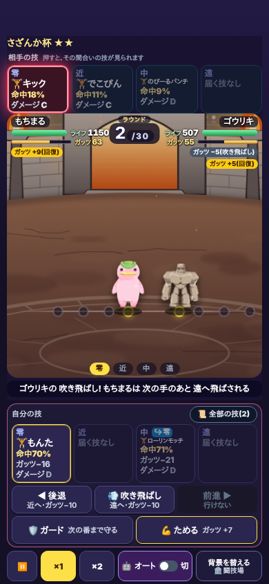
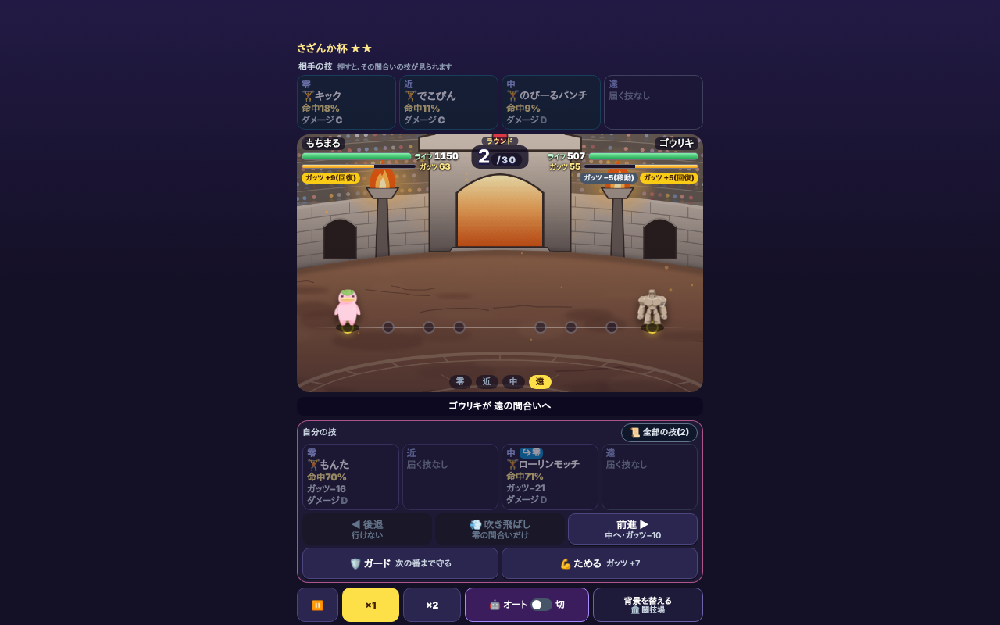
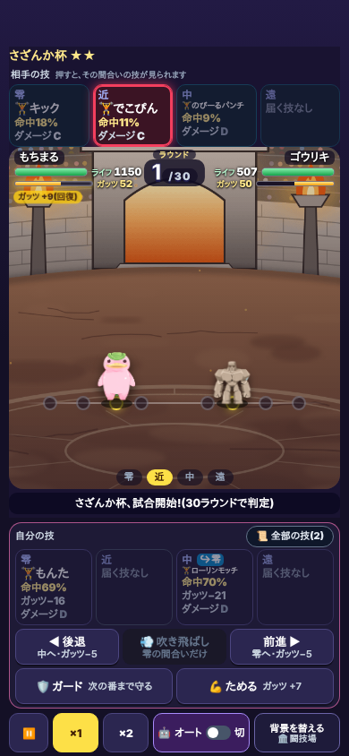
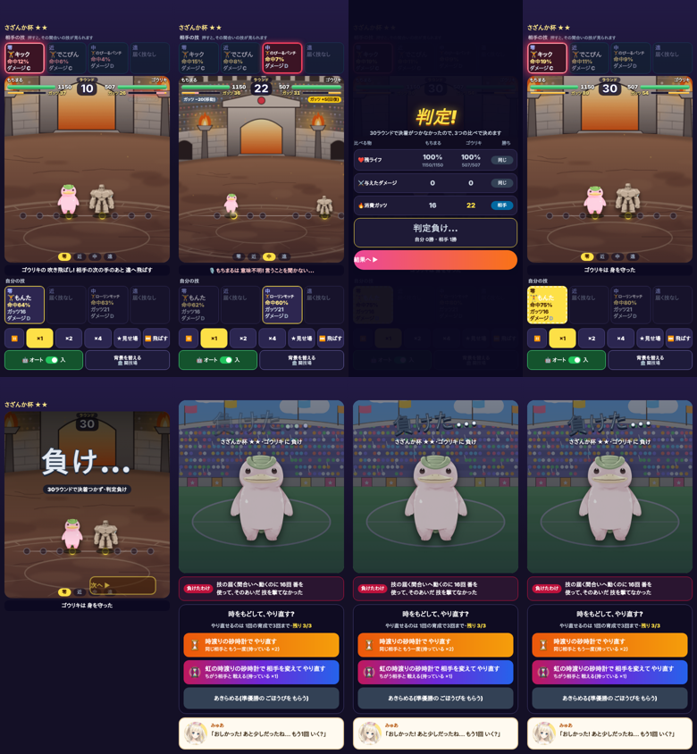

# ②バトル 再点検の直し その1: 試合の画面(MonsucArena・手動の帯・技の札)

再点検 [findings-battle.md](../findings-battle.md) の高・中のうち、**試合の画面**に出る件を直した(r1119-033)。
大会の受付・組み合わせ表・結果・負けた画面の件は、その2・その3 の PR で直す。

## 止め絵(縦 390×844・PC 1280×800)

| 場面 | 直したあと |
| --- | --- |
| 手動の試合(零の間合い・吹き飛ばしが押せる) |  |
| 手動の試合(PC) |  |
| 試合の始まり |  |
| オートの1試合(10・22・判定・30ラウンド・決着) |  |

## 直した件

| 件 | 直したこと |
| --- | --- |
| バ-24・32・35・44 | 下のボタン列が縦・PC で画面の外へ出ていた → 場の高さを、画面に残る高さを測って決める(上限 420px・下限 260px)。縦 844 で下端 840px・PC 800 で 796px |
| バ-38 | 移動の段が5つ(略した「ガ10」)→ 横3つ「◀ 後退・💨 吹き飛ばし・前進 ▶」の1段と、ガード・ためるの段に分けた。「ガッツ−10」と書く |
| バ-25・33・37・53・60 | 技の札の字を 12px に・技名は 14px の太字で1行(長い名前だけ縮める)。相手の札はガッツの行を出さない(押すと一覧で全部) |
| バ-15・22・36 | 間合いが4〜5か所 → 足もとの「遠」の字・左右の「間合い 近→中」の帯・札の「いま」をやめ、場の下の零/近/中/遠の札1つ(札は枠の色だけ) |
| バ-14 | 「ガッツをためた」が帯・実況・小札で三重 → 帯をやめた(帯は「ガードで軽減」「息切れ」の続く状態だけ) |
| バ-13 | 息切れの吹き出しが頭に重なる・効き目が分からない → 頭の上には出さず、帯に「息切れ(ガッツ残りわずか)」 |
| バ-12 | 意味不明の理由が分からない → 「忠誠度が100より低いと、ときどき命令を聞きません」を添えた(芯の決まりどおり) |
| バ-47・64・65 | 「+9」「移動 −5」「63」が何の数か分からない → 「ガッツ +9(回復)」「ガッツ −5(移動)」、棒の数字に「ガッツ」 |
| バ-34 | 見出しの「相手 ゴウリキ・力丸ダイゴ」をやめ、大会名だけ |
| バ-10 | 「負け…」と「LOSE」の二重 → LOSE をやめ、字を場の上の方へ(2体が見える) |
| バ-09 | 30ラウンドで判定になる決まりが分からない → 始まりの実況に「(30ラウンドで判定)」、決着に「30ラウンドで決着つかず・判定負け」。判定の画面の「ターン」を「ラウンド」に |
| バ-46 | 決着のあと押せる物が無い → 決着の場に「次へ ▶」 |
| バ-17・59 | 実況の欄が空になる → 言うことが無い行は直前の文を残す。始まりは「さざんか杯、試合開始!」 |
| バ-11 | 何も起きないラウンドの待ちが長い → オート・記録の試合では、ためる・守る・歩くの行を短く見せる |
| バ-50・61 | 「手動 オートへ」が分かりにくい → 「オート 入/切」の切り替え。「★見せ場」は「★見せ場だけ」、背景は「背景を替える(いまの背景)」 |
| バ-51 | ラウンドの数字に背景の赤い飾りが重なる → 数字に暗い下地 |
| バ-23 | 試合の前に相手が透けて見える → 登場で透けさせない |

## 直していない件(理由)

| 件 | 理由 |
| --- | --- |
| バ-08 | 30ラウンドずっとダメージ0のまま判定 → 試合の計算・オートの手の選び方(r1119-042 のバランスの会話の受け持ち)。窓口へ |
| バ-48 | 命中が毎ラウンド変わる・相手の命中が一桁 → 間合いで命中が変わるのは札に出ている。一桁の命中は計算の数値(同上) |
| バ-63 | モンスターが小さい → 大きさは社長の決め r1119-008(遠10%・中13%・近17%・零20%)。変えるなら社長の判断 |
| バ-52 | 寄り・引きでモンスターの大きさが変わる → 間合いで寄せる・引くのは r1119-008 の決め。左端で切れる件はカメラの寄せの上限の話なので、段3b(1つの部品にする)で見直す |
| バ-49 | オートの試合の途中で並びが変わる → 撮影の手順が始めに手動→オートへ切り替えていたため(オートを選んでいる育成では最初からオートの並び) |

## 社長の決めごととの突き合わせ

| 決めごと | 止め絵のどこで満たすか |
| --- | --- |
| r1119-007 縦は上に相手の枠・中に場・下に自分の枠と操作。場の高さ420px。危険は光の強さだけ | r3-MA2: 上から相手の技の枠 → 場 → 自分の技の枠 → 操作。相手の「零」の枠が赤く光る(字は出さない)。場の高さは入るときは 420px、縦 844 では下のボタン列を入れるために 357px(r1115-184「下のボタン列まで1画面」を優先) |
| r1119-008 絵の大きさ・2体の間は場の幅の割合 | 数値は変えていない(r3-W1・r3-MA1-pc) |
| r1115-184 下のボタン列まで1画面に収める | r3-MA2(縦 844 で下端 840px)・r3-MA1-pc(PC 800 で 796px) |
| r1115-195 移動の段は横3つ「◀後退・💨吹き飛ばし・前進▶」 | r3-MA2・r3-MA1-pc の操作の1段目 |
| r1115-193 吹き飛ばしは零距離のときに選べる | r3-MA2(零)は押せる・r3-MA1-pc(遠)は押せない形で「零の間合いだけ」 |
| r1115-185 技の性能が分かるように | 札に命中・ガッツ・ダメージ、押すと一覧で全部(ガッツダウン・クリティカル・届く間合い) |

## API の見直し(r1119-031・2回・使った額 $0.29 + $0.18)

1回目の指摘のうち、ラウンドの全数(2/30)・ガッツの符号(ガッツ−16)・ライフの名札・名前の大きさ・押せないボタンの見分け・吹き飛ばしの実況(誰が飛ばされるか)を直した。
2回目に残った高・中は、どれも決めごとに関わる設計の話なので窓口の判断を待つ:

- 相手と自分の技の4枠が2段で画面を取る・相手と自分の札の形が同じ(r1119-007 の形)
- 遠の間合いでモンスターが小さい(r1119-008 の大きさ)
- 手動で30ラウンド押すのは長い・ガード/吹き飛ばしの効き目の数字・ダメージの段(C/D)の基準・「命中」と能力の命中の言葉の重なり
- ガッツの増減が名前の下の札と棒の数字で二重・背景のボタンを試合の画面から外すか
