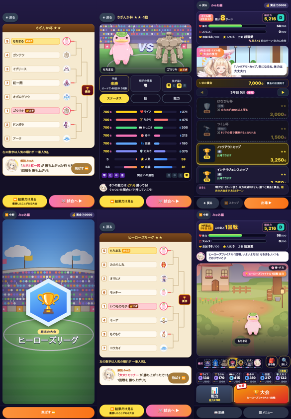
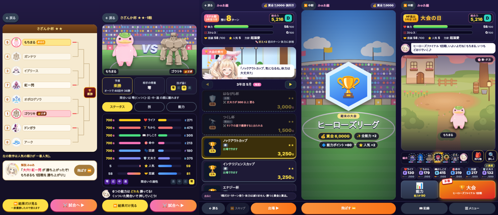
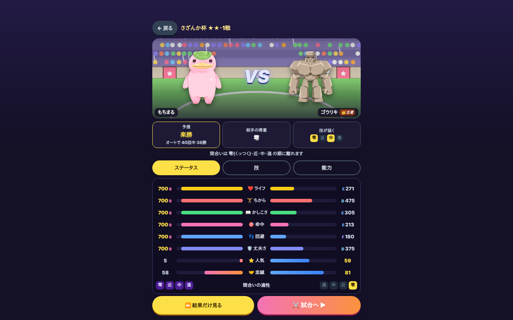

# ②バトル 再点検の直し その2: 大会の受付・入り・組み合わせ表・試合の前・ファイナル当日

再点検 [findings-battle.md](../findings-battle.md) の高・中のうち、試合の前後の画面の件(r1119-033)。その1(試合の画面)は #6984。

## 止め絵

| | 止め絵 |
| --- | --- |
| 直す前(縦 390×844: 組み合わせ表・試合の前・受付・期末の入り・組み合わせ表(期末)・ファイナル当日) |  |
| 直したあと(縦: 組み合わせ表・試合の前・受付・期末の入り・ファイナル当日) |  |
| 直したあと(PC 1280×800: 試合の前) |  |

## 直した件

| 件 | 直したこと |
| --- | --- |
| バ-06・16・19・41 | 大会名が戻るの横と表の見出しで二重 → 表の見出しだけ |
| バ-07・20 | 1回戦の途中で決勝の顔合わせを言う・「見せるだけの演出です」の裏話 → 顔合わせは表が決勝まで進んでから。裏話はやめ、「戦うのは決勝の1戦」は解説の台詞で |
| バ-21 | 試合の前で大会名が見出しと絵の上の札で二重 → 絵の上の札をやめる |
| バ-55 | 戻る「表へ」/進む「決勝へ」「準備完了」がばらばら → 「戻る」「⚔ 試合へ ▶」にそろえる。「優勝ずみ」→「優勝したことがある大会」 |
| バ-56・66 | 組み合わせ表の絵が右端に約28px → 名前の左に 38px |
| バ-57 | 「零」が何か分からない → 「間合いは 零(くっつく)・近・中・遠 の順に離れます」を1行 |
| バ-67 | 「SKIP ▸▸」が英語で小さい → 「飛ばす ⏭」・44px |
| バ-02・58 | PC で「結果だけ見る・試合へ」が切れる → ボタンの段を下に留め、低い画面では能力の行を詰める |
| バ-26 | 受付の下の説明が「期/末」と折れる → 言葉の切れ目で折る・左そろえ・「期末の大会まで あと◯ターン」は1つの塊 |
| バ-27 | 受付で賞金が右上と帯で二重・年月と期が上の箱と場面で二重 → 帯と場面の年月をやめ、賞金の段は右上の札に添える |
| バ-01 | ファイナル当日に「1回戦」が4か所 → 場の札をやめ、上の箱は「当日」だけ(大会名はボタンと吹き出し) |
| バ-40・54 | 期末の大会の入りが大会名と絵文字だけ → 紋章の下に賞金・もらえる物を並べる |

## まだの件(その3 で)

バ-03・04・05・28・29・30・31・39・43・44・62(結果・負けた画面の演出と重複)、バ-42(見出しの形をそろえる)、バ-45(相手の行を押して能力を見る・同じ絵の相手の色違い)。

## 社長の決めごととの突き合わせ

| 決めごと | 止め絵のどこで満たすか |
| --- | --- |
| r1115-184 下のボタン列まで1画面に収める | r3-C2-pc: 「結果だけ見る・試合へ」が画面の中 |
| r1115-198/201 大会の能力ポイント | 期末の入り(tate-grid 4枚目)に「能力ポイント +60」(芯の値をそのまま) |
| r1119-025 ボタンは行き先が分かる言葉 | 「⚔ 試合へ ▶」「← 戻る」 |
| 漢字で書ける所は漢字(依頼) | 「飛ばす」「戻る」 |

## API の見直し(r1119-031・2回・使った額 $0.29 + $0.25)

1回目の指摘で、この PR で出た物(解説の「飛ばす」が文に重なる・「当日」だけでは何の日か分からない・「優勝したことがある大会」の言い方)と、受付の残りターンの二重を直した。
2回目に残った高は、前からある作りの話で設計の判断が要る:

- 受付: 上の箱の年月と月送りの年月の二重・一覧に賞品を出すか・「甘え+2」の説明・「体力は大丈夫?」と「体力は減りません」の食い違い
- 組み合わせ表: 1回戦の見せ場と次の相手が表から読めない(表の見せ方の作り直し)
- ファイナル当日: 「1回戦」がどこで分かるか(見出しは「大会の日」・ボタンと吹き出しに大会名)
- ボタンの絵文字込みの中央ぞろえ
