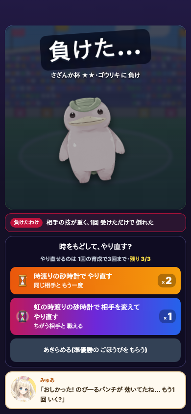
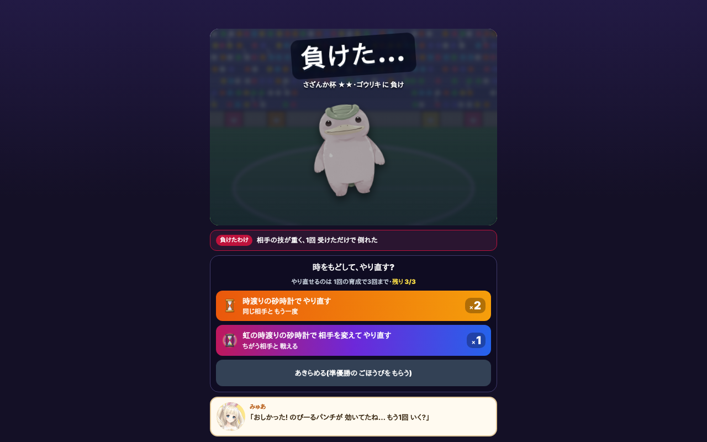
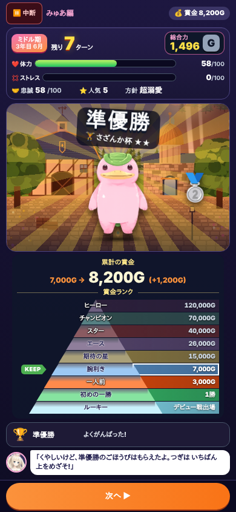
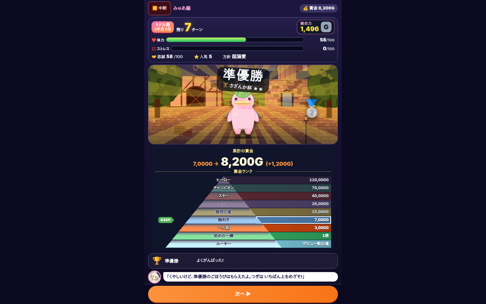
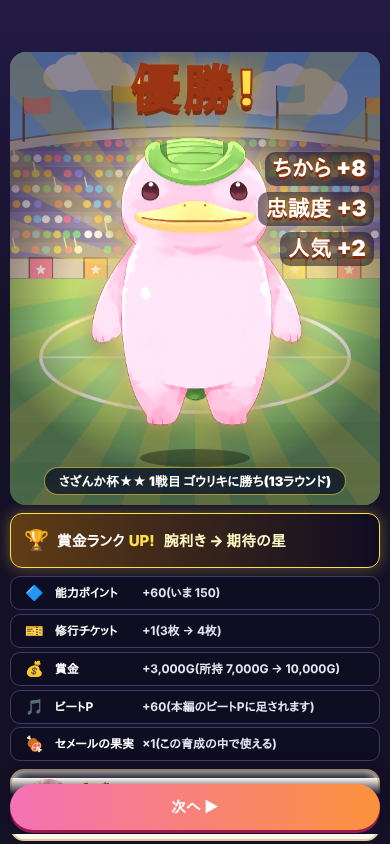
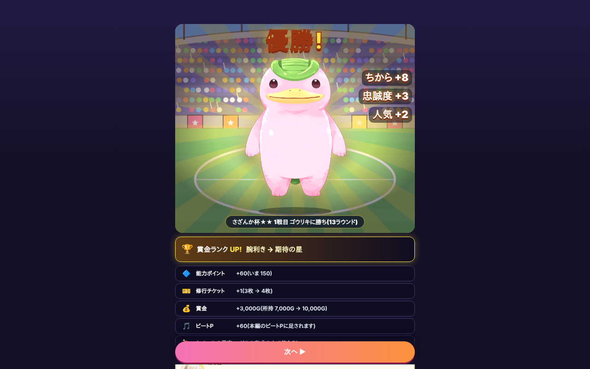
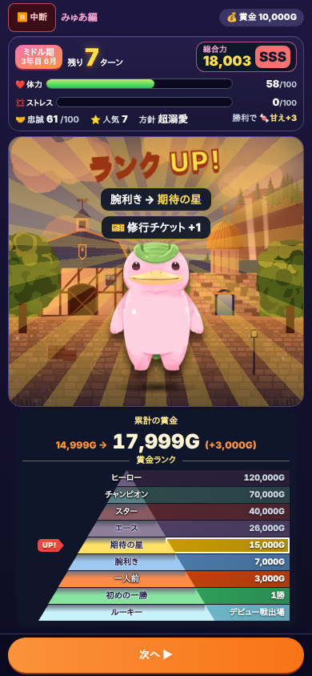
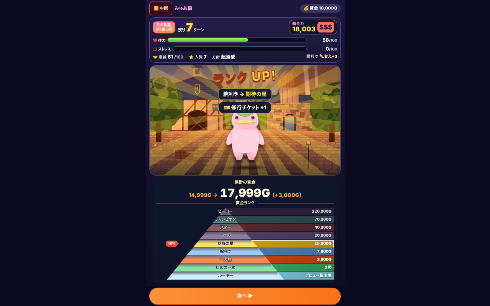
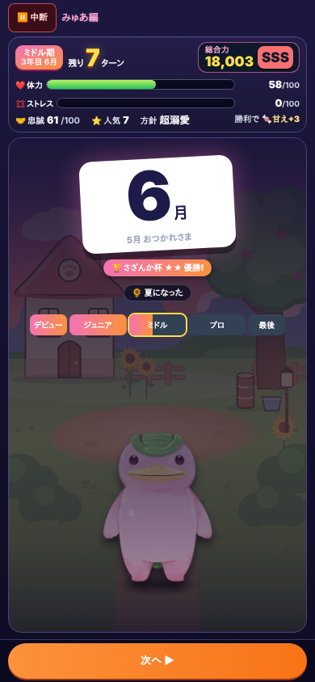
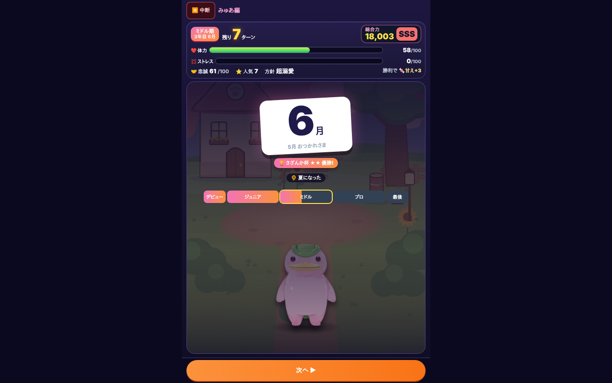

# ②バトル 再点検の直し その3: 結果・負けた画面

再点検 [findings-battle.md](../findings-battle.md) の高・中のうち、試合のあとの画面の件(r1119-033)。その1(試合の画面)は #6984、その2(試合の前)は #6994。
見出しの形(バ-42)と、相手の行を押して見る(バ-45)は次の PR。

## 止め絵(縦 390×844 と PC 1280×800)

| 場面 | 縦 | PC |
| --- | --- | --- |
| 負けた(C4) |  |  |
| 準優勝のごほうび(C4g) |  |  |
| 優勝(結果だけ見る・B2) |  |  |
| ランク UP!(R1) |  |  |
| 大会のあとの月替わり(C3) |  |  |

## 突き合わせ表(指摘 → 止め絵のどこで満たすか)

| 件 | 直したこと | 止め絵で見る所 |
| --- | --- | --- |
| バ-03 | 負けた場面がふだんの立ち姿・「負けた…」が観客席に埋もれる → 場面を暗く・ぼかし、モンスターはうなだれて沈む(灰色)。題は白い字・濃いふち・暗い下地で、上から落ちる | C4 の上半分(縦・PC) |
| バ-43 | 砂時計の説明が10px・違いが分からない → 説明 12px、持っている数は右端に大きく「×2」 | C4 の2つの砂時計のボタン |
| バ-44 | 押せない砂時計が色の下地に灰色の字 → 灰色の下地に白い字のまま、「今回の育成では もう使えない」「持っていないので 使えない」を1行 | (C4d。押せないときだけ) |
| バ-04・30 | 賞金が4か所・ランクが2か所、右上の賞金と表の数が食い違う → 下の「賞金ランク」「賞金」の行をやめ、表の上に「累計の賞金 7,000G → 8,200G(+1,200G)」の1か所。右上は所持の賞金、表はランクを決める累計と書き分ける | C4g・R1 のピラミッドの上 |
| バ-05 | 準優勝のモンスターが小さく足もとが燃えて見える・「準優勝」が読めない・演出がない → モンスターを場面の主役の大きさに、成長のピークの炎は結果の段では出さない。題は白い字と暗い下地。賞金は数え上がり、自分の段が光って KEEP/UP! の札が弾む | C4g の上半分とピラミッド |
| バ-29 | ランクUPにモンスターがいない・字が背景に埋もれる → 真ん中にモンスターを大きく(跳ねる)。ランク名と修行チケットは無地の札に載せて順に出す | R1 の上半分 |
| バ-62 | 明るい段(期待の星の黄・ルーキーの水色)に白い字 → 明るい段は濃い字 | R1・C4g のピラミッド |
| バ-39 | 優勝のごほうびが同じ箱に淡々と並ぶ → 能力・忠誠度・人気の上がり幅はモンスターの横に大きな数字で順に飛び出す。賞金ランクの昇格は光る帯、ほかの細かい物は最後に小さくまとめる | B2 |
| バ-28 | 大会のあとの月替わりで優勝が分からない → 暦の下に「🏆 さざんか杯 ★★ 優勝!」の札(負けたときは「○○ は 負け…」) | C3 の暦の下 |
| バ-31 | 「甘え+3 勝った」が不自然 → 「勝利で 🍬甘え+3」(短い理由を名詞にそろえた: 体力の余裕・体力不足・ほめたこと・叱ったこと など)。残りの数え方の二重は別の会話の直しで「残り○ターン」1つになっている | C3・R1 の上の帯の右 |

## 検査

- `run-checks.js --changed`: 残る NG は main でも出る物(rotation-height・success-layout)
- success-r3-shoot(C4・C4g・R1・B2・C3・S0): NG なし
