# 前の点検で見られなかった所の点検(r1119-013 ⑩・2026-11-19・ミハリ)

基準: main `67a921b7`(2026-11-19 20:30 JST 時点)。監査だけで、ゲームのコードは変えていない。
元の2つの点検(`docs/progress/kensa/uiux-audit-2026-11/README.md`・`docs/progress/kensa/monsuc-quality-2026-11/README.md`)の「確かめられなかったこと」「未確認」を、本物のブラウザ(ヘッドレスの Chromium)で開いて見た。

- 大きさ: 縦 390×844・横 844×390・小さい横 568×320・PC 1363×936。**iPhone の実機ではない**(セーフエリア・指の届く範囲・音は下の「社長が実機で見る所」)
- 開き方: 既存の撮影台本(`tools/success/success-r3-shoot.js`・`success-shoot.js`・`success-arc-shoot.js`)の写しを scratchpad で4つの大きさにして回した。助手ライフは既存の検査(`assistant-life-buygive`・`-friend`・`-roomedit` の browser-check)を撮影つきで回した
- ランキングは**ページの中だけの偽の記録**(30件・自分の行あり)。外への通信はすべてページの中で止め、POST は1件も外へ出していない。Supabase には触れていない。デバッグの合言葉は使っていない
- 目線: プレイヤーが見て一目でおかしいと分かるもの。参考は REF-MAP の行を引き、te-09・10(覚醒)・te-30(当日のメイン)・te-37(結果)・mm-03・04(マスモン一覧と詳細)の実物と並べた
- 「既知」は、受け持ち表(`docs/progress/hq/r1119-monsuc-fix/README.md`)にある件。ここでは見つけた新しい形だけを書く

## 件数

| 優先度 | 件数 | 番号 |
| --- | --- | --- |
| 高 | 8 | U-1〜U-8 |
| 中 | 11 | U-9〜U-19 |
| 低 | 6 | U-20〜U-25 |
| 合計 | **25** | (ほかに、既知の件の再確認 7件・確認して問題なし 12 観点) |

いちばん大きい傾向: **横・小さい横で「その画面でいちばん要る物」が画面の外に出る**(U-1〜U-6・U-11・U-12)。
縦 390×844 で作って、横は「左に絵・右に中身」の2列にしただけの画面が多く、右の列が送らないと見えない・左の列が空のまま、のどちらかになっている。
元の点検の M-1(小さい横の大会の確認窓)・B-4(修行)・C-1(トレーニング)と同じ根で、**大会の当日・ランキング・結果・引退・エンディング・編成・染色**にも出ていた。

## 先に直すべき物(上位)

1. **U-1 期末の大会・ヒーローズファイナルの当日、横で「大会」のボタンが画面の外** — その日に押せる物は2つだけなのに、主役が見えない
2. **U-2 優勝のエンディング(とっておき)の最後の場面で、横だと台詞の箱が出ない** — 育成のいちばんの山場が「写真と『…』のボタン」だけになる
3. **U-3 ランキングが横で1行・小さい横で0行しか見えない** — β1/β2 に記録が入った状態で、一覧がほぼ見えない
4. **U-12 窓(モンスターの詳細・合体の確認・イベント図鑑のお話)を横で開くと、閉じる・決める が画面の外** — 窓の土台(⑥)で一度に直る
5. **U-5 名前と染色の段で、横だとモンスターが映らない** — 色を選んでも結果が見えない
6. **U-4 編成の選ぶ画面が横で候補の顔の上端しか見えない**
7. **U-7 横で左の列が空のまま**(アシストの段・マスモンボックス・名前と染色)— 4画面で同じ形。共通の2列の型で直る

## 問題の一覧

### 高

#### U-1 期末の大会・ヒーローズファイナルの当日、横・小さい横で「大会」のボタンが画面の外 — 高
- 画面: 育成のメイン(期末の大会の当日・HF 1回戦の当日)/ 横 844×390・小さい横 568×320
- 再現: 期の最後のターン(ジュニア期 2年目12月)まで進める →「続きから」でメインを開く
- 起きること: 縦では下に「能力」「大会(本番)」の大きな2つが出る。横では「本番」の札の上の端だけが足の帯(中断・記録・メニュー)の上に覗き、ボタンは送らないと出ない。小さい横では札も見えない
- なぜダメか: その日にできるのは「能力」と「大会」だけ(te-30 と同じ作り)。主役のボタンが見えないと、何をすればいいか分からず止まる
- 参考では: te-30 は「能力」「大会(本番)」の2つが画面の下の真ん中に大きく出て、子の絵の上に重なる。帯は上の1行だけ
- 改善案: 当日のメインは「状態1行 + 子 + 2つのボタン」にし、編成の顔・能力の6札は折りたたむ(押すと出る)。横は右の列の下端に2つを固定
- 受け持ちの候補: ④育成の1画面の型(C-4 の横の型に当日の形を入れる)
- 止め絵: `u1-cupday-land.jpg`(左から 縦の期末の当日・横の期末の当日・横の HF 当日・小さい横の HF 当日)

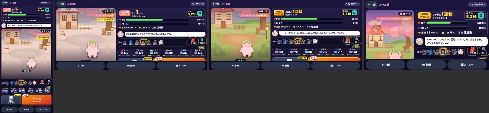

#### U-2 優勝のエンディング(とっておき)の最後の場面で、横・小さい横だと台詞の箱が出ない — 高
- 画面: みゅあ編のエンディング(`success-arc-shoot` の S5: 「みゅあの最高のチーム」の写真の場面)/ 横・小さい横
- 起きること: 縦・PC では写真の下に「丘の上で、みゅあがスマホを高く構えた。…せーのっ!」の箱が出る。横・小さい横では写真の札だけが左に出て、右の列は空。台詞が読めない。下のボタンは「…」だけ
- なぜダメか: 育成の最後の山場(優勝のあとのお話)で、文が消える。ボタンの「…」も何をするボタンか分からない
- 参考では: v4 128〜154秒は、場面が変わっても文の箱は常に下に出る
- 改善案: エンディングの場面は横でも「左に絵・右に文の箱」を必ず出す。ボタンは「次へ ▶」(最後は「引退へ ▶」)
- 受け持ちの候補: ⑤イベント・ストーリー
- 止め絵: `u4-ending-no-text.jpg`(縦・横・小さい横)

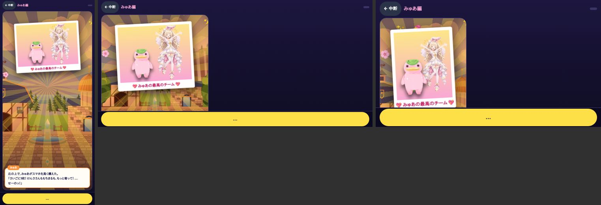

#### U-3 ランキングが、横で1行・小さい横で0行しか見えない — 高
- 画面: モンサクのホーム → ランキング(β2/β1・全体)/ 偽の記録 30件・自分は5位
- 起きること: 縦は1〜8位+自分の行が見える。横は見出し・説明・β2/β1・血統の帯で上半分を使い、一覧は1位の1行だけ+下に固定の「自分の行(5位)」と「戻る/押すと詳細が開く」。小さい横は一覧が0行(自分の行と帯だけ)
- なぜダメか: ランキングに記録が入ったとたん、横では「だれが上にいるか」がほぼ見えない
- 参考では: 参考なし(REF-MAP)。点の出し方だけ v4 202秒
- 改善案: 横は「左に見出し・β・血統・自分の行」「右に一覧の全高」の2列。説明の2行は「?」へ。M-9(黄色い帯)と一緒に直す
- 受け持ちの候補: ⑦画面の質(M-9 と同じ画面)
- 止め絵: `u3-land-list-1row.jpg`(左から ランキング 縦・横・小さい横 / 編成の選ぶ画面 横(U-4)/ 大会の受付 小さい横)

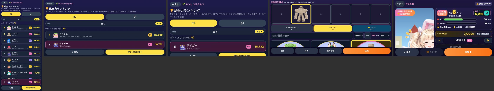

#### U-4 編成の「◯枠目を選ぶ」画面が、横・小さい横で候補の顔の上端しか見えない — 高
- 画面: はじめる2段目 → 枠を押す → 選ぶ画面(ベースモンのタブ)/ 横 844×390・小さい横
- 起きること: 上の6枠の段が画面の高さの約4割(1枠 90×90px 前後)を使い、タブ・検索の帯のあと、候補の丸い顔は上の端が覗くだけ。足の帯(戻る・外す・効果・詳細・決定)が下に固定
- なぜダメか: 選ぶ画面なのに、選ぶ物が見えない
- 改善案: 横では6枠を1行の小さい顔(高さ 44px)にし、候補の升目に高さを渡す。または左に6枠(縦並び)・右に候補
- 受け持ちの候補: ⑦画面の質(はじめる段・Q-3-4 と同じ流れ)。r1119-011 アシモン専用の見せ方(④)とも重なるので、④の新しい札に合わせる
- あわせて: 候補の札に「同じ種類」の札が多くの子に付き、何と同じなのかが書かれていない(U-17)

#### U-5 名前と染色の段で、横・小さい横だとモンスターが映らない — 高
- 画面: はじめる5段目「名前と染色」/ 横・小さい横
- 起きること: 左の絵の枠に空と地面の上の端だけが映り、モンスターは枠の下の外。色を選んでも結果が見えない。縦・PC は映る
- なぜダメか: 色を選ぶ画面で、色を塗った子が見えない
- 改善案: 横の絵の枠は子を中央に収める(`bottom` 基準でなく枠に contain)。塗る場所の②③を選んでいるときも絵が見えるよう、横は左の絵を固定・右だけ送る
- 受け持ちの候補: ⑦画面の質
- 止め絵: `u8-dye-no-monster.jpg`(縦・横・小さい横)

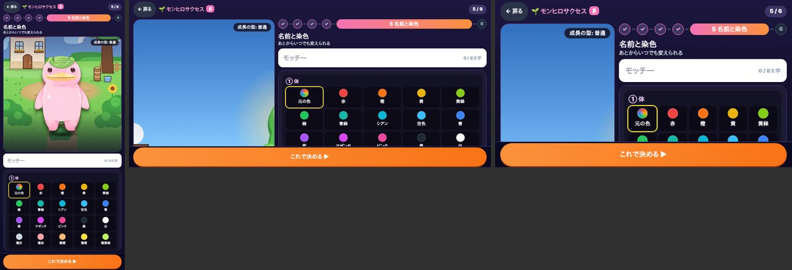

#### U-6 引退の能力ポイントの段で、横だと子の顔の大写し・能力は2行だけ見える — 高
- 画面: 引退(46ターン目)→ 能力ポイントを使う段(E3)/ 横・小さい横
- 起きること: 左の絵の枠に子の顔が画面いっぱいに切れて映る(目と口だけ)。右は「能力」「技の熟練」・1P〜MAX・まとめての段のあと、ライフ・ちからの2行だけ。小さい横は1行
- なぜダメか: 最後の振り分けの画面で、6つの能力を見比べられない。絵の切れ方が壊れて見える
- 参考では: v4 158〜178秒は子の大写し+右に能力の札(6つが一度に)
- 改善案: 絵は全身を contain で。1P〜MAX とまとめての段は1行に詰め、6行を送らずに見せる
- 受け持ちの候補: ⑦画面の質(Q-5-2 の引退の流れと一緒)
- 止め絵: `u6-retire-zoom.jpg`(縦・横・小さい横)

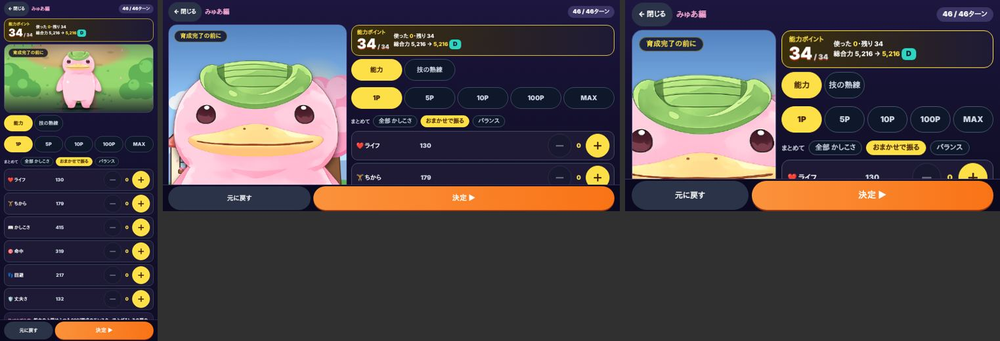

#### U-7 横で、左の列が空のままの画面が4つある — 高
- 画面: 引退のアシストの段(E2)・マスモンボックスの入口(X0)・マスモンボックスの一覧(X3)・保存枠の「名前と染色」(X1)/ 横 844×390(小さい横も)
- 起きること: 画面の左 45% が何も無い暗い面。中身は右 55% に詰め込まれ、送らないと見えない(入口の2つの大きな札は上の端だけ・一覧は1行半)
- なぜダメか: 半分空いているのに、要る物が見えない。壊れて見える
- 原因(推測): 横の「左に絵の場・右に中身」の2列の型に、絵の場を持たない画面も載っている
- 改善案: 絵の場が無い画面は横でも1列(最大 720px で中央)にする。共通の型を1つ直せば4画面とも直る
- 受け持ちの候補: ⑦画面の質(共通の型を触るので ⑥ と相談)
- 止め絵: `u2-land-left-empty.jpg`(左から アシスト・ボックスの入口・一覧・名前と染色)

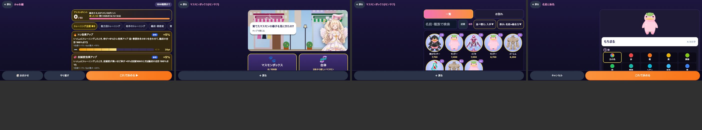

#### U-8 ゲームオーバーの画面が、小さい横で見出しが切れ、「やり直し 残り3/3」と出る — 高
- 画面: デビュー戦に3回負けた → ゲームオーバー(G1)
- 起きること:
  - 小さい横で、見出し「育成は ここまで…」の右が絵の枠で切れて「育成は ここま」
  - 下の欄に「やり直し 砂時計 残り 3 / 3」。もうやり直せないのに、まだ使えるように読める
  - 上の帯(残り11ターン・最後まであと40・体力・ストレス・忠誠・人気・方針)がそのまま。終わった育成の「残り」が出る
- なぜダメか: 終わりの画面で、文が切れ、数字が矛盾して見える
- 改善案: 見出しは2行に折るか字を小さく。「やり直し」の行は「デビュー戦は砂時計では戻せない」など終わりに合う文に。帯は終わりの画面では出さない(または「育成終了」1行)
- 受け持ちの候補: ⑦画面の質
- 止め絵: `u5-gameover.jpg`(左から 縦・小さい横 / 右端は U-9 のエンディングの帯)

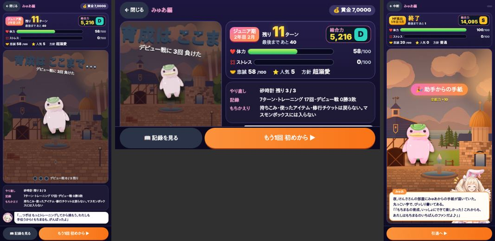

### 中

#### U-9 エンディングの場面で、上の帯が「終了」と「最後まで あと 1」を同時に出す・「HF進出」のまま — 中
- 画面: 優勝のあとのお話(G1〜G4・助手からの手紙)/ 全部の大きさ
- 起きること: 帯の左に「HF進出 5年目5月」、大きく「終了」、その下に「最後まで あと 1」。体力・ストレス・忠誠・人気・方針もそのまま
- なぜダメか: 優勝したのに「進出」、終わったのに「あと1」。お話の画面に数字の帯が要らない
- 参考では: v4 128〜154秒のお話の場面は帯が無い(全面の場面と文の箱)
- 改善案: お話・エンディングの場面は帯を出さない
- 受け持ちの候補: ⑤イベント・ストーリー(帯の共通部品は ④)

#### U-10 合体の演出が、小さい横で円盤石が見出しに重なる・横で2体が端で小さい — 中
- 画面: マスモンボックス → 合体 → 合体する(F4・F5)
- 起きること: 小さい横で、円盤石(大きな丸)が見出し「2体の力が円盤石に集まっていく…」の真ん中に重なり、字が読めない。横では2体が画面の左右の端に小さく(場の高さの 2 割)
  PC では「早送り」「短縮」が画面の右上の外(既存の撮影台本の見張りでも NG: `F4(pc)`・`F5(pc)` 枠からはみ出す)
- なぜダメか: いちばん見せたい「合体」の瞬間に、文と石がぶつかる
- 改善案: 円盤石の位置を見出しの下からにし、横では場の高さに合わせて小さくする。2体は場の中央寄りに
- 受け持ちの候補: ⑦画面の質
- 止め絵: `u7-fuse-fx.jpg`(縦・横・小さい横・横の合体の確認の窓)

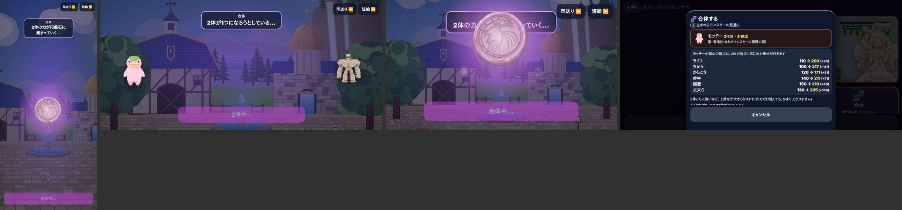

#### U-11 大会の結果・負けの画面が、横で次にすること(やり直す・次へ)が折りの下 — 中
- 画面: 大会の優勝の結果(B2)・負けた画面(C4)・賞金ランク UP(R1)/ 横・小さい横
- 起きること: 横では「優勝!」の場が画面いっぱいで、ごほうびの行・次へは送らないと出ない。負けた画面は「時をもどして、やり直す?」の見出しだけが下の端、砂時計の2つのボタンとあきらめるは見えない。小さい横の R1 は賞金ランクの表の上2段(ヒーロー・チャンピオン)だけで、上がった段(UP)が見えない
- なぜダメか: 負けたときの大事な選択(砂時計を使うか)が見えない。ランク UP なのに上がった段が見えない
- 参考では: te-37 は場の写真の札は上 4 割、下にピラミッド・人気・アイテム、次へとリザルト詳細が常に見える
- 改善案: 横は「左に場の写真(高さ全部)・右に結果の行と選ぶボタン」。ピラミッドは上がった段が見える所まで自動で送る
- 受け持ちの候補: ⑦画面の質(Q-2-2 結果の札の見出しと一緒)
- 止め絵: `u9-result-lose-land.jpg`(左から 優勝 横・負け 横・負け 小さい横・ランク UP 小さい横)

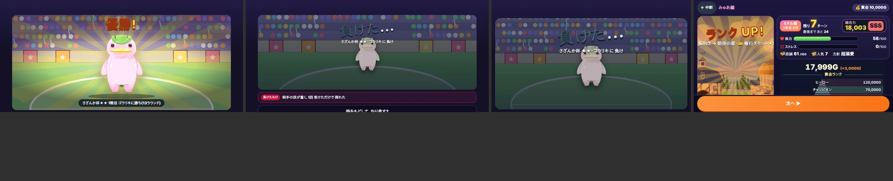

#### U-12 窓を横で開くと、閉じる・決めるが画面の外(窓の中を送らないと出ない) — 中(数が多いので先に)
- 画面: マスモンボックスの「モンスターの詳細」(X4)・ランキングの行の詳細・合体の確認(F2)・イベント図鑑のお話(DX4)/ 横・小さい横
- 起きること:
  - モンスターの詳細: 横は窓の下の「技/アシスト/育成情報」のタブまで。貸し出す・お別れ・閉じるは窓の外(窓の中を送ると出る)。ランキングの詳細も同じで、技の升目と閉じるが見えない
  - 合体の確認: 横では「キャンセル」だけが窓の下に固定で見え、「合体する」「選び直す」は送った先。決める物より取り消す物が先に見える
  - イベント図鑑のお話: 横は本文4行、小さい横は本文 0 行(「第1話」と「閉じる」だけ)。前回 M-5(最後の行が閉じるに重なる)の続き
- なぜダメか: 窓を開いて、閉じ方・決め方が見えない
- 改善案: 窓の共通部品で「見出し・中身(送る)・足(閉じる/決める)」の3段にし、足は常に見える所に固定。小さい横は窓を全画面のシートに
- 受け持ちの候補: ⑥窓と戻るの土台(窓の共通部品)
- 止め絵: `u10-sheet-close-hidden.jpg`(左から 詳細 横・詳細 小さい横・ランキングの詳細 横・図鑑のお話 小さい横)

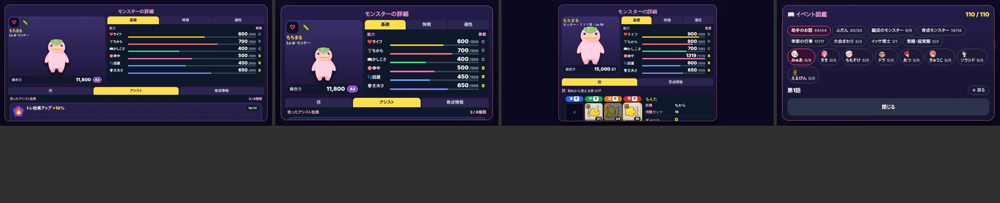

#### U-13 HOME の「🏘 n」(フレンドの行き来の印)が、顔バッジ・ほかのボタンに重なる — 中
- 画面: HOME(縦 390×844・横 844×390・375×667)/ 助手ライフのボタン
- 起きること: 「🏘 2」の印が、助手ライフのボタンの上の顔バッジ(3人の顔)と、隣のマーケットのボタンに重なる。既存の検査 `assistant-life-friend-browser-check.js` が NG 5件(`①`×3・`⑦`×2)で落ちている
- なぜダメか: HOME の真ん中で印と顔が重なり、何の数字か分からない
- 改善案: 印をボタンの左下へ移すか、顔バッジの左に並べる(検査の決まりどおり)
- 受け持ちの候補: ⑨落ちている検査(受け持ち表の7本に入っていない8本目)。直すのは助手ライフの部
- 止め絵: `u11-friend-badge.jpg`(縦・小さい横の HOME)

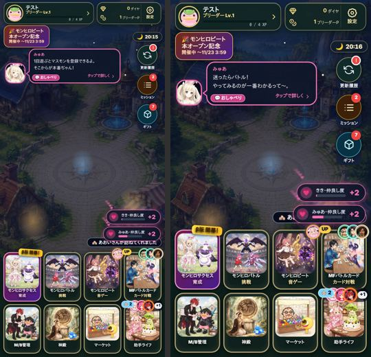

#### U-14 更新履歴を送ると、一覧の札が送り箱の上端で切れ、区切りが無い — 中(B-1 の推測を確かめた)
- 画面: HOME → 更新履歴 → 下へ送る / 縦 390×844
- 起きること: 送ったあと、上端の札が途中で切れ(札の上のふちと色の帯の下半分だけ)、タブとの間に線も影も無い。「タブのすぐ下に上が切れた枠」(社長の止め絵)はこの形
- 改善案: 送り箱の上端に影(または 8px の余白)を足す。日付の見出しを送り箱の上に貼り付ける
- 受け持ちの候補: ⑥窓と戻るの土台(r1119-010 更新情報の見た目全体)
- 止め絵: `u12-changelog-scrolled.jpg`(左から 開いた直後・送ったあと・横のヘルプのモンサクのページ(U-16))

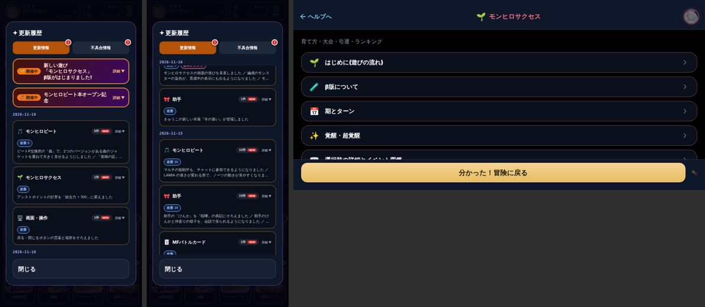

#### U-15 ブラウザの「戻る」の効き方が画面で違う — 中(C-1 の続き)
- 確かめたこと(縦・横):
  - M/B管理 → モンスター図鑑 でブラウザの戻る → **M/B管理へ戻る**。もう一度で HOME。ゲームの外へは出なかった
  - モンヒロビートのモード選びでブラウザの戻る → **何も起きない**(モード選びのまま)。画面の「←」(左上 44×44・名前は「戻る」)で HOME へ戻る
- なぜダメか: 同じ「戻る」が、ある画面では一つ前へ、別の画面では効かない(C-1 の直しが一部の画面にだけ入っている形)
- 改善案: C-1 の直しを、モンヒロビート・モンサク・助手ライフにも同じ部品で入れる。モンヒロビートの「←」も「HOMEへ戻る」の言葉にそろえる(B-3)
- 受け持ちの候補: ⑥窓と戻るの土台

#### U-16 覚醒の演出の最後で、子が場の 4 割に縮む・気の色が参考と逆 — 中
- 画面: 覚醒(`MsxAwakeShow`・段0〜3)/ 全部の大きさ
- 起きること: 段0・1 は子が場いっぱい(78%)。段3(覚醒!)になると子が 40% に縮み、下に能力の札・文・吹き出しが3段積まれる。気は黄色と橙の炎
- 参考では: te-09・10 は子が画面の 7 割のまま、黒と赤の気が噴き出し赤い筋。帯は上の1行だけ
- なぜダメか: 「覚醒した!」の頂点で子が小さくなり、盛り上がりが抜ける
- 改善案: 段3 も子の大きさは変えず、能力の上がり分は子の上に重ねる札で出す。上の状態の箱はこの場面では1行に
- 受け持ちの候補: ⑦画面の質(演出は ①音 と合わせて)
- 止め絵: `u14-awake.jpg`(左から 縦の段0・縦の段3・小さい横の段3)

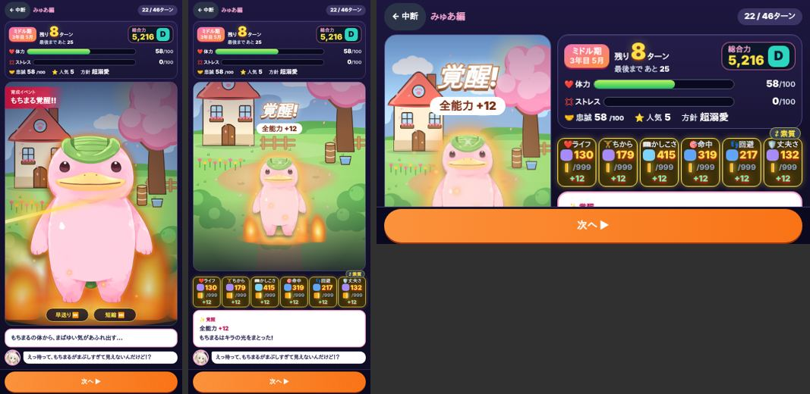

#### U-17 編成の選ぶ画面で、候補の多くに「同じ種類」の札。何と同じか分からない — 中(「同じゴーレムが2体」の関連)
- 画面: はじめる2段目 → 2枠目を押す → ベースモンのタブ / 縦
- 起きること: 10体のうち、キュービ・スエゾー・ライガー・ピクシー・ウンディーネに「同じ種類」、モッチーに「育てる種と同じ」の札。ほかの枠に入っている子と同じ種、という意味だと思われる(**推測**)
- 「同じゴーレムが2体」: 今回も保存の形からは再現できなかった。ただし、この画面では同じ種の子を別の枠に入れられ、札は「同じ種類」とだけ出る。ボックスのゴーレムとベースモンのゴーレムを両方入れれば2体並ぶ(手順としては作れる・止め絵の状態とは未照合)
- 改善案: 札を「2枠目と同じ」のように番号で。同じ種を2枠に入れたときは決める前に一言(効果が重ならない等、仕組みに合わせて)
- 受け持ちの候補: ③編成の固定(編成の決まりの会話)か ⑦

#### U-18 修行の技の詳細に、覚える条件(条件1〜4と「済」)が出ない — 中(統合バッチ「技を覚える条件」)
- 画面: 修行 → 技を1つ選ぶ(Q4・Q5)
- 起きること: 右の詳細の箱は 技種・消費ガッツ・ダメージ・命中率・ガッツダウン・クリティカル率 と「覚えられる 70%」。条件(別の技の熟練など)は出ていない。更新履歴には「覚える条件の偏りを見直しました」とある
- 参考では: te-67・68・v3 22〜28秒は、選んだ技の下に条件1〜4(満たすと「済」)
- 改善案: C-4 の修行の型の「選んだ技の札」に条件の行を足す
- 受け持ちの候補: ④育成の1画面の型(修行画面)

#### U-19 模様替えの縦で、道具の段が右で切れる — 中
- 画面: 助手ライフ → 部屋 → 模様替え / 縦 390×844
- 起きること: 道具の1行目(小・大・↔・回す×2・色・前へ・後…)が右端で切れ、「後ろへ」「助手の後ろへ」「しまう」は送らないと見えない。送れる印も無い。横は2段に折れて全部見える
- 改善案: 縦も2段に折る(横と同じ)。または右端にフェードと「›」
- 受け持ちの候補: ⑥(助手ライフの窓)
- 止め絵: `u13-room-tools.jpg`(縦・横)

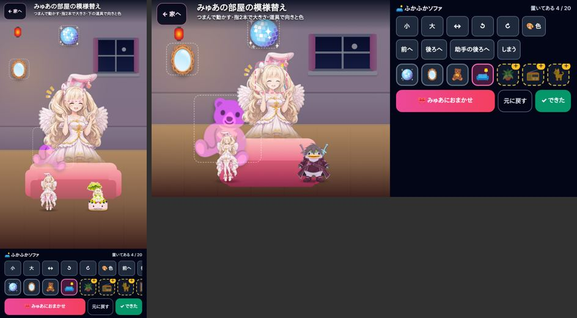

### 低

#### U-20 名前と染色のカスタム色で、濃さの値が2か所に出る — 低
- 画面: 保存枠の「名前と染色」→ カスタム
- 起きること: 濃さの帯の右に「100%」、その下の「− 濃さ100% +」にも同じ値。−/+ の位置(左端・右端・数字は真ん中)は更新履歴どおりで、ずれは無かった
- 改善案: 帯の右の値を消す(−/+ の行に1つ)
- 受け持ちの候補: ⑦

#### U-21 名前を付けていない子は種の名前だけで、同じ種が並ぶと見分けられない — 低(統合バッチ「名前の見分け」)
- 画面: マスモンボックスの一覧(「モッチー」が2体・ゴーレムといわお)・ランキング(名前なしの子は種の名前・「ゴーレム」が2行)
- 改善案: 名前なしの子は「モッチー(C5)」のようにランクや番号を添える
- 受け持ちの候補: ⑦

#### U-22 戻るの言葉がまだ揃っていない画面(B-3 の続き) — 低
- 図鑑「← M/B管理へ戻る」/ モンヒロビート「←」(字なし)/ ヘルプのモンサクのページ「← ヘルプへ」と下の大きな「分かった!冒険に戻る」の2つ / モンサクのゲームオーバー「← 閉じる」
- ヘルプのモンサクのページは、横で項目が3つ・小さい横で3つしか見えず、下の「分かった!冒険に戻る」が高さの 1/6 を使う(`u12` の右端)
- 受け持ちの候補: ⑥

#### U-23 HOME の横で、右上の更新履歴・ミッション・ギフトに字が無い — 低
- 縦は「更新履歴」「ミッション」「ギフト」と字が出る。横は丸い印と数字だけ
- 受け持ちの候補: ⑥(B-3 と一緒)

#### U-24 メインとイッサ博士の画面で、既存の見張りが「字が小さすぎる(/100 が 8px)」で NG — 低
- `success-shoot.js` の `M1`・`I1` が4つの大きさすべてで NG(忠誠の「/100」が 8px)。受け持ち表の ⑨ の7本には入っていない
- 受け持ちの候補: ⑨落ちている検査

#### U-25 撮影台本の E0・E1(引退の評価・振り返り)が注記の行の中に入り、撮られていない — 低(検査の穴)
- `tools/success/success-r3-shoot.js:131` の `// 引退の能力ポイント: …(r1115-172)` の注記のあとに `['E0', …], ['E1', …]` が同じ行で続き、注記として読み飛ばされている。引退の2画面目以降(評価・振り返り)は、この台本では一度も開かれていない
- 受け持ちの候補: ⑨落ちている検査(行を分けるだけ)

## 既知の件の再確認(新しい形だけ書いた)

| 既知 | 今回見た形 |
| --- | --- |
| M-1(小さい横の大会の確認窓) | 小さい横で窓の見出しが上で切れ、「閉じる」が下で切れる(出られない大会の窓も同じ)。横 844×390 は収まる |
| M-5(図鑑の最後の行) | 小さい横でお話の本文が 0 行(U-12 に含めた) |
| Q-3-3(小さい横の月の札) | 月めくりの札の数字「6月」が小さい横で見えない(札の上の帯だけ) |
| Q-3-1(説明の吹き出しが対象を隠す) | 編成の段(横・小さい横)で、みゅあの説明が6枠の真ん中に出る。マスモンボックスの入口(横)では吹き出しが町の絵を覆う |
| Q-2-5(賞金ランクの表が2回) | 優勝の結果の行「賞金ランク 腕利き → 期待の星」のあと、次の画面で「ランク UP!」とピラミッド |
| Q-3-2・M-8(PC の細い列) | ランキング・大会の受付・合体の窓も PC で中央の細い列 |
| M-9(ランキングの黄色い帯) | 記録がある状態でも「押すと詳細が開く」が主ボタンの形で一覧の下に固定。行を押すと詳細が開く(帯を押す必要は無い)ことを確かめた |

## 確認して問題が無かった観点

- **賞金額**(統合バッチ): ジュニア期 2年目7月の受付で 銀 2,500G・銅 1,250G。更新履歴(2026-11-18 20:25)どおり。ミドル期は 3,000G/1,500G と銅が銀の半分(r1115-207 の決め)
- **染色の −/+**(統合バッチ): 「−」が左端・「+」が右端・濃さの数字が真ん中。字もボタンの中央(縦・小さい横)
- **能力のアイコン**(統合バッチ): ❤️🏋️📖🎯👣🛡 が メイン・詳細・ランキングの詳細・覚醒の札で同じ並び
- **顔アイコンの位置**(統合バッチ): マスモンボックスの一覧・ランキングの行・編成の枠・図鑑で、顔が切れたり右上へずれたりしていない
- **保存枠**: 合体の見通し → 合体の演出 → 名前(F2〜F5)・お別れ・アシストに残した子。保存枠に1体入り、途中の育成が消える(E9)。ビートPは1回だけ
- **引退の2画面目以降**: 能力ポイント → アシストの段 → ベスト3 → 育成完了(E3・E2・E9)は4つの大きさで開けた。ベスト3 の並びは動きの途中で1行目が空に見えるが、3秒待つと正しい
- **ランキング β1/β2 に記録がある状態**: β2・β1 の切り替え、自分の行の固定、行を押すと詳細(縦)。ページのエラー 0
- **大会の一覧・試合の入り・結果(横・小さい横・PC)**: 受付・確認窓・優勝・ランク UP・月めくり・負け は開けた(見え方の問題は U-1・U-11)
- **イッサ博士**: 4つの大きさで選択肢の札が並び、主ボタン「体力回復に賭ける ▶」が見える
- **マスモンボックス**: 入口・一覧・詳細(見え方の問題は U-7・U-12)。一覧の顔の升目5列・ランクの印は mm-03 と同じ組み立て
- **思い出アルバムの「買って贈る」の窓**: 縦・横 844×390・横 667×375 で、品名・「ビートP 150 で買って、そのまま…に贈ります」・所持ビートP 前→後・上がる量・キャンセル/買って贈る が窓に収まる(`assistant-life-buygive-browser-check` 34件 OK)
- **フレンドの家**: 偽のフレンドの一覧で家・部屋4つ・置き手紙・来た場面を4つの大きさで開けた(`assistant-life-friend-browser-check` 227件 OK・NG は U-13 の5件)
- **模様替えのドラッグ**: 家具を指でつまんで動かす・2本指で大きさ・保存(`assistant-life-roomedit-browser-check` 67件 OK・縦横)。見え方の問題は U-19

## 確かめられなかったこと(推測のまま・未確認)

- **iPhone の実機ではない**。下の「社長が実機で見る所」は試験のブラウザでは分からない
- 「同じゴーレムが2体」の止め絵そのものの状態(保存の中身)は再現していない(U-17 は作れる手順を示しただけ)
- 統合バッチの「名前の見分け」が何の画面の直しだったかは、更新履歴の文から特定できなかった。ボックスとランキングで見た(U-21)
- 横の更新履歴を送った状態(横は更新履歴のボタンに字が無く、台本で押せなかった)
- 「助手の説明」は、モンサクのみゅあの説明(はじめる段・マスモンボックス)だけを見た。助手ライフの説明の吹き出し(A-1)は前回の点検のまま
- 音はすべて未確認(ヘッドレス)

## 社長が実機で見る所(試験のブラウザでは分からない)

1. **セーフエリア**: ランキング・マスモンボックス・モンサクのメインの左上「← 戻る/中断」が時計の帯に食い込まないか(縦)。横でノッチ側の左端の「← 戻る」が欠けないか
2. **ホームバー**: 足の帯(中断・記録・メニュー/出場/次へ)がホームバーに重ならないか。U-1 の当日の「大会」ボタンが横で届くか
3. **指の届く範囲**: 片手の縦で、左上の「← 中断」「← 戻る」(縦の上 1/4)に親指が届くか。窓の「閉じる」が下にある画面(更新履歴)と上にある画面の差
4. **音を耳で**: 大会の受付・試合の開始・勝ち/負け・覚醒の段ごとの音(①音の会話が直したあと)。合体の演出の音
5. **横に倒したとき**: U-1〜U-7 の画面を実機で横にして、ここの止め絵と同じに見えるか(実機の横は 844×390 より低いことがある)

## 受け持ちの候補のまとめ

| 会話 | 件 |
| --- | --- |
| ④育成の1画面の型 | U-1・U-18 |
| ⑤イベント・ストーリー | U-2・U-9 |
| ⑥窓と戻るの土台 | U-12・U-14・U-15・U-19・U-22・U-23 |
| ⑦画面の質・流れ・文言 | U-3・U-4・U-5・U-6・U-7・U-8・U-10・U-11・U-16・U-20・U-21 |
| ③編成の固定(または ⑦) | U-17 |
| ⑨落ちている検査 | U-13・U-24・U-25 |

使い捨ての台本(撮影台本の写し・ランキングの偽の記録・HOME を触る台本)と生の止め絵は scratchpad にだけ置き、コミットしていない。
