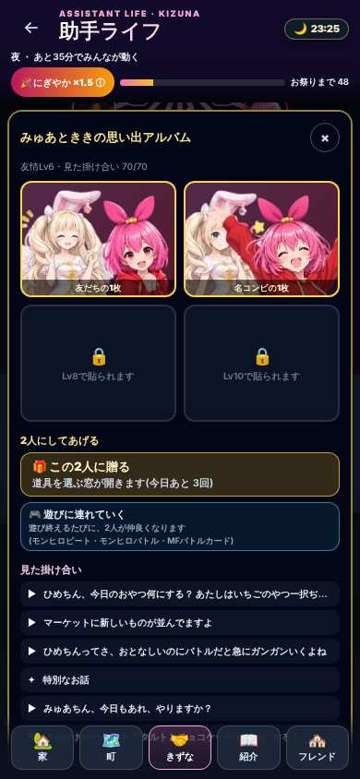
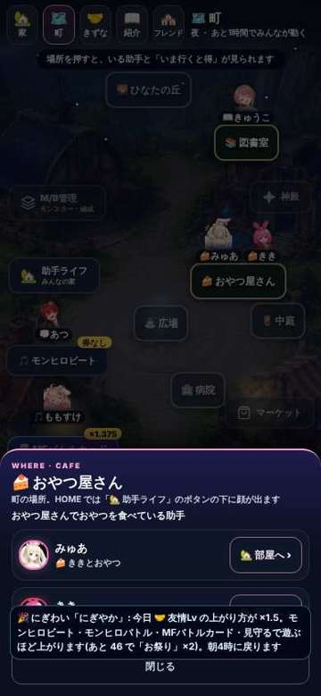
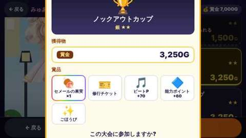

# UI/UX 総点検: モンサクと助手ライフ(r1118-001・2026-11-18・ミハリ)

監査だけ。ゲームのコードは変えていない。本物のブラウザ(Chromium・Playwright)で、ページの中だけの偽の保存データを入れて操作した。
本番のサーバーへの登録・送信はしていない(Supabase への通信はすべてページの中で空の返事に差し替えた)。

- 画面の大きさ: 縦 390×844 / 横 844×390 / 小さい横 568×320(以上はタッチ操作の機械として開く)/ PC 1280×800(ホイール)
- 試した操作: タップ・指で送る(タッチの指の動きをそのまま送る)・ホイール・窓やシートの開閉・ゲーム内の戻る・ブラウザの戻る・速い10回連打
- 窓の裏の調べ方: 窓を開いたまま画面を 9×15 の点に分けて `elementFromPoint` で「窓の外の物に当たる点」を数え、
  窓の真ん中・上の端・右下の隅で上下に指で送り(とホイール)、裏の送り箱の位置が変わるかを測った。
  窓を開かない状態で同じように送ると裏(家の一覧)が 150px 動くことを先に確かめてから測っている
- 点検のスクリプトは使い捨て(コミットしていない)。止め絵はこのフォルダの jpg

優先度: **致命** 遊べない・データが壊れる / **高** 多くの人が迷う・押したい物が押せない / **中** 気づけば避けられるが分かりにくい / **低** 見た目・揃え

## 件数

| 優先度 | 件数 |
| --- | --- |
| 致命 | 0 |
| 高 | 4 |
| 中 | 5 |
| 低 | 4 |

(社長の返事により、見つかった問題は今は直さず、監査の結果として残す。2026-11-18 窓口経由)

## 既知の症状(社長の報告・助手ライフで1件)について

**再現した。** 社長の見た所は「助手同士の思い出アルバム」(きずな → ペアの行を押すと開く窓)だった(窓口経由で社長に確認)。
最初の点検では範囲に入れていなかったため、追加で4つの大きさを測った。結果は下の **A-0**。

- 再現したのは**タップが裏へ通る**ほう。アルバムを開いたまま、上の帯(「←」・「🎉 にぎやか ⓘ」)と下のタブ(家・町・きずな・紹介・フレンド)が押せる
- **スクロールが裏へ通る症状は出なかった**: アルバムの中を端まで送ってさらに送っても(指・ホイール、上下3回ずつ)、裏のきずなの画面(`mhl-body`)の位置は4つの大きさとも変わらなかった

最初の点検で候補に挙げた A-1(吹き出し)と A-2(家具の上の「← 家へ」)は、既知の症状とは別の問題として残す。

## 問題の一覧

### 両方に共通

#### C-1 ブラウザ(スマホ)の「戻る」で、ゲームの外へ出てしまう — 高
- 画面: モンサクのどの画面でも / 助手ライフのどの画面でも
- 再現手順: HOME → モンサク → 続きから(育成の画面)でブラウザの戻る。助手ライフ → みゅあの部屋 でブラウザの戻る
- 起きること: どちらもゲームのページから出て、前のページ(試験では about:blank)へ移った。縦・横・小さい横・PC すべて同じ
- なぜダメか: Android の戻るボタン・iPhone の左端からのスワイプは「1つ前の画面へ」のつもりで押す。育成の途中で1回押すだけでゲームごと閉じる。
  ほかの画面では戻るを画面の戻るボタンに置き換える仕組みがあるのに、この2つでは効かない
- 原因の見当(コードを読んだ推測): `60-app.jsx` の戻るの扱いは「いまの画面が HOME のときは何もしない(ブラウザに任せる)」作り。
  モンサクも助手ライフも HOME の上に重ねて開くので、ゲームの状態は HOME のまま。また画面の戻るは `header.mh-screen-head` のボタンを探すが、2つの画面はその形を使っていない
- 改善案: 2つの画面を開いている間は「HOME 以外」と同じに扱い、各画面の戻る(モンサクの `.v-hd .bk` / 部屋の「← 家へ」/ シートの「閉じる」)を押したのと同じ動きにする

### 助手ライフ

#### A-0 思い出アルバムを開いたまま、上の帯と下のタブが押せる(社長の報告の症状) — 高
- 画面: 助手ライフ → 🤝 きずな → ペアの行(またはきずなの図の線・今日のペア)→ 思い出アルバム
- 再現手順: 縦 390×844 でアルバムを開き、下のタブの「🗺 町」を押す(「🏡 家」・左上の「←」・「🎉 にぎやか ⓘ」も同じ)
- 起きること:
  - アルバムの暗い幕が上の帯と下のタブにかからず、帯とタブがアルバムの**上**に明るいまま見える。画面を 9×15 の点に分けると、縦では 27/135 点が裏の物に当たる(横 12・小さい横 18・PC 9)
  - 開いたまま「町」を押すと、アルバムが閉じて町へ移る。「家」なら家へ移る。「にぎやか ⓘ」を押すと、アルバムを開いたまま説明の吹き出し(A-1)が出る
  - 縦では、アルバムの下の方(見た掛け合いの最後の行)が下のタブの裏に隠れ、そこを押すと掛け合いではなくタブに当たる
  - 右上の隅(時計のあたり)を押してもアルバムは閉じない(幕ではなく上の帯に当たるため)。ほかの幕の所を押すと閉じる
  - 横・小さい横は下のタブが無い並びなので、当たるのは上の帯(「にぎやか ⓘ」など)だけ
- なぜダメか: 窓を開いているのに、窓の外の物が明るく見えて押せる。窓を閉じるつもりで下や上を押すと、別の画面へ移ってしまう。隠れた行は押せない
- 原因の見当(画面の中で重なり順を測った): アルバム(`56-assistant-peer.jsx` の `AssistantPeerAlbum`)は `fixed inset-0`・`z-index:9100` だが、
  描かれる場所が助手ライフの本文の箱 `.mhl-body`(`position:relative; z-index:2`)の中にある。z-index の付いた箱は**重なりの文脈**を作るので、
  9100 は `.mhl-body` の中だけで効き、助手ライフ全体の中では「2」として扱われる。同じ階の兄弟の上の帯 `.mhl-hdr`(z-index:5)と
  下のタブの箱(`relative z-[3]`、中に `.mhl-icons`)の方が上に描かれる。
  アルバムは `AssistantPeerMap`(きずなの関係図)の中に置かれていて、関係図が `.mhl-body` の中にあるため、この形になる
- 改善案: アルバムを `ReactDOM.createPortal` で `document.body` へ出す(フレンドのプロフィールの窓 `data-alf-profile-layer` がこの形で正しく出ている)。
  あわせて、アルバムの中の送り箱に `overscroll-behavior: contain` を付ける(今回は漏れなかったが、端で裏へ送られないことを部品の側で保証する)。
  閉じる「×」は 32×32 なので 44px にする
- 同じ形の心配: `.mhl-body` の中で `fixed` の窓を出す部品があれば同じことが起きる。今回の点検で開いた窓(声をかける・贈る・今日あったこと・部屋・町・家具・マスモン)はどれも本文の外に出ていて、裏に当たらなかった
- 止め絵: `life-album-under-bars-tate.jpg`(縦: 上の帯と下のタブが幕の上に出ている)/ `life-album-yoko.jpg`(横)

#### A-1 にぎわいの説明の吹き出しが消えず、ほかの画面のシートに重なる — 高
- 画面: 家 → 「🎉 にぎやか ×1.5 ⓘ」/ そのあとの 町 → 場所のシート
- 再現手順: 家の上の「🎉 にぎやか ×1.5 ⓘ」を押す → 吹き出しの外(見出し)を押す → 吹き出し自身を押す → 8秒待つ → 下の「町」→「おやつ屋さん」
- 起きること: 吹き出し(`data-assistant-life-note`)はどの操作でも消えない。町へ移っても残り、おやつ屋さんのシートを開くと
  縦ではシートの下の方(きき の行と「部屋へ」・「閉じる」の上)に重なる。吹き出しの真ん中を押しても吹き出しに当たり、裏の「部屋へ」は押せない。横でも町の地図とシートの下にかぶる
- なぜダメか: 説明を読んだあと消し方が分からない。消えない札が、押したいボタンを隠して押せなくする
- 改善案: 吹き出しの外を押す・タブ(家・町…)を替える・シートを開く・数秒たつ、のどれかで閉じる。重なり順をシートより下にする
- 止め絵: `life-note-over-sheet-tate.jpg` / `life-note-over-sheet-yoko.jpg`

#### A-2 家具・模様替えを開いたまま、部屋の「← 家へ」が上に残って押せる — 中
- 画面: 家 → みゅあの部屋 → 家具 / → 模様替え
- 再現手順: 部屋で「家具」を押してシートを出す(または、さらに「模様替え」)。左上の「← 家へ」を押す
- 起きること: シートの上に「← 家へ」が重なって見え、押すと家具のシートも模様替えも部屋も一度に閉じて家へ戻る(縦・横・小さい横・PC)。
  縦では家具のシートの見出しの行(左の字)が「← 家へ」の下に隠れる。もう一度部屋を開くと模様替えは閉じた状態
- なぜダメか: シートを閉じるつもりで左上を押すと部屋ごと出てしまう。模様替えの途中で置いた家具がどうなるかが分からない
  (試験のデータでは置いた家具が0個で、置いた途中で押したときに残るかは確かめていない)
- 改善案: 家具・模様替えを開いている間は「← 家へ」を隠すか、シートの「閉じる」と同じ動き(1段だけ戻る)にする。シートを「← 家へ」より上に出す
- 止め絵: `life-furn-home-btn-tate.jpg`

#### A-3 町の地図の場所の札が小さい(件数は下の M-6 に含めて1件と数える)
- 既存の通し点検(`life-walkthrough.js`)で、町の地図は縦・横あわせて 44px 未満の押せる所が 29 か所。うち 32px 未満が 7 か所
  (🌄 ひなたの丘 97×26・📚 図書室 75×26・🍰 おやつ屋さん 105×26・🌷 中庭 63×26 など、高さ 26px)
- 改善案: 札の見た目はそのままで、押せる範囲だけ上下に広げる(高さ 44px)

### モンサク

#### M-1 小さい横で、大会の参加確認の窓が画面に入らず「はい/キャンセル」が見えない — 高
- 画面: 育成 → 🏆 大会 → 出場 ▶(大会参加確認)/ 小さい横 568×320
- 再現手順: 小さい横で大会を選んで「出場 ▶」
- 起きること: 窓が画面より高く、上(大会の名前)と下(「この大会に参加しますか?」の続きと「キャンセル」「はい」)が画面の外。
  窓は画面に固定されておらず裏の送り箱(`v-body`)の中にあるため、裏ごと送れば「はい」に届く(測定: はい の位置 328〜368 / 画面の高さ 320)。縦・横では収まっている
- なぜダメか: 決めるボタンが見えず、送れば出ることも分からない。裏ごと動くので、送ると窓の位置もずれる
- 改善案: 窓を画面に固定して窓の中だけ送る形にする。小さい横では賞品の札を1段にして高さを詰める
- 止め絵: `msx-cup-entry-small.jpg`(縦の正しい見え方: `msx-cup-entry-tate.jpg`)

#### M-2 持ち物・詳しく・大会・記録の表示中も、上の「← 中断」が押せる(確認なしで抜ける) — 中
- 画面: 育成の画面 → 🎒 持ち物(詳しく・大会・記録も同じ形)
- 再現手順: 持ち物を開いたまま、左上の「← 中断」を押す
- 起きること: 持ち物の札は画面の真ん中(縦で y=185〜723)だけを覆い、上の帯(← 中断)と能力の列は押せるまま。「← 中断」を押すと確認なしに育成のホームへ出る
  (保存はされ「続きから」で戻れる)。☰ メニューだけは画面全体を覆う幕で、裏は押せない。持ち物には閉じる手段が「✕」と下の「← 戻る」の2つある
- なぜダメか: 同じ「下の行のボタンで開く物」なのに、開いたときに裏が押せる物と押せない物がある。左上は「戻る」のつもりで押されやすい位置
- 改善案: パネルを出している間は左上を「← 戻る(パネルを閉じる)」に替えるか押せなくする。閉じる手段は1つにそろえる
- 止め絵: `msx-bag-not-modal-tate.jpg`

#### M-3 横持ちで、マスモンボックスと能力ポイントの札が下の「← 戻る」の帯に隠れる — 中
- 画面: 横 844×390 / マスモンボックス(モンサク)・育成 → 📊 能力
- 再現手順: 横持ちでマスモンボックスを開く。育成の画面で「能力」を開く
- 起きること: 「マスモンボックス 0/100体」「合体」の札、「1P・5P・10P・100P・MAX」の行が、下の「← 戻る」の帯と重なり下半分が隠れる。
  送れば出てくる作りかは確かめていない(止め絵では隠れたところに送れそうな印が無い)
- なぜダメか: 横持ちの最初の1画面で、いちばん押したい札が半分しか見えない
- 改善案: 横持ちでは絵の段を低くするか、下の帯の高さぶんを中身の下に空ける
- 止め絵: `msx-box-under-bar-yoko.jpg` / `msx-points-under-bar-yoko.jpg`

#### M-4 小さい横で、育成の画面の「🔍 詳しく」が右端からはみ出す。詳しくの数字の札が画面の外 — 中
- 画面: 小さい横 568×320(詳しくの札は横 844×390 でも)
- 起きること: 育成の画面の編成の行の右の「🔍 詳しく」が右端で切れる。詳しく → 適性の 1〜5 の数字の札の一部が画面の外へ出る
- 改善案: 編成の行を折り返すか、持ち物・詳しくを縦に並べる。数字の札の列を画面幅で割り付ける
- 止め絵: `msx-play-small.jpg`

#### M-5 小さい横で、イベント図鑑の最後の行が「閉じる」に重なる — 低
- 起きること: 「？？？ まだ見ていない」の行が「閉じる」の帯と重なる(一覧が帯の下まで続く)。押し間違いは起きにくい
- 改善案: 一覧の下に帯の高さぶんの余白

#### M-6 44px 未満のタップ対象(当たり判定の矩形を測った) — 中
縦 390×844 の値(横・小さい横・PC もほぼ同じ)。

| 画面 | 押せる所(幅×高さ px) |
| --- | --- |
| モンサクのホーム | ← 閉じる 66×36 |
| 総合力ランキング | 左上 ← 戻る 63×26(いちばん小さい)/ β2・β1 179×40 / 血統の選ぶ 366×39 / 下の ← 戻る 179×36 |
| マスモンボックス・ベースモン | ← 戻る 55×36 |
| イベント図鑑 | 分類の札 17 個が高さ 24(助手のお話 105×24 など) |
| 育成の準備(1/6) | ← やめる 66×36 / 🔍 詳しく 70×22 |
| 育成の画面 | ← 中断 55×36 |
| 能力ポイント | おまかせで振る 99×22 / 能力・技の熟練・1P〜MAX 高さ 40 |
| 大会 | ◀ ▶(月) 44×30 / 参加確認の キャンセル・はい 160×40 |
| 詳しく | 基礎・特徴・適性 67×24 / 数字の札 42×42 |
| 助手ライフ 町の地図 | 場所の札 高さ 26(A-3) |
| 助手ライフ 思い出アルバム | 閉じる × 32×32(A-0) |
| 助手ライフ その他 | 家・友情・フレンド で各 2 か所(32〜44px) |

- なぜダメか: 22〜26px の物は指で押し損じやすい。とくに左上の「← 戻る」63×26 は端にあり、押し損じると下の物を押す
- 改善案: 見た目は変えず、押せる範囲(padding か疑似要素)を 44px 四方まで広げる

#### M-7 戻る・閉じるの言葉と位置の揺れ — 低
- モンサク: ← 閉じる(ホーム)/ ← 戻る(ランキング・ボックス・ベースモン)/ ← 中断(育成)/ ← やめる(準備)/ 閉じる(図鑑)/ ✕ と ← 戻る の2つ(持ち物)。
  ランキング・ボックスは上と下の両方に「← 戻る」がある
- 助手ライフ: 閉じる ✕(シート)/ ← 家へ(部屋)/ ✖(見守る)/ ←(紹介・きずな)
- それぞれの言葉には理由がある(中断は保存して抜ける等)が、「1つ前へ戻る」だけの所は「← 戻る」にそろえると迷いが減る

#### M-8 PC で、モンサクの画面によって幅がばらばら — 低
- 起きること: 育成の画面は真ん中の細い幅なのに、総合力ランキングは画面いっぱい(β1・β2 の札が各 624px、血統の欄が 1256px)。助手ライフは真ん中 480px
- 改善案: ランキングも育成の画面と同じ最大幅にそろえる
- 止め絵: `msx-rank-pc.jpg`

#### M-9 ランキングの下の黄色い「押すと詳細が開く」が主ボタンに見える — 低(押せるかは未確認)
- 起きること: 下の帯の右に、決定ボタンと同じ黄色の札「押すと詳細が開く」がある。中身は使い方の説明で、押す物に見える
  (試験ではランキングが空のため、押したときの動きは確かめていない)
- 改善案: 説明なら字だけにする。行を押すと詳細が開くことは一覧の上の説明文へ

## 先に直すべき5件

1. **A-0 思い出アルバムの裏の帯とタブが押せる(高)** — 社長が実際に見た症状。窓の外が明るく見えて押せ、押すと別の画面へ移る。原因が1か所(窓を描く場所)で、ポータルへ出せば直る見込み
2. **C-1 ブラウザの戻るでゲームの外へ出る(高)** — 2つの画面のどこでも1回の操作で起き、育成や助手ライフの途中の流れが切れる。直す所が1か所(戻るの扱い)で済む見込み
3. **A-1 にぎわいの説明の吹き出しが消えない(高)** — 消し方が無く、ほかの画面のボタンを隠して押せなくする(アルバムの上にも出る)
4. **M-1 小さい横で大会の参加確認の「はい」が見えない(高)** — 大会に出るという中心の操作が、小さい端末で行き止まりに見える
5. **A-2 家具・模様替えの上の「← 家へ」(中)** — A-0 と同じ「窓の上に裏のボタンが残る」種類。シートを閉じたいだけで部屋ごと出てしまう

M-2(パネル表示中の「← 中断」)はこの5件の次に直す。

5件とも「押したい物が押せない・押すつもりの無い物が押せる」の種類で、見た目の揃え(M-7・M-8)より先に直す価値が大きい。

## 確認済み(問題が見つからなかった観点)

実際に操作して確かめたもの。

- **助手ライフの窓の裏(タップ)**: 見守る・声をかける・贈る・今日あったこと・場所(おやつ屋さん)・部屋(みゅあ・あつ)・町・部屋→マスモン を開くと、
  縦・横・小さい横で裏に当たる点は 0/135(A-2 の「← 家へ」の2点を除く)。PC は真ん中の 480px の外の暗い所が裏の帯に当たるが、押せる物は無い
- **助手ライフの窓の裏(スクロール)**: 上の窓を開いたまま、窓の真ん中・上の端・右下の隅で上下に指で送り、ホイールも回した。裏の家の一覧(`mhl-body`)は4つの大きさのどれでも動かなかった。
  町のシートの外は暗い幕(押すと閉じる)で地図は押せない。部屋の画面は絵と下の欄が1つの送り箱で、家の一覧は動かない
- **思い出アルバム(追加の点検)**: 4つの大きさで、アルバムの中を端まで送ってさらに送っても(指・ホイール)裏のきずなの画面は動かない。
  ペアの行を速く10回 → アルバムは1枚だけ。幕(窓の外の暗い所)を押すと閉じる。ページのエラー 0。写真を大きくする窓は無い(写真は並べて見せるだけ)。
  ブラウザの戻るはほかの画面と同じく外へ出る(C-1)
- **助手ライフの連打**: 部屋を速く10回 → 部屋は1枚だけ開く。贈るを速く10回 → シートは1枚。ページのエラー 0
- **モンサクの連打**: ランキングを速く10回 → ランキングが1枚開くだけ。大会の月の ▶ を10回 → エラーなし
- **モンサクの移動**: ホーム ⇄ ランキング・マスモンボックス・ベースモン・イベント図鑑、育成の画面 ⇄ 能力・大会・記録・メニュー・詳しく は、画面の戻るで元の画面へ戻れた(4つの大きさ)。
  ☰ メニューは画面全体の幕で裏は押せない
- **モンサクの重なり**: 縦 390×844 では押せる物どうしの重なり・画面の外へ出る物は無かった
- **ページのエラー**: 点検中にゲーム本体のエラーは出なかった

## 確かめられなかったこと(推測のまま・未確認)

- 思い出アルバムの中の「買って贈る」の確かめの窓(道具を持っていない状態を作っていないため開いていない)
- **セーフエリア**: 試験のブラウザでは `env(safe-area-inset-*)` に実機の値を入れられず、ノッチ・ホームバーへの食い込みは確かめていない。実機(iPhone)で見る必要がある
- 片手で届く範囲: 位置からの見積もりだけ(左上の戻る・中断・家へ はどれも縦の上 1/4 にある)。実機の指では試していない
- モンサクの **保存枠**(合体・引退後の枠の選び直し)・**引退の2画面目以降**(能力ポイントを振る画面とみゅあの説明までは開いた)・大会の試合そのもの
- **ランキング β1/β2 に記録がある状態**(サーバーへ送らないため一覧は空。並びの見え方・行を押したときの詳細は未確認)
- **フレンドの家**(フレンドの一覧がサーバーから来るため、訪ねる家が無かった)
- 模様替えで家具を置いた状態での指のドラッグと、A-2 で置いた途中の家具が残るか
- M-3 の隠れた札が送れば出てくるか
- 押したときの反応(押した色・音)と読み込み中の見せ方は、止め絵で押した瞬間を撮っていないため、目立った問題は見ていないが、きちんと測ってはいない
