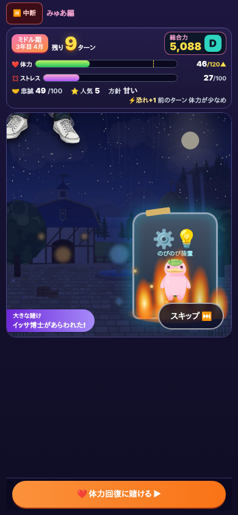
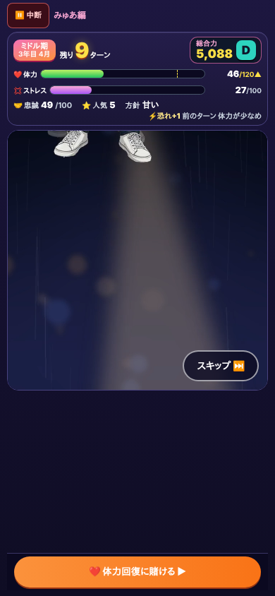
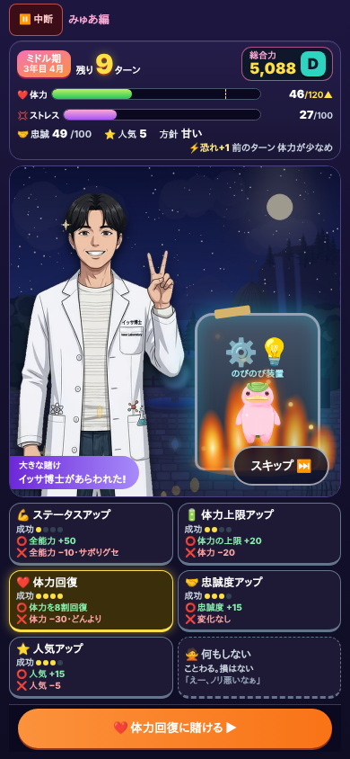
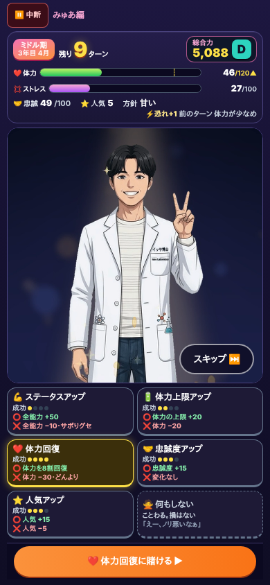
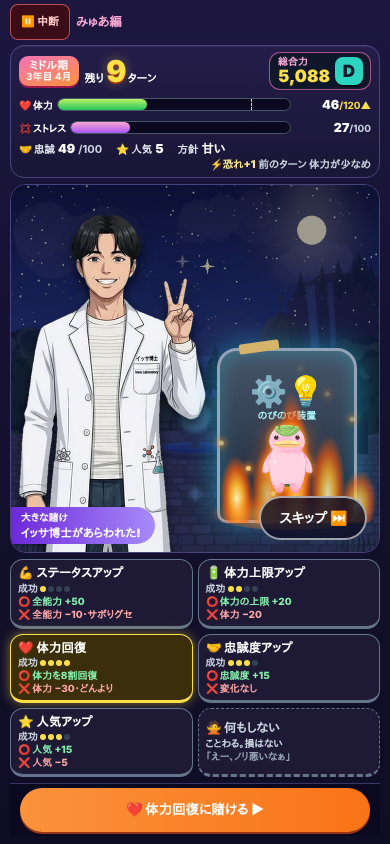
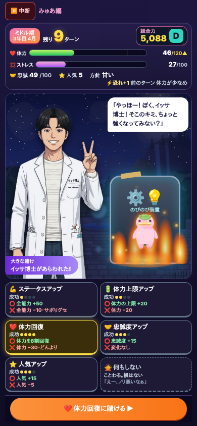

# イッサ博士の登場動画(r1119-059・社長に見せる止め絵)

モンサク「大きな賭け」で博士があらわれる場面(`MsxIssaMeet`)に、登場の動画を1回だけ流す。最後の決めポーズで、今までの止め絵(issa-hakase.png)へ切り替える(同じ絵・同じ位置なので、つなぎ目は見えない)。

| | 透過の版(本命・WebM) | iPhone・iPad・Mac の Safari(背景付きの mp4) |
|---|---|---|
| ①始まり |  |  |
| ②途中 |  |  |
| ③最後の決めポーズ |  |  |
| 終わったあと(吹き出しが出る) |  |  |

- 透過の版: 博士の止め絵と同じ枠に重ねて流す。夜の背景・のびのび装置はそのまま見える
- 背景付きの版: 場面いっぱいに流し(顔と上半身が見える位置)、終わったら0.3秒で消えて場面へ戻る
- 「スキップ ⏭」(r1119-051 の呼び名・右下)を押すと、すぐ最後の決めポーズ(止め絵)へ
- 吹き出しは動画が終わってから出す。下の賭けの札は流れている間も押せる
- 音は無い(muted・playsinline。勝手に全画面にならない)。読めない・自動再生できない(2.5秒たっても始まらない)・動きを減らす設定のときは、今までの止め絵の登場のまま
- 動画は場面を開いたときに初めて読む(起動時の読み込みには入れていない)。画質はそのまま(r1115-143)
- 縦 390×844 で撮った。撮影は遅く流して撮っている(`tools/success/success-shoot.js` の I1V・I1B)
