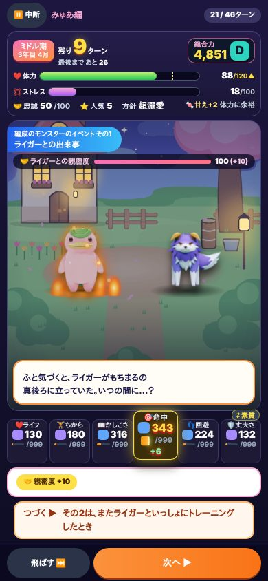
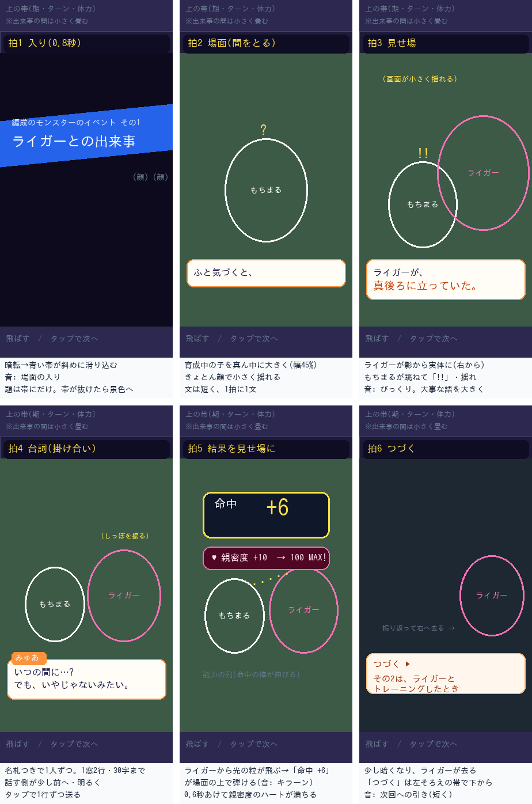

# モンサクのイベントの流れの作り直し(案・コードは変えない)

- 依頼: 窓口(社長「イベントの流れが悪い。アクセントがないというか、全然入ってこない」)/ シナリオ / 2026-11-20
- 例にした出来事: **編成のモンスターのイベント その1「ライガーとの出来事」**(`MsxTrainEvent`・56-monsuc-tevent.jsx)
- 社長の OK が出てから作る。ここは案だけ

## 1. いまの流れ

題の帯 → 親密度の帯 → 2体が小さく立つ景色 → 地の文1行の窓 → 能力の列 → 白い結果の箱(親密度 +10)→ つづく。
撮ったのは、出来事に入ってから 0.7秒・1.5秒・3秒([並べた止め絵](now-strip.jpg))。**3枚とも同じ絵**で、全部が一度に出ている。

なぜ入ってこないか:

| いま | 起きていること |
|---|---|
| 全部が同時に出る | 目がどこを見ればよいか分からない。見せ場が無い |
| 2体が画面幅の2割ほどで、立っているだけ | 「ライガーが真後ろに立っていた」のに、絵は何も起きていない。文と絵が合っていない |
| 文は地の文1行だけ | 掛け合いが無いので、2体の関係が伝わらない |
| 上がった物は下の白い箱と能力の列の札にまとめて出る | 上がった瞬間が無い。社長の「親密度+10 の箱」もここ |
| 上の帯(期・ターン・体力・方針)が出たまま | 出来事の場面が画面の半分しかない |

参考([v2 36〜50秒](ref-v2-36-50s.jpg))は、大きな立ち絵・名札つきの台詞を1行ずつ・暗転での場面の切り替え、で進む。
写しにはせず、「1拍に1つだけ見せる」「場面を大きく」の考え方だけ借りる。

## 2. 案: 6つの拍で進める

| 拍 | 見せる物 | 動き・表情 | 音 | 文 |
|---|---|---|---|---|
| 1 入り | 暗転 → 青い帯が斜めに滑り込む「編成のモンスターのイベント その1 / ライガーとの出来事」 | 帯が抜けたら景色が開く | 場面の入り | (題だけ) |
| 2 場面 | 育成中の子を真ん中に大きく(幅45%) | きょとん顔で小さく揺れる。**間をとる**(0.5秒は何も足さない) | 無し(環境音だけ) | 「ふと気づくと、」 |
| 3 見せ場 | ライガーが右の影から実体に | もちまるが跳ねて「!!」、画面が小さく揺れる | びっくり | 「ライガーが、**真後ろに立っていた。**」大事な語を大きく・色を変える |
| 4 台詞 | 2体が並ぶ。話す側が少し前に出て明るく | ライガーがしっぽを振る | 無し | 名札つきで1人ずつ。みゅあ「いつの間に…? でも、いやじゃないみたい。」 |
| 5 結果 | ライガーから光の粒がもちまるへ → **「命中 +6」が場面の上で弾ける** → 0.6秒あけて親密度のハートが満ちる(100 なら「MAX!」) | 能力の列の命中の棒がそのとき伸びる | キラーン → ハート | (字は札だけ) |
| 6 つづく | 少し暗くなり、ライガーが振り返って去る | 下から「つづく ▶」の帯 | 次回への引き(短く) | 「その2は、ライガーとトレーニングしたとき」(左そろえ・2行まで) |

### 決まりごと(どの出来事にも当てる)

- **1拍に1つ。** 新しく出る物は1拍に1つだけ。前の拍の物は暗くするか退かせる
- **文の長さ:** 1つの窓は2行・30字まで。それより長い台本は窓を分ける。地の文と台詞は別の窓にする(名札の有る無しで分かる)
- **文字の強弱:** 1つの出来事で強調は1か所だけ(見せ場の拍)。強調は大きさと色。全部を太字にしない
- **結果は演出で見せる:** 下の白い箱にまとめない。上がる能力ごとに1回ずつ弾けさせる(3つ以上上がるときは、大きい順に2つを弾けさせ、残りは能力の列が伸びるだけ)
- **上の帯は出来事の間は畳む**(期とターンだけの細い帯)。場面に高さを回す
- **送り方:** 拍はタップで進む。待ちの長い拍(入り・結果)は自動で次へ。「飛ばす」で全部とばして、最後の結果だけ1枚で出す
- **動きを減らす設定(`msxFxCalm`)では、** 揺れ・弾けを止め、拍の区切りだけ残す

## 3. 使える部品(作り直さない)

| 部品 | どこ | 使い道 |
|---|---|---|
| 入りの帯 `tev-in-b`(帯と顔) | 56-monsuc-tevent.jsx | 拍1。斜めの帯の動きは今の作りを伸ばす |
| 光の粒 `MsxKira`・時間で鳴らす音 `msxUseTimedSe` | 56-monsuc-awake・既存 | 拍5 の粒とキラーン |
| 能力の棒の伸び `MsxStRow`(社長の A 案の持ち上がり) | ④の部品 | 拍5。札を持ち上げる演出はそのまま使う |
| 本編のお話の新しい見た目(r1103 の案B)の名札つきの窓・送り方 | 60-app.jsx のお話の窓 | 拍4。名札・1行ずつの送りを同じ見た目にそろえる |
| 「つづく」の部品 `MsxEvNext`(#6933 で左そろえに) | 56-monhero-success-store.jsx | 拍6。下から出る帯にする |

## 4. 作るときの順(OK が出たら)

1. 編成の子のイベント(その1〜3)だけで6拍の型を作る(台本は今の地の文+助手のひとこと1行を足す)
2. 型を育成イベント(選択肢つき)と日々の出来事へ広げる(選択肢の拍が1つ増える)
3. 台本に「見せ場の語」と「動き」の印を足す(書き手が拍を指定できるように)

決めてほしいこと: ①6拍の型でよいか ②拍4の台詞を足す(台本が増える)か、地の文だけで拍2〜3を厚くするか ③「飛ばす」で結果だけ1枚、でよいか
