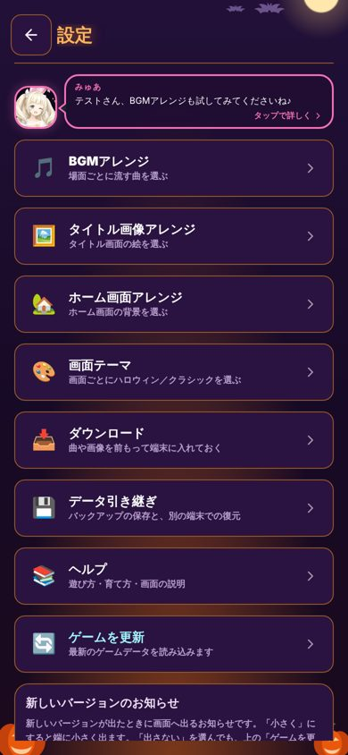
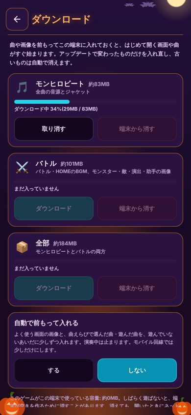

# 事前ダウンロード(曲・画像を端末にためておく)

2026-10-11 社長依頼「よくゲームにある事前ダウンロードのように、曲や画像を前もって端末にダウンロードしておける仕組み」。
「モンビー周り、バトル周り、全部」で選べるようにし、アップデートでは変わった分だけ落とし直す。

| もの | 置き場 |
| --- | --- |
| Service Worker 本体 | `monster-hero/sw.js`(手書き。ビルドでは変えない) |
| 一覧と版の印 | `monster-hero/asset-manifest.json`(`node tools/build.js` が `tools/build-asset-manifest.js` で作る。手で書かない) |
| ページ側 | `monster-hero/src/parts/25-asset-cache.jsx`(`ASSET_CACHE`) |
| 設定の画面 | `51-screen-settings.jsx` の `AssetDownloadPage`(設定 → ダウンロード) |
| デバッグの切り替え | DEBUG MENU → ⑤その他 →「📥 事前ダウンロード」(`data-asset-cache-toggle`) |
| 検査 | `node tools/boot/asset-prefetch-check.js`(実ブラウザ。`build.js --check` も一覧の古さを見る) |

## 仕組み

1. **一覧** — `asset-manifest.json` に、音源(`audio/*.mp3`)と画像(`images/**`・`data/images/*.jpg`)を1件ずつ
   `{ v: 中身の sha256 先頭12桁, size, pack }` で載せる。`v` は画像の `?v=`(stamp-version.js)・音源の `?v=`
   (stamp-audio-keys.js)と同じ計算なので、ゲームが使う URL とそのまま合う。
2. **まとまり** — データから機械的に決める。
   - `beat`(モンヒロビート): `rhythm-mode.js` の `bgmTrackId` → BGM 一覧の `src` の音源、`images/song-art/`、`images/rhythm-look/`
   - `battle`(バトル): それ以外の音源と画像(バトル・HOME の BGM、モンスター、敵、演出、助手、アイコン、背景)
   - `card`(バトルカード): MFバトルカードのカードの絵 `images/card-battle/`(小さい版 `s` と大きい版 `l`。2026-10-25 社長「両方入れる」・約26MB)。
     **公開の印 `RELEASE_FLAGS.cardBattle` が false のあいだは、遊ぶ人には設定に出さず、「全部」にも自動ダウンロードにも入れない。**
     デバッグの合言葉が合った端末だけに出す(`25-asset-cache.jsx` の `assetPackOpen`)。印を立てた日から、遊ぶ人にも出て、自動ダウンロードでは
     よく使う画像・最近の曲のあとに、小さい版(`images/card-battle/s/`)→大きい版(`images/card-battle/l/`)の順に落とす(2026-10-25 社長「両方入れる」。1回の起動の上限はほかと同じ)
   - `all`(全部): 出してよいまとまりの全部(公開前はモンヒロビートとバトル。公開後はバトルカードも)
   - 2026-10-11 時点: モンヒロビート 77件 83MB / バトル 436件 101MB / 全部 184MB
   - `movies/` は入れない(`<video>` は Range で取るため、丸ごと返すと iPhone で再生できないことがある)
3. **ためる鍵** — Cache Storage の `mh-assets-v1` に「パス?v=<v>」で置く。中身が変われば鍵が変わるので、
   **古い絵や音が出ることはない**。
4. **アップデート** — ページを開くたび(navigate のたび)に SW が一覧を取り直す。一覧の `id` が変わっていたら、
   一覧に無い・版の違うものを消す。変わった・増えたファイルは、使った時点か「残りを入れる」で入る。
   設定には「一部が入っています」と出て、「残りを入れる」で差分だけ落とす。
5. **版のない取得**(`?v=` を付けずに取っている古い作りの絵) — SW はページを開いたときの一覧の取り直しが
   終わるまで待ってから、一覧の版で返す。だから新しい版を出した直後でも、古い絵は返らない。
6. **使ったものもためる** — SW が扱う範囲(一覧に載っている音源・画像)は、遊んで取ったときにもためる。

## ゲーム本体の更新を止めない約束

- SW が `respondWith` するのは「`audio/` `images/` `data/images/` の下の mp3・png・jpg・webp」と、
  下の「本体とデータ」の JS・CSS だけ。HTML(index.html)・JSON・version.json・Supabase には手を出さない
  (ブラウザがふつうに取りに行く)。なので、新しい版を出したら今まで通り必ず新しい版が動く。
- ページ本体(navigate)にも `respondWith` しない。オフラインで遊べるようにするものではない。
- Range つきの取得には手を出さない。

## 本体とデータ(2026-10-27〜)

社長「本体とデータもダウンロードに入れる」。案は [`docs/progress/speed/download-plan.md`](../progress/speed/download-plan.md)。

- **版を決めるのは index.html。** index.html は毎回ネットから取る(SW は触らない)。index.html が読む同じサイトの JS・CSS
  (`game-system.compiled.js`・`tailwind.css`・`data/*.js`・`data/images/*.js`・`vendor/*.js`)は、どれも `?v=<版>` 付き。
  本体の版 `GAME_BUILD` は中身のハッシュ(`tools/stamp-game-build.js`)
- **一覧**: `build-asset-manifest.js` が index.html から拾い、`asset-manifest.json` の files に `pack:'core'` で載せる(版は index.html の `?v=` のまま)。
  本体の版は本体を書き出したあとに決まるので、`build.js` のいちばん最後に作る。「全部」のまとまりには数えない
- **SW**: 置き場は `mh-code-v1`(画像・音源の `mh-assets-v1` とは分ける)。URL の `?v=` が一覧の版と**ぴったり同じ**ときだけ返し・ためる。
  `?v=` の無い取得・`&retry=` 付き(index.html の読み込み直し)は素通し。新しい版を出した直後は、ページを開いたときの一覧の取り直しを
  待ってからためる。ためるのは中身の大きさが一覧と同じときだけで、見出しは種類(Content-Type)だけ写す
- **古い版**: 一覧が変わったら、一覧に無い・版の違うものを `mh-code-v1` から消す
- **止め札**: sw.js の `const CODE_CACHE_OFF = false;` を true にして公開すると、次に開いたときから JS・CSS は素通しになり、`mh-code-v1` を消す
- **切にしたとき**: 設定(DEBUG MENU)で事前ダウンロードを切にすると、SW を外し `mh-code-v1` も消す
- **検査**: `tools/boot/asset-prefetch-check.js`(2回目に開くと本体が置き場から返る・返した JS・CSS はどれも一覧の版と同じ・切で消える)。
  版の入れ替えで新しい本体が動くことは `tools/boot/code-prefetch-check.js`(開発部ドライバーくん)

## 保存データ・ランキング

- **入/切の保存値は、本人が押したとき(`enabledChosen:true`)だけ使う。** 既定が切だった 1段目(#2739〜#2743・約20分)は、
  曲えらびで曲を選ぶと `noteSong` が保存を呼び、`enabled:false` が書かれていた。公開後にそれを本人の選択として読んで、
  設定の「ダウンロード」の行が出ない端末があった(社長の端末で発覚)。印の無い `enabled` は既定(入)で読む。
  設定の行は入/切に関係なく出し、切のときはページの中に「ダウンロードを使う」を出す

- localStorage に足したのは `mh_asset_prefetch_v1` だけ(入/切・自動・最近選んだ曲)。`normalizeAssetCacheSettings`
  で壊れた値は既定に戻す。SW は localStorage を触れない。ランキング(Supabase)には触れない。
- 切にすると SW に「何もためない」を伝えてから外し、`mh-assets-*` の置き場を消す。セーブデータは消えない。

## 自動の前もって落とし(画面の名前は「自動ダウンロード」)

- 対象: よく使う画面の画像(`data/images/` `images/ui/` `images/monster-icons/`)と、
  曲えらびで選んだ曲・遊んだ曲(最近12曲。音源とジャケット)。
- 1つずつ、0.6秒あけて取る。次のときは止める: まとめてダウンロード中 / 演奏の準備中・演奏中 /
  画面が裏 / 通信の節約モード / 2G。
- 1回の起動で落とす上限: Wi-Fi・有線 200MB、モバイル回線 8MB、わからない端末(iPhone は回線の種類を
  教えてくれない)30MB。
- 演奏の準備・演奏中の印は修理部ドライバーくんの仕組みが出す: `window.__mhSongPrepBusy` / `window.__mhSongPlaying`、
  イベント `mh:song-prep-start` / `mh:song-prep-end`(detail.songId) / `mh:song-play-start` / `mh:song-play-end`。
  印がまだ無い版では「準備中ではない」として動く。`mh:song-prep-start` の songId は「遊んだ曲」として覚える。
- 曲の音源は、ドライバーくんの `loadBuffer` が `audio/…mp3?v=<AUDIO_CACHE_KEYS>` で取る。SW の鍵も同じ形なので、
  前もって入れた曲はそのまま当たる。`14-audio.jsx` と `30-rhythm-play.jsx` はこの仕組みからは触らない。

## iPhone(Safari・ホーム画面に追加したアプリ)の容量と消される場合

調べた結果(WebKit「Updates to Storage Policy」、MDN「Storage quotas and eviction criteria」、2026-10-11):

- **容量の上限**: iOS 17 / Safari 17 から、ブラウザアプリ(Safari)で1つのサイトにつき**端末の容量の最大60%**、
  全サイト合わせて最大80%。ホーム画面に追加したアプリも、Safari で開いたときと同じ上限(WebKit の説明)。
  184MB は通常どの端末でも上限の内側。空きが足りないと `QuotaExceededError` になり、画面に
  「端末の空きが足りないため止まりました」と出して止める。
- **消される場合**:
  - 端末の空きが少なくなったとき(古く使われていないサイトから消える)
  - Safari では、**7日間そのサイトを開かない**と、スクリプトが書いたデータ(Cache Storage を含む)が消されることがある
    (追跡防止 ITP)。ホーム画面に追加したアプリはこの数え方が別で、アプリを使っていれば消されにくい
  - 設定 → Safari → 履歴とWebサイトデータを消去 / ホーム画面のアプリを削除したとき
- **消されにくくするお願い**: ダウンロードのときに `navigator.storage.persist()` を呼ぶ。Safari は利用状況から黙って
  決める(確認の窓は出ない)。Safari 17 で常に false を返すという報告(WebKit Bug 271401)もあるので、頼りにはしない。
- **消されたとき**: ためたものが無いだけなので、開いたときにネットから読み込む(今までと同じ)。壊れない。
  設定の「ダウンロード」には「まだ入っていません」と出る。
- **localStorage(セーブデータ)との関係**: 7日ルールは localStorage にも同じくかかる(この仕組みとは関係なく前から)。
  この仕組みはセーブデータの置き場を変えない。

## 公開までの段取り

1. いま: デバッグで入/切(`ASSET_CACHE_DEFAULT_ENABLED = false`)。切のあいだは SW を登録しない
2. bot(`asset-prefetch-check.js`)と社長の静止画の確認
3. 既定を入にする(`ASSET_CACHE_DEFAULT_ENABLED = true`)と同時に、更新履歴・ヘルプを書く(changelog-help-update スキル)

## 画面(2026-10-11 の静止画)

設定 → ダウンロード(いまはデバッグで入にしたときだけ出る)

 
