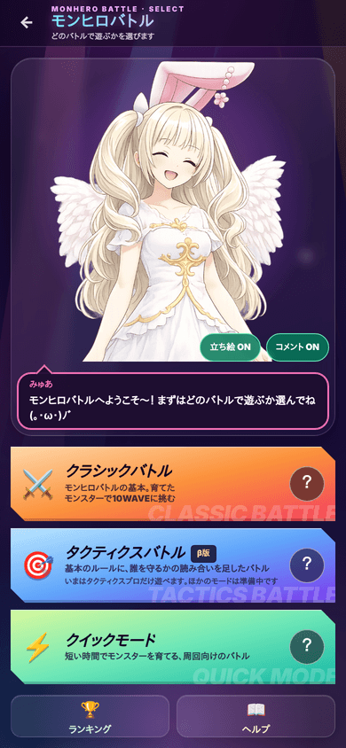
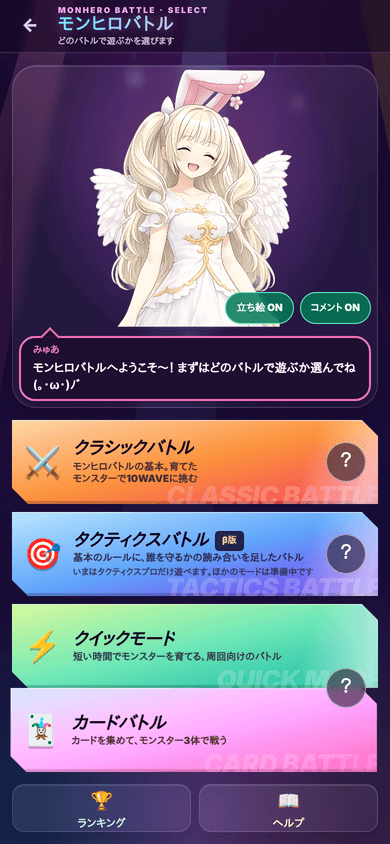

# カードバトル 設計書(案)

2026-10-24 カード部 デッキくん。**まだ実装しない。** カゲあつくんの確認と社長のOKが出てから作り始める。

紙の『モンスターファームバトルカード』(テクモ・1999年ごろ)のルールを基本そのまま使い、
**カードも元のもの(絵・名前・数字・文)をそのまま使う**カードバトル(社長が使用の許可を取った)。

**社長が決めたこと**([`PRESIDENT_DECISIONS.md`](../rules/PRESIDENT_DECISIONS.md) 2026-10-23・10-24):
- 新コンテンツとしてカードバトルを作る(最初から対人戦も・スターター→パック・専用通貨・育てた強さは持ち込まない)
- 元のカード(絵・名前・数字・文)をそのまま使う
- **入れるのは、社長から届いたカードの種族だけ。** まだ届いていない種族は、あとから足す。モンヒロにいない種族(ディノ・ナーガ・ガリ など)も、カードが届けば入れる。元のカードに無いモンヒロの子(イルミネ など)は、いまは入れない
- 細かい決まりは、元のルールを調べてそろえる。調べても分からない所は、案と根拠を書いて★のまま残す
- スターターキットは元の3つ(ミラクルチーム・スピードチーム・パワフルチーム)
- カードの下の帯の「© TECMO, LTD. 1999」「monsterrancherbc.com」は消す(許可を取ったときに消してよいと言われた)。絵や数字には手を加えない
- ブリーダーカードを入れる

**届いているカード**(`tools/art-sources/card-battle/`。数字はカード部が拡大して1枚ずつ確かめた):
- 9種族: ライガー・ガリ・ゴーレム・スエゾー・ピクシー・ディノ・ナーガ・ハム・モッチー(3つのスターターの種族がすべてそろった)
- モンスターカード 24枚・技カード 117枚・全モンスターカード 19枚・ブリーダーカード 18枚 = **178枚**
- 全モンスターカードとブリーダーカードの37枚は、**絵が英語版**(名前・文が英語)。→ 2-5

社長に決めてもらうことは、最後の「[8. 社長に決めてもらうこと](#8-社長に決めてもらうこと)」にまとめた。

---

## 1. ルール

### 1-1. 元のルールで調べられたこと

この環境からは解説ページ(note・解説サイト・Wikipedia・tcg-db・legendcup)を直接開けない。**検索の抜粋で確かめた範囲**。
ルールブックの写真は届かない(社長)。

| 項目 | 元のルール | 出どころ(抜粋) |
| --- | --- | --- |
| 準備 | モンスターカード3枚を**裏向き**で場に置く。技カード50枚の山札を切って裏向きに置く。先攻・後攻を決め、5枚ずつ引く | Wikipedia |
| 後攻の特例 | 後攻は、手札から2枚までガッツにできる | Wikipedia・note |
| ターンの流れ | **ドロー → 攻撃 → ガッツ**の順 | 解説サイト・note |
| ドロー | **手札が5枚になるまで**山札から引く。先攻の1ターン目は飛ばす。手札がすでに5枚なら、山札の一番上を裏向きのままガッツにする | note |
| ガッツ | ガッツのときに、手札を**好きな枚数**ガッツにできる(カード「長期戦の予感」で2枚までに縛られる、という例がある)。ガッツの量は相手にも見える | note・legendcup |
| ガッツの払い方 | ガッツにした時期が新しいものから払う | 解説サイト |
| 攻撃 | モンスター1体につき1回(カードの効果で増えることがある) | 解説サイト |
| 守り | 回避・防御は、カードとガッツがある限り同じターンに何回でも使える。1回の攻撃に何枚でも重ねられる | 解説サイト |
| カードの種類 | ちから・かしこさ・防御・回避・特殊・**全体** | 解説サイト |
| 空中・地上 | モンスターには「特徴」(地上/空中)がある。技の文に「空中にいるモンスターには当たらない」などがあり、特徴を空中に変える回避(舞い上がる など)や全体カード(空間のひずみ・悪天候)もある | legendcup・解説サイト |
| 全体カード | 全体カードの効果は優先して処理する(ぶつかる技の効果は不発) | 解説サイト |
| 同じカード | 同じ技・全体・ブリーダーカードは3枚まで(モンスターカードは数えない) | 解説サイト |
| 勝ち | 相手のモンスター3体のライフを全部0にする、または相手の山札を使い切らせる | Wikipedia |
| スターター | 3種類(スピード・パワフル・ミラクル)。モンスター3枚＋技カード50枚の決まった中身 | Wikipedia |

**初版から直したこと**: 初版は「ふだんのガッツは1ターン1枚まで」「ドローは1枚」と推測で書いていた。
調べ直して、元のルールどおり「**手札5枚まで引く**」「**ガッツは好きな枚数**」に直した。

### 1-2. 元とモンヒロ版の対応表

| 元 | モンヒロ版 |
| --- | --- |
| モンスターカード3枚(裏向きで置く) | 同じ。同じ種族は1体まで★(キラ・別絵キラも同じ種族として数える。元のスターターも3体とも別の種族) |
| 技カード50枚の山札・手札5枚 | 同じ |
| 手札を伏せてガッツ | 同じ |
| ちから・かしこさ・特殊・防御・回避・全体 | 同じ(全体カードは届いたら入れる。いまは0枚) |
| ブリーダーカード | 入れる(18枚届いた。絵は英語版) |
| 全モンスターカード | 入れる(19枚届いた。どのモンスターでも使える技。絵は英語版) |
| 同じカード3枚まで | 同じ |
| 全滅か山札切れで勝ち | 同じ |
| 後攻は2枚までガッツ | 同じ |
| カードの絵・名前・数字・文 | 元のカードそのまま |
| 育てた強さ | 持ち込まない。カードに書いた数字だけ |
| 対戦相手 | コンピューター戦 + 対人戦(みんなで対戦の仕組み) |

### 1-3. モンヒロ版のルール本文

**いちばん大事な決まり: カードの文は、この本文より優先する。** 本文はカードに書いていないときの決まり。

**準備**
1. モンスターカード3枚と技カード50枚でデッキを作る。同じ技カードは3枚まで。
2. 先攻・後攻は、コンピューター戦では毎回ランダム、対人戦は部屋の抽選で決める。
3. モンスター3体を裏向きで置き、山札を切って5枚引く。
4. 後攻は、手札から**2枚まで**ガッツにできる。★(Wikipedia は「始める前」、note は「後攻の最初のガッツのとき」と読める。後攻が最初の攻撃からガッツを使えるよう、始める前とした)
5. **モンスターを両方いっしょに表にして**、先攻の1ターン目を始める。★(裏向きにする理由は「相手の3体を見てから後攻のガッツを決めさせない」ためと読める。表にする時期は見つからなかった)
6. 引き直しは無し(元にも見当たらない)。

**ターンの流れ**(自分のターン)
1. **ドロー**: 手札が5枚になるまで引く(先攻の1ターン目は飛ばす)。手札がすでに5枚なら、山札の一番上を裏向きのままガッツにする。
   引かなければいけないのに山札が無ければ、そのプレイヤーの負け。
2. **攻撃**: 生きている自分のモンスターごとに1回、技カードを使える。
   - 技カードは、**カードに書いてあるモンスターだけ**が使える(スエゾーの技はスエゾーだけ)。全モンスターカードは、どのモンスターでも使える。
   - 攻撃したモンスターは「疲れ」(英語版のカードの exhausted)になり、そのターンはもう攻撃できない。自分の次のターンのはじめに取れる★
     (英語版のカードに「最後の1体なら疲れずに攻撃できる」「疲れを取る」「疲れたまま戻ってくる」があるので、1体1回の攻撃を「疲れ」で数えていると読める)。
   - ブリーダーカードは、モンスターの攻撃の回数に数えずに使える★(ブリーダーが使うカードのため)。
   - カードに書いたガッツを払う(新しく置いたガッツから捨て札へ)。
   - 攻撃先は、相手の生きているモンスターから選ぶ(「全ての相手モンスター」の技は選ばない)。
   - 攻撃を受けた側は、回避・防御のカードを何枚でも重ねて出せる(ガッツが足りる限り)。使えるのは、カードに書いてあるモンスターが狙われたときだけ★。
   - 「ちから技と同時に使う」「ちから技を使う前に使う」特殊(跳躍・渾身)は、**そのモンスターの攻撃の回数に数えない**★(技に付ける札として読める)。
   - 使い終わったカードは捨て札へ。
3. **ガッツ**: 手札から好きな枚数を伏せてガッツにできる。
4. **終わり**: 「ターン終了」を押す。

**ダメージ**
- 技に書いたダメージがそのまま入る。ライフが0以下でそのモンスターは倒れる(戻らない)。
- 防御で減らしたダメージは0より下にならない。
- 「回避されても半分」の端数は切り捨て(5→2)。根拠: ナーガの「カウンター」の文に「半分(切り捨て)」とある。
- 「全ての相手モンスターにダメージ」は、相手1体ずつに守るかどうかを聞く★。

**空中・地上**
- モンスターカードの右上の丸が、そのモンスターの「特徴」(届いた9種のうち、ガリ・ピクシーが「空中」、ほかは「地上」)。
- 技の文が特徴にふれていればそれに従う(ディノの「しっぽビンタ」は空中にいるモンスターにダメージを与えられない)。
- 特徴を変えるカード(空中にする回避・全体カード)が届いたら、その文のとおり、期限つきで特徴を書き換える。
  全体カードの効果は、ほかの技の効果より優先する。

**勝ち負け**
- 相手のモンスター3体を全員倒す → 勝ち
- 相手が引くときに山札が無い → 勝ち
- 対人戦で相手が抜けた・持ち時間を3回続けて使い切った → 勝ち
- 両方が同時に決まる(「自分も2ダメージ受ける」で最後の1体同士が倒れる など)ときは、ターンを持っていたほうの負け★(自分の技で倒れた扱い)

**持ち時間**(対人戦): 自分のターン60秒・守り15秒。過ぎると、そのターンは終了/守りはしない。

---

## 2. カード(元のカードをそのまま使う)

### 2-1. 素材の受け取り方

社長から届いた元のカードは、種族ごとに `tools/art-sources/card-battle/<種族>/` に置く。

| 置くもの | 中身 |
| --- | --- |
| カードの画像 | 元の大きさ 742×1038 の JPEG(番号.jpg) |
| `cards.json` | 画像から書き写した番号・名前・種類・ダメージ・ガッツ・文 |

- ゲームは**画像から読み取らない**。動きはすべて `cards.json` の数字と文から作る。
- 道具 `tools/card/card-data-build.js` が、全種族の `cards.json` から配信用のデータ `monster-hero/data/card-battle-cards.js` を作る。
  検査 `tools/card/card-data-check.js` が、番号のだぶり・種類の名前・数字が整数か・画像があるか・**文に対応する効果が作ってあるか**を見る。
- カードの id は**元のカード番号**(`C-004`・`037` など)。持っているカードの保存もこの番号で持つ。
- ブリーダーカード・全体カードが届いたときのために、データの種類に `breeder`・`field` を最初から用意しておく(0枚のまま動くようにする)。

### 2-2. 届いているカード(178枚)

| 種族 | モンスターカード | ライフ | 特徴 | 技カード |
| --- | --- | --- | --- | --- |
| ライガー | C-001・S・V | 6 | 地上 | 001〜012・357 |
| ガリ | C-002・S | 7 | **空中** | 013〜024・358 |
| ゴーレム | C-003・S・V | 9 | 地上 | 025〜036・359 |
| スエゾー | C-004・S・V | 7 | 地上 | 037〜048・360 |
| ピクシー | C-005・S・V | 6 | **空中** | 049〜060・361 |
| ディノ | C-006・S | 8 | 地上 | 061〜072・362 |
| ナーガ | C-007・S | 8 | 地上 | 073〜084・363 |
| ハム | C-008・S・V | 6 | 地上 | 085〜096・364 |
| モッチー | C-009・S・V | 7 | 地上 | 097〜108・365 |

(S=キラ・V=別絵キラ。強さは通常と同じで、絵だけ違う)

| 種類 | 技カード(9種族) | 全モンスター | ブリーダー |
| --- | --- | --- | --- |
| ちから | 52 | — | 1 |
| かしこさ | 30 | — | — |
| 特殊 | 18 | 13 | 16 |
| 回避 | 10 | 2 | — |
| 防御 | 7 | 4 | 1 |
| 計 | 117 | 19 | 18 |

- 各種族の技は、番号の続く12枚(001〜108)と、離れた番号の1枚(357〜365)。元のスターターに入っているのは、続く12枚の中からだけ(3.)。離れた番号は、あとの弾で足されたカードと読める★。
- **全モンスターカード**(109〜350 のうち19枚): どのモンスターでも使える技。`category: "全モンスター"`。
- **ブリーダーカード**(112〜366 のうち18枚): モンスターではなくブリーダーが使うカード。`category: "ブリーダー"`。
  ブリーダーカードの「加勢」(112)だけは、ちから・ダメージ1の攻撃(「モンスターを倒すためには使えない」)。どのモンスターの攻撃として使うかは★(案: 攻撃の回数に数えず、生きている自分のモンスターから出す)。
- 全体カード(ENV。場の全員に効く)はまだ0枚。「祈る」(280)が全体カードを打ち消すカードなので、届いたら入れる。

### 2-3. 文を動きにする(効果の部品)

カードの文を、決まった効果の部品に当てる。届いた9種族の技117枚は、次の部品で全部動かせる。

| 部品 | 中身 | 使うカードの例 |
| --- | --- | --- |
| 回避されない | この技は回避されない | テレポート・ガッチョ・聖なる光・くしざし・ライトニング |
| 回避されても半分 | 回避されても、半分(切り捨て)のダメージ | ワンツーパンチ・ガッチャー・魔神ダンス・連続魔空弾 |
| 防御で減らされない | 防御でダメージをマイナスされない | ボディーブロー・渾身 |
| 守備されない | 回避も防御もされない | 瞬殺 |
| 自分も受ける | 回避されなかったら、自分も N ダメージ | 頭つき・タックル・体当たり・炎の体当たり |
| ガッツを減らす | ダメージを与えたら、相手のガッツを N 減らす(全部も) | しっぽアタック・ベロビンタ・キッス・なめる |
| 攻撃できない | ダメージを受けたモンスターは次のターン攻撃できない(全員も) | 巴投げ・砂キック・冷気弾・クロー・吠え・ブリザード |
| 全員に | 全ての相手モンスターにダメージ | おなら・さくら吹雪・炎のカベ・竜巻アタック |
| 地上の全員に | 自分以外の、地上にいる全てのモンスター(味方も)にダメージ | 地震 |
| 割り振り | ダメージを複数の相手に割り振れる | ショットガン |
| 空中に当たらない | 空中にいるモンスターにはダメージを与えられない | しっぽビンタ |
| 空中にする | 次のターン終了まで、このモンスターの特徴を空中にする | ジャンプ・舞い上がる |
| ダメージ2倍 | 次の自分のちから技のダメージを2倍(ダメージを受けたら終わる、など) | 力をためる・ジャンプ・舞い上がる |
| ダメージを足す | 捨て札の自分の技の枚数・減ったライフの分だけ足す | 魔神ファイナル・ビッグバン |
| 同時に使う | 決まった技どうしを同時に使い、組み合わせでダメージが変わる | 右爪・左爪・ツノ(2種類で3・3種類で7) |
| 続けて使う | 決まった技どうしは同じターンに続けて使える | 雷・電撃(ピクシー) |
| 何回でも | このターン、このモンスターは好きなだけ技を使える | 死亡遊戯 |
| 技に付ける | このターン、次に使うちから技は回避されない/防御で減らされない/守備されない | 跳躍・電光石火・渾身・瞬殺 |
| 回避させない | このターン、相手は回避を使えない | にらむ |
| 狙いを固定 | 次のターン、相手はこのモンスターにダメージを与える技しか使えない | 挑発・レロレロ |
| 狙わせない | 次のターン、相手はこのモンスターにダメージを与える技を使えない | 魅了 |
| ターンを飛ばす | 相手のターンを1回飛ばす | 歌う |
| 回復 | ライフを回復する(与えたダメージ分・3 など) | ドレイン・回復 |
| 手札・山札 | 相手の手札を見る/引く/捨てる・捨てさせる/捨て札から手札へ | 偵察・素早い計算・大声・超大声・作戦の指示 |
| 回避 | ちから技・かしこさ技を回避する(消費ガッツ N 以上だけ・ちから技だけ、などの縛りつき) | 横回転・ステップ・ふせる・バック転 |
| 防御・減らす | 受けるダメージを −N | 踏ん張る・まるまる・堅い守り |
| 防御・はね返す | 受けるダメージ(半分など)を、使ったモンスターへはね返す。特別な効果は返さない | 魔法反射・カウンター |
| 防御・かばう/身代わり | 味方へのダメージを自分が受ける/狙いを別の味方へ変える | 友をかばう・隠れる |

- 種族が届くたびに新しい文を部品に当てる。**部品がまだ無い文のカードは「準備中」にして、パック・デッキ・CPUに出さない**(検査が止める)。
- 全モンスター・ブリーダーの37枚は、上の部品に加えて「ガッツの山を作り直す」「疲れ(exhausted)を取る」「モンスターを捨ててガッツにする」などが要る。
  **いまは動かせないカード**(届いていないものに関わる): 混血のモンスターに関わる3枚(346 Pureblood・348 Ancient Echo・352 Fusion)と、フェニックスを呼び戻す1枚(128 Reborn)。全体カードを打ち消す 280 Pray は、全体カードが無いあいだは使い道が無い。

### 2-4. カードの絵(配信へ入れる形と、読み込み)

元の画像には名前・数字・文・© の表記がすべて入っているので、**カードは画像をそのまま見せる**(上に文字を重ねない)。
場の上で変わるもの(残りのライフ・ガッツの数・倒れた印・攻撃できない印)だけを、カードの外や上に別に出す。

| 大きさ | 使う所 | 形 | 1枚の目安 |
| --- | --- | --- | --- |
| 小 240×336 | 手札・場・デッキを組む・図鑑の一覧 | JPEG(`sharp` `quality:78` `mozjpeg`) | 15〜25KB |
| 大 480×672 | 長押しで拡大・パックを開ける | 同上 | 45〜70KB |

**数百枚になったときの重さ(iPhone)**
- いま届いている178枚 × (小20KB＋大60KB) ≒ 14MB。元の種族が全部そろうと数百枚・数十MBになるので、**まとめては読まない**。
- 起動時には1枚も読まない(`index.html` の起動時の読み込みに混ぜない)。
- 対戦の前に読むのは、**両方のデッキに入っているカードの「小」だけ**(1回の対戦で最大 2×(3＋最大50種) 枚・1MB 前後)。
- 「大」は、長押しで拡大したときと、パックを開けるとき(その8枚だけ)に読む。
- 図鑑・デッキを組む画面は、画面に見えているカードだけ読む(`loading="lazy"`)。
- 一度読んだ画像は、いまのゲームの絵と同じ置き方(ブラウザのキャッシュ)で持つ。iPhone の画像のメモリを食わないよう、画面に出す枚数を絞る(一覧は1画面ぶん)。
- 元の画像(742×1038)は `tools/art-sources/` に残し、配信には入れない。縮めるのは道具でまとめて行い、配信の画像と `cards.json` の番号が1対1か検査する。

**© の表記を消す**(社長が決めた): 道具 `tools/card/card-image-build.js` が、縮めるときにいっしょに消す。
- 消すのは下の細い帯の文字だけ。モンスターカードは名前とライフのあいだの2行(© は絵の板のふちの内側、URL はふちの下)、技カードは右下の URL の1行。
- 文字の四角を、すぐ上とすぐ下の色でつないで塗る(左右3列ずつならして、縦すじが出ないようにする)。絵・数字・名前・番号には触れない。
- 178枚すべてで、消したあとの帯を並べて目で確かめた(塗り残し・はみ出しなし)。
- **技カードの「© TECMO」は、下の帯ではなく絵の右下に乗っている**。既定では消さない。`--art-copyright` を付けると同じやり方で消せる(8. で社長が決める)。

| 見本 | 中身 |
| --- | --- |
|  | 下の帯だけ消した(スエゾーのモンスターカード・ライガーの技カード) |
|  | 技カードの絵の上の © も消した場合(ライガー・ピクシー) |

---

## 3. スターターキット(元の3つ)

社長が箱の写真で決めた(`tools/art-sources/card-battle/starter-kits.jpg`)。中身は、社長から届いた元の表(`tools/art-sources/card-battle/starter-decklists/`)のとおり。
**3つとも、カードが全部届いている。** どのキットも、モンスターごとに技15枚＋全モンスター1枚＋ブリーダー4枚＝50枚。

| キット | モンスター3体(ライフ・特徴) |
| --- | --- |
| 一発必殺 ミラクルチーム ★名前は下 | スエゾー(7・地上)・ガリ(7・空中)・ライガー(6・地上) |
| 先手必勝 スピードチーム | ディノ(8・地上)・ハム(6・地上)・モッチー(7・地上) |
| 一撃必殺 パワフルチーム | ゴーレム(9・地上)・ピクシー(6・空中)・ナーガ(8・地上) |

**ミラクルチーム**
| スエゾー | 枚数 | ガリ | 枚数 | ライガー | 枚数 |
| --- | --- | --- | --- | --- | --- |
| ツバはき | 3 | ひっかき | 3 | 右爪 | 3 |
| しっぽアタック | 3 | けり | 3 | 左爪 | 3 |
| かみつき | 2 | 聖なる光 | 1 | ツノ | 3 |
| ベロビンタ | 2 | 炎のカベ | 1 | 突き刺し | 2 |
| なめる | 1 | 炎 | 3 | 電撃 | 1 |
| 偵察 | 1 | 魔法反射(守り) | 2 | バック転(守り) | 2 |
| 横回転(守り) | 3 | ふせる(守り) | 2 | ジャンプ(守り) | 1 |

**スピードチーム**
| ディノ | 枚数 | ハム | 枚数 | モッチー | 枚数 |
| --- | --- | --- | --- | --- | --- |
| パンチ | 3 | 頭つき | 2 | もんた | 3 |
| 体当たり | 1 | ソバット | 3 | ローリン | 3 |
| かみつき | 3 | ワンツーパンチ | 2 | ガッチョ | 1 |
| 炎の体当たり | 1 | ぐるぐるパンチ | 3 | もちき | 3 |
| 火炎 | 2 | おなら | 1 | さくら吹雪 | 1 |
| 踏ん張る(守り) | 3 | 大声 | 1 | まるまる(守り) | 2 |
| 横っ飛び(守り) | 2 | フットワーク(守り) | 3 | 転がる(守り) | 2 |

**パワフルチーム**
| ゴーレム | 枚数 | ピクシー | 枚数 | ナーガ | 枚数 |
| --- | --- | --- | --- | --- | --- |
| でこぴん | 3 | ひっかき | 3 | つき | 3 |
| キック | 3 | 雷 | 3 | くしざし | 3 |
| チョップ | 3 | 電撃 | 2 | はたき | 3 |
| ぐるぐるアタック | 1 | ライトニング | 2 | ドレイン | 2 |
| 地震 | 1 | キッス | 1 | 連続魔空弾 | 1 |
| 堅い守り(守り) | 2 | 回復 | 1 | にらむ | 1 |
| 友をかばう(守り) | 2 | ステップ(守り) | 3 | カウンター(守り) | 2 |

**3つ共通**: 全モンスター「底力」(111・英語版の絵は Grit)1枚、ブリーダー「加勢」(112・Help)2枚・「カララギマンゴー」(113・Mango)2枚。

**表とカードの突き合わせ**(カード部が確かめた)
- 名前が合わないのは1件だけ: 表の「頭突き」(ハム)は、カードでは「**頭つき**」(085)。カードの文字に合わせる。
- 枚数は3つとも 15・15・15・1・4 の50枚で、表の写真と書き写し(`decklists.json`)は合っている。
- **キットの名前**: 箱の印刷は「**一発必殺**ミラクルチーム」、表と、カードの収録先を書いたデータベース(tcg-db・legendcup の抜粋)は「**一発逆転**ミラクルチーム」。
  箱の写真が元の商品そのものなので、箱どおり「一発必殺」を推す。ただ、データベースがどれも「一発逆転」なので、社長に選んでもらう(8.)。
- 社長に見せるときは、3つのキットの箱の絵と、**CPU どうしで数百回戦わせた勝率**を並べて出す(ルールを作ったあと)。

## 4. パックと専用通貨

### 4-1. 専用通貨

名前の案(社長が選ぶ): **「カードコイン」**(推し・意味がすぐ分かる) / 「バトルメダル」 / 「ガッツコイン」。
以下「コイン」と書く。ほかの通貨(ダイヤ・ブリーダーP・ビートP)とは交換しない。

| 手に入り方 | コイン |
| --- | --- |
| はじめて遊んだとき(スターターといっしょに) | 300(パック3つぶん) |
| CPU戦 勝ち(よわい/ふつう/つよい) | 30 / 45 / 60 |
| CPU戦 負け(最後まで戦った) | 10 |
| CPU戦 降参 | 0 |
| 対人戦 勝ち | 60 |
| 対人戦 負け(最後まで戦った) | 20 |
| 対人戦 途中で抜けた | 0 |
| その日はじめての勝ち(CPU・対人どちらでも) | +50 |
| だぶったカード(自動でコインへ) | 技カードは4枚目から 5 / モンスターカードは2枚目から 50(キラ 100・別絵キラ 200) |

**1日の上限**
- CPU戦: 1日 600 まで(放置で増やしすぎない)。
- 対人戦: 1日 900 まで。**同じ相手からもらえるのは1日3戦まで**(同じ相手どうしで回し続けられないように。相手はブリーダーidで見分ける)。

**ほかのモードとのつながり**: 最初はつなげない(ログインボーナス・ミッションからコインは出さない)。あとでミッションに「カードバトルで1勝」を足すかは、公開後に決める。

### 4-2. パックの種類と値段

1パック **8枚・100コイン**(5パックまとめて 450)。

| パック | 出るカード | いつ |
| --- | --- | --- |
| はじまりのパック | 届いている全種族 | いつも |
| 種族ごとのテーマパック | その種族を半分以上 | 種族が増えてから(名前は届いたカードに合わせて社長と決める) |

### 4-3. レア度と中身の出方

元のカードのキラ(番号の後ろに S)・別絵キラ(V)に合わせる。

| レア度 | 当てはまるカード |
| --- | --- |
| ふつう | 技カード全部・モンスターカードの通常の絵(C-004 など) |
| キラ | モンスターカードの S(C-004S など) |
| 別絵キラ | モンスターカードの V(C-004V など。ディノのように V が無い種族もある) |

| 枠 | 枚数 | 出るもの |
| --- | --- | --- |
| 技の枠 | 7 | 技カード(同じパックの中で同じカードは2枚まで) |
| モンスターの枠 | 1 | 通常 85% / キラ 12% / 別絵キラ 3%(V が無い種族を引いたときはキラ) |

- **天井**: キラも別絵キラも出ないまま7パック開けたら、**8パック目**のモンスターの枠はキラ以上。数は新しい保存キーに持つ(6.)。
- 持っていない種族のモンスターカードが出やすいように、モンスターの枠は「まだ持っていない種族」を2倍の重みで引く。
- 技カードは元に印が無いので、レア度を付けない★(技の強さで差をつけると、元に無い差になるため)。
- 確率はパックの画面に「出る確率」として出す(だれでも見られる)。

---

## 5. 画面の流れ

### 5-1. 入口

**HOME にボタンは足さない。バトルの入口(モンヒロバトル → `BATTLE_SYSTEM_SELECT`)の札の4枚目に入れる案。**

| いま | 案(見本。札の色・絵は仮) |
| --- | --- |
|  |  |

(iPhone 13 の大きさ 390×844 で撮った。右は見本として、いまの画面に札を1枚足しただけ)
- iPhone 13 では4枚目まで1画面に収まる。いちばん小さい iPhone SE(375×667)では、いまでも3枚でぎりぎりなので、4枚にするなら札の高さか助手の絵を詰める。
  `tools/battle/battle-system-fit-check.js` は「札3枚」を前提にしているので、作るときにいっしょに直す。
- 札のひとことは「カードを集めて、モンスター3体で戦う」(仮)。

### 5-2. 流れ

```
バトルの入口の「カードバトル」
 └ はじめて: ルールのお話(助手が3場面で説明)→ スターターを1つ選ぶ → 練習試合(CPU よわい・手順の案内つき)
 └ カードバトルのトップ CARD_TOP
     ├ CPU と戦う   … 相手のデッキ(よわい/ふつう/つよい)を選ぶ → 対戦 CARD_BATTLE → 結果(コイン)
     ├ みんなで対戦 … フリーマッチ / 部屋をつくる / 合言葉で入る / フレンドを誘う → 対戦 → 結果
     ├ デッキ       … デッキ一覧(5つまで)→ デッキを組む CARD_DECK_EDIT
     ├ パック       … パック一覧(確率つき)→ 買う → パックを開ける CARD_PACK_OPEN
     ├ カード図鑑   … 持っている/持っていない・枚数
     └ ルール       … いつでも読める(ヘルプにも同じ節)
```

**デッキを組む**: 上にモンスター3体の枠、下に持っているカード。「使える子で絞る」「種類(ちから/かしこさ/特殊/回避/防御)で絞る」。
50枚そろうまで「保存」はできても「対戦に使う」はできない(足りない枚数を出す)。

**対戦**: 上が相手・下が自分。各側に モンスター3体(カードの小さい絵＋残りのライフ)・ガッツの数・山札の数・捨て札。手札5枚は一番下。
攻撃は「手札の技をタップ → 相手のモンスターをタップ」。守りの番は、使える回避・防御のカードだけを出し、15秒の輪を出す。
カードを長押しすると「大」の絵で文が読める。縦画面を基本にし、横画面でも崩れないようにする。

**パックを開ける**: 袋を横になでると切れる → 8枚が裏で並ぶ → タップでめくる(モンスターの枠は最後・キラは光る)。「全部めくる」あり。

---

## 6. 保存データと対人戦の作り

### 6-1. 新しい保存キー(既存の `mh_*` は1つも変えない)

| キー | 中身 | 無い・壊れているとき |
| --- | --- | --- |
| `mh_card_collection_v1` | `{ カード番号: 枚数 }` | `{}`。枚数は `Number.isFinite` で確かめ 0〜99 に収める。知らない番号は残す(消さない) |
| `mh_card_decks_v1` | `{ active: デッキid, decks:[{ id, name, monsters:[3], cards:[50] }] }`(5つまで) | 空。持っていないカードが入っていたら「足りない」と出すだけで消さない |
| `mh_card_coin_v1` | 数(コイン) | 0。マイナス・数でない値は0 |
| `mh_card_starter_v1` | `{ kit:'speed'|'power'|'miracle', at }` 一度きりの印 | 無ければスターター選びを出す。**ある人には二度と配らない**(二重付与を防ぐ) |
| `mh_card_pack_pity_v1` | `{ パックid: キラなしで開けた数 }` | `{}` |
| `mh_card_daily_v1` | `{ day:'YYYY-MM-DD', cpuCoin, pvpCoin, firstWin, foes:{ ブリーダーid: 戦った数 } }` | 今日の0 |
| `mh_card_record_v1` | `{ cpu:{win,lose,surrender}, pvp:{win,lose}, recent:[…30件] }` | 0 |
| `mh_card_settings_v1` | 演出の速さ・守りの自動パス など | 既定値(`normalizeCardSettings` を通す) |

- 引き継ぎ(`data/mhsave-backup.js`)は `mh_` で始まるキーをまとめて運ぶので、何もしなくても入る。
- [`SAVE_DATA.md`](SAVE_DATA.md) に8行足す。
- 既存のランキング・勇者モン・マスモン・ダイヤには一切さわらない。

### 6-2. 対人戦の作り(いまの「みんなで対戦」の仕組みが使える)

いまの「みんなで対戦」([`RHYTHM_MULTI.md`](RHYTHM_MULTI.md))は **Supabase Realtime の Broadcast だけ**で、表も SQL も使っていない。
カードバトルは1対1・ターン制なので、演奏より通信はずっと少なく、同じやり方がそのまま使える。

| いまの仕組み | カードバトルでの使い方 |
| --- | --- |
| 部屋のチャンネル `realtime:mhb-room-<コード>` | 別の名前 `realtime:mhc-room-<コード>`(混ざらない) |
| 受付 `realtime:mhb-lobby-free` | `realtime:mhc-lobby-free`(2人そろったら部屋へ) |
| ホスト=先に入った人 | 同じ。ホストが先攻・後攻の抽選をする |
| `hb`(2秒ごと) | 同じ(名前・アイコン・フレーム・生きているか) |
| 受け取った知らせは掃除してから使う | 同じ(`cardMultiCleanMessage`) |
| フレンドの招待・合言葉 | そのまま使う([`FRIENDS.md`](FRIENDS.md)) |
| `bye` | 同じ。抜けたら相手の勝ち |

**知らせ(案)**: `ready`(使うデッキ)/ `draw`(引いた枚数だけ)/ `guts`(伏せた枚数)/ `atk`(使ったカード・攻めた子・狙った子)/
`def`(使ったカード。パスも)/ `end`(ターン終了)/ `show`(偵察で見せる手札。偵察を使われたときだけ)/ `chat`(定型文)/ `bye`。

- **手札は相手に送らない**(偵察を使われたときだけ、そのとき見せる)。ダメージは両方の端末で同じ決まりで計算し、食い違ったらホストの値に合わせる。
- 山札の順は自分の端末だけが知る。`ready` のデッキに無いカード・3枚を超える使い方は、相手の端末がはねる。
- 1日の上限(4-1)は自分の端末で数える。**最初は表を作らない**(いまの対戦と同じ)。

**のちにランキングを作るときの表の案**(そのとき改めて相談):
```
card_battle_results(id, at, winner_breeder_id, loser_breeder_id, winner_deck_monsters, loser_deck_monsters, turns, end_reason)
card_battle_ratings(breeder_id 主キー, rating, wins, loses, updated_at)
```
新しい表だけで、既存の表(`rankings` など)は読みも書きもしない。

---

## 7. 作る順番とかかりそうな量

**3つのスターターのカードがそろったので、最初の公開から3つとも選べる形にできる。**

| 順 | 中身 | 量の目安 |
| --- | --- | --- |
| 1 | ルールとCPU戦: カードのデータを作る道具・画像の道具(`tools/card/card-image-build.js`。© の帯を消して縮める。作ってある)・効果の部品(2-3)・対戦の進め方・対戦画面・CPU(よわい/ふつう/つよい)・検査(ルール・CPU同士の勝率・画面の崩れ) | 会話3〜4回。新しい部品2〜3枚(`src/parts/82-card-battle-core.jsx`・`83-screen-card-battle.jsx` など)とデータ1枚。`60-app.jsx` は画面の切り替えを数行足すだけ |
| 2 | スターター(3つ)・デッキ・パック・コイン・図鑑・入口(バトルの入口の4枚目)・ヘルプと更新履歴 | 会話2〜3回 |
| 3 | 最初の公開 | — |
| 4 | 対人戦: 受付・部屋・合言葉・フレンド招待・持ち時間・抜けたとき・1日の上限・通信を偽物にした検査(2人ぶん動かす) | 会話2〜3回 |
| 5 | 種族・カードが届くたびに足す: `cards.json` と画像 → 道具でデータと画像を作る → 新しい文の部品 → 検査 | 1種族 会話0.5〜1回 |
| 6 | 全体カード(届いたら)・混血のモンスター(届いたら)・対人戦のランキング | 社長と相談して決める |

- 検査は新しく `tools/card/` に置き、`run-checks.js --changed` から選ばれるようにする。

---

## 8. 社長に決めてもらうこと

1. **対人戦を待つか**: CPU戦を先に出して対人戦はあとから足す / 対人戦までそろえてから出す
2. **英語版の37枚(全モンスター・ブリーダー)をどう見せるか**: 日本語版の絵があれば送ってもらう / 英語の絵のまま出す / 英語の絵の名前と文の所に日本語を重ねる(日本語の名前が分かっているのは 底力・加勢・カララギマンゴー の3枚だけ。ほかは訳を作って見せる)
3. ミラクルチームの名前: 箱どおり「一発必殺」 / データベースどおり「一発逆転」
4. 技カードの絵の右下の「© TECMO, LTD. 1999」も消すか(下の帯ではなく絵の上に乗っている。見本 2-4)
5. 画面に出す名前(元のゲームの名前を使うか、「モンヒロカードバトル」のような名前にするか)
6. 専用通貨の名前(「カードコイン」/「バトルメダル」/「ガッツコイン」)
7. 入口: バトルの入口の4枚目に入れる(写真の案)でよいか
8. 選ばなかったスターターを、あとからコインで買えるようにするか
9. ★の決め(調べても分からなかった所)を、案のままでよいか(1-3・2-2 の★)

---

## 調べたところ

この環境から開けないページは、検索の抜粋だけを使った。
- [モンスターファームバトルカード(Wikipedia)](https://ja.wikipedia.org/wiki/%E3%83%A2%E3%83%B3%E3%82%B9%E3%82%BF%E3%83%BC%E3%83%95%E3%82%A1%E3%83%BC%E3%83%A0%E3%83%90%E3%83%88%E3%83%AB%E3%82%AB%E3%83%BC%E3%83%89)
- [モンスターファームバトルカード 基本ルール(note・もち)](https://note.com/mochiplaza128/n/n37f5cea8dcff)
- [モンスターファームバトルカードのルール解説](http://www.grimoirebox.sakura.ne.jp/games/monster_farm_battle_card/monster_farm_battle_card_rule_tips.html)
- [モンスターファームバトルカードデータベース＆ギャラリー(legendcup)](https://legendcup.com/mfbctccg.php)
- [tcg-db モンスターファーム バトルカード](https://tcg-db.nikita.jp/explist/mfb/)
- [Yahoo!知恵袋(PS版の攻略。ガッツを1枚ずつ使う戦い方は作戦で、決まりではない)](https://detail.chiebukuro.yahoo.co.jp/qa/question_detail/q1467278684)
- 元のカード: `tools/art-sources/card-battle/<種族>/cards.json`(社長から。画像から書き写し)
- いまの対戦の作り: [`RHYTHM_MULTI.md`](RHYTHM_MULTI.md)
