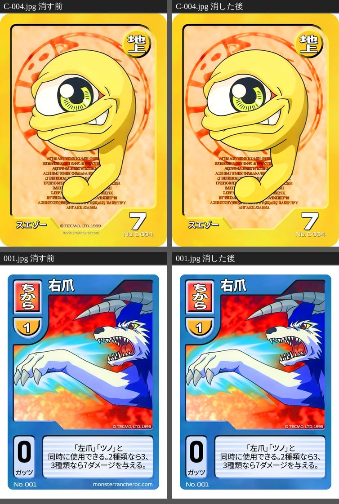
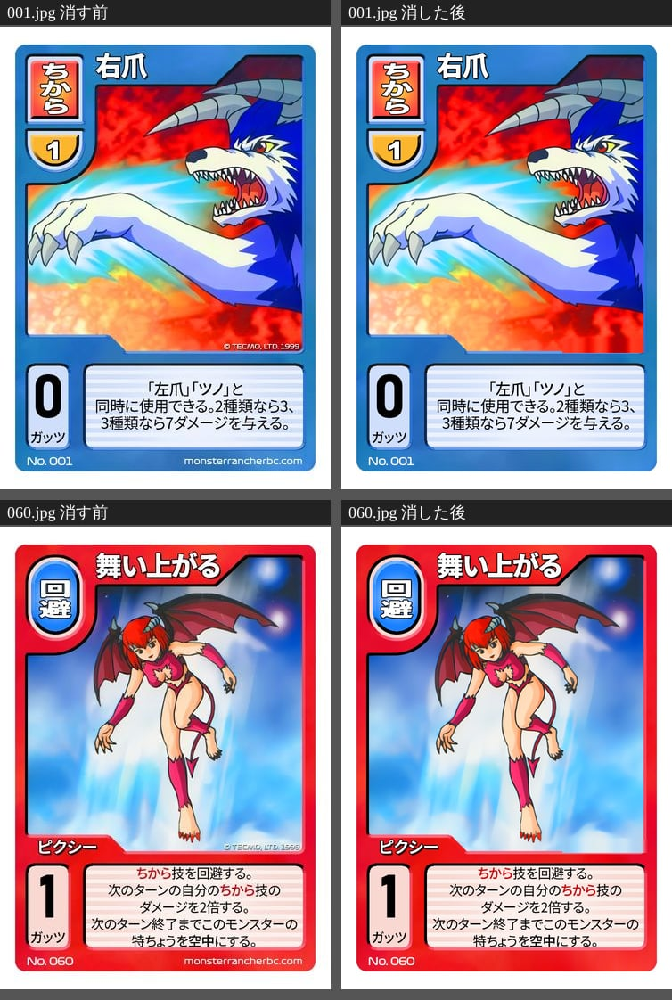
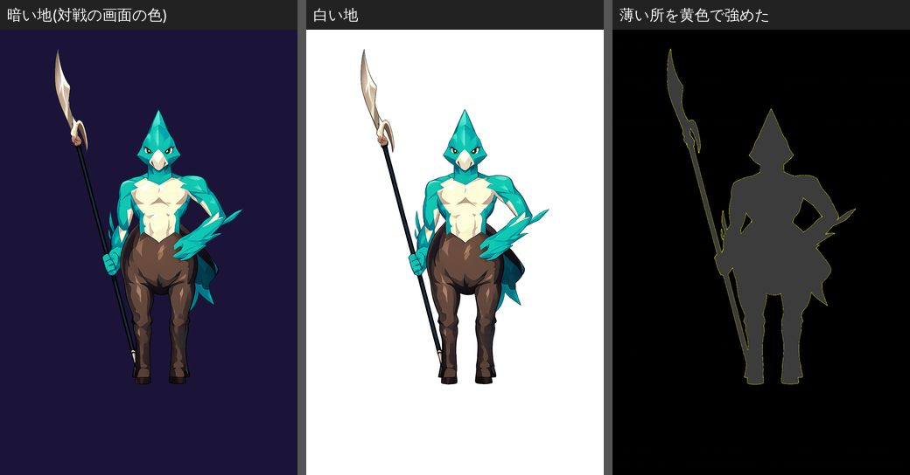
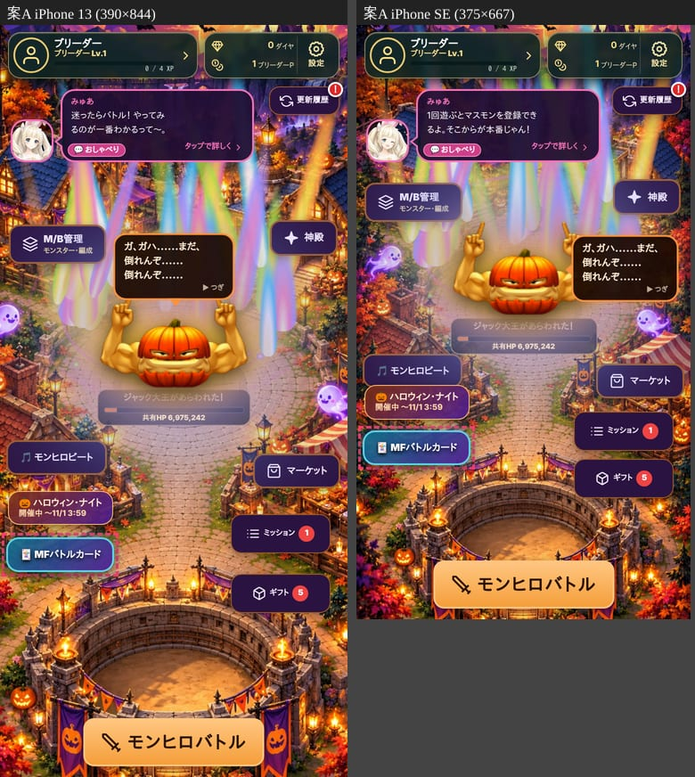
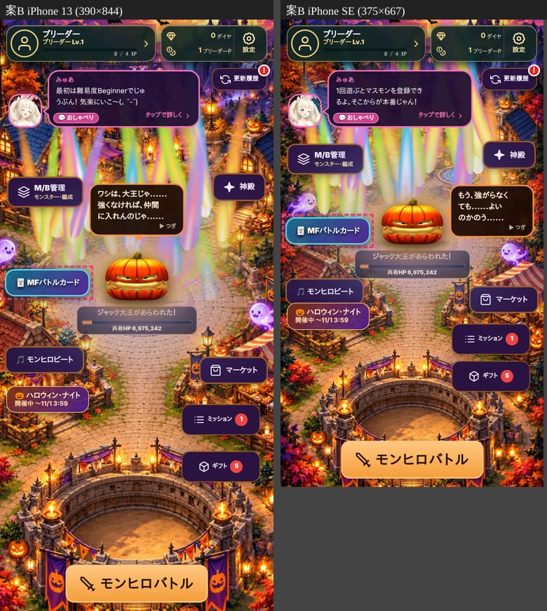
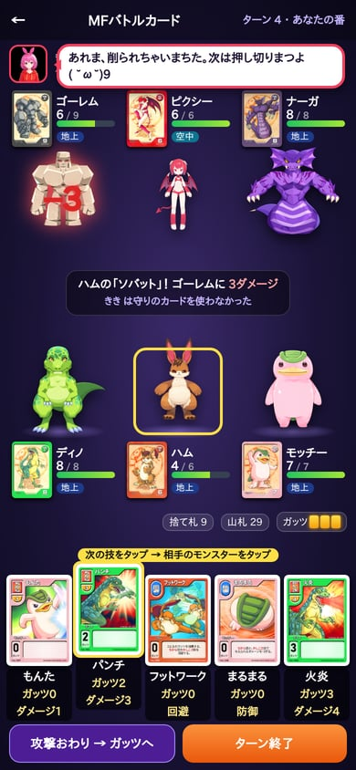
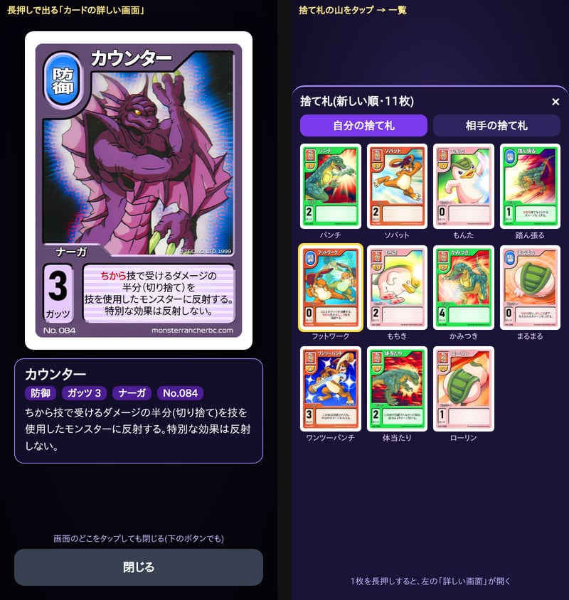

# カードバトル 設計書(案)

2026-10-24 カード部 デッキくん。**まだ実装しない。** カゲあつくんの確認と社長のOKが出てから作り始める。

紙の『モンスターファームバトルカード』(テクモ・1999年ごろ)のルールを基本そのまま使い、
**カードも元のもの(絵・名前・数字・文)をそのまま使う**カードバトル(社長が使用の許可を取った)。

**社長が決めたこと**([`PRESIDENT_DECISIONS.md`](../rules/PRESIDENT_DECISIONS.md) 2026-10-23・10-24):
- 新コンテンツとしてカードバトルを作る(最初から対人戦も・スターター→パック・専用通貨・育てた強さは持ち込まない)
- 元のカード(絵・名前・数字・文)をそのまま使う
- **入れるのは、社長から届いたカードの種族だけ。** まだ届いていない種族は、あとから足す。モンヒロにいない種族(ディノ・ナーガ・ガリ など)も、カードが届けば入れる。元のカードに無いモンヒロの子(イルミネ など)は、いまは入れない
- 細かい決まりは、元のルールを調べてそろえる。社長が元のルールを確かめてきてくれた(`card-battle/RULES_SOURCE.md`。これが正本)
- スターターキットは元の3つ(ミラクルチーム・スピードチーム・パワフルチーム)
- カードの下の帯の「© TECMO, LTD. 1999」「monsterrancherbc.com」は消す(許可を取ったときに消してよいと言われた)。絵や数字には手を加えない
- ブリーダーカードを入れる
- 画面に出す名前は **「MFバトルカード」**、専用のお金は **「カードポイント」**
- 入口は HOME に足し、専用のトップ画面を通って入る。デッキ編成はその中に専用のものを作る。**カードポイントの買い物(パック・スターターキット・モンスターなどの交換)は、全部いまのマーケットの「カードポイント」の欄にまとめ**、トップ画面にはそこへ飛ぶボタンを置く
- コンピューター戦の相手は、ゲームの中の助手(人によって戦い方にくせがある)。外のAIは、ひとまず入れない
- 最初の公開は、コンピューター戦・デッキ編成・パック。対人戦はあとから足す
- 最初に選ばなかったスターターキットは、カードポイントで買える
- 引き直しは、元のルールに無ければ入れない
- ルールは、社長が確かめてきた元のルール(`docs/spec/card-battle/RULES_SOURCE.md`)を正本にする。細かい所は社長が10問に答えた(同じモンスターは1体まで・半分は切り上げ・最後の1体どうしが同時に倒れたら攻撃した側の勝ち など)。攻撃は**各モンスター1ターンに1枚まで**(10問の「何回でも」は取り消し)(1-3)
- 技カードの絵の上の「© TECMO」も消す。英語版の全モンスター・ブリーダーの37枚は、英語の文字を消して日本語にする。黄色のキットの名前は「一発逆転ミラクルチーム」(2026-10-24 社長が「一発必殺」を取り消した)
- カードポイントは、キット・パックのほかに、ビートポイントと同じようにモンスター(円盤石)などとも交換できる
- バトルの画面は、モンヒロのモンスターの絵と動きを生かす

**届いているカード**(`tools/art-sources/card-battle/`。数字はカード部が拡大して1枚ずつ確かめた):
- 9種族: ライガー・ガリ・ゴーレム・スエゾー・ピクシー・ディノ・ナーガ・ハム・モッチー(3つのスターターの種族がすべてそろった)
- モンスターカード 24枚・技カード 117枚・全モンスターカード 19枚・ブリーダーカード 18枚 = **178枚**
- 全モンスターカードとブリーダーカードの37枚は、**絵が英語版**(名前・文が英語)。英語の文字を消して日本語にする(2-5)

社長に決めてもらうことは、最後の「[8. 社長に決めてもらうこと](#8-社長に決めてもらうこと)」にまとめた。

---

## 1. ルール

### 1-1. 元のルールで調べられたこと

この環境からは解説ページ(note・解説サイト・Wikipedia・tcg-db・legendcup)を直接開けない。**検索の抜粋で確かめた範囲**。
ルールブックの写真は届かない(社長)。

| 項目 | 元のルール | 出どころ(抜粋) |
| --- | --- | --- |
| 準備 | モンスターカード3枚を**裏向き**で場に置く。技カード50枚の山札を切って裏向きに置く。先攻・後攻を決め、5枚ずつ引く | Wikipedia |
| 後攻の特例 | 後攻は、手札から2枚までガッツにできる | Wikipedia・note |
| ターンの流れ | **ドロー → 攻撃 → ガッツ**の順 | 解説サイト・note |
| ドロー | **手札が5枚になるまで**山札から引く。先攻の1ターン目は飛ばす。手札がすでに5枚なら、山札の一番上を裏向きのままガッツにする | note |
| ガッツ | ガッツのときに、手札を**好きな枚数**ガッツにできる(カード「長期戦の予感」で2枚までに縛られる、という例がある)。ガッツの量は相手にも見える | note・legendcup |
| ガッツの払い方 | ガッツにした時期が新しいものから払う | 解説サイト |
| 攻撃 | モンスター1体につき1回(カードの効果で増えることがある) | 解説サイト |
| 守り | 回避・防御は、カードとガッツがある限り同じターンに何回でも使える。1回の攻撃に何枚でも重ねられる | 解説サイト |
| カードの種類 | ちから・かしこさ・防御・回避・特殊・**全体** | 解説サイト |
| 空中・地上 | モンスターには「特徴」(地上/空中)がある。技の文に「空中にいるモンスターには当たらない」などがあり、特徴を空中に変える回避(舞い上がる など)や全体カード(空間のひずみ・悪天候)もある | legendcup・解説サイト |
| 全体カード | 全体カードの効果は優先して処理する(ぶつかる技の効果は不発) | 解説サイト |
| 同じカード | 同じ技・全体・ブリーダーカードは3枚まで(モンスターカードは数えない) | 解説サイト |
| 勝ち | 相手のモンスター3体のライフを全部0にする、または相手の山札を使い切らせる | Wikipedia |
| スターター | 3種類(スピード・パワフル・ミラクル)。モンスター3枚＋技カード50枚の決まった中身 | Wikipedia |

**初版から直したこと**: 初版は「ふだんのガッツは1ターン1枚まで」「ドローは1枚」と推測で書いていた。
調べ直して、元のルールどおり「**手札5枚まで引く**」「**ガッツは好きな枚数**」に直した。

### 1-2. 元とモンヒロ版の対応表

| 元 | モンヒロ版 |
| --- | --- |
| モンスターカード3枚(裏向きで置く) | 同じ。**同じモンスターは1体まで**(通常・キラ・別絵キラは同じモンスター)。同じ血統の別のモンスター(ピクシーとミーアのような形)は入れてよい(社長) |
| 技カード50枚の山札・手札5枚 | 同じ |
| 手札を伏せてガッツ | 同じ |
| ちから・かしこさ・特殊・防御・回避・全体 | 同じ(全体カードは 2026-10-25 に15枚入れた。種類の名前は `fld`) |
| ブリーダーカード | 入れる(18枚届いた。絵は英語版) |
| 全モンスターカード | 入れる(19枚届いた。どのモンスターでも使える技。絵は英語版) |
| 同じカード3枚まで | 同じ |
| 全滅か山札切れで勝ち | 同じ |
| 後攻は2枚までガッツ | 同じ |
| カードの絵・名前・数字・文 | 元のカードそのまま |
| 育てた強さ | 持ち込まない。カードに書いた数字だけ |
| 対戦相手 | コンピューター戦 + 対人戦(みんなで対戦の仕組み) |

### 1-3. モンヒロ版のルール本文

**いちばん大事な決まり: カードの文は、この本文より優先する。** 本文はカードに書いていないときの決まり。

**準備**
1. モンスターカード3枚と技カード50枚でデッキを作る。同じ技カードは3枚まで。
2. 先攻・後攻は、コンピューター戦では毎回ランダム、対人戦は部屋の抽選で決める。
3. モンスター3体を裏向きで置き、山札を切って5枚引く。
4. 後攻は、**対戦を始める前に**、手札から**2枚まで**ガッツにできる(社長)。
5. 後攻のガッツのあとに、**モンスターを両方いっしょに表にして**、先攻の1ターン目を始める(社長)。
6. 引き直しは無し(元に無いので入れない。社長)。

**ターンの流れ**(自分のターン)
1. **ドロー**: 手札が5枚になるまで引く(先攻の1ターン目は飛ばす)。手札がすでに5枚なら、山札の一番上を裏向きのままガッツにする。
   引かなければいけないのに山札が無ければ、そのプレイヤーの負け。
2. **攻撃**: **各モンスターは、1ターンに攻撃用の技(ちから・かしこさ・特殊)を1枚まで**使える。3体がそれぞれ1枚ずつ使ってよく、順番は自由。攻撃しない子がいてもよい(元のルール `card-battle/RULES_SOURCE.md`・社長)。
   - 同じモンスターが攻撃の技を使ったあと、別の攻撃の技や特殊技を続けて使うことはできない。ただし、**カードの文が先**:
     「同時に使用できる」(右爪・左爪・ツノ)・「同一ターンに連続して使用できる」(雷・電撃)・「ちから技と同時に使用する/使う前に使用できる」(跳躍・渾身・瞬殺・電光石火)・「好きなだけ技を使える」(死亡遊戯)は、その文のとおり。
   - 技カードは、**カードに書いてあるモンスターだけ**が使える(スエゾーの技はスエゾーだけ)。全モンスターカードは、どのモンスターでも使える。
   - **派生モンスター**(MAIN と SUB の2つの種族を持つモンスター)は、攻撃・特殊は MAIN の種族の技を、防御・回避は SUB の種族の技を使う(元のルール12)。**MAIN の種族の防御・回避は使えない**(2026-10-27 社長)。SUB が「？？？」(`sub: 'unknown'`。ジェントル・ギンギライガー・ムー・剣士モッチー・パンドラ)の子は**純血として数え**、防御・回避も MAIN の種族の技を使う(社長。純血のスピード・純血のプライドでも純血)。
   - **ブリーダーカードは、1ターンに1枚まで**(モンスターの攻撃とは別に数える)。
   - **全体カード**(カードの左上の札が「全体」・使う人はブリーダー)は場に残って効き続け、両方のブリーダーに効く。場全体で1枚だけで、新しい全体カードが出たら前のものと入れ替わる(前のものは出した人の捨て札へ)。出せるのは自分の攻撃の段で、ブリーダーカードと同じく1ターン1枚。くわしくは「全体カード」の節。
   - カードに書いたガッツを払う(新しく置いたガッツから捨て札へ)。ガッツ0の技は、ガッツが無くても使える。ガッツはプレイヤーごとに持つ(モンスターごとではない)。
   - 攻撃先は、相手の生きているモンスターから選ぶ(「全ての相手モンスター」の技は選ばない)。
   - 攻撃を受けた側は、回避・防御のカードを何枚でも重ねて出せる(ガッツが足りる限り)。守りをしても、その子の次の自分のターンの攻撃はなくならない。
     **専用のカード(そのモンスターの技)は、その子が狙われたときだけ。誰でも使えるカード(全モンスター)は、狙われた子が使える**(社長)。
   - **特殊技は、ふつうの防御・回避では守れない**。
   - 「次のターン攻撃できない」になった子は、そのターン技を使えない。
   - 使い終わったカードは捨て札へ。
3. **ガッツ**: 手札から好きな枚数を伏せてガッツにできる。ガッツにしたカードは、技として使い直せない。
4. **終わり**: 「ターン終了」を押す。

**ダメージ**
- 技に書いたダメージがそのまま入る。ライフが0以下でそのモンスターは倒れる(戻らない)。
- 防御で減らしたダメージは0より下にならない。
- 「回避されても半分」の端数は**切り上げ**(5→3。社長)。ただし、文に「切り捨て」と書いてあるカード(ナーガの「カウンター」)は、文のとおり切り捨て。
- 「全ての相手モンスターにダメージ」は、狙われた1体ずつ、守るかどうかを選べる(社長)。
- 「相手の手札を1枚捨てさせる」は、捨てる側が選ぶ(社長)。

**空中・地上**
- モンスターカードの右上の丸が、そのモンスターの「特徴」(届いた9種のうち、ガリ・ピクシーが「空中」、ほかは「地上」)。
- 技の文が特徴にふれていればそれに従う(ディノの「しっぽビンタ」は空中にいるモンスターにダメージを与えられない)。
- 特徴を変えるカード(空中にする回避・全体カード)が届いたら、その文のとおり、期限つきで特徴を書き換える。
  全体カードの効果は、ほかの技の効果より優先する。

**KO**
- ライフが0以下になったモンスターは KO。そのモンスターカードを裏向きにする(暗くして裏の絵を見せる)。KO した子は技を使えない。

**勝ち負け**
- 相手のモンスター3体を全員倒す → 勝ち
- 相手が引くときに山札が無い → 勝ち
- 相手が投了した(降参した) → 勝ち。自分が投了したら負け
- 対人戦で相手が抜けた・持ち時間を3回続けて使い切った → 勝ち
- 両方の最後の1体が同時に倒れたとき(「自分も2ダメージ受ける」・はね返し など)は、**攻撃した側の勝ち**(社長)

**持ち時間**(対人戦): 自分のターン60秒・守り15秒。過ぎると、そのターンは終了/守りはしない。

---

## 2. カード(元のカードをそのまま使う)

### 2-1. 素材の受け取り方

社長から届いた元のカードは、種族ごとに `tools/art-sources/card-battle/<種族>/` に置く。

| 置くもの | 中身 |
| --- | --- |
| カードの画像 | 元の大きさ 742×1038 の JPEG(番号.jpg) |
| `cards.json` | 画像から書き写した番号・名前・種類・ダメージ・ガッツ・文 |

- ゲームは**画像から読み取らない**。動きはすべて `cards.json` の数字と文から作る。
- 道具 `tools/card/card-data-build.js` が、全種族の `cards.json` から配信用のデータ `monster-hero/data/card-battle-cards.js` を作る。
  検査 `tools/card/card-data-check.js` が、番号のだぶり・種類の名前・数字が整数か・画像があるか・**文に対応する効果が作ってあるか**を見る。
- カードの id は**元のカード番号**(`C-004`・`037` など)。持っているカードの保存もこの番号で持つ。
- 全体カードは、使う人 `breeder`・種類 `fld`・番号に F を付ける(F115〜F120・F255〜F263。261〜263 のグジラの技などと重ならないように。今あるカードの番号は変えない)。

### 2-2. 届いているカード(406枚)

**1回目(178枚)**: スターター3つの9種族(下の表)と、全モンスター19枚・ブリーダー18枚。
**2回目(214枚・2026-10-24 #3403)**: 14種族(モンスターカード30枚・技168枚)と、派生(混血)モンスターカード16枚。下の「2回目に届いた種族」の表。

| 種族 | モンスターカード | ライフ | 特徴 | 技カード |
| --- | --- | --- | --- | --- |
| ライガー | C-001・S・V | 6 | 地上 | 001〜012・357 |
| ガリ | C-002・S | 7 | **空中** | 013〜024・358 |
| ゴーレム | C-003・S・V | 9 | 地上 | 025〜036・359 |
| スエゾー | C-004・S・V | 7 | 地上 | 037〜048・360 |
| ピクシー | C-005・S・V | 6 | **空中** | 049〜060・361 |
| ディノ | C-006・S | 8 | 地上 | 061〜072・362 |
| ナーガ | C-007・S | 8 | 地上 | 073〜084・363 |
| ハム | C-008・S・V | 6 | 地上 | 085〜096・364 |
| モッチー | C-009・S・V | 7 | 地上 | 097〜108・365 |

(S=キラ・V=別絵キラ。強さは通常と同じで、絵だけ違う)

| 種類 | 技カード(9種族) | 全モンスター | ブリーダー |
| --- | --- | --- | --- |
| ちから | 52 | — | 1 |
| かしこさ | 30 | — | — |
| 特殊 | 18 | 13 | 16 |
| 回避 | 10 | 2 | — |
| 防御 | 7 | 4 | 1 |
| 計 | 117 | 19 | 18 |

- 各種族の技は、番号の続く12枚(001〜108)と、離れた番号の1枚(357〜365)。元のスターターに入っているのは、続く12枚の中からだけ(3.)。離れた番号は、あとの弾で足されたカードと読める★。
- **全モンスターカード**(109〜350 のうち19枚): どのモンスターでも使える技。`category: "全モンスター"`。
- **ブリーダーカード**(112〜366 のうち18枚): モンスターではなくブリーダーが使うカード。`category: "ブリーダー"`。
  ブリーダーカードの「加勢」(112)だけは、ちから・ダメージ1の攻撃(「モンスターを倒すためには使えない」)。**モンスターの攻撃とは別の扱いで、その子が攻撃したあとにも使える**(社長)。使うときに、出す子を自分の生きているモンスターから1体選ぶ。ブリーダーカードなので1ターン1枚。
- 全体カードは「場に残るカード」(全モンスターのカード・ENV ではない。2026-10-25 社長)。15枚を 2026-10-25 に入れた。「おいのり」(280)は、相手が全体カードを出した瞬間に出せて、その全体カードを無くす。

#### 全体カード(2026-10-25)

| No | 名前 | ガッツ | 効き目(部品) |
| --- | --- | --- | --- |
| F115 | 冷静な判断 | 1 | 出した時に1枚引く(`fieldDrawOnPlay`) |
| F116 | 壮絶な戦い | 2 | ちから・かしこさ技の当たったダメージ +1(`fieldDmg`) |
| F117 | 興奮のるつぼ | 2 | かしこさ技の当たったダメージ -2 |
| F118 | ホリィの声援 | 3 | カードを使うのに要るガッツ -1(0より下にならない。`fieldCost`) |
| F119 | 必殺技の応酬 | 3 | 最終的なダメージ3以下のちから・かしこさ技は出せない(`fieldBanDmg`) |
| F120 | 大混乱 | 4 | それぞれの番のドローの前に、その番の人の山札の上から2枚を捨てる(`fieldMill`) |
| F255 | 純血のプライド | 2 | 純血の子の攻撃に、派生の子は回避の札を出せない(`fieldPurePride`) |
| F256 | 師匠のまなざし | 3 | カードを使うのに要るガッツ +1 |
| F257 | がんじがらめ | 3 | モンスターは特殊技を出せない(ブリーダーの特殊は出せる。`fieldBanKind`) |
| F258 | 必殺技の封印 | 3 | 最終的なダメージ4以上のちから・かしこさ技は出せない |
| F259 | 悪天候 | 3 | 全員の持ちょうを地上に。場から無くなると元に戻る(`fieldType`) |
| F260 | 灼熱の地 | 4 | 「攻撃おわり」のとき、攻撃した側の全員に1ダメージ(`fieldBurn`) |
| F261 | 飛び散る火花 | 2 | かしこさ技の当たったダメージ +1 |
| F262 | 空間のひずみ | 3 | 全員の持ちょうを空中に。場から無くなると元に戻る |
| F263 | 長期戦の予感 | 3 | ガッツの段でガッツにできるのは2枚まで(`fieldGutsMax`) |

- 決まりの読み方(バトル部の案): 「最終的なダメージ」の足し引きは、守りで減らしたあと・当たったとき(0のときは足さない)。出せるかどうかの見きわめ(応酬・封印)は、守る前の数(書いてある数・同時に使う組・付けた札・n倍・全体カードの足し引き)。
  持ちょうは、全体カードがいちばん先(ジャンプなどで空中になっていても、悪天候なら地上)。
- おいのり(280・ブリーダー・ガッツ0): 相手が全体カードを出した瞬間に、両方の端末で「おいのりの窓」を開く(マルチで隠れた手札を見ずに同じにするため、手札がある・その番にまだ出していない・ガッツが足りるときに開く)。
  おいのりを持っていなければ、画面は自動で「使わない」。使うと、出た全体カードは効かずに出した人の捨て札へ行き、前から場にあった全体カードはそのまま残る。相手の番に出すので、自分の番のブリーダーカード1枚には数えない(1つの番に1枚まで)。
- 画面: 場の全体カードは、まんなかの記録の上に「全体 名前(自分/相手が出した)」の札で出す(タップで詳しい画面・名前は切らずに折り返す)。
- 助手も出す: 自分に得な向きのとき(自分のカードに多い種類が強くなる・相手の全体カードを消せる など)だけ。相手が出した全体カードは、おいのりがあれば消す。

**2回目に届いた種族**(技は各12枚。数字はカード部が拡大して1枚ずつ確かめた)

| 種族 | モンスターカード | ライフ | 特徴 | 技カード | モンヒロに |
| --- | --- | --- | --- | --- | --- |
| ヒノトリ | C-021・S | 4 | 空中 | 129〜140 | いない |
| ゲル | C-022・S | 7 | 地上 | 141〜152 | いない |
| モノリス | C-023・S | 8 | **空中** | 153〜164 | いる |
| ヘンガー | C-025・S | 6 | 地上 | 177〜188 | いない |
| ニャー | C-026・S | 6 | 地上 | 189〜200 | いない |
| プラント | C-027・S | 10 | 地上 | 201〜212 | いる |
| ワーム | C-028・S | 9 | 地上 | 213〜224 | いない |
| ドラゴン | C-029・S | 8 | 地上 | 225〜236 | いない |
| グジラ | C-031・S(地上)/ C-031R・RS(水中) | 10 | 地上・**水中** | 261〜272 | いない |
| メタルナー | C-046・S | 6 | 地上 | 285〜296 | いない |
| ジョーカー | C-047・S | 7 | 空中 | 297〜308 | いない |
| アローヘッド | C-048・S | 7 | **水中** | 309〜320 | いない |
| ケンタロウス | C-049・S | 7 | 地上 | 321〜332 | いない |
| コロペンドラ | C-050・S | 8 | 地上 | 333〜344 | いない |

- **ゴースト(C-024・S・技 165〜176)は 2026-10-27 に届いた**(高画質。社長「ゴーストのカードが盛れてたから実装よろしく」・台帳 #204)。ライフ5・**空中**。新しい種族として第4弾にヘンガーと並べる(第4弾だけ4種族)。キラはふつうとキラの2枚。
  絵の字(名前・種類・ダメージ・ガッツ・文・番号)は14枚とも拡大してデータと照らし、崩れは無かった。元の PNG は四隅が透けているので白で敷いて JPEG にした。キラは地が粒の模様で、© と URL を上下の色でつなぐと縦じまが出るため、すぐ上・下の同じ模様を写して周りの明るさになじませる(`card-image-build.js` の isKiraMonster・copyRect。2026-10-27 にキラのモンスターカード全部へ広げた #3769)。
  新しい部品: カード投げ(169)= `tossBonus`・のりうつる(174)= `possess`。ゴーストラッシュ(175)は死亡遊戯と同じ文(`unlimitedAttacks`)、帽子に隠れる(176)は「ちから技か、かしこさ技で与えられるダメージを0にする」(`reduceAll`)。
- 番号の抜け: 281〜284・353〜356 のカードはまだ届いていない。デュラハン(C-030・C-030S・技 237〜248)は 2026-10-24 に届いた(#3421。`durahan/cards.json`。12枚とも使える)。
- **新しい特徴「水中」**: アローヘッド・グジラ(R)・ギガロン(混血)。「地上にいる全ての」「空中にいる全ての」の技は、水中の子には当たらない(文のとおり)。**ふつうの1体を狙う技と、特徴を言わない全体攻撃(「全ての相手モンスター」のおなら・さくら吹雪 など)は、水中の子にも当たる**。アローヘッドの「ひきずりこむ」(318)で味方を水中にできる。水中だけに効く決まりは、元のルールで見つかっていない★。
- **派生(混血)モンスター16枚**(`hybrid/cards.json`): 絵の左上に MAIN、右下に SUB の種族。**絵は英語版**(名前と特徴の札 G=地上・A=空中・W=水中が英語)で、番号も英語版の C-051〜。日本語版の派生モンスターは別の番号(C-010 ハムライガー など)。日本語の名前は社長が1体ずつ決めた(台帳 #3418): バロン・アクアリウス・プラムラー・ストライクリパー・ダークハム・ヘルファット・ウロコゲル・ワカクサケンザイ・ガーラント・ミミニャー・ベニヒメソウ・ムラサキチュウ・アーマードラゴン・ケルマディクス・ギガロン(`card-battle/hybrid-names.jpg`)。**絵の中の英語(名前・MAIN/SUB・G/A/W の印)は、英語版37枚と同じく消して日本語(メイン/サブ・地上/空中/水中)にする**(2-5 と同じ道具の段で)。
  - C-060C は絵の下に「fanart by YafusaArt」とあり、**元のカードではなく、ファンの描いた絵**。**入れない**(社長)。`cards.json` に `excluded:true` を付けた。
  - デュラハンが MAIN の C-064 ケルマディクスは、デュラハンの技が届いたので使える(2026-10-24)。
- 技の文が切れているカード: ワームの「羽化」(222)は、カードの文の箱の中で文が途中で切れている(「取りかえたモンスターは、」まで)。文の続きが分かるまで「羽化」と「まゆ化」(221)は準備中。
- 同じ名前: ケンタロウスの「捨て身」(330)が元の名前なので、全モンスターの 249 は「**肉を切らせて**」に名前を変えた(社長。台帳 #3413)。

### 2-3. 文を動きにする(効果の部品)

カードの文を、決まった効果の部品に当てる。届いた9種族の技117枚は、次の部品で全部動かせる。

| 部品 | 中身 | 使うカードの例 |
| --- | --- | --- |
| 回避されない | この技は回避されない | テレポート・ガッチョ・聖なる光・くしざし・ライトニング |
| 回避されても半分 | 回避されても、半分(切り捨て)のダメージ | ワンツーパンチ・ガッチャー・魔神ダンス・連続魔空弾 |
| 防御で減らされない | 防御でダメージをマイナスされない | ボディーブロー・渾身 |
| 守備されない | 回避も防御もされない | 瞬殺 |
| 自分も受ける | 回避されなかったら、自分も N ダメージ | 頭つき・タックル・体当たり・炎の体当たり |
| ガッツを減らす | ダメージを与えたら、相手のガッツを N 減らす(全部も) | しっぽアタック・ベロビンタ・キッス・なめる |
| 攻撃できない | ダメージを受けたモンスターは次のターン攻撃できない(全員も) | 巴投げ・砂キック・冷気弾・クロー・吠え・ブリザード |
| 全員に | 全ての相手モンスターにダメージ | おなら・さくら吹雪・炎のカベ・竜巻アタック |
| 地上の全員に | 自分以外の、地上にいる全てのモンスター(味方も)にダメージ | 地震 |
| 割り振り | ダメージを複数の相手に割り振れる | ショットガン |
| 空中に当たらない | 空中にいるモンスターにはダメージを与えられない | しっぽビンタ |
| 空中にする | 次のターン終了まで、このモンスターの特徴を空中にする | ジャンプ・舞い上がる |
| ダメージ2倍 | 次の自分のちから技のダメージを2倍(ダメージを受けたら終わる、など) | 力をためる・ジャンプ・舞い上がる |
| ダメージを足す | 捨て札の自分の技の枚数・減ったライフの分だけ足す | 魔神ファイナル・ビッグバン |
| 同時に使う | 決まった技どうしを同時に使い、組み合わせでダメージが変わる | 右爪・左爪・ツノ(2種類で3・3種類で7) |
| 続けて使う | 決まった技どうしは同じターンに続けて使える | 雷・電撃(ピクシー) |
| 何回でも | このターン、このモンスターは好きなだけ技を使える | 死亡遊戯・ゴーストラッシュ |
| 捨ててダメージ | 使うときに手札を好きな枚数(0枚も)捨て、捨てた枚数をダメージに足す(`tossBonus`。手 `toss` に捨てる手札の番号) | カード投げ |
| のりうつる | KOされた味方1体を、この子の今のライフ(戻る子のもとの最大まで)で戻し、この子はKO。戻った子はそのターン攻撃できない(`possess`) | のりうつる |
| もう一回攻撃 | 攻撃したあとの子が、もう一回攻撃できる。英語版の「疲れ(exhausted)」は「**そのターンの攻撃権を使った**」と読む(「疲れずに攻撃できる」「疲れを取る」= もう一回攻撃できる。「疲れて出てくる」= そのターンは攻撃できない)。元の日本語版のオイリーオイルの文(「既に攻撃したモンスターは、もう一回攻撃できる」)と同じ | オイリーオイル・最後の一体・夏美草・ヒノトリの復活・合体 |
| 技に付ける | このターン、次に使うちから技は回避されない/防御で減らされない/守備されない | 跳躍・電光石火・渾身・瞬殺 |
| 回避させない | このターン、相手は回避を使えない | にらむ |
| 狙いを固定 | 次のターン、相手はこのモンスターにダメージを与える技しか使えない | 挑発・レロレロ |
| 狙わせない | 次のターン、相手はこのモンスターにダメージを与える技を使えない | 魅了 |
| ターンを飛ばす | 相手のターンを1回飛ばす | 歌う |
| 回復 | ライフを回復する(与えたダメージ分・3 など) | ドレイン・回復 |
| 手札・山札 | 相手の手札を見る/引く/捨てる・捨てさせる/捨て札から手札へ | 偵察・素早い計算・大声・超大声・作戦の指示 |
| 回避 | ちから技・かしこさ技を回避する(消費ガッツ N 以上だけ・ちから技だけ、などの縛りつき) | 横回転・ステップ・ふせる・バック転 |
| 防御・減らす | 受けるダメージを −N | 踏ん張る・まるまる・堅い守り |
| 防御・はね返す | 受けるダメージ(半分など)を、使ったモンスターへはね返す。特別な効果は返さない | 魔法反射・カウンター |
| 防御・かばう/身代わり | 味方へのダメージを自分が受ける/狙いを別の味方へ変える | 友をかばう・隠れる |

- 種族が届くたびに新しい文を部品に当てる。**部品がまだ無い文のカードは「準備中」にして、パック・デッキ・CPUに出さない**(検査が止める)。
- 全モンスター・ブリーダーの37枚は、上の部品に加えて「ガッツの山を作り直す」「疲れ(exhausted)を取る」「モンスターを捨ててガッツにする」などが要る。
  **いまは動かせないカード**(届いていないものに関わる): 混血のモンスターに関わる3枚(346 Pureblood・348 Ancient Echo・352 Fusion)と、フェニックスを呼び戻す1枚(128 Reborn)。全体カードを打ち消す 280 Pray(おいのり)も、全体カードが無いあいだは使い道が無い。
  **これらは、使えるようになるまでパックから外し、図鑑では「準備中」と出す**(社長)。いま外すのは 128・280・346・348・352 の5枚。

### 2-4. カードの絵(配信へ入れる形と、読み込み)

元の画像には名前・数字・文・© の表記がすべて入っているので、**カードは画像をそのまま見せる**(上に文字を重ねない)。
場の上で変わるもの(残りのライフ・ガッツの数・倒れた印・攻撃できない印)だけを、カードの外や上に別に出す。

| 大きさ | 使う所 | 形 | 1枚の目安 |
| --- | --- | --- | --- |
| 小 240×336 | 手札・場・デッキを組む・図鑑の一覧 | JPEG(`sharp` `quality:78` `mozjpeg`) | 15〜25KB |
| 大 480×672 | 長押しで拡大・パックを開ける | 同上 | 45〜70KB |

**数百枚になったときの重さ(iPhone)**
- いま届いている178枚 × (小20KB＋大60KB) ≒ 14MB。元の種族が全部そろうと数百枚・数十MBになるので、**まとめては読まない**。
- 起動時には1枚も読まない(`index.html` の起動時の読み込みに混ぜない)。
- 対戦の前に読むのは、**両方のデッキに入っているカードの「小」だけ**(1回の対戦で最大 2×(3＋最大50種) 枚・1MB 前後)。
- 「大」は、長押しで拡大したときと、パックを開けるとき(その8枚だけ)に読む。
- 図鑑・デッキを組む画面は、画面に見えているカードだけ読む(`loading="lazy"`)。
- 一度読んだ画像は、いまのゲームの絵と同じ置き方(ブラウザのキャッシュ)で持つ。iPhone の画像のメモリを食わないよう、画面に出す枚数を絞る(一覧は1画面ぶん)。
- 元の画像(742×1038)は `tools/art-sources/` に残し、配信には入れない。縮めるのは道具でまとめて行い、配信の画像と `cards.json` の番号が1対1か検査する。

**© の表記を消す**(社長が決めた): 道具 `tools/card/card-image-build.js` が、縮めるときにいっしょに消す。**ゲームの中では、© を消した絵(道具で作ったもの)しか使わない**。元の画像は配信に入れない。
- 消すのは下の細い帯の文字だけ。モンスターカードは名前とライフのあいだの2行(© は絵の板のふちの内側、URL はふちの下)、技カードは右下の URL の1行。
- 文字の四角を、すぐ上とすぐ下の色でつないで塗る(左右3列ずつならして、縦すじが出ないようにする)。絵・数字・名前・番号には触れない。
- 178枚すべてで、消したあとの帯を並べて目で確かめた(塗り残し・はみ出しなし)。
- 技カードの「© TECMO」は、下の帯ではなく絵の右下に乗っている。**これも消す**(社長が決めた)。道具の既定で消す(`--keep-art-copyright` で残した見本も作れる)。

| 見本 | 中身 |
| --- | --- |
|  | 下の帯だけ消した(スエゾーのモンスターカード・ライガーの技カード) |
|  | 技カードの絵の上の © も消した形(ライガー・ピクシー。これが既定) |

### 2-5. 英語版の37枚を日本語にする(社長が決めた: 英語の文字を消して日本語にする)

> 2026-10-24 済み(台帳 #3511): 全モンスター19・ブリーダー18・混血15 の52枚。道具 `tools/card/card-image-ja.js` → `tools/art-sources/card-battle-ja/` → `card-image-build.js --build`。

全モンスター19枚・ブリーダー18枚は、絵が英語版。**英語の文字を消して、日本語の文字を書き入れる**。絵には手を加えない。
- 置き換える所: 技名(上の題字)・種類の札(DGE→回避・BLK→防御・SPE→特殊・POW→ちから)・「GUTS」→「ガッツ」・「ANY MONSTER」→「全モンスター」・「BREEDER」→「ブリーダー」・文の箱の中身。
- 消し方は © と同じ(すぐ外の色でつないで塗る)。文の箱と札は地が無地なので、塗りつぶしてから書く。
- 書く字は、日本語版のカード(技カード117枚)の字の形・太さ・ふち取りにそろえる。道具 `card-image-build.js` に「日本語にする」段を足し、文字の位置と大きさは日本語版のカードから測って決める。
- **日本語の名前と文**(一覧の画像 `card-battle/jp-list-1.jpg`・`jp-list-2.jpg`。描く前に、窓口からカゲあつくん→社長に見てもらう):
  - 名前: **37枚のうち32枚は、元の日本語版の名前を調べて確かめた**(legendcup の MFBC データベースと、日本語のカードリストの検索の抜粋)。残りの5枚は案(125「後は頼んだ」は推定、249・250・251・273 は案)。
  - 文: 元の日本語の文が分かった17枚はそのまま、要旨だけ分かった8枚は日本語版の言い回しに整え、残り12枚は英語から訳した(訳案)。
  - 言い回しは日本語版のカード(「〜を回避する」「この技でダメージを与えた場合、〜」「相手ブリーダーはガッツを〜」)にそろえる。
  - **初版の取り違えを直した**: スターターに入る全モンスター「底力」は 110(英語版の Will Power)。前に 111(Grit)と書いていた。111 は「根性」。
  - 種類の札は DGE=回避・BLK=防御・SPE=特殊・POW=ちから(INT=かしこさ は37枚の中には無い)。
  - 書き入れた見本の絵(3枚くらい)は、一覧が決まってから作る。
  - 言い回しを日本語版の技カードにそろえた(1体・引く・「攻撃のはじめに使う」・メイン/サブ。英字は KO だけ残す)。
  - 273「吹き飛ばし」(ガッツ0で相手1体を次のターン攻撃できなくする)は、英語版のカードを拡大して確かめ直した。**元のカードもガッツ0・同じ文**(SPE・0 GUTS・"Choose an opponent's monster. It cannot attack next turn.")。強いが、元のとおりにする。ブリーダーの 277「意味不明」(ガッツ1)は当たったときだけ効くのに対し、273 は特殊技なので守れない。釣り合いは CPU どうしの勝率で見て、強すぎたら社長に相談する。
  - 249「捨て身」: 防御なのに受けるダメージが2倍になるので、文の頭に「受けるダメージは2倍になるかわりに、次のターンのちから技が強くなる。」を足した。
  - 250 と 127「最後のきらめき」の名前が紛らわしいので、250 の名前を「孤軍奮闘」(案)に変えた(250 は元の日本語名が見つかっていない)。
  - **37枚の名前と文は、jp-list-1・2 のままでよい**(社長。案の5枚もそのまま)。
- `cards.json` には、訳を `name`・`text` に入れ、英語は `name_en`・`text_en` に残す。

---

## 3. スターターキット(元の3つ)

社長が箱の写真で決めた(`tools/art-sources/card-battle/starter-kits.jpg`)。中身は、社長から届いた元の表(`tools/art-sources/card-battle/starter-decklists/`)のとおり。
**3つとも、カードが全部届いている。** どのキットも、モンスターごとに技15枚＋全モンスター1枚＋ブリーダー4枚＝50枚。

| キット | モンスター3体(ライフ・特徴) |
| --- | --- |
| 一発逆転 ミラクルチーム | スエゾー(7・地上)・ガリ(7・空中)・ライガー(6・地上) |
| 先手必勝 スピードチーム | ディノ(8・地上)・ハム(6・地上)・モッチー(7・地上) |
| 一撃必殺 パワフルチーム | ゴーレム(9・地上)・ピクシー(6・空中)・ナーガ(8・地上) |

**ミラクルチーム**
| スエゾー | 枚数 | ガリ | 枚数 | ライガー | 枚数 |
| --- | --- | --- | --- | --- | --- |
| ツバはき | 3 | ひっかき | 3 | 右爪 | 3 |
| しっぽアタック | 3 | けり | 3 | 左爪 | 3 |
| かみつき | 2 | 聖なる光 | 1 | ツノ | 3 |
| ベロビンタ | 2 | 炎のカベ | 1 | 突き刺し | 2 |
| なめる | 1 | 炎 | 3 | 電撃 | 1 |
| 偵察 | 1 | 魔法反射(守り) | 2 | バック転(守り) | 2 |
| 横回転(守り) | 3 | ふせる(守り) | 2 | ジャンプ(守り) | 1 |

**スピードチーム**
| ディノ | 枚数 | ハム | 枚数 | モッチー | 枚数 |
| --- | --- | --- | --- | --- | --- |
| パンチ | 3 | 頭つき | 2 | もんた | 3 |
| 体当たり | 1 | ソバット | 3 | ローリン | 3 |
| かみつき | 3 | ワンツーパンチ | 2 | ガッチョ | 1 |
| 炎の体当たり | 1 | ぐるぐるパンチ | 3 | もちき | 3 |
| 火炎 | 2 | おなら | 1 | さくら吹雪 | 1 |
| 踏ん張る(守り) | 3 | 大声 | 1 | まるまる(守り) | 2 |
| 横っ飛び(守り) | 2 | フットワーク(守り) | 3 | 転がる(守り) | 2 |

**パワフルチーム**
| ゴーレム | 枚数 | ピクシー | 枚数 | ナーガ | 枚数 |
| --- | --- | --- | --- | --- | --- |
| でこぴん | 3 | ひっかき | 3 | つき | 3 |
| キック | 3 | 雷 | 3 | くしざし | 3 |
| チョップ | 3 | 電撃 | 2 | はたき | 3 |
| ぐるぐるアタック | 1 | ライトニング | 2 | ドレイン | 2 |
| 地震 | 1 | キッス | 1 | 連続魔空弾 | 1 |
| 堅い守り(守り) | 2 | 回復 | 1 | にらむ | 1 |
| 友をかばう(守り) | 2 | ステップ(守り) | 3 | カウンター(守り) | 2 |

**3つ共通**: 全モンスター「底力」(110・英語版の絵は Will Power)1枚、ブリーダー「加勢」(112・Help)2枚・「カララギマンゴー」(113・Mango)2枚。

**表とカードの突き合わせ**(カード部が確かめた)
- 名前が合わないのは1件だけ: 表の「頭突き」(ハム)は、カードでは「**頭つき**」(085)。カードの文字に合わせる。
- 枚数は3つとも 15・15・15・1・4 の50枚で、表の写真と書き写し(`decklists.json`)は合っている。
- **キットの名前**: 「**一発逆転**ミラクルチーム」(2026-10-24 社長が決め直した。いちど「一発必殺」にしたのは取り消し)。表とデータベース(tcg-db・legendcup の抜粋)と同じ。赤の「一撃必殺パワフルチーム」はそのまま。
- 社長に見せるときは、3つのキットの箱の絵と、**CPU どうしで数百回戦わせた勝率**を並べて出す(ルールを作ったあと)。

## 4. パックと専用通貨

### 4-1. 専用通貨

名前は **「カードポイント」**(社長が決めた)。**ほかの通貨(ダイヤ・ブリーダーP・ビートP)をカードポイントに両替はしない**(カードポイントはカードバトルで遊んでためる)。**カードポイントで、円盤石などは買える**(下の交換所)。

**1戦でもらえる数は案A**(社長が決めた・台帳 #3484。比べた表: `docs/progress/card-battle/rates-proposal.jpg`)。数の本体は `82-card-battle-core.jsx` の `CARD_AI_LEVELS`(point・loops)・`cardCpuReward`・`cardCpuLoops`・`CARD_PVP_REWARD`。

| 手に入り方 | カードポイント | クイック周回(◯周ぶん) |
| --- | --- | --- |
| はじめて遊んだとき(スターターといっしょに) | 300(パック3つぶん) | — |
| コンピューター戦 勝ち(難易度 EASY/NORMAL/HARD/EXPERT/MASTER) | 80 / 110 / 140 / 170 / 200 | 14 / 16 / 18 / 20 / 22 |
| CPU戦 負け(最後まで戦った) | どの難易度も 25 | 勝ちの半分 × (自分の番の数 ÷ 10。10回で満額) |
| CPU戦 降参 | 倒した相手のモンスター × 10(25まで。0体なら0) | 倒した数 × 負けの満額の3分の1(0体なら0) |
| 対人戦 勝ち | 200 | 24 |
| 対人戦 負け(最後まで戦った) | 50 | 12 |
| 対人戦 途中で抜けた | 0(残った人は勝ち扱い) | 0 |
| その日はじめての勝ち(CPU・対人どちらでも) | +50(上限の外) | — |
| だぶったカード(自動でカードポイントへ) | 技カードは4枚目から 5 / モンスターカードは2枚目から 50(キラ 100・別絵キラ 200) | — |

- **ずるの防ぎ方**: かかった時間は見ない(止めて放っておいても増えない)。**自分の番を3回やる前に終わった試合は、カードポイントも周回も0**(すぐ降参・すぐ負けで回せないように)。負けのポイントを難易度で増やさないのは、MASTER でわざと早く負けるのがいちばん得にならないようにするため。
- **クイック周回**: 結果の画面に「クイック周回 ◯周ぶん」を出す。周回クリア扱いにするのは、ビートと同じく、AUTO設定のクイックの難易度をクイックで通したことがある人だけ(60-app の `awardBackQuickLoops`。プロモード・ジャック戦と同じ入口)。入ったときは「裏のクイック周回(難易度)が◯周ぶん進みました」、入らないときは数字を出さず「クイック周回をしていないときは入りません」。

**1日の上限**: **設けない**(社長 2026-10-24・台帳 #3531。助手と対戦・マルチ対戦とも、何戦してももらえる)。「今日はじめての勝ちで +50」は1日1回のおまけとして残す。
- 前の案(取り消し): コンピューター戦 1日 1,500・対人戦 1日 2,200・同じ相手から1日3戦まで。保存の `mh_card_daily_v1` の `cpuPoint` は数えるだけで、もらえる数には使わない(キーは消さない)。下の「目安」の表の「上限まで」の行は、前の案で数えたもの。

**カードポイントの使い道**(社長): キット・パックのほかに、ビートポイントと同じように、モンスター(円盤石)などとも交換できる。カードを集め終わったあとの使い道にもなる。
置き場所は、いまのマーケットの「カードポイント」の欄(ビートP交換所と同じ並べ方。社長)。

**交換所の案**(いまのビートP交換所 `RHYTHM_EVENT_POINT_SHOP_*`・`data/rhythm-event.js` と同じ形)

| 品物 | 値段 | 決まり | ビートP交換所では |
| --- | --- | --- | --- |
| 第1弾パック・拡張パック(8枚) | **300**(5つまとめて 1,350。2026-10-25 社長。以前は100・450) | 何回でも | 無い |
| スターターキット(選ばなかったもの) | **1,500**(1つにつき1回。2026-10-25 社長。以前は500) | 最初に選ばなかった2つ。中身は元の表どおり50枚。持っているキットも売り場に「持っています」で並び、どのキットも中身(モンスター3枚・50枚)を見られる | 無い |
| 円盤石(モンスター) | 1,500 | 1体につき1回。持っていれば交換できない。交換すると `mh_unlocked_monsters` に入る(ダイヤショップ・ビートP交換所と同じ。形は変えない) | 同じ20体・1,500P |
| アシストカード | 1,500 | 1枚につき1回。`mh_unlocked_teachings` に入る(同じく形は変えない) | 同じ4枚・1,500P |
| ダイヤ・チケットなどの消耗品 | 並べない(案) | — | ダイヤ300=5P など |

- **円盤石とアシストカードは、ビートP交換所と同じ物を同じ値段で並べる**(案)。どちらで交換しても1回だけ(持っていれば両方「所持済み」)。並べる物の一覧は、ビートP交換所の一覧(`RHYTHM_EVENT_POINT_SHOP_DISC_OFFERS`・`_ASSIST_OFFERS`)をそのまま引き、手で書き写さない(新しいモンスターを足したら両方に出る)。
- 消耗品(ダイヤ・チケット・勇者の証 など)は並べない(案)。カードポイントはカードバトルの中でたまる速さが違うので、育成の釣り合いを崩さないため。並べるなら、ビートPと同じ値段の何倍にするかを別に決める。
- 目安: ビートPは、イベントの無いときに1曲(2〜3分)で30〜40P。円盤石1体(1,500P)は40曲ほど。カードポイントでは、コンピューター戦 HARD の勝ち(140)で11戦ほど・1日の上限(1,500)でほぼ1日(案A)。
- 保存は新しいキーだけ。交換したことは、それぞれの品物の入れ物(`mh_unlocked_monsters` など)に入り、カードポイントの残りは `mh_card_point_v1` から引く。

**1戦にかかる時間の目安**: コンピューター戦は EASY・NORMAL で1戦 7〜8分、HARD より上で 9〜10分(山札50枚・3体の元のルールで、1ターン30秒〜1分 × 20ターンほどと見積もった。作ったら測り直す)。
- 円盤石1体(1,500)を稼ぐ時間(案A): カードは約2時間〜2時間半。ビートは1曲(2〜3分)30〜40P → 40曲ほどで **約2時間**。
- 案Aで、カードとビートがほぼ同じ時間になった(はじめの数では、カードはビートの2倍ほどかかっていた)。それでも、円盤石とアシストカードはビートP交換所と同じ物を同じ 1,500 で並べる(社長。台帳 #3405)。

**集め終わるまでの日数**(上の要るカードポイントを、1日にもらえる量で割った目安)

| 遊び方(1日に) | もらえる量 | 第1弾を遊ぶのに困らない(約4,100) | 第1弾を全部(約4,500) | 全部の弾を全部(約11,100) | 円盤石とアシストカードの交換まで全部(約47,100) |
| --- | --- | --- | --- | --- | --- |
| 30分・コンピューター戦 NORMAL 4戦(3勝1敗) | 約190 | 約22日 | 約24日 | 約2か月 | 約8か月 |
| 1時間・NORMAL 8戦(6勝2敗) | 約340 | 約12日 | 約13日 | 約33日 | 約4.5か月 |
| 1時間・HARD 8戦(5勝3敗) | 約380 | 約11日 | 約12日 | 約29日 | 約4か月 |
| コンピューター戦の上限まで | 650 | 約6日 | 約7日 | 約17日 | 約2.5か月 |
| 上限まで＋対人戦8戦(4勝4敗) | 約970 | 約4日 | 約5日 | 約11日 | 約7週間 |
| コンピューター戦と対人戦の両方の上限まで | 約1,550 | 約3日 | 約3日 | 約7日 | 約4週間 |

(どの難易度も最初から全部の助手と戦える。HARD を開くまでは NORMAL の行。弾を順に出すなら、第2弾から先は出たときに足していく)

- 集め終わったあとは、円盤石(1,500)・アシストカードの交換が使い道になる(いま20体＋4枚 = 36,000。右の列)。円盤石は、ダイヤショップ・ビートP交換所ですでに持っている子もいるので、実際はもっと早く終わる人が多い。
- 種族が届いて技が増えるたびに、集める量も増える(1種族でだいたい +450)。
- 対人戦は、公開のあとに足す(最初の公開では、上の表のうち対人戦の行は無い)。

**ほかのモードとのつながり**: 最初はつなげない(ログインボーナス・ミッションからカードポイントは出さない)。あとでミッションに「カードバトルで1勝」を足すかは、公開後に決める。

### 4-2. パックの種類と値段(社長が決めた: 弾ごとに分けて、弾ごとに出るカードを分ける)

1パック **8枚・300カードポイント**(5パックまとめて 1,350。2026-10-25 社長「300で8枚」。以前は100・450)。マーケットの「カードポイント」の欄で買う。
各パックに「中身を見る」(出るカードの絵の一覧・未取得の印・押すと詳しい画面)と「提供割合」(レア度ごとの割合と、カード1枚ずつの割合の表・天井とだぶりの決まり)を置く(社長 台帳 #3558。手本は `docs/spec/card-battle/ref-shop-2026-10-25/`)。

**8弾に作り直した(2026-10-25 社長「パックは8弾までふやそうか」「持ってないやつを出やすくしなくていい」)**。この節の下にある4弾・混血パックの表は、それまでの形の記録として残す。
- 種族3つずつで1弾(id は p1〜p8。以前の w1〜w4・hybrid とは別の名前)。第1〜3弾はスターターキットの顔ぶれ
  - 第1弾 ディノ・ハム・モッチー / 第2弾 ゴーレム・ピクシー・ナーガ / 第3弾 スエゾー・ガリ・ライガー / 第4弾 ヒノトリ・モノリス・ヘンガー
  - 第5弾 プラント・ドラゴン・ゲル / 第6弾 ニャー・ワーム・デュラハン / 第7弾 グジラ(水中も)・メタルナー・ジョーカー / 第8弾 アローヘッド・ケンタロウス・コロペンドラ
- 混血15体はメインの種族の弾へ(第8弾は無し)。キラの無い通常のモンスターとして通常の枠に入る。だぶりは50。混血パック(1,000・3枚)はなくした。図鑑の「混血」のタブは残す
- 全モンスター・ブリーダーのカード37枚は、どの弾も50種前後になるよう番号の若い順に半分ずつ配る(`CARD_PACK_SHARED`)
- どの弾も 300・8枚(技など7・モンスター1)・5パック1,350・天井7。レア度は 第1〜3弾 85/12/3(別絵キラ)・第4〜8弾 85/15。同じレア度の中はどれも同じ確率
- 弾の割り当ては `89-card-pack.jsx` の表で決め、カードのデータ(wave)は書き換えない(図鑑の混血・練習試合・助手のデッキが wave を使う。準備中のカードの効き目づくりとぶつからないように)
- 天井の数: 以前の w1〜w4 は消さずに残し、買うときに1回だけ新しい弾へ写す(w1→第1〜3弾 / w2→第4・5弾 / w3→第6弾 / w4→第7・8弾。印 `mh_card_pack_pity_split_v1`)
**パックには、技カードのほかに、全モンスターカードとブリーダーカードも出る**(その弾のカードから同じ確率で)。**「準備中」のカードは出ない**。
~~準備中のカード(2026-10-25 時点で83枚)は、効果を作れても元の弾のパックへは混ぜず、まとめて**あとのパック(追加パック)**として出す(社長 2026-10-25「まだ出せないやつをあとパックにしとけば？」。台帳)。元の弾に混ぜると、いまあるカードが出にくくなり、知らせも無いため。~~
**→ 台帳 #140 で取り消し**(社長が決め直した。準備中の83枚は全部作ってそれぞれの弾に入れる。パックは8弾に分ける=台帳 #147)。追加パックは作らない。

**弾の分け方**(社長が決めた。台帳 #3413: 種族ごとの4弾の表のまま。グジラは地上=第3弾・水中=第4弾。ヒノトリは第2弾。**4弾とも最初から全部出す**)

調べて分かったこと(legendcup の MFBC データベースの検索の抜粋): モンスターごとに、どの弾に入っていたかが書いてある。
**番号の順に弾が並んでいるのではなく、第2弾と第3弾の種族が交互に並んでいる**(ゲル C-022 は第3弾、モノリス C-023 は第2弾)。技カードの番号は種族ごとに続くので、**種族で弾を決めれば、技カードの弾も決まる**。

| 弾 | 種族(届いている分) | モンスターカード | 技カード | 調べて分かったか |
| --- | --- | --- | --- | --- |
| 第1弾 | (スターターの9種族の技)ライガー・ガリ・ゴーレム・スエゾー・ピクシー・ディノ・ナーガ・ハム・モッチー | 24枚(元の第1弾には無い。モンヒロでは入れる) | 108枚＋全モンスター・ブリーダー 109〜127 の14枚 | 分かった(第1弾にスターターの技) |
| 第2弾 | モノリス・ヘンガー・プラント・ドラゴン・**ヒノトリ**(社長。元は GB の付録) | 10枚 | 60枚 | 分かった(4種とも「ブースター第2弾」) |
| 第3弾 | ゲル・ニャー・ワーム・グジラ(地上)・**デュラハン** | 10枚 | 60枚 | 分かった(デュラハンも legendcup の抜粋で第3弾。2026-10-24 に届いた) |
| 第4弾 | メタルナー・ジョーカー・アローヘッド・ケンタロウス・コロペンドラ・グジラ(水中) | 12枚 | 60枚 | メタルナー・コロペンドラ・水中グジラは分かった。あいだの番号の3種(C-047〜C-049)は推定 |

| 番号 | 中身 | 弾(推定) |
| --- | --- | --- |
| 249〜254 | 全モンスター・ブリーダー 6枚 | 第2弾(番号が第2弾・第3弾の種族のあとで決めきれない。ドラゴンの次なので第2弾と置いた) |
| 273〜280 | 全モンスター・ブリーダー 8枚 | 第3弾(グジラの次) |
| 345〜352 | 全モンスター・ブリーダー 8枚 | 第4弾(コロペンドラの次) |
| 357〜366 | 各種族の離れた番号の技 9枚・ブリーダー 366 | 第4弾(推定) |
| 128 | ヒノトリの復活 | 第2弾(ヒノトリと同じ) |
| C-051〜C-065 | 混血(派生)モンスター 15枚(英語版。C-060C のファンの絵は入れない) | **混血パック**(社長) |

**パックの名前・中身・キラ**(案)

| パック | 入るカード(準備中を除く) | 1パック8枚の中身 | キラの出方 |
| --- | --- | --- | --- |
| 第1弾パック | 技108・全/ブ14 = 122種、モンスター9種(24枚) | 技の枠7・モンスターの枠1 | モンスターの枠: 通常85%/キラ12%/別絵キラ3% |
| 第2弾パック | 技60＋全/ブ7(ヒノトリの復活を含む)= 67種、モンスター5種(10枚) | 技の枠7・モンスターの枠1 | 通常85%/キラ15%(別絵キラは無い) |
| 第3弾パック | 技60(デュラハンの12を含む)＋全/ブ7(おいのりは準備中)= 67種、モンスター5種(10枚) | 同上 | 同上 |
| 第4弾パック | 技60＋離れた番号の技9＋全/ブ8 = 77種、モンスター6種(12枚。水中グジラはここ) | 同上 | 同上 |
| **混血パック** | 混血(派生)モンスター 15種(技カードは無い) | **3枚・1,000カードポイント**(2026-10-25 社長。以前は150)。3枚ともモンスター | キラは無い。だぶりは1枚20(ほかのモンスターの50より少なくする。安く集まりすぎないため) |

- 混血パックで15体をそろえるまで: 約1,800 カードポイント(真ん中の値)。混血の日本語の名前は社長が決めた(`card-battle/hybrid-names.jpg`)。
- **混血モンスターの使い方**: 攻撃・特殊はメインの種族の技だけ、防御・回避はサブの種族の技だけ使える(2026-10-27 社長「ヘルファットがモッチーの守備技使ってきます」。前は「サブの守りも」と読み、メインの守りまで使えていた)。サブが「？？？」の子(剣士モッチー・パンドラなど)は純血と同じに扱い、メインの種族の技を全部使える(社長「サブが？？？は純血扱い」。純血の誇り・純血のスピードでも純血に数える)。デッキの3体の1体として入れる。同じ種族どうし(メインがスエゾーの混血と、スエゾー)は別のモンスターとして入れてよい(1-3 の「同じ血統の別のモンスターはよい」)。 前に組んだデッキに残った使えない技は、保存の中身を変えずにデッキ編成で「このデッキの子は使えない」の帯で見せ、枚数の一行を押すと「デッキ」の一覧で先頭に並べる。CPUのデッキは、防御・回避の弾の上限をサブの種族の弾で見る(`cardAiMonWave` に card を渡す)。
- 天井は弾ごとに数える(前の決めのまま)。

**準備中の見直し**(混血とヒノトリのカードで動かせるようにした。台帳 #3413)

| 番号 | 名前 | いま | 動かし方 |
| --- | --- | --- | --- |
| 128 | ヒノトリの復活 | **使える** | KO されたヒノトリをライフ4で場に戻す(そのターンは攻撃できない) |
| 346 | 純血のスピード | **使える** | 純血のモンスターの技に付ける。混血モンスターはその技を回避できない |
| 348 | 太古の記憶 | **使える** | 混血モンスターが、サブの種族の特殊技も使えるようになる(そのターンだけ) |
| 352 | 合体 | **使える** | 生きている味方2体を KO し、**自分が持っている混血モンスターカード**のうち、片方の種族がメイン・もう片方がサブのものを1枚選んで場に出す(ライフは満タン・そのターンは攻撃できない)。当てはまる混血を持っていなければ使えない(使えるときだけ明るくする) |
| 280 | おいのり | 2026-10-25 に入れた | 相手が全体カードを出した瞬間に出せる(全体カードの節) |
| 221・222 | まゆ化・羽化 | 準備中のまま | 羽化の文がカードの中で切れていて、続きが分からない(羽化はワームがサブの混血に取りかえるカード。混血は届いたので、文の続きが分かれば動かせる) |
| C-064 | ケルマディクス | **使える**(2026-10-24) | メインのデュラハンの技が届いた |

**モンヒロにいない種族**(バトル画面の絵をどうするか、社長に聞く)

**ケンタウロスの光**(#3428。README に「体のまわりに半透明の光がある」とあったので、取り込む前に確かめた。2026-10-24)
- 透明度を1ドットずつ数えると、透明(0)か不透明(240〜255)がほとんどで、体のまわりに広がる半透明の光は無かった。黄色の線は、ふちの1ドットのなめらかな縁(ほかの子にもある)。
- 暗い地・白い地のどちらに置いても、光の輪は見えない。**消す・残すで見た目は変わらないので、このまま取り込んでよい。**
- 見本: 

| 種族 | 絵 |
| --- | --- |
| ディノ・ガリ・ナーガ・**ドラゴン・ヘンガー・デュラハン** | 社長が立ち絵を送ってくれた(#3386・#3415・#3416。デュラハンはカードがまだ届いていない。`tools/art-sources/new-monsters-2026-10-24/`)。あとで味方モンスターにも使える形で作る(5-3) |
| ヒノトリ・ゲル・ニャー・ワーム・グジラ・メタルナー・ジョーカー・アローヘッド・ケンタロウス・コロペンドラ(10種) | 無い。**対戦画面ではカードの絵で代え、立ち絵が届いたら差し替える**(社長) |
| 混血モンスター15体(バロン・アクアマスク・グリーンスエゾー など) | 同上 |

モンヒロにいてカードにもいるのは、ライガー・ゴーレム・スエゾー・ピクシー・ハム・モッチー・モノリス・プラントの8種。

- **天井は弾ごとに数える**: その弾のパックで、キラも別絵キラも出ないまま7パック開けたら、8パック目のモンスターの枠はキラ以上。モンスターの枠が無い弾には天井は無い。数は `mh_card_pack_pity_v1` に弾ごとに持つ(`{ 弾id: 数 }`)。
- 持っていない種族のモンスターカードが出やすいように、モンスターの枠は「まだ持っていない種族」を2倍の重みで引く。
- 技カードにレア度の差はない(社長)。
- 確率はパックの画面に「出る確率」として出す(だれでも見られる)。

**弾を出す順番**(社長が決めた: **4弾とも最初から全部出す**。下は決める前に並べた案)

| 案 | 良い点 | 悪い点 |
| --- | --- | --- |
| A: 全部の弾を最初から買える | 欲しいカードの弾をすぐ選べる。作るのが簡単 | あとで盛り上げる場面が少ない。新しく始めた人が、どの弾を買えばいいか迷う。集める量(約11,000)を一度に見せることになる |
| B: 順に出す(イベントのように、新しい弾を出す) | 「新弾が出た」で遊ぶ理由が続く。お知らせ・助手の告知にのせやすい | 先に始めた人と後の人で差が出る。弾を出すたびに更新の手間がある |

- B の「中身が少なすぎる」は、2回目のカードで第2〜4弾が各54〜77種になったので、なくなった。
- 推しは **B: 第1弾から順に、イベントのように出す**(第1弾は最初から。第2弾・第3弾・第4弾は、間をあけて「新弾」として出す)。始めた時期による差は、前の弾を出したあとも買えるようにして小さくする。

**集め終わるまでに要るカードポイント**(試算。弾ごとに150回ずつ回した真ん中の値/運が悪いとき 90%。準備中のカードは除く。★1パック100のときの数。2026-10-25 に300へ上げたので、いまはおよそ3倍)

| 集める目標 | 要るカードポイント |
| --- | --- |
| 第1弾を遊ぶのに困らない(122種 ×3枚・通常のモンスター9体) | 約4,100 / 4,500 |
| 第1弾を全部(キラ・別絵キラも) | 約4,500 / 5,200 |
| 第2弾を全部 | 約1,900 / 2,000 |
| 第3弾を全部 | 約2,300 / 2,400(デュラハンが入って +約450。2026-10-24) |
| 第4弾を全部 | 約2,800 / 3,000 |
| 全部の弾を全部 | 約11,500 |

---

## 5. 画面の流れ

### 5-1. 入口(社長が決めた: HOME に足して、専用のトップ画面を通る)

**HOME に「MFバトルカード」を足し、モンヒロバトルやモンヒロビートと同じく、専用のトップ画面を通って入る。**
デッキ編成は、そのトップ画面の中に専用のものを作る。**パック・スターターキット・モンスターなどの交換は、いまのマーケットの「カードポイント」の欄にまとめ**、トップ画面にはそこへ飛ぶボタンを置く(社長)。

**置き場所は案A に決まった**(社長。左の列のいちばん下、ハロウィン・ナイトの下)。見本(赤い点線の所。iPhone 13 と SE の両方で撮った):

| 案A: 左の列のいちばん下(ハロウィン・ナイトの下) | 案B: 左の列の「M/B管理」と「モンヒロビート」のあいだ |
| --- | --- |
|  |  |

- 2案とも、同じ場面(動きを止めて同じ瞬間)で撮った。どちらも、いまのボタン・助手の吹き出し・ジャック大王のひとことにはかぶらない。
- 案B は、iPhone 13 では左のふちを漂うおばけ(飾り)に一部重なり、SE では大王と HP の帯のすぐ横で窮屈。案A のほうがゆとりがある(推し)。
- 案A は、イベントのボタン(いまはハロウィン・ナイト)の下なので、イベントが無いときは1段上がる。案B は、イベントの有る無しで動かない。
- 作るときは `node tools/home-layout-check.js`(320×568 と 390×844 で吹き出しのかぶりなどを測る)を通す。
- ボタンの見た目は、隣の「モンヒロビート」と同じ形にそろえた(色・絵柄は作るときに決める)。
- (初版の「バトルの入口の4枚目」の案はやめた。写真 `card-battle/battle-entry-*.png` は比べるために残す)

### 5-2. 流れ

```
HOME の「MFバトルカード」
 └ はじめて: ルールのお話(助手が3場面で説明)→ スターターを1つ選ぶ → 練習試合(みゅあが相手・手順の案内つき)
 └ MFバトルカードのトップ CARD_TOP
     ├ コンピューター戦 … 相手の助手を選ぶ(5-5)→ 対戦 CARD_BATTLE → 結果(カードポイント)
     ├ デッキ編成       … デッキ一覧(5つまで)→ デッキを組む CARD_DECK_EDIT
     ├ マーケットへ     … いまのマーケットの「カードポイント」の欄へ飛ぶ(パック(確率つき)・選ばなかったスターターキット・円盤石など)→ 買う → パックを開ける CARD_PACK_OPEN
     ├ カード図鑑       … 持っている/持っていない・枚数
     ├ ルール           … いつでも読める(ヘルプにも同じ節)
     └ (あとから)みんなで対戦 … フリーマッチ / 部屋をつくる / 合言葉で入る / フレンドを誘う
```

**デッキ編成**: 上にモンスター3体の枠、下に持っているカード。「使える子で絞る」「種類(ちから/かしこさ/特殊/回避/防御/全モンスター/ブリーダー)で絞る」。
50枚そろうまで「保存」はできても「対戦に使う」はできない(足りない枚数を出す)。同じモンスターを2体入れようとしたら止める。

**マーケットの「カードポイント」の欄**: パックの一覧(中身の確率つき)・最初に選ばなかったスターターキット・円盤石などの交換。カードポイントで買う。パックを買ったら、その場でパックを開ける画面へ進む。

**パックを開ける**: 袋を横になでると切れる → 8枚が裏で並ぶ → タップでめくる(モンスターの枠は最後・キラは光る)。「全部めくる」あり。

### 5-3. 対戦の見せ方(社長: モンヒロのバトルの見せ方を生かせるところは生かす)



(390×844 で作った配置の見本。絵はいま届いている素材をそのまま並べたもの。色・飾りは作るときに整える)

| 場所 | 出すもの |
| --- | --- |
| いちばん上 | 戻る・「MFバトルカード」・何ターン目か・どちらの番か |
| 相手の帯 | 相手の助手の顔(表情が変わる・5-5)・名前・デッキ名・手札の枚数(裏向き)・山札・ガッツ・捨て札 |
| 相手の場 | モンスターカード3枚(小さい絵)＋**モンスターの名前**＋残りのライフ(数字とバー)＋特徴(地上/空中)、その下に**モンヒロの絵**(相手は左右を反転) |
| まんなか | いま起きたこと(「ハムの『ソバット』！ ゴーレムに3ダメージ」・守ったかどうか) |
| 自分の場 | モンヒロの絵、その下にモンスターカード3枚＋ライフ＋特徴。技を出した子を黄色い枠で囲む |
| 自分の帯 | 捨て札・山札・ガッツ |
| 手札 | 5枚。カードの絵は小さいので、**下に名前・「ガッツ2」「ダメージ3」(または「回避」「防御」)を大きな字で出す**(英字や「ダメ」のような略しは使わない)。選んだカードは少し上がる。案内「技をタップ → 相手のモンスターをタップ」 |
| いちばん下 | 「攻撃おわり → ガッツへ」「ターン終了」 |

- 守りの番(相手に攻撃されたとき)は、手札のうち**使える回避・防御のカードだけ**を明るくして「守る/守らない」を出す。
- ダメージは、いまのバトルと同じく、狙われた子の上に大きな数字(赤いふち)＋揺れ＋赤く光る。
- 倒れた子は、いまのバトルの倒れる動きのあと、カードを裏返して暗くする。
- **どのカードも、長押しで「詳しい画面」を見られる**(社長): 手札・自分の場のモンスター・相手の場のモンスター・相手が使ったカード(まんなかの「いま起きたこと」に出たカード)・捨て札の一覧の1枚。
- **捨て札(自分と相手の両方)の中身も見られる**(社長): 捨て札の山をタップすると一覧が開く。「自分の捨て札」「相手の捨て札」のタブ。新しい順に並べ、1枚を長押しすると詳しい画面が出る。相手のターン中にも開ける(守りの番の15秒の輪は止めない)。

| 詳しい画面(左)と捨て札の一覧(右)の見本 |
| --- |
|  |

- 詳しい画面: 大きな絵(480×672)・名前・種類・ガッツ・使える子・番号・文(大きな字)。画面のどこをタップしても閉じる(下の「閉じる」でも)。
- 対戦の進みは止めない(コンピューター戦は相手の番の動きをいったん止めて待つ。対人戦は持ち時間のまま)。

**相手の助手のひとこと**(社長: 対戦中に相手の助手がしゃべる。外のAIは使わず、場面ごとに決めた台詞を出す)

| 場面 | 1場面に用意する数 |
| --- | --- |
| 対戦の始まり | 4 |
| 大技を出したとき(消費ガッツ5以上・全員に当たる技) | 4 |
| 大きなダメージを受けたとき(1回で3以上) | 4 |
| 回避・防御が決まったとき(自分が決めた/相手に決められた) | 3＋3 |
| 自分のモンスターが KO されたとき | 3 |
| 相手のモンスターを KO したとき | 3 |
| 残り1体になったとき(自分/相手) | 2＋2 |
| 山札が少なくなったとき(残り10枚・自分/相手) | 2＋2 |
| 勝ち・負け | 3＋3 |

- 1人あたり 42 通り × 6人 = 約250。同じ場面では、直近に出した台詞を続けて出さない。1ターンにしゃべるのは2回まで(しゃべりすぎない)。
- 出し方: **相手の帯(名前・手札・山札・ガッツ・捨て札)は隠さない**。吹き出しは帯の下、相手のモンスターの絵の上あたりに、顔アイコンから下へ向けて出す(見本 battle-layout.jpg)。**4.5秒で消える。そのあいだに次のことが起きたら(次の技・守り)、その時点で消す**。手札と自分の場にはかからない。**指の操作は吹き出しの下へ通す**(相手のモンスターを狙うタップもそのまま通る)。顔アイコンの表情も場面に合わせて変える。
- 吹き出しは2行まで。顔文字は途中で折らない(見本で確かめた)。
- 台詞は、その子のくせ(5-5)と、ゲームの中の話し方の決まり(`ASSISTANTS` の一人称・語尾・くせ・台帳の決め)に合わせる。**全文は、作る前にカゲあつくん → 社長の順で見てもらう**。

**BGM**(社長: バトルと同じように自分で決められる。決めていないときは、相手の助手に合わせて曲が変わる)
- 決め方は、いまのバトルの BGM 設定(`13-bgm-and-rhythm-settings.jsx` の `BGM_BATTLE_MODE_TABS`・`normalizeBgmArrangement`)と同じ形: BGM の設定画面に「MFバトルカード」のタブを足し、「コンピューター戦」「対人戦」の枠を並べる。コンピューター戦の枠の既定は「おまかせ(相手の助手に合わせる)」。**助手と対戦の1曲えらびは、2026-10-26 に下の「助手と対戦の曲の並び」へ替えた(`cpu` の値は残すが使わない)。**
- 保存は新しいキー `mh_card_bgm_v1`(`{ top: 曲id, cpu:'auto' か 曲id, pvp: 曲id }`。top は 2026-10-26 に足した)。読むときは `normalizeCardBgm` を通し、無い項目・知らない曲idは既定にする。既定はトップ画面が「MF × ICHIKA MIX」(`atsu_cup_theme`・2026-10-26 社長「入ったときのBGMをMFいちかみっくすに」)、対戦は前のとおり(助手と対戦は助手ごとの曲・練習試合はみゅあの曲・マルチは `ichika_battle`)。オプションで選んだ人の値は書き換えない。いまの `mh_bgm_arrangement` は触らない

| 相手 | 「おまかせ」のときの曲(社長が1人ずつ決めた。台帳 #3438) | 曲の id |
| --- | --- | --- |
| みゅあ | トリコ | `melo_toriko` |
| きき | 綺季一閃 ～花雪に舞う詠姫～(フル版) | `eiki_boss` |
| ももすけ | crossing field | `melo_crossing_field` |
| きゅうこ | Toward the Stars, Paradise or Truth(ゲームには short 版しかないので、それを使う) | `melo_toward_the_stars_short` |
| ドラ | もう一つの世界へ | `melo_mou_hitotsu_no_sekai_e` |
| あつ | Against My Own Shadow | `melo_against_my_own_shadow` |
| 対人戦の既定 | バトルテーマ by いちか | `ichika_battle` |

**助手と対戦の曲の並び**(2026-10-26 社長の依頼。実装済み)
- 助手と対戦では、助手ごとに **1〜5曲** を選べる(オプションの「音」の「助手と対戦」)。既定は上の表の曲1つ(82 の `CARD_CPU_PLAYLIST_DEFAULT`。84 の `CARD_AI_BGM` はここから作る)。
- 流し方: 対戦を始めるたびにシャッフルし、**全部を1回ずつ**流す。1曲が最後まで流れたらすぐ次へ。1周が終わったら並べ直し、**直前の曲が次の周の1曲目にならない**。2曲なら交互、1曲ならふつうに繰り返す(82 の `cardPlaylistPlayer`)。
- 音の側: 14-audio の `Audio_.setBgmOnce(曲id, { onEnd, onFail })` でその曲だけ繰り返さずに流し、**最後まで流れたときだけ** 次へ進む(止めた・別の曲にした・裏へ回ったときは進まない)。ほかの曲を鳴らすと印が外れるので、ほかの画面の曲には効かない。先に読むのは次の1曲だけ。
- 止めるとき: 対戦の画面(`CARD_BATTLE`)を出たら・ほかの曲にしたら止める(60-app の `playCardBgm`)。止めたあとに古い読み込みが終わっても、並びは進まない。
- 読めない曲は飛ばす。並びの曲が続けて全部読めなければ、並びをやめて BGM を止める(対戦は続く。何度も読み直さない)。
- オプション: 助手を選ぶ札(遊べる助手だけ)・曲の行(変える・試聴・外す)・曲を足す・はじめの曲に戻す・「(助手の名前)の曲を全員に写す」(写す前に1〜5曲に直せる。確かめてから。やめれば何も変わらない)。同じ曲は選ぶ一覧に出さない。1曲のときは外せない。直すたびにその場で保存し、開いただけでは保存しない。試聴はオプションを閉じたら止める。
- 保存は新しいキー `mh_card_cpu_playlist_v1`(`{ v:1, assistants:{ 助手id: [曲id…] } }`。`cardNormalizeCpuPlaylist`)。**前の1曲えらび(`mh_card_bgm_v1` の `cpu`)は使わなくなったが、消さない・書き換えない**。トップ画面・マルチ対戦・練習試合(みゅあの曲)はこれまでどおり。
- 検査: `tools/card/card-cpu-playlist-check.js`(流す順・保存の読み方)・`tools/card/card-cpu-playlist-browser-check.js`(画面・保存・本物の音の出口・対戦)。

**裏でクイック∞周回**(社長: ほかのモードと同じく、MFバトルカードを遊んでいるあいだも回り続ける)
- 手本はモンヒロビート(`60-app.jsx` の `RHYTHM_BACKGROUND_RUN_SCREENS`・`rhythmBackgroundRun`・`returnToBackgroundRun`、[`QUICK_RHYTHM_LINK.md`](QUICK_RHYTHM_LINK.md))。
- **画面の一覧で持たず、名前の頭(`CARD_`)で見る**(`isCardScreen`)。モンヒロビートで、一覧から漏れた画面だけ「離れた」と見なされ、裏の周回がバトル画面へ切り替わった事故があったため(同じ仕様書の §3.1)。カードバトルの画面は全部 `CARD_` で始める(トップ・デッキ編成・コンピューター戦・対人戦・図鑑・ルール・パックを開ける)。
- 対戦中(`CARD_BATTLE`)も回す。モンヒロビートの演奏中と違って、1/60秒ごとの判定が無く、ターン制なので割り込まれても困らない。重くなったら、対戦の部品を周回の値から切り離す(周回の進み具合は帯にだけ渡す)。
- **知らせの出し方**: トップ・デッキ編成・図鑑・ルールでは、モンヒロビートと同じ帯(◯周目・獲得ダイヤ・獲得経験値、バトルへ戻る/やめる/再開)を上に出す。**対戦中は帯もポップアップも出さない**。ヘッダーの右に小さく「⚔ ◯周目」だけ出す(見本 battle-layout.jpg)。1戦が長い(7〜10分)ので、**周回が止まったら「⚔」を赤くする**(ポップアップは出さない)。負けた・止まったなどの知らせの中身は、対戦が終わって結果画面に移ってから出す。
- **音**: カードバトルにいるあいだは、裏の周回のバトルの BGM・効果音を止め、カードバトルの音だけを鳴らす(モンヒロビートと同じ仕組み・§4.4)。手で変えた音量は上書きしない。
- **対人戦**: 通信は1ターンに数件の知らせだけ(6-2)なので、周回と同時でも重くならない見込み。作ったら、2人ぶん動かす検査で、周回あり・なしの時間を測って確かめる。
- アプリが裏に回って戻ったとき、止まっていた周回を続ける決まり(同じ仕様書の §12)もそのまま効くようにする。
- **作ったもの(2026-10-24)**: 周回中のバトル画面の「🃏 バトルカード」から周回を止めずに入れる。カードのトップの「マーケット」から開いたマーケットもカードの中と同じに扱う(印は押した瞬間に入れる)。帯には「⚔ バトルへ」も置く。カードの「戻る」は、モンヒロビートの「戻る」と同じく周回を締めてから出る。1戦ぶんの周回は、裏で回していればその周回へ入れて次の周から始める(モンヒロビートの1曲と同じ)。効果音は、カードの画面は `Audio_.fgSe`、裏の周回は `Audio_.setBackgroundSeQuiet` で止める(音量の保存値は変えない)。検査は `battle/run-stage-check.js` ⑥・`card/card-quick-run-browser-check.js`。
- 縦画面を基本にし、横画面でも崩れないようにする(`landscape-screens-check.js` などに入れる)。

**モンヒロの絵**:
- モンヒロにいる6種(スエゾー・ハム・モッチー・ライガー・ゴーレム・ピクシー)は、いまの絵(`ALL_PLAYER_MONSTERS` の `imgUrl`)と待機アニメ(`MONSTER_IDLE_RIGS`)をそのまま使う。
- モンヒロにいないディノ・ガリ・ナーガ・ドラゴン・ヘンガー(・デュラハン)は、社長から届いた立ち絵(`tools/art-sources/new-monsters-2026-10-24/`)を使う。ほかのモンヒロにいない種族は、カードの絵で代え、立ち絵が届いたら差し替える。
  **あとで味方モンスターとしても使えるよう、`monster-add` スキルの手順(`import-monster-art.js` で配信用にする・`idle-rig-build.js` の `RIGS` に待機アニメ・`SKILL_MOTION_SETS` に技の動き)で作る**。カードバトルのためだけの別の形にしない。

### 5-4. 技と動きの対応表

カードの技を出したとき、そのモンスターがモンヒロの技の動き(`SKILL_MOTION_SETS`。体の動き＋飛ぶもの＋敵に重ねる絵＋当たったときの小片)で動く。

**1. 同じ名前の技がモンヒロにあれば、その動きをそのまま使う**(16枚)
| 種族 | 同じ名前の技 |
| --- | --- |
| スエゾー | ツバはき・テレポート・しっぽアタック・かみつき・ベロビンタ・キッス・なめる |
| モッチー | もんた・ガッチョ・もちき・もっちゃん・ガッチャー |
| ゴーレム | でこぴん・キック・チョップ |
| ピクシー | ライトニング |

**2. それ以外は、技の種類と名前から決まった動きに当てる**
| 技 | 体の動き | 飛ぶもの・重ねる絵 | 例 |
| --- | --- | --- | --- |
| ちから: なぐる(パンチ・チョップ・はたき) | `jab` | こぶし | パンチ・ソバット・はたき |
| ちから: ける(キック・けり・ひざげり) | `kick` | 星 | けり・ひざげり・キック |
| ちから: ぶつかる(体当たり・タックル・頭つき) | `dash` / `bash` | 土けむり | 体当たり・タックル・頭つき |
| ちから: かむ・爪(かみつき・ひっかき・爪・ツノ) | `bash` / `slash` | かみ跡・斜めの線 | かみつき・ひっかき・右爪 |
| ちから: 投げる(〜投げ・巴投げ) | `flip` | 落ちる衝撃 | 巴投げ・クロー投げ |
| ちから: 回る(回転・ぐるぐる・竜巻) | `spin` | 風 | 回転アタック・ぐるぐるパンチ |
| かしこさ: 雷・電撃 | `cast` | 上から降る雷 | 雷・電撃・超電撃 |
| かしこさ: 炎・火炎 | `cast` | 炎の玉(まっすぐ) | 火炎・炎・炎のカベ |
| かしこさ: 冷気・ブリザード | `cast` | 氷 | 冷気弾・ブリザード |
| かしこさ: 光・魔法の玉(聖なる光・魔空弾・ドレイン) | `cast` / `float` | 光の玉・闇の玉 | 聖なる光・魔空弾 |
| かしこさ: キッス・ぺろりん | `lick` / `cast` | ハート | キッス・ぺろりん |
| 全ての相手に | 上と同じ | 飛ぶものを相手3体へ広げて降らせる(`fall`) | おなら・さくら吹雪・地震 |
| 特殊 | `float` / `gather` | 光の輪・音符(歌う)・目(偵察・にらむ) | 歌う・偵察・挑発 |
| 回避 | **新しく作る `dodge`**(横にすっと避けて戻る)。ジャンプ・舞い上がるは `jump` のまま上で止まり、空中の印を出す | 残像 | 横回転・フットワーク・ジャンプ |
| 防御 | **新しく作る `guard`**(身構えて光の盾) | 盾・数字(−3 など) | まるまる・堅い守り |
| はね返す | `guard` のあと、光線で相手へ返す | 光線 | 魔法反射・カウンター |
| ブリーダー | モンスターは動かず、画面の端に助手(ブリーダー)の顔を出す | 光 | 加勢・カララギマンゴー |

- 当て方は表(データ)で持ち、カード番号ごとに上書きできるようにする(社長が見て「この技はこう動いてほしい」と言ったら、その1枚だけ変える)。
- 新しく作る `dodge`・`guard` と、ディノ・ガリ・ナーガの動きは、味方モンスターでもそのまま使える形で作る(社長)。
- **作ったもの(2026-10-24)**: 上の表の全部(特殊は光の輪・音符・目/ジャンプは上で止まって「空中」/防御は盾と数字/はね返すは光線/ブリーダーは端に顔)と、倒れたあとカードが裏返る動き。CSS は `70-bootstrap.jsx` の `mh-card-*`、当て方は `85-card-battle-motion.jsx`。

### 5-5. コンピューター戦の相手(社長が決めた: ゲームの中の助手と戦う。人によって戦い方にくせがある)

**助手は「くせ」だけを決める。強さ(難易度)は、戦う前に選ぶ**(社長)。もらえるカードポイントは、選んだ難易度で決まる(4-1)。

| 難易度(社長が決めた5段) | 先読みの深さ | 気まぐれ(点の低い手をわざと選ぶ割合) | 相手のデッキ | 勝ったときのカードポイント | 選べるようになる時 |
| --- | --- | --- | --- | --- | --- |
| EASY | 0(いまの番だけ) | 30% | 助手のデッキ(元のスターターを元にしたもの)のまま | 80(周回14) | 最初から |
| NORMAL | 1(相手の次の番まで) | 15% | 助手のデッキのまま | 110(周回16) | 最初から |
| HARD | 2 | 8% | 同じ3体で組み直した強いデッキ(重い技・守りを厚く。くせに合わせて) | 140(周回18) | NORMAL でどの助手かに1回勝つと開く |
| EXPERT | 3 | 4% | さらにパックのカード(全モンスター・ブリーダー・離れた番号の技)まで入れた完成形 | 170(周回20) | HARD でどの助手かに1回勝つと開く |
| MASTER | 3＋相手の手札を山札の残りから細かく読む | 1% | EXPERT と同じ完成形 | 200(周回22) | EXPERT でどの助手かに1回勝つと開く |

- 変えるのは「先読みの深さ」「気まぐれ」「相手のデッキの強さ」の3つ。くせの重み(下の表)は難易度で変えない(どの難易度でも、その助手らしい戦い方)。
- どの助手でも4つの難易度を選べる。開いた難易度は全部の助手で使える(1人ずつ開け直さない)。開いたかどうかは新しい保存キー `mh_card_cpu_unlocked_v1`(`{ hard, expert, master }` の印)に持つ。
- 上の段を勝って開ける形にしたのは、はじめての人がいきなり MASTER を選んで負け続けないようにするため。最初から全部開けておく形でもよい(作るときに社長に見せる)。
- 数字は、CPU どうしを数百回戦わせて、難易度の順に勝率が並び、同じ難易度での助手どうしの勝率の差が小さくなるまで直す。
- **EXPERT・MASTER の強さをそろえた**(公開の条件・2026-10-24): プレイヤー役(スターター3つ)への勝率が、直す前はみゅあ 33〜34%・ももすけ(MASTER)38% と弱かった → どの助手も 45〜55% に(差 7〜9点)。デッキの組み方(入れたい度の低い札を順番の枠に入れない `CARD_AI_LANE_MIN`)と、深く読む難易度でみゅあ・ももすけのくせの重みを真ん中へ少し寄せる(`CARD_AI_HABIT_BLEND`。向きは変えない)。測り方と表は `tools/card/card-ai-balance.js`・進捗メモ。

**相手の並べ方と、それぞれのデッキ・くせ・強さ**(案。くせは、ゲームの中の助手の設定 `ASSISTANTS` の `tagline`・`speech`・台帳の決めごとから決めた)

| 相手 | デッキの組み方 | カードの出し方のくせ | なぜそのくせにしたか |
| --- | --- | --- | --- |
| みゅあ | スピードチームそのまま | **攻撃ばかりする**。守りのカードもすぐガッツにして、とにかく技を出す | 「明るく元気なムードメーカー」「テンション高めで背中を押す」。考えるより先に動く子なので、最初の相手(練習試合も) |
| ももすけ | ミラクルチームを元に、偵察・大声・なめる・キッスを多めに | **相手の手札とガッツをいじる特殊カードが好き**。相手のガッツが多いときに、ガッツを減らす技を先に出す | 「生意気かわいい小悪魔系」「からかったり軽く煽ったりする」。相手を困らせて楽しむ戦い方 |
| きき | パワフルチームを元に、重い技(ぐるぐるアタック・回転アタック・連続魔空弾)を多めに | **ガッツをためこんで大技を狙う**。小さい技はあまり使わない | 社長「ききはおとなしい感じだけど結構パワー型な育成とか戦い方をする」・「おとなしいのに火力で押し切るお姉さん」 |
| きゅうこ | 自分で3体を選んで組む(案: ナーガ・ピクシー・モッチー)。ガッツの安い技と守りを厚くし、全モンスター・ブリーダーのカードを多めに入れる | **何手も先を読む**。手札とガッツの損得を数えて選ぶ。ただし、ときどき気まぐれの一手を出す | 「無課金なのにランカー、ゆるくて頭のいい育成上手」「いいかげんなところもある」(台帳 2026-10-22) |
| ドラ | パワフルチームを元に、守り(堅い守り・友をかばう・カウンター)を多めに | **守りのカードを手放さない**。はね返す・かばうの組み合わせを狙う | 「説明は上手いおじさん」「仕組みの話はいちばん分かりやすい」。カードの効果の組み合わせ(仕組み)で勝つ子 |
| あつ | ゴーレム・ライガー・ガリの3体で、全体攻撃を集めた組み(竜巻アタック・地震=ゴーレム/ブリザード・吠え=ライガー/炎のカベ=ガリ)。ガリは空中なので、自分以外の地上の全員に当たる「地震」を受けない | **全体攻撃が好き**。そのうえで、ライフの少ない子を確実に倒しにいく | 「ぐいぐい上へ誘う勇者」「人をよく見ている」。まとめて押し込み、相手の弱った所を見逃さない |

- 最初から並ぶのは、**いまゲームで選べる助手だけ**。解放の決まりは、ほかのモードと同じ `assistantUnlockedBy`(助手の加入のお話を見たか・公開の印)をそのまま使う。
  みゅあ・きき・ももすけ・ドラは最初から。あつは、みゅあ・きき・ももすけの仲良し度が3人とも Lv5 以上になって加入のお話を見た人だけ。
  きゅうこは、ゲームに公開の印(`assistantKyuko`)が立ってから(いまは未公開。公開されたら最初から並ぶ)。
- 1人に1回勝つと、その助手の横に印が付く(記録だけ。次の相手を閉じ込めない)。

**くせの重み**(コンピューターの考え方を数字で切り替える)

| 重み | 中身 | みゅあ | もも | きき | きゅうこ | ドラ | あつ |
| --- | --- | --- | --- | --- | --- | --- | --- |
| 攻め | 技を出すことそのものの点 | 1.5 | 1.0 | 0.9 | 1.0 | 0.7 | 1.2 |
| 守りを残す | 回避・防御を手札に残す点 | 0.2 | 0.6 | 0.7 | 1.0 | 1.5 | 0.6 |
| ガッツをためる | ガッツを残す・ためる点 | 0.2 | 0.8 | 1.6 | 1.0 | 1.0 | 0.8 |
| 大技 | 消費ガッツの多い技の点 | 0.8 | 0.6 | 1.8 | 1.0 | 0.6 | 1.0 |
| 手札・ガッツいじり | 相手の手札・ガッツを減らす点 | 0.5 | 1.8 | 0.5 | 1.0 | 0.8 | 0.8 |
| 全体攻撃 | 全ての相手に当たる技の点 | 0.8 | 0.8 | 1.0 | 1.0 | 0.8 | 1.8 |
| 弱った子を狙う | 倒し切れる相手を選ぶ点 | 0.5 | 0.8 | 1.0 | 1.2 | 0.8 | 1.5 |

- 考え方: 自分の番にできる手(どの技を・誰に・どの順で・どのカードをガッツへ)を並べ、相手の見えない手札は「残りの山札からの平均」で守りの出方を見積もって点を付け、点に上の重みを掛けて選ぶ。先読みが1以上なら、相手の次の番の反撃も見積もって点から引く。
- 先読みの深さと気まぐれは、助手ではなく、選んだ難易度で決まる(上の表)。

**助手の顔の出し方とひとこと**
- 対戦の前: 相手の助手の**立ち絵**(大きい絵)と、ひとこと(「勝負しよ！」のような挑戦の一言)。
- 対戦中: 相手の帯に**顔アイコン**。大きいダメージを受けた・与えた・ガッツを全部失った、などで表情を変える(助手の8つの表情 `ASSISTANT_EXPRESSIONS` を使う)。
- 勝ち・負けのあと: 立ち絵と、勝ちのひとこと/負けのひとこと。
- ひとことは、**ゲームの中の助手の話し方の決まり**(`ASSISTANTS` の `firstPerson`・`speech`・`speechQuirks`、台帳の決めごと: あつは文末に「笑」か記号、きゅうこは「ほい！」「〜ぇ」、ききは基本敬語で「でつ」まじり など)に合わせて書く。
  **全文は、作るときにカゲあつくんが確かめてから社長に見せる。**

**あとから外のAIを足せる口**(社長: ひとまず外のAIは入れない。あとから足せる作りにだけしておく)
- 次の1手を選ぶ所: `cardAiChooseAction(state, policy)` を1つの関数にして、ほかの考え方に差し替えられるようにする(いまはゲームの中の先読み＋くせの重み)。
- デッキを組む所: `cardAiBuildDeck(pool, policy)` も同じく差し替えられるようにする(いまは助手ごとの決まった組み方)。

---

## 6. 保存データと対人戦の作り

### 6-1. 新しい保存キー(既存の `mh_*` は1つも変えない)

| キー | 中身 | 無い・壊れているとき |
| --- | --- | --- |
| `mh_card_collection_v1` | `{ カード番号: 枚数 }` | `{}`。枚数は `Number.isFinite` で確かめ 0〜99 に収める。知らない番号は残す(消さない) |
| `mh_card_decks_v1` | `{ active: デッキid, decks:[{ id, name, monsters:[3], cards:[50] }] }`(5つまで) | 空。持っていないカードが入っていたら「足りない」と出すだけで消さない |
| `mh_card_point_v1` | 数(カードポイント) | 0。マイナス・数でない値は0 |
| `mh_card_starter_v1` | `{ kit:'speed'|'power'|'miracle', at }` 一度きりの印 | 無ければスターター選びを出す。**ある人には二度と配らない**(二重付与を防ぐ) |
| `mh_card_pack_pity_v1` | `{ パックid: キラなしで開けた数 }` | `{}` |
| `mh_card_pack_pity_split_v1` | `true`(以前の4弾の天井の数を8弾へ写した印。1回だけ) | 無し |
| `mh_card_shop_v1` | `{ starters:{ キットid: 時刻 } }` マーケットで買ったスターターキットの印(区切り2) | `{ starters:{} }`。印があるキットは二度と買えない |
| `mh_card_daily_v1` | `{ day:'YYYY-MM-DD', cpuCoin, pvpCoin, firstWin, foes:{ ブリーダーid: 戦った数 } }` | 今日の0 |
| `mh_card_record_v1` | `{ cpu:{win,lose,surrender}, pvp:{win,lose}, recent:[…30件] }` | 0 |
| `mh_card_bgm_v1` | `{ top: 曲id, cpu:'auto' か 曲id, pvp: 曲id }` BGM(5-3) | `{ top:'atsu_cup_theme', cpu:'auto', pvp:'ichika_battle' }`(top は 2026-10-26) |
| `mh_card_cpu_playlist_v1` | `{ v:1, assistants:{ 助手id: [曲id 1〜5] } }` 助手と対戦の曲の並び(2026-10-26。`cardNormalizeCpuPlaylist`) | 助手ごとの曲1つ(上の表) |
| `mh_card_cpu_unlocked_v1` | `{ hard, expert, master }` コンピューター戦の難易度を開いた印(5-5) | EASY・NORMAL だけ開いている |
| `mh_card_settings_v1` | 対戦中の設定(演出・速さ・助手のひとこと・操作・自動・表示。項目は 82 の `CARD_SETTING_GROUPS`)・裏の周回の自動(`quickAutoStart`) | 既定値(`normalizeCardSettings` を通す。足した項目は前からの人にも既定値で補う。前の `speed:"fast"` は考える時間「はやい」・結果まで「短め」に引き継ぐ) |
| `mh_card_ai_talk_v1` | 助手のおしゃべり(AI)の入/切 `{ on }`(仕様 `docs/spec/CARD_ASSISTANT_TALK.md`) | 入(`cardNormalizeAiTalk`) |

- 引き継ぎ(`data/mhsave-backup.js`)は `mh_` で始まるキーをまとめて運ぶので、何もしなくても入る。
- [`SAVE_DATA.md`](SAVE_DATA.md) に10行足す。
- 既存のランキング・勇者モン・マスモン・ダイヤには一切さわらない。

### 6-1b. トップとランキング(社長 台帳 #3513)

- トップはモンヒロビートのモードえらび・モンヒロバトルの入口と同じ部品(`RhythmModeSelectStage`・`ModeSelectAssistantPanel`・`mhms-card`)。上に英字の小見出しと題・カードポイント、まんなかに助手の立ち絵と吹き出し(場面 `cardTop`)、その下に大きい札(対戦・デッキ編成・マーケット・ランキング)、いちばん下に小さいボタン(カード図鑑・ルール(練習試合)・記録・オプション)。
- 週の区切りは、モンヒロビートの週間ランキングと同じ**月曜 5:00(日本時間)**(カゲあつくん)。`week_key` はその週の月曜の日付(`cardWeekKeyJst`)。
- ランキング: 表 `card_battle_ranks`(1人1行・SQL `docs/sql/card-battle-ranks/CARD_BATTLE_RANKS_APPLY.sql`)。助手と対戦の勝ち数(難易度ごと・今週と通算)・連勝(いちばん長い連勝)・カード図鑑の集めた種類・マルチ対戦(準備中の札だけ)。
  - 2026-10-26 社長「ブリーダーIDで数える形に直す」: 書く先を新しい表 `card_battle_ranks_v2`(主キー breeder_id・SQL `docs/sql/card-battle-ranks/CARD_BATTLE_RANKS_V2_APPLY.sql`)へ移した。旧表は消さず書き換えず、まだ移っていない人の行として読むだけ(同じ breeder_id は新しい表の行を出す)。新しい表が無い環境では旧表へ書く
  送るのは公開後に、デバッグでない人がふつうの入口から戦った対戦だけ(`rank.send`)。いまは送らず、画面だけ見られる。

### 6-2. 対人戦の作り(いまの「みんなで対戦」の仕組みが使える)

いまの「みんなで対戦」([`RHYTHM_MULTI.md`](RHYTHM_MULTI.md))は **Supabase Realtime の Broadcast だけ**で、表も SQL も使っていない。
カードバトルは1対1・ターン制なので、演奏より通信はずっと少なく、同じやり方がそのまま使える。

| いまの仕組み | カードバトルでの使い方 |
| --- | --- |
| 部屋のチャンネル `realtime:mhb-room-<コード>` | 別の名前 `realtime:mhc-room-<コード>`(混ざらない) |
| 受付 `realtime:mhb-lobby-free` | `realtime:mhc-lobby-free`(2人そろったら部屋へ) |
| ホスト=先に入った人 | 同じ。ホストが先攻・後攻の抽選をする |
| `hb`(2秒ごと) | 同じ(名前・アイコン・フレーム・生きているか) |
| 受け取った知らせは掃除してから使う | 同じ(`cardMultiCleanMessage`) |
| フレンドの招待・合言葉 | そのまま使う([`FRIENDS.md`](FRIENDS.md)) |
| `bye` | 同じ。抜けたら相手の勝ち |

**知らせ(案)**: `ready`(使うデッキ)/ `draw`(引いた枚数だけ)/ `guts`(伏せた枚数)/ `atk`(使ったカード・攻めた子・狙った子)/
`def`(使ったカード。パスも)/ `end`(ターン終了)/ `show`(偵察で見せる手札。偵察を使われたときだけ)/ `chat`(定型文)/ `bye`。

- **手札は相手に送らない**(偵察を使われたときだけ、そのとき見せる)。ダメージは両方の端末で同じ決まりで計算し、食い違ったらホストの値に合わせる。
- 山札の順は自分の端末だけが知る。`ready` のデッキに無いカード・3枚を超える使い方は、相手の端末がはねる。
- 1日の上限(4-1)は自分の端末で数える。**最初は表を作らない**(いまの対戦と同じ)。

**のちにランキングを作るときの表の案**(そのとき改めて相談):
```
card_battle_results(id, at, winner_breeder_id, loser_breeder_id, winner_deck_monsters, loser_deck_monsters, turns, end_reason)
card_battle_ratings(breeder_id 主キー, rating, wins, loses, updated_at)
```
新しい表だけで、既存の表(`rankings` など)は読みも書きもしない。

---

## 7. 作る順番とかかりそうな量

**3つのスターターのカードがそろったので、最初の公開から3つとも選べる形にできる。**

| 順 | 中身 | 量の目安 |
| --- | --- | --- |
| 1 | ルールとCPU戦: カードのデータを作る道具・画像の道具(`tools/card/card-image-build.js`。© の帯を消して縮める。作ってある)・効果の部品(2-3)・対戦の進め方・対戦画面(モンヒロの絵と動き)・コンピューター戦の助手(くせとデッキ・5-5)・技と動きの対応(5-4)・検査(ルール・CPU同士の勝率・画面の崩れ) | 会話3〜4回。新しい部品2〜3枚(`src/parts/82-card-battle-core.jsx`・`83-screen-card-battle.jsx` など)とデータ1枚。`60-app.jsx` は画面の切り替えを数行足すだけ |
| 2 | スターター(3つ。選ばなかったものはマーケットで買える)・デッキ編成・パック・カードポイント・図鑑・入口(HOME)と専用のトップ画面・ヘルプと更新履歴 | 会話2〜3回 |
| 3 | 最初の公開(コンピューター戦・デッキ編成・パック。対人戦は入れない)。**お話を通して公開し、見たら HOME の入口が開く(7-3)** | — |
| 4 | 対人戦: 受付・部屋・合言葉・フレンド招待・持ち時間・抜けたとき・1日の上限・通信を偽物にした検査(2人ぶん動かす) | 会話2〜3回 |
| 5 | 種族・カードが届くたびに足す: `cards.json` と画像 → 道具でデータと画像を作る → 新しい文の部品 → 検査 | 1種族 会話0.5〜1回 |
| 6 | 全体カード(届いたら)・混血のモンスター(届いたら)・対人戦のランキング | 社長と相談して決める |

- 検査は新しく `tools/card/` に置き、`run-checks.js --changed` から選ばれるようにする。

### 7-2. あとから足すもの(外のAI。中継は Supabase Edge Function を通す)

社長: ひとまず外のAIは入れない。あとから足せる作りにだけしておく(5-5 の2つの差し替え口)。
- **おまかせ編成**: 持っているカードから、外のAIが50枚のデッキを組んで出す(`cardAiBuildDeck` の差し替え)。
- **デッキ相談**: 組んだデッキを見せて、助手がよいところ・足りないところを話す(助手の話し方の決まりで)。
- **助手のひとこと**: 対戦の流れに合わせて、助手がその場のひとことを言う(いまは決まった台詞の中から選ぶ)。


### 7-3. 公開の区切り: お話と解放のつなぎ方(社長 台帳 #3422)

**公開までは、デバッグ設定からだけ入れる。** HOME の入口・マーケットの「カードポイント」の欄・更新履歴・ヘルプは、公開の区切りまで出さない。
作った画面(トップ・スターター選び・相手えらび・対戦・結果、これから作るデッキ編成・パック・図鑑・ルール・マーケットの欄)は、**全部デバッグ設定から開ける**ようにしておく。

**公開は、新モンスターのときと同じく、お話を通して行う。**

| 決めること | 中身(案) |
| --- | --- |
| お話の役目 | 誰が MFバトルカードを持ち込むか。助手たちがルールを覚えて、助手と戦えるようになる流れ |
| 持ち込む人(案) | **ドラ**。牧場の物置を片付けていて、古いカードの箱を見つける(「おでが昔ハマってたやつ」)。「仕組みの話はいちばん分かりやすい」ので、ルールの説明役にも合う |
| 流れの筋(案) | ① ドラが物置から『モンスターファームバトルカード』の箱を持ってくる → ② みゅあ・ももすけは知らなくて興味しんしん。ききとあつは「遊んだことある」 → ③ ドラがルールを3つだけ教え(3体・ガッツ・回避と防御)、きゅうこが「組み方は任せて」と乗る → ④ 「じゃあ、ブリーダー(プレイヤー)にもデッキを選んでもらお！」でスターター選びへ → ⑤ 最初の相手はみゅあ(練習試合)。「ほかのみんなとも戦えるよ」で締める |
| 中身を書く人 | 窓口からブレイブくんに頼む(上の筋は案。台詞は話し方の決まり・台帳に合わせてブレイブくんが書く) |
| 出てこない子 | あつは、解放していない人には出さない(`eventScriptForPlayer` の `atsu:'with'/'without'`)。きゅうこは最初から選べる(台帳 #53)ので、分けずにいつも出す(2026-10-25 窓口の確認で分かれをなくした) |

**解放のつなぎ方**

- 公開の印 `RELEASE_FLAGS.cardBattle` を足す。印が立つまでは、お話も入口も出ない。
- お話の id は `card_battle_intro_2026`(案)。印が立ったあとの最初の HOME で1回だけ流す(助手とおしゃべりのお話 `ASSISTANT_CHAT_STORY_ID` と同じ流し方)。はじめての人は、チュートリアルのあとの最初の HOME で流す。
- **見た(飛ばしても)ら、HOME の入口(案A の場所)が出る。** 見たかどうかは、新しい保存キー `mh_story_card_battle_seen_v1` に持つ(既存のキーは触らない)。回想からいつでも見直せる。
- お話の最後で、そのままスターター選び(`CARD_TOP`)へ進む。閉じた人も、HOME の入口から同じところへ入れる。
- デバッグから見たぶんは、解放の印を立てない(本番の印と分ける。ほかのお話と同じ)。
- 公開の日に、更新履歴・ヘルプ・助手の告知(`changelog-help-update` スキルの種別 `content`)を出す。


### 7-4. チュートリアル(練習試合で、遊びながらルールを覚える。社長 台帳 #3450・案)

**公開のお話のあと、スターターを選んだら、そのまま最初の相手みゅあとの練習試合に入る。** 練習試合はふつうの対戦ではなく、
ドラが横について**5つのことを1つずつ、実際に操作させて**教える(お話でドラが教える「3体・ガッツ・回避と防御」と同じ中身)。

| 決めること | 案 |
| --- | --- |
| 案内役 | **ドラが説明する**(お話で箱を持ってきた人・「仕組みの話がいちばん分かりやすい」)。**相手はみゅあ**(最初の相手・考えるより先に動く子)。みゅあは相手の帯の吹き出しで、ドラはまんなかの場所(`data-card-stage`)の下に出る説明の窓で話す |
| 台詞の量 | ドラ 約20本(1つのことに3〜4本＋はじめと終わり)・みゅあ 約8本(やられた・よけた・負けた などの反応)。1本は2行まで |
| 台詞を書く人 | カード部が書く(ルールの言い方を、ルールの画面・ヘルプとそろえるため)。お話とのつながり(呼び方・口ぐせ)はブレイブくんに見てもらう。**全文はカゲあつくん → 社長の順に見てから組み込む** |
| デッキ | **決まった手札・山札で進める**。自分は練習用のデッキ(「ドラが貸すデッキ」。ゴーレム・ピクシー・ナーガ＋説明に要るカード)、みゅあはスピードチーム。選んだスターターとは別にする(3つのキットそれぞれに台本を作らなくてすむ) |
| 操作のしかた | 1つの段のあいだは、**教えている操作だけ**を押せるようにする(押してほしい所を光らせ、ほかは暗くする)。ちがう所を押したら、ドラが「まずは○○だよ」と言う |
| 飛ばせるか | 飛ばせる。上の「投了」の場所が「飛ばす」になる → 「チュートリアルを飛ばしますか？(ルールの画面からいつでもできます)」→ トップへ。**飛ばしても見た印は付ける**(二度と勝手には出さない) |
| もう一度できるか | できる。トップの「ルール」の画面に「練習試合をもう一度」を置く。2回目からは、もらえるものは無い |
| もらえるもの | はじめて最後までやったときだけ **カードポイント 100**(パック1つぶん)。1日の上限(コンピューター戦の600)とは別に数える。飛ばしたときは無し |
| 見た印のキー | 新しいキー **`mh_card_tutorial_v1`**: `{ done: 最後までやった, skipped: 飛ばした, rewarded: 100 を渡した, at }`。読むときは `cardNormalizeTutorial` を通す。`rewarded` があれば二度と渡さない |

**5つの段(この順に進める)**

ガッツが無いと技を出せないので、「ガッツにする」のあとに、先に「守る」を教えて、次の自分の番で「技を出す」にする。

| 段 | 場面(決まった手札・山札で作る) | させる操作 | ドラの説明(要点) |
| --- | --- | --- | --- |
| ① 5枚まで引く | 自分が先攻。手札を3枚から始める(練習試合だけ) | 本番と同じく自動で5枚まで引くのを見て、説明の窓の「次へ」 | 「ターンのはじめに、手札が5枚になるまで山札から引く。5枚あったら、引くかわりに山札の上が1枚ガッツになる」 |
| ② ガッツにする | ガッツが0なので、どの技も出せない(暗い) | 「攻撃おわり → ガッツへ」→ 手札を2枚選んで「ターン終了」 | 「技にはガッツが要る。要らないカードを手札からガッツに置こう。何枚でもいい」 |
| ③ 守る | みゅあが、ちから技で攻めてくる。手札に「ステップ」(回避・ガッツ0)がある | 光った「ステップ」をタップ | 「相手の番に攻められたら、回避か防御のカードで守れる。ちから技は回避できる」 |
| ④ 技を出す | 自分の番。ガッツ2で「パンチ」が出せる | 「パンチ」→ みゅあのモンスターをタップ | 「技をタップして、狙う相手をタップ。1体は1ターンに1回まで攻撃できる」 |
| ⑤ 山札切れで負ける | みゅあの山札を0にした場面へ進める(「時間を進めるよ」とドラが言って、数ターン飛ばす) | 「ターン終了」→ みゅあが引けずに負ける | 「山札が引けなくなったら負け。3体を全部倒しても勝ち。山札の残りも気にしよう」 |

- 終わったら結果の画面(「練習試合クリア！」・カードポイント 100)→ トップへ。
- 段の進め方は、ルールの本体(82)の操作をそのまま使い、「いま押してよい操作」だけを絞る。練習試合だけの決まり(手札3枚から・数ターン飛ばす)は、練習用の台本(新しい pure の部品)に書き、ふつうの対戦には入れない。
- 画面は対戦と同じ `CARD_BATTLE` を使い、練習試合の印(`game.tutorial`)で出し方を変える(作ったときに決めた。2026-10-24)。台本と段は `86-card-tutorial.jsx`。
- 検査: 5つの段を順に進めて最後まで行けるか・ちがう所を押しても進まないか・飛ばすと印が付くか・100 が1回だけか、をブラウザで流す。
---

## 8. 社長に決めてもらうこと

いまは無い(2026-10-24 台帳 #3413 で全部決まった)。

(名前・お金・入口を HOME の案A に・最初の公開・選ばなかったスターター・引き直し・相手は助手・ルール・© を消す・英語版を日本語に・キットの名前は、社長が決めた。冒頭の一覧と 1-3)

あとで見てもらうもの(作るときに出す): 英語版37枚の訳と書き入れた見本(2-5)/助手のひとことの全文(5-5)/CPU どうしの勝率(3)/HOME の入口の本番の見た目(5-1)

---

## 調べたところ

この環境から開けないページは、検索の抜粋だけを使った。
- [モンスターファームバトルカード(Wikipedia)](https://ja.wikipedia.org/wiki/%E3%83%A2%E3%83%B3%E3%82%B9%E3%82%BF%E3%83%BC%E3%83%95%E3%82%A1%E3%83%BC%E3%83%A0%E3%83%90%E3%83%88%E3%83%AB%E3%82%AB%E3%83%BC%E3%83%89)
- [モンスターファームバトルカード 基本ルール(note・もち)](https://note.com/mochiplaza128/n/n37f5cea8dcff)
- [モンスターファームバトルカードのルール解説](http://www.grimoirebox.sakura.ne.jp/games/monster_farm_battle_card/monster_farm_battle_card_rule_tips.html)
- [モンスターファームバトルカードデータベース＆ギャラリー(legendcup)](https://legendcup.com/mfbctccg.php)
- [tcg-db モンスターファーム バトルカード](https://tcg-db.nikita.jp/explist/mfb/)
- [Yahoo!知恵袋(PS版の攻略。ガッツを1枚ずつ使う戦い方は作戦で、決まりではない)](https://detail.chiebukuro.yahoo.co.jp/qa/question_detail/q1467278684)
- 元のカード: `tools/art-sources/card-battle/<種族>/cards.json`(社長から。画像から書き写し)
- いまの対戦の作り: [`RHYTHM_MULTI.md`](RHYTHM_MULTI.md)
